<!-- page: 1 -->

**KINGDOM OF ESWATINI** **MINISTRY OF HEALTH**

## **CLINICAL GUIDELINES FOR THE MANAGEMENT OF COMMON NON-COMMUNICABLE, INJURIES AND MENTAL HEALTH CONDITIONS**

<!-- page: 2 -->

b  Clinical Guidelines for the Management of Common Non-Communicable, Injuries and Mental Health Conditions - Ministry of Health

<!-- page: 3 -->

# Table of Content

**Preface**................................. vi  
**Acknowledgements**.......................... vii  
**Abbreviations**.............................. viii  

## **CHAPTER 1: PREVENTION, HEALTH EDUCATION AND ROUTINE HEALTH EXAMINATIONS** 1

NCD Risk Factors............................ 2  
Screening Protocol for Modifiable Risk Factors.................... 2  
Risk Factor Assessment Algorithms ............... 3  
Management of Identified Risk Factors ............... 4  
Referral Criteria and Follow-Up .................... 4  
Physical Inactivity ............................ 5  
Screening for Physical Inactivity .................... 6  
Health Consequences of Physical Inactivity ............... 7  
Brief Counseling Intervention (5 A'S Framework) ............... 7  
Key Message for Patients ........................ 8  
Nicotine Use ................................. 9  
Alcohol Use ................................. 10  
Cancer Risk ................................. 10  
Screening for Alcohol Use ........................ 10  
Brief Intervention: The 5 A's ........................ 11  
Practical Strategies for Patients .................... 12  
When to Refer .............................. 13  
Unhealth Diet ............................... 13  
Hypertension .............................. 15  
Obesity ................................. 17  
Diabetes Mellitus ........................... 18  
Lipids Disorder ............................. 18  

## **CHAPTER 2: ENDOCRINOLOGY** 21

Diabetes ................................. 21  
Testing and Diagnosis of Diabetes .................... 21  
Diagnosis of Diabetes is Confirmed when ............... 22  
Management of Type 2 Diabetes in Outpatient ............... 24  
Insulin Therapy in Type 2 Diabetes .................... 27  
Management of Type 1 Diabetes ........................ 29  
Insulin Therapy for Type 1 Diabetes .................... 30  
Insulin Regimens ........................... 31  
Management of Diabetes Emergencies .................... 34  
Diabetic Emergencies ........................... 35  
Management of Hypoglycemia ........................ 41

<!-- page: 4 | printed: ii -->

Glycemic Control in Non-Critical Hospitalized Adult Patients Protocols 42
Management of Comorbidities and Complications 46
Diet Education 46
Diabetes in Special Populations 52
Diagnosis of Osteoporosis 56
Patient Assessment 56
Management of Thyroid Disorders 62
Management of Hypothyroidism 62
Pharmacological Treatment 63
Congenital Hypothyroidism 64
Diagnostic Criteria 65
Pharmacological Treatment 65
Diagnostic Criteria 66
Hyperthyroidism 66
Non-Pharmacological Management of Hypothyroidism 68
Emergencies in Hyperthyroidism 70
Management of Thyroid Storm 72
Management of Hyperthyroidism in Special Populations Hyperthyroidism in Pregnancy 73
Hyperthyroidism, Graves Disease 76

**CHAPTER 3: CARDIOLOGY** 80
Hypertension 80
Diagnosis of Hypertension 82
Patient Assessment 82
Non-Pharmacological Management of Hypertension 84
Other Antihypertensives 87
Resistant Hypertension 90
Hypertensive Emergencies 90
Management of Special Populations 99
Recommendations for Treatment of Hypertension in Elderly 100
How to measure BP in Paediatric Client 102
Heart Failure 106
Algorithm for Heart Failure Diagnosis and Management 107
Drugs Used in Management of Heart Failure 110
Ischemic Heart Disease 112
Acute Coronary Syndromes 115
Stroke Management 120
Emergency Management of Stroke 122
Management of Special Populations 131
Acute Rheumatic Fever 131
Rheumatic Heart Disease 133
Congenital Heart Disease 138

<!-- page: 5 | printed: iii -->

# **CHAPTER 4: DERMATOLOGY** 141
Classification and Characteristics of AD 141
Psoriasis 146
Pharmacological Management 148
Systemic Agents in the Treatment of Psoriasis 149
Management of Special Populations 151

# **CHAPTER 5: GASTROENTEROLOGY AND HEPATOLOGY** 152
Chronic Liver Disease 152
Clinical Presentation 152
Diagnosis and Management of Chronic Liver Disease 154
Peptic Ulcer Disease 156
Gastroesophageal Reflux Disease (GERD) 156
Gastroduodenal Ulcers (PUD) 157
Pharmacological Management 158
Gastrointestinal Bleeding 159

# **CHAPTER 6: INJURIES AND TRAUMA** 162
Head Injury 162
Burns 163
Special Types of Burns 167
Management of Electrical Burns 167
Spinal Injury 168
Clinical Features 169
Snakebite Envenomation 170
Medical treatment 171
Traumatic Brain Injury 173
Indication for Brain CT Scan 175
Patient Assessment 176
Treatment Targets 177
Pharmacological Management of Traumatic Brain Injury 178
In-Hospital Management of Traumatic Brain Injury 180
Traumatic Brain Injury and Other Comorbidies 181
Poisoning 182
General Principles of Management of Poisoning 183

# **CHAPTER 7: NEPHROLOGY** 190
Acute Kidney Injury in Adults and Children 190
Diagnosis of Acute Kidney Injury 192
Pharmacological Management of acute Kidney Injury Management 196
Causes of PR-AKI 200
Chronic Kidney Disease 201

<!-- page: 6 | printed: iv -->

Prognosis of CKD and ALBUMINURIA 202
Targeted Screening 204
KDIGO Heart Map 206
Patient Assessment 207
Indications for Renal Replacement Therapy in CKD 209
CKD and Diabetes 209
Finerone in Diabetic Kidney Disease 211
Management of Populations 222

**CHAPTER 8: NEUROLOGY** <u>224</u>
Attention Deficit Hyperactivity Disorder 224
Screening and Diagnosisi of ADHD 224
Non-Pharmacological Management of ADHD 227
Pharmacological Management of ADHD 228
Autism Spectrum Disorder 229
Screening and Diagnosis of ASD 229
Epilepsy 234
Pharmacological Management of ASD 233
Diagnosis of Epilepsy 235
Status Epilepticus 240

**CHAPTER 9: ONCOLOGY** <u>241</u>
Cervical Cancer 241
Special Populations 243
Adult Lymphomas 243
Breast Cancer 245
Provider-initiated Breast Exam (Pibe)/ Clinical Breast Examination 247
Treatment Targets 249
Childhood Cancers 250
Screening and Diagnosis of Childhood Cancers 250
Colorectal Cancer 253
Patient Assessment 255
Staging of Colorectal Cancer (TNM) 256
Oral & Maxillofacial Cancers 259
Diagnostic Algorithm 260
Prostate Cancer 262
Prostate Cancer Staging 263
General Principles of Management by Category 264
Complications of Prostate Cancer 266

**CHAPTER 10: OPHTHALMOLOGY** <u>267</u>
Diagnosis and Management of Cataracts 267

<!-- page: 7 | printed: V -->

Non-pharmacological Management of Cataract........................269
Diabetic Retinopathy (DR)................................................269
Screening and Diagnosis of Diabetic Retinopathy ............271
Clinical Guidelines Diagnosis and Management of Glaucoma.....272
Chronic Glaucoma..............................................................274

**CHAPTER 11: PALLIATION**...........................................276
Palliation.................................................................276
Pain Management.......................................................276
Opioids Equi-analgesic Dose Ratios .................................280

**CHAPTER 12: PODIATRY**...............................................284
Diabetic Foot..........................................................284
Key Components of Post-Amputation Care ........................291
Long-Term Rehabilitation............................................292
Special Considerations.................................................294
Peripheral Arterial Disease (PAD) ..................................297

**CHAPTER 13: PYSCHIATRY**............................................298
Major Depressive Disorder............................................298
Depression Management-Pharmacological Treatment ............299
General Prescribing Rules............................................300
Substance use Disorder...............................................303
Anxiety Disorders.......................................................309
Suicide.................................................................313
Management of Suicide...............................................314

**CHAPTER 14: PULMONOLOGY**..........................................317
Bronchial Asthma.......................................................317
Asthma Severity & Control Assessment .............................320
Management of Acute Asthma Exacerbations ......................327
Bronchiectasis..........................................................335

**CHAPTER 15: UROLOGY**.................................................337
Hematuria..............................................................337
Management of Gross Hematuria ...................................338
Benign Prostatic Uropathy..............................................341

**References**............................................................347

<!-- page: 8 | printed: vi -->

# Preface

Non-Communicable Diseases (NCDs), injuries, and mental health conditions are emerging as major public health challenges in Eswatini, contributing significantly to morbidity, disability, and premature mortality. With changing lifestyles, urbanisation, road traffic expansion, and the increasing burden of psychosocial stressors, these conditions threaten not only the health of individuals but also the social and economic development of the nation.

Recognising this, the Ministry of Health has prioritised the integration of NCDs, injuries, and mental health into the broader health agenda.

In response to this pressing need, the Ministry of Health has developed these guidelines to assist healthcare providers in managing the most common NCDIMH conditions found in Eswatini.

These guidelines provide evidence-based, context-specific strategies for prevention, early detection, treatment, and long-term management of these conditions. They are designed to equip healthcare providers at all levels of care with practical tools to deliver person-centred, holistic, and integrated services.

The development of these guidelines reflects Eswatini's commitment to Universal Health Coverage (UHC) and the Sustainable Development Goals (SDGs), particularly the target to reduce premature mortality from NCDs by 2030. By strengthening health systems, building the capacity of frontline providers, and engaging communities, Eswatini is laying the foundation for a resilient healthcare system capable of addressing the growing burden of chronic diseases, injuries, and mental health needs.

It is our hope that these guidelines will serve as a valuable resource to health professionals, policymakers, and partners, and ultimately contribute to improved health outcomes and quality of life for the people of Eswatini.

I extend my gratitude to all stakeholders, partners, and health workers who have contributed to the development and implementation of these guidelines. Your efforts ensure that Eswatini is better equipped to respond to the growing burden of NCDs, injuries, and mental health conditions.

[signature]

**Dr. Velaphi Okello**
Director of Health Services

<!-- page: 9 | printed: vii -->

# Acknowledgements

The Ministry of Health of Eswatini extends its sincere gratitude to all individuals and organisations who contributed to the development of the *Eswatini Non-Communicable Diseases, Injuries, and Mental Health (NCDIMH) Guidelines*. This important document is the result of extensive collaboration, technical expertise, and dedication from a wide range of stakeholders committed to strengthening NCDIMH services across the country and improving the quality of care provided in the country.

We acknowledge with appreciation the invaluable contributions of the Technical Working Group, which brought together representatives from the Ministry of Health, regional health teams, programme managers, clinicians, and other healthcare providers. Your insights and commitment have been essential in developing guidelines that are evidence-based, practical, and responsive to the needs of the population.

We also wish to recognise the support of our development partners, and other non-governmental organisations, alongside implementing partners and Civil Society Organisations (CSOs). Your technical guidance and financial support have played a critical role in making this achievement possible.

Special thanks go to front-line health workers who contributed immensely to the expansion and integration of injuries and mental health conditions within these guidelines. Your dedication and first-hand experiences have ensured that the guidelines are comprehensive and grounded in the realities of healthcare delivery in Eswatini.

Together, we have laid the foundation for a comprehensive and integrated approach to the prevention and management of non-communicable diseases, injuries, and mental health conditions in Eswatini. These guidelines mark a significant step towards a healthier future for all.

<!-- page: 10 -->

# Abbreviations

**TSH** Thyroid Stimulating Hormone  
**fT4** Free Thyroxine/ Unbound T4  
**fT3** Free Triiodothyronine/ Unbound T3  
**tT3** Total Triiodothyronine  
**Anti-TPO** Anti-Thyroid Peroxidase  
**TSI** Thyroid Stimulating Immunoglobulin  
**TBII** Thyroid Binding Inhibitory Immunoglobulin  
**TBG** Thyroid Binding Globulin  
**RAIU** Radioactive Iodine Uptake  
**TRAb** Thyrotropin Receptor Antibody  
**OPMD** Oral Potentially Malignant Disorder  
**OSCC** Oral Squamous Cell Carcinomas  
**PDT** Photodynamic Therapy  
**PS** Photosensitizer  
**ROS** Reactive Oxygen Species  
**TPF** Chemotherapy Combination of Docetaxel, Cisplatin and Fluorouracil  
**AKI** Acute Kidney Injury  
**CKD** Chronic Kidney Disease  
**GFR** Glomerular Filtration Rate  
**BMAT** Bone Marrow Aspirate Trephine  
**CHL** Classical Hodgkin lymphoma  
**EBV** Ebstein's Barr Virus  
**HIV** Human Immunodeficiency Virus  
**HL** Hodgkin's Lymphoma  
**HTLV-1** Human T-lymphotropic Virus 1  
**IHC** Immunohistochemistry  
**NHL** Non-Hodgkin's Lymphoma  
**IOL** Intra Ocular Lens  
**PEC** Primary Eye Care  
**IOP** Intra Ocular Pressure

<!-- page: 11 | printed: 1 -->

## **CHAPTER 1**
## **PREVENTION, HEALTH EDUCATION AND ROUTINE HEALTH EXAMINATIONS**

In Eswatini, like many countries globally, there has been a notable increase in non-communicable diseases (NCDs) over the past two decades due to an epidemiological transition. This shift highlights the growing burden of diseases such as cardiovascular disease, cancer, respiratory diseases, diabetes, obesity, and musculoskeletal disorders. Evidence indicates that non-communicable diseases (NCDs) are largely preventable, with both modifiable and non-modifiable risk factors often emerging early in life. Addressing these factors is crucial for NCD prevention in Eswatini.

### **NCD Risk Factors**

| Category | Risk Factor | Clinical Relevance |
| --- | --- | --- |
| Non-Modifiable | Age | Risk increases significantly after age 40, especially for DM and HTN. |
|  | Gender | Specific risks (e.g., gender-specific cancers, cardiovascular disease patterns). |
|  | Family History | Genetic predisposition to HTN, DM, or premature coronary artery disease (CAD). |
| Modifiable | Overweight/Obesity | High BMI is a primary driver for HTN and DM. |
|  | Tobacco Use (Smoking) | A leading preventable cause of cardiovascular and chronic respiratory diseases and lung cancer. |
|  | Alcohol Use | Increases risk of liver disease, some cancers, and hypertension. |
|  | Unhealthy Diet | High intake of salt, sugar, and saturated fats contributes to hypertension and dyslipidaemia and some cancers. |
|  | Lack of Physical Activity | A sedentary lifestyle is a key independent risk factor for all major NCDs. |

Health checks, counselling, immunization, and evidence-based screening programs should be promoted and utilized in various settings according to risk assessments (age, gender, and risk factors).

<!-- page: 12 | printed: 2 -->

## **Screening for and Identifying Modifiable Risk Factors**

This guideline provides a standardized approach to screening and managing modifiable risk factors for non-communicable diseases (NCDs) in primary healthcare settings across Eswatini. It is designed to be practical, resource-appropriate, and aligned with WHO PEN protocol and regional best practices.

### **Target Population for Screening**

* All adults aged 18 years and above attending health facilities
* Priority screening for adults ≥40 years or those with risk factors
* Pregnant women (at first antenatal visit)
* People living with HIV (at each clinic visit)

### **Key Modifiable Risk Factors**

* Tobacco use
* Harmful alcohol use
* Unhealthy diet
* Physical inactivity
* Overweight and obesity
* Raised blood pressure (hypertension)
* Raised blood glucose (diabetes/pre-diabetes)
* Raised cholesterol (dyslipidaemia)

### **Screening Protocol for Modifiable Risk Factors**

#### **Initial Assessment - All Patients**

| Risk Factor | Screening Method | Frequency |
| --- | --- | --- |
| Tobacco use | Ask all patients about current and past tobacco use | Every visit |
| Alcohol use | AUDIT-C questionnaire (3 questions) | Annually |
| Physical Activity | Ask: ‘How many days per week do you engage in moderate physical activity for at least 30 minutes?’ | Annually |
| Diet Assessment | Ask about fruit/vegetable intake and consumption of processed foods | Annually |
| Weight/BMI | Measure height and weight; calculate BMI | Every visit |
| Blood Pressure | Measure BP using standardized technique | Every visit |
| Blood Glucose | Random or fasting blood glucose; HbA1c if available | Age ≥18 years: every visit; High risk: annually |
| **Cholesterol** | Total Cholesterol; LDL/HDL if available | Screening guidelines for lipids disorders differ among experts. Cholesterol disorders screening is recommended in adult men aged ≥35 years, in women aged ≥40 years or menopausal and All adults with any risk factors. |

<!-- page: 13 | printed: 3 -->

## **Risk Factor Assessment Algorithms**

### **Blood Pressure Screening Algorithm**

| BP Reading (mmHg) | Category | Action |
| --- | --- | --- |
| <120/80 | **Normal** | Recheck in 1 year or at next clinic visit whichever comes first; promote healthy lifestyle |
| 120-129/<80 | **Elevated** | Lifestyle modification; recheck in 3-6 months |
| 130-139/80-89 | **Stage 1 Hypertension** | Confirm with 2 more readings; initiate lifestyle + medication if CVD risk ≥10% |
| ≥140/90 | **Stage 2 Hypertension** | Confirm within 1 month; initiate lifestyle + medication |
| ≥180/120 | **Hypertensive Crisis** | **URGENT: Assess for end-organ damage; immediate treatment** |

### **Blood Glucose Screening Algorithm**

| **Test Type** | Normal | Pre-diabetes | Diabetes |
| --- | --- | --- | --- |
| Fasting glucose (mmol/L) | <6.1 | 6.1-6.9 | ≥7.0 |
| Random glucose (mmol/L) | <7.8 | 7.8-11.0 | ≥11.1 |
| HbA1c (%) | <5.7 | 5.7-6.4 | ≥6.5 |

### **BMI Classification Algorithm**

| BMI (kg/m²) | Classification | Action |
| --- | --- | --- |
| <18.5 | Underweight | Nutritional assessment; screen for underlying conditions |
| 18.5-24.9 | **Normal weight** | Encourage maintenance; promote healthy lifestyle |
| 25.0-29.9 | **Overweight** | Lifestyle counselling; 5-10% weight loss goal |
| 30.0-34.9 | **Obesity Class I** | Intensive lifestyle intervention; screen for comorbidities |
| 35.0-39.9 | **Obesity Class II** | As above; consider referral for specialist care |
| ≥40 | **Obesity Class III (Severe)** | Refer to specialist; multidisciplinary approach |

<!-- page: 14 | printed: 4 -->

# Management of Identified Risk Factors

## **Lifestyle Interventions (FIRST LINE for All Patients)**

### **Tobacco Cessation**
- Brief advice: Use the 5 A's (Ask, Advise, Assess, Assist, Arrange)
- Behavioural counselling at each visit
- Pharmacotherapy if available: nicotine replacement therapy, bupropion, or varenicline

### **Alcohol Reduction**
- Brief intervention for hazardous drinking (AUDIT-C score 3-7)
- Refer to specialized services for AUDIT-C score ≥8
- Recommended limits: Men ≤14 units/week; Women ≤7 units/week

### **Healthy Diet**
- Increase fruits and vegetables to at least 5 servings daily
- Reduce salt intake to <5g per day
- Limit saturated fats and trans fats
- Choose whole grains over refined carbohydrates
- Reduce sugar-sweetened beverages.

### **Physical Activity**
- Goal: At least 150 minutes of moderate-intensity aerobic activity per week
- Alternative: 75 minutes of vigorous-intensity activity per week
- Muscle-strengthening activities 2 or more days per week
- Start slowly for sedentary patients; any increase in activity is beneficial.

## **Referral Criteria and Follow-Up**

## **Referral to Specialist Care**

### **Immediate/Urgent Referral:**
- Hypertensive emergency (BP ≥180/120 with symptoms or end-organ damage)
- Diabetic ketoacidosis or hyperosmolar hyperglycaemic state
- Severe hypoglycaemia with altered consciousness
- Acute cardiovascular event (chest pain, stroke symptoms)

<!-- page: 15 | printed: 5 -->

## **Non-urgent Referral**

* Uncontrolled BP on 3 medications at optimal doses
* Diabetes uncontrolled (HbA1c >9%) despite dual therapy
* Secondary hypertension suspected (young age, resistant hypertension)
* Complications of diabetes (retinopathy, nephropathy, neuropathy)
* BMI ≥40 or BMI ≥35 with significant comorbidities
* Severe alcohol dependence (AUDIT score >20)

## **Follow-up Schedule**

| **Condition** | **Initial Follow-up** | **Stable Follow-up** |
| --- | --- | --- |
| Newly diagnosed hypertension | 2-4 weeks after starting medication | Every 3-6 months when controlled |
| Newly diagnosed diabetes | Monthly until stable | Every 3 months (HbA1c check) |
| Pre-diabetes | 3 months (lifestyle counselling) | Every 6-12 months |
| Overweight/obesity | Monthly for first 3 months | Every 3-6 months |
| Tobacco cessation | 1-2 weeks after quit date | Monthly for 6 months, then as needed |

## **Documentation**

* Record all risk factors identified, and interventions initiated in patient file.
* Use standardized NCD register for tracking and monitoring outcomes.
* Set specific, measurable goals with each patient (e.g., BP target, weight loss goal)
* Review medication adherence at each visit.
* Screen for complications annually (eye exam, foot exam, kidney function)

## **Patient Education Priorities**

* Explain the link between risk factors and NCDs in simple terms.
* Emphasize that lifestyle changes can be as effective as medication.
* Provide written information in appropriate language.
* Encourage family involvement in lifestyle modifications.
* Address barriers to adherence (cost, side effects, beliefs)

## **Physical Inactivity**

### **Introduction**

Physical inactivity is the fourth leading risk factor for global mortality, accounting for 6% of deaths worldwide. In 2022, 31% of adults globally were physically inactive. This guideline provides evidence-based recommendations for screening, counselling, and managing physical inactivity in primary care settings in Eswatini, based on the latest WHO guidelines (2020) and adapted for the Southern African context.

<!-- page: 16 | printed: 6 -->

# Key Definitions

**Physical Activity (PA):** Any bodily movement produced by skeletal muscles that requires energy expenditure, including leisure time, transportation, work, household chores, and recreational activities.

**Physical Inactivity:** Not meeting the WHO recommendations of at least 150 minutes of moderate-intensity physical activity per week.

**Sedentary Behaviour:** Any waking behaviour characterized by low energy expenditure (≤1.5 METs) while sitting, reclining, or lying down.

## Who Physical Activity Recommendations

| Age Group | Recommendations |
| --- | --- |
| **Children & Adolescents (5-17 years)** | • At least 60 minutes of moderate-to-vigorous intensity PA daily<br/>• Include vigorous-intensity aerobic activities at least 3 days/week<br/>• Include muscle and bone-strengthening activities at least 3 days/week |
| **Adults (18-64 years)** | • At least 150-300 minutes of moderate-intensity PA per week, OR<br/>• At least 75-150 minutes of vigorous-intensity PA per week, OR<br/>• An equivalent combination of moderate and vigorous activity<br/>• Muscle-strengthening activities involving major muscle groups on 2 or more days per week |
| **Older Adults (≥65 years)** | • Same as adults (150-300 min moderate or 75-150 min vigorous)<br/>• Muscle-strengthening activities 2 or more days per week<br/>• Multicomponent PA emphasizing functional balance and strength training 3 or more days/week to prevent falls |
| **Pregnant & Postpartum Women** | • At least 150 minutes of moderate-intensity PA per week<br/>• Incorporate variety of aerobic and muscle-strengthening activities<br/>• Add gentle stretching; may be beneficial to add pelvic floor muscle training |

**Note:** *Some activity is better than none. Inactive individuals should start with small amounts and gradually increase frequency, intensity, and duration.*

## Screening for Physical Inactivity

### Who to Screen
- All patients attending primary care facilities.
- Particularly those with risk factors: obesity, hypertension, diabetes, cardiovascular disease, depression
- Routine screening at annual check-ups or chronic disease reviews

<!-- page: 17 | printed: 7 -->

# Simple Screening Questions

Use these quick questions during consultations:
- On how many days in a typical week do you do at least 30 minutes of physical activity?
- What type of activities do you do? (walking, household chores, sports, farming, etc.)
- How many hours per day do you spend sitting? (at work, watching TV, etc.)
**Classification:** If <150 minutes of moderate activity per week = **PHYSICALLY INACTIVE**

## <u>Health Consequences of Physical Inactivity</u>

### **Increased Risk of**
- All-cause mortality (20-30% increased risk)
- Cardiovascular disease (heart disease, stroke, hypertension)
- Type 2 diabetes mellitus
- Certain cancers (colon, breast, endometrial)
- Obesity and overweight
- Depression and anxiety
- Dementia and cognitive decline
- Falls and fractures in older adults.

## <u>Brief Counseling Intervention (5 A's Framework)</u>

| ASK | Ask about current physical activity levels using screening questions. |
| --- | --- |
| ADVISE | Provide clear, personalized advice on benefits of physical activity for their specific health condition. |
| ASSESS | Assess willingness and readiness to change. Identify barriers (time, safety, cost, cultural factors). |
| ASSIST | Help develop a realistic action plan. Start small and build gradually. Provide written guidance. |
| ARRANGE | Arrange follow-up to monitor progress and provide ongoing support. |

## <u>Practical Recommendations for Eswatini Context Low-Cost, Accessible Activities</u>
- Brisk walking for 30 minutes, 5 days per week
- Walking to/from work or the clinic
- Dancing (traditional or modern)
- Active household chores (sweeping, gardening, fetching water)
- Playing with children/grandchildren
- Community sports (football, netball, volleyball)
- Bodyweight exercises (squats, push-ups, sit-ups)

<!-- page: 18 | printed: 8 -->

# **Special Considerations**

- Chronic diseases: Physical activity is safe and beneficial; adjust intensity based on individual capacity.
- HIV/TB patients: Encourage light-to-moderate activity; avoid vigorous activity during acute illness.
- Elderly: Focus on balance and fall prevention exercises; social group activities beneficial.

## <u>Key Messages for Patients</u>

**Some physical activity is better than none**

- Start slowly and gradually increase over time.
- Every minute counts - even 10 minutes at a time adds up.
- Choose activities you enjoy and can maintain long-term.
- Reduce sitting time - stand up and move every 30 minutes.
- Involve family and friends for motivation and support.

<!-- page: 19 | printed: 9 -->

## **Nicotine Use**

**Smoking cassation approach in clinical practices. All smokers should be identified and their readiness to quit evaluated. If resistance to quitting exists, information and suitable follow-up should be provided (top). If an individual is ready to make a quit attempt evaluation of nicotine dependence, co-morbid divided and psychosocial factor should guide the clinician in the choice of affective intervations (bottom). Co-carbon monoxide; NRT - nicotine replacement therapy.**

**Flowchart: Smoking cessation approach flowchart**

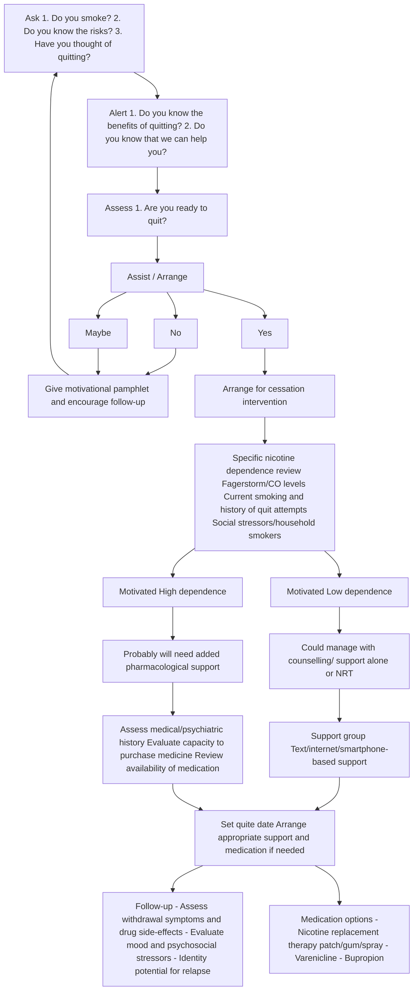

**Nicotine dependence level (table in the figure):**

| Have already attempted to quit smoking | How many times do you smoke per day | How soon after waking in the morning do you smoke your first cigarette | Level of dependence |
| --- | --- | --- | --- |
| Yes | >30 | >5 min | Very High |
| Yes | 20-30 | 5-30 min | High |
| Yes | 10-20 | 30-60 min | Medium |
| No | <10 | >60 min | Low |

<!-- page: 20 | printed: 10 -->

# Alcohol Use

## **Health Harms of Alcohol Use**
Alcohol is causally linked to over 200 diseases and injuries. Even light-to-moderate drinking increases health risks.

## <u>Cancer Risk</u>
**Alcohol is a well-established cause of at least 7 types of cancer:**
- Mouth, Throat, and Oesophageal Cancer
- Liver Cancer
- Colon and Rectal Cancer
- Breast Cancer (women)

**Important:** Cancer risk begins with ANY amount of alcohol consumption and increases with higher intake.

## **Other Major Health Consequences**
- **Cardiovascular disease:** Hypertension, stroke, heart disease, cardiomyopathy
- **Liver disease:** Fatty liver, hepatitis, cirrhosis
- **Mental health:** Depression, anxiety, suicide, alcohol use disorder
- **Infectious diseases:** Increased risk of tuberculosis and HIV acquisition (through risky behaviors)
- **Injuries:** Road traffic accidents, falls, violence, burns
- **Pregnancy complications:** Fetal Alcohol Spectrum Disorders, miscarriage, stillbirth
- **Gastrointestinal:** Pancreatitis, gastritis, malabsorption, malnutrition
- **Neurological:** Brain damage, memory impairment, dementia, peripheral neuropathy

## <u>Screening for Alcohol Use</u>

### **Who to Screen**
- ALL adult patients (≥18 years) attending primary care
- Adolescents (12-17 years) presenting with risk behaviors or concerns
- ALL pregnant women and women planning pregnancy
- Patients with conditions linked to alcohol (liver disease, hypertension, depression, injuries)
- Patients on Antiretroviral Therapy (ART) or TB treatment

## **Screening Tools**

**AUDIT-C (Recommended for Busy Settings)**
The AUDIT-C consists of the first 3 questions from the full AUDIT. It is quick and effective for identifying unhealthy alcohol use.

<!-- page: 21 | printed: 11 -->

| **Question** | **Scoring** |
| --- | --- |
| **1. How often do you have a drink containing alcohol?**<br/>Never (0) \| Monthly or less (1) \| 2-4 times/month (2) \| 2-3 times/week (3) \| 4+ times/week (4) | 0-4 points |
| **2. How many drinks containing alcohol do you have on a typical day when drinking?**<br/>1 or 2 (0) \| 3 or 4 (1) \| 5 or 6 (2) \| 7-9 (3) \| 10+ (4) | 0-4 points |
| **3. How often do you have 5 or more drinks on one occasion?**<br/>Never (0) \| Less than monthly (1) \| Monthly (2) \| Weekly (3) \| Daily/almost daily (4) | 0-4 points |

## **AUDIT-C Interpretation:**
* **Men: Score ≥4** = Unhealthy alcohol use → Provide brief intervention
* **Women: Score ≥3** = Unhealthy alcohol use → Provide brief intervention
* **Score ≥8:** Possible alcohol use disorder → Consider full AUDIT and referral

## **Brief Intervention: The 5 A’s**

*For patients identified as drinking alcohol, use this evidence-based counseling approach:*

| **ASK** | **Ask about alcohol use using AUDIT-C**<br/>*“How often do you drink alcohol?” “How much do you typically drink?”* |
| --- | --- |
| **ADVISE** | **Provide clear, personalized advice**<br/>*“The safest choice is to not drink alcohol at all. There is no safe level of drinking.”*<br/>Link to their health concerns: “Alcohol is making your blood pressure worse” or “Drinking increases your cancer risk.” |
| **ASSESS** | **Assess readiness to change**<br/>“How do you feel about quitting or cutting down?” “What makes it difficult for you to stop?” |
| **ASSIST** | **Help develop a quit/reduction plan**<br/>• Set a quit date or reduction goal<br/>• Identify triggers and develop coping strategies<br/>• Provide written educational materials<br/>• Consider referral to counseling or support groups |
| **ARRANGE** | **Schedule follow-up**<br/>Follow-up in 2-4 weeks to monitor progress, provide support, and address challenges |

## **Special Populations**

### **Pregnant Women and Women of Childbearing Age**

<!-- page: 22 | printed: 12 -->

# **ABOLUTE RECOMMENDATION**: Complete abstinence during pregnancy and when planning pregnancy

- No amount of alcohol is safe during pregnancy
- Alcohol causes Fetal Alcohol Spectrum Disorders (FASD): growth problems, facial abnormalities, brain damage, learning disabilities
- Screen ALL pregnant women at first antenatal visit and subsequent visits
- Counsel all women of childbearing age about risks

## Patients Living with HIV
- Alcohol reduces ART adherence and treatment effectiveness
- Increases HIV viral load and accelerates disease progression
- Associated with increased risky sexual behaviours
- Worsens liver disease (especially with hepatitis B co-infection)
- **RECOMMENDATION**: Strong advice to quit alcohol for optimal HIV treatment outcomes

## Patients on TB Treatment
- Alcohol interferes with TB medication effectiveness
- Increases risk of liver toxicity from TB drugs
- Reduces treatment adherence and increases treatment failure
- **RECOMMENDATION**: Complete abstinence during TB treatment

## Adolescents and Young Adults
- Brain continues developing until age 25; alcohol impairs brain development
- Early alcohol use increases lifetime risk of alcohol use disorder
- Associated with risky behaviours, injuries, poor school performance
- **RECOMMENDATION**: Delay alcohol initiation as long as possible; abstinence is safest

## Older Adults (≥65 years)
- Increased sensitivity to alcohol effects with aging
- Higher risk of falls, fractures, and injuries
- Interactions with multiple medications
- Worsens cognitive decline and increases dementia risk

## <u>Practical Strategies for Patients</u>

### **Tips for Quitting Alcohol**
- Set a clear quit date and tell family/friends for support
- Remove all alcohol from home
- Avoid places and situations where alcohol is present
- Find alternative activities (sports, hobbies, church/community groups)

<!-- page: 23 | printed: 13 -->

- Practice saying 'no' to offers of alcohol
- Keep non-alcoholic drinks available
- Manage stress through exercise, prayer, meditation, talking to friends
- Join support groups or counseling services

## **Managing Cravings and Triggers**
- Recognize triggers: stress, social pressure, certain places, emotions
- Use the '4 Ds': Delay, Distract, Deep breathing, Drink water
- Call a supportive friend or family member
- Remember health benefits: better sleep, more energy, improved health, saving money

## When to Refer

**Refer to **specialized alcohol treatment services** if:**
- AUDIT score ≥20 (likely alcohol dependence)
- Failed previous attempts to quit despite brief intervention
- Signs of withdrawal symptoms (tremors, sweating, anxiety, seizures)
- Co-occurring mental health disorders (depression, anxiety, psychosis)
- Severe alcohol-related medical complications (cirrhosis, pancreatitis)
- Patient requests specialized help

## **Key Messages for Patients**

| • \*\*NO amount of alcohol is safe for your health\*\* |
| --- |
| • \*\*The safest choice is NOT to drink alcohol at all\*\* |
| • Alcohol increases your risk of cancer, heart disease, liver disease, and many other conditions |
| • Quitting alcohol improves your health at any age |
| • You don't have to quit alone - ask for help from healthcare providers, family, and support groups |
| • If you are pregnant or planning pregnancy, do **NOT** drink any alcohol |

## Unhealthy Diet
Unhealthy dietary patterns contribute significantly to non-communicable diseases in Eswatini. Healthcare providers should screen patients for dietary habits and provide brief counseling emphasizing increased consumption of fruits, vegetables, whole grains, and legumes, while limiting salt (less than 5g/day), sugar, and processed foods. The accompanying visual dietary guideline provides practical, culturally appropriate recommendations based on WHO guidelines and featuring locally available and affordable food options suitable for Eswatini's context.

<!-- page: 24 | printed: 14 -->

## **HEALTHY EATING GUIDELINES**

### icon: apple **EAT A VARIETY OF FOODS DAILY FOR GOOD HEALTH** icon: carrot

| icon: broccoli, tomato, carrot<br/><br/>**VEGETABLES & FRUITS**<br/><br/>**Eat PLENTY daily**<br/>At least 5 portions (400g) per day<br/>*Examples: spinach, cabbage, tomatoes, carrots, pumpkin, oranges, bananas, mangoes* | icon: corn, bread, rice<br/><br/>**STARCHY FOODS**<br/><br/>**Part of MOST meals**<br/><br/>Choose WHOLE GRAINS<br/>*Examples: whole grain pap/maize meal, brown bread, rice, potatoes, sweet potatoes* | icon: fish, peanuts, egg<br/><br/>**PROTEIN FOODS**<br/><br/>**Eat DAILY**<br/><br/>Choose lean options<br/>*Examples: beans, lentils, peanuts, fish, chicken, lean meat, eggs* |
| --- | --- | --- |
| icon: glass of milk, cheese<br/><br/>**MILK & DAIRY**<br/><br/>**Have EVERY DAY**<br/><br/>Good for bones & teeth<br/>*Examples: milk, maas, yoghurt, cheese* | icon: water droplets<br/><br/>**CLEAN WATER**<br/><br/>**STARCHY FOODS**<br/><br/>**Drink LOTS daily**<br/>6-8 glasses per day<br/>*Best choice for hydration* | icon: olive<br/><br/>**FATS & OILS**<br/><br/>**Use SPARINGLY**<br/><br/>**Choose vegetable oils**<br/>*Avoid hard fats & excessive frying* |

#### ⚠️ **FOODS TO LIMIT** ⚠️

| icon: salt shaker **SALT**<br/>**Less than 1 teaspoon (5g) per day**<br/>Reduces blood pressure & heart disease | icon: candy **SUGAR**<br/>**Less than 6 teaspoons (25g) per day**<br/>Reduces blood pressure & heart disease | icon: french fries **PROCESSED FOODS**<br/>**Limit chips, soda, sweets, fast food**<br/>High in salt, sugar & unhealthy fats |
| --- | --- | --- |

| **COUNSELING TIPS** | **HEALTH BENEFITS** |
| --- | --- |
| ✓ Fill half the plate with vegetables | ✓ Prevents heart disease & stroke |
| ✓ Eat locally available seasonal foods | ✓ Reduces diabetes risk |
| ✓ Choose whole grains over refined | ✓ Helps maintain healthy weight |
| ✓ Eat beans/legumes regularly | ✓ Prevents some cancers |
| ✓ Remove visible fat from meat | ✓ Improves overall wellbeing |

<!-- page: 25 | printed: 15 -->

## **Routine Health Examinations: What to look for When Accessing for NCDS**

Routine health examinations aim to identify risk factors and early signs of the disease as well as preventing future diseases using early interventions. It includes counselling, vaccination/immunization, investigations (labs, imaging, etc.), and physical examination tailored to the patient’s gender and age.

### **HYPERTENSION**

Hypertension is defined as systemic blood pressure of ≥140/90mmHg. Controlling hypertension is associated with a reduction in heart failure, strokes, chronic kidney disease, and myocardial infarctions. Therefore, routine screening for hypertension is recommended.

#### **Recommendations for BP measurements in the office and at home**

image: circular infographic of blood pressure measurement recommendations

**1.** Use validated automated electronic upper-arm cuff device

**2.** Quiet room with comfortable temperature

**3.** No smoking, caffeine, food, drug intake or exercise 30 min before measurement

**4.** Remain seated and relaxed for 3–5 min

**5.** No talking during or between measurements

**6.** Sitting with back supported by chair

**7.** Legs uncrossed, feet flat on floor.

**8.** Bare arm resting on table mid-arm at heart level

**9.** Office: Take 3 readings with 1 min interval between readings use average of the last 2 the last

**10.** Home: Take 2 readings with 1 min interval between and use average

<!-- page: 26 | printed: 16 -->

## **Algorithm for Hypertension Screening**

**Flowchart: Algorithm for Hypertension Screening**

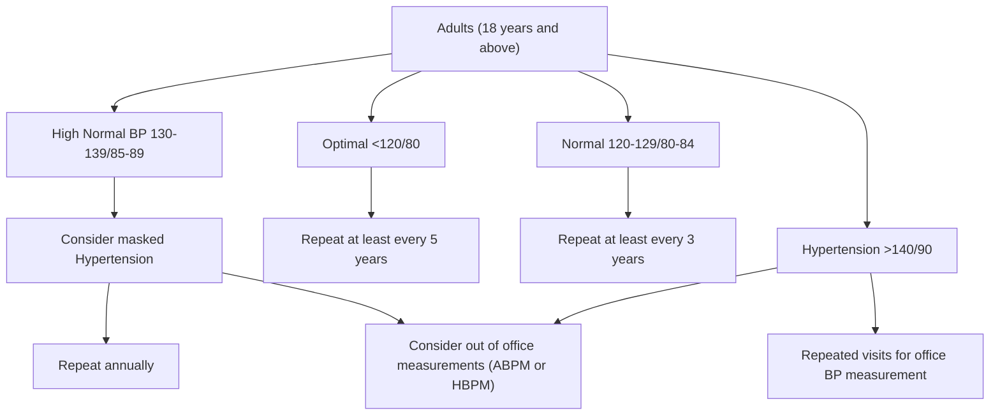

Adopted from ESC/ESH guidelines, 2023

***N.B: Ministry of Health recommends measuring Blood pressure yearly for adults ≥18 years of age.***

<!-- page: 27 | printed: 17 -->

## **OBESITY**

### **Anthropometric Measurements (Age ≥18 years)**

|  | BMI (kg/m²) = The body mass divided by the square of the body height | Obesity class | Disease risk\* (Relative to normal weight and waist circumference | Disease risk\* (Relative to normal weight and waist circumference |
| --- | --- | --- | --- | --- |
|  |  |  |  | Men ≥ 102 cm and Women ≥ 88 cm |
|  |  |  |  |  |
| Underweight | <18.5 |  | - |  |
| Normal\* | 18.5-24.9 |  | - |  |
| Overweight | 25-29.9 |  | Increased | High |
| Obesity | 30-34.9 | Class 1 | High | Very high |
|  | 35-39.9 | Class 2 | Very high | Very high |
|  | ≥ 40 | Class 3 | Extremely high | Extremely high |

\*Disease risk for hypertension, type 2 diabetes, and cardiovascular diseases.

\*Increased waist circumference can also be a marker for increased risk even in persons of normal weight.

<!-- page: 28 -->

## **DIABETES MELLITUS**

### **Algorithm for Diabetes Mellitus Screening**

**Flowchart: Algorithm for Diabetes Mellitus Screening**

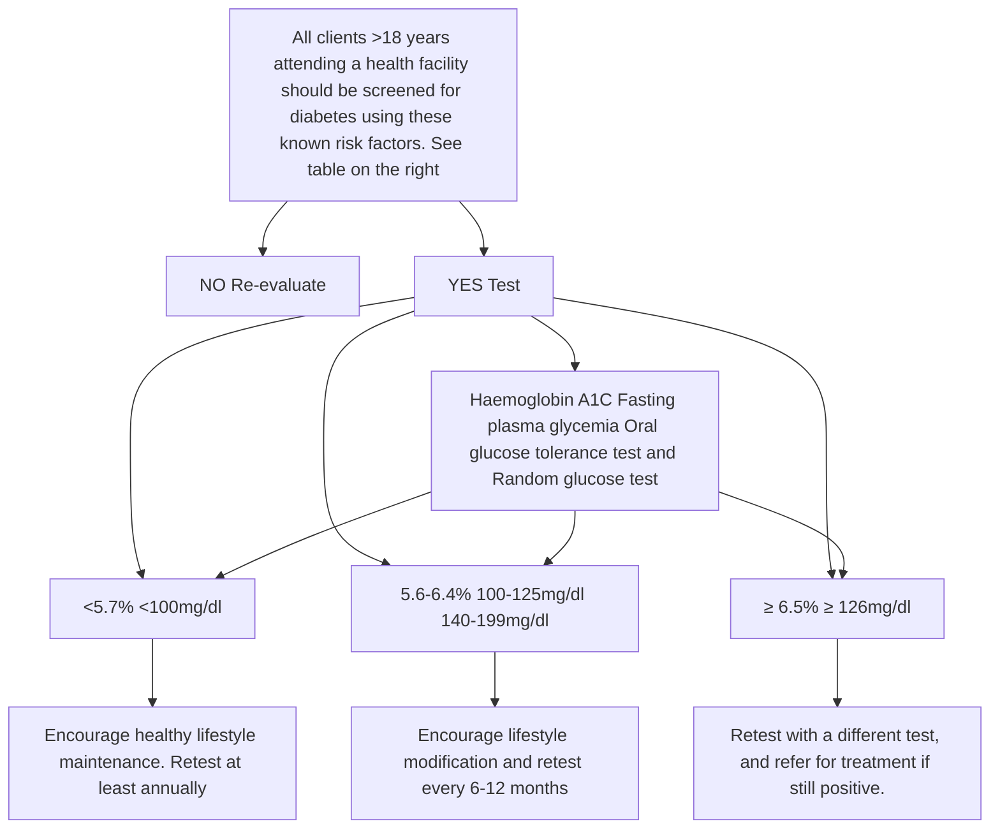

\*Known Risk Factors for Diabetes
Physical inactivity
Family history of diabetes
High-risk race or ethnicity: African, Indian

Hypertension (≥ 140/90)
HDL-C <35 or Triglyceride > 250 mg/dL

History of gestational diabetes or gave birth to a baby ≥4.5kg

History of heart disease
Conditions associated with insulin resistance

Polycystic ovary syndrome
Malnutrition

Adapted from the American Diabetic Association Standard of Medical Care in Diabetes.

**N.B: Ministry of Health recommends measuring glycemia yearly in adults ≥ 18 years of age.**

### **LIPIDS DISORDERS**

Screening guidelines for lipids disorders differ among experts. Cholesterol disorders screening is recommended in adult men aged ≥35 years, in women aged ≥40 years or menopausal and All adults with any of the following conditions regardless of age:

Cigarette smoking
Hypertension
Obesity (BMI) ≥27 kg/m<sup>2</sup>
Family History of Premature CAD
Clinical signs of Hyperlipidaemia
Evidence of Atherosclerosis
RA, SLE, Psoriasis
HIV infection on ARVs

<!-- page: 29 | printed: 19 -->

EGFR < 60 mL/min/1.73m<sup>2</sup>
Erectile dysfunction
Screening children with a Family History of Hypercholesterolemia or chylomicronemia.

## **Lipid Management - Clinical Decision Pathway**

**Flowchart: Lipid Management - Clinical Decision Pathway**

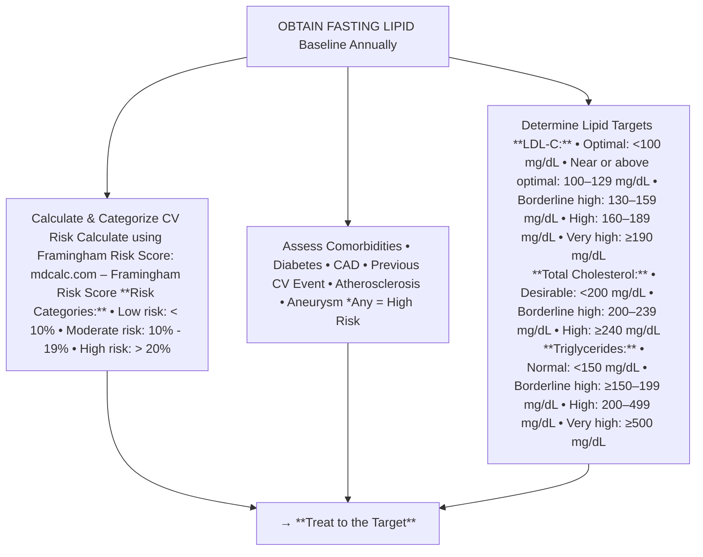

## **Chronic Kidney Disease Clinical Protocols**

**Flowchart: Chronic Kidney Disease Clinical Protocols**

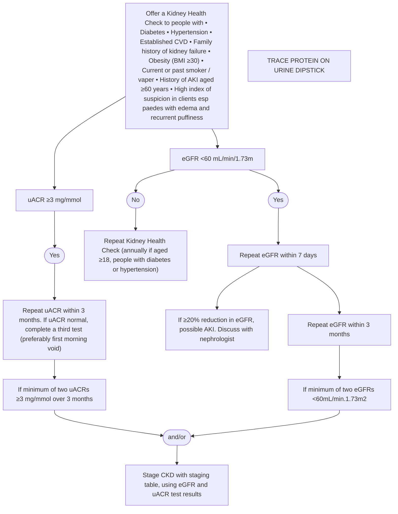

<!-- page: 30 | printed: 20 -->

**Undertake investigations to determine underlying diagnosis**
**fully specify CKD diagnosis, e.g CKD stage 2 with microalbuminuria(A2) in the presence of type 2 diabetes**
**refer to the color-coded clinical action plans for CKD management**

## **Algorithm for Chronic Kidney Disease Screening**

**Flowchart: Algorithm for Chronic Kidney Disease Screening**

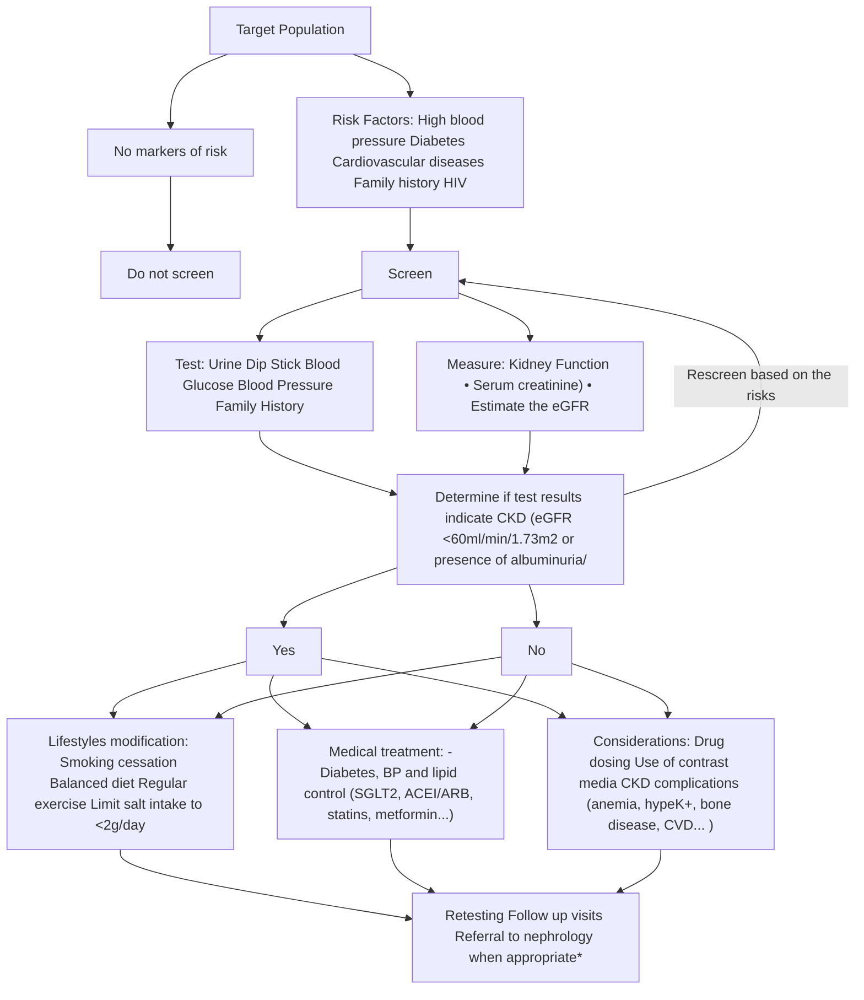

| Albuminuria Stage<br/>Kidney Function Stage | Albuminuria Stage<br/>GFR (mL/min/1.73m2) | Albuminuria Stage<br/>Normal (A1) uACR <3.0 mg/mmol | Albuminuria Stage<br/>Microalbuminuria (A2) uACR 3.0-3.0mg/mmol | Albuminuria Stage<br/>Microalbuminuria (A3) uACR >30 mg/mmol |
| --- | --- | --- | --- | --- |
| 1 | ≥90 | Not CKD unless haematuria structural or pathological abnormalities present |  |  |
| 2 | 60-89 |  |  |  |
| 3a | 45-59 |  |  |  |
| 3b | 30-44 |  |  |  |
| 4 | 15-29 |  |  |  |
| 5 | <15 or on dialysis |  |  |  |

<!-- page: 31 | printed: 21 -->

# CHAPTER 2
# ENDOCRINOLOGY

## Diabetes

| **Definition:** Diabetes Mellitus is a chronic metabolic condition in which the pancreas no longer produces enough insulin (impaired insulin secretion) or cells stop responding to the insulin that is produced (insulin resistance) resulting in increased blood glucose. |  |  |
| --- | --- | --- |
| **Classification** |  |  |
| **Common types** 1. **Type 1 diabetes:** due to autoimmune b-cell destruction, usually leading to absolute insulin deficiency including latent autoimmune diabetes of adulthood) 2. **Type 2 diabetes:** due to a progressive loss of b-cell insulin secretion frequently on the background of insulin resistance) | **Specific types of diabetes:** - **Monogenic diabetes syndromes:** ✓ Neonatal diabetes ✓ Maturity-onset diabetes of the young - Diseases of the exocrine pancreas (such as cystic fibrosis and pancreatitis) - **Drug-or chemical-induced diabetes:** glucocorticoid use, treatment of HIV/AIDS, or after organ transplantation - **Gestational Diabetes Mellitus (GDM):** diabetes diagnosed in the second or third trimester of pregnancy that was not clearly overt diabetes before gestation. |  |
| **Treatment Target** |  |  |
| HbA1c <7% for most adults - HbA1c <6.5% for type 1 diabetes without hypoglycemia - HbA1c <8% for people with frequent hypoglycemia, limited life expectancy, cardiovascular complications. | All clients on treatment should aim for a glycemia (random or fasting ranging: 5-10mmol/L |  |

## Testing and Diagnosis of Diabetes

### Criteria for Testing
- Age 18 years and above to be screened annually **AND** as when new risk factors **AND** symptoms present themselves)
- Sustained blood pressure >130/ 80 mmHg or history of CVD
- HDL cholesterol level <35mg/dL/ 0.90mmol and or triglyceride level >250 mg
- Overweight
- Individuals with polycystic ovary syndrome (insulin resistance and other conditions)
- People with prediabetes (hba1c >5.7-6.4 or FBG >7mmol)/l should be testing yearly.
- People living with HIV.
- People with history of or current TB diagnosis
- People who have been diagnosed with gestational diabetes are to be **checked every year**

<!-- page: 32 | printed: 22 -->

## **Diagnosis of Diabetes is Confirmed When**

The diagnosis of diabetes is confirmed:

(a) In patients <u>*with symptoms*</u> of hyperglycaemia ( polyuria, polydipsia, blurred vision, weight loss) or metabolic decompetion (diabetic ketocidosisi or hyperosmolar non-ketotic state), when <u>any one single test</u> confirms that the:
* Random plasma glucose is ≥ 11.1 mmol/L
* Fasting plasma glucose ≥ 7.0 mmol/L
* HbA<sup>1</sup>c ≥ 6.5%
* 2 hour post-load glucose is ≥ 11.1 mmol/L. However, GTT is rarely needed in this category of patient.

(b) In an <u>*asymptomatic individual*,</u> when <u>*any one*</u> of the following test, <u>*repeated*</u> on separate days within a 2 week period confirms that the
* Fasting plasma glucose is ≥ 7.0 mmol/L
* 2hr-post load glucose (OGTT) is ≥ 11.1 mmol/L
* HbA<sup>1</sup>c ≥ 6.5%

If the diagnosis of diabetes is not confirmed with the repeated test, institute lifestyle modification and retest in 3 to 6 months.

### **Diabetes Baseline and Follow-Up Checklist**

| **Component** | **Initial Visit** | **3–6 Monthly** | **Annually** |
| --- | --- | --- | --- |
| Patient History |  |  |  |
| Glycaemic symptom review (polyuria, polydipsia, weight change, fatigue, blurred vision) | ✓ | ✓ | ✓ |
| Hypoglycaemic symptom review (shakiness, sweating, dizziness, confusion, hunger, irritability, loss of consciousness) | ✓ | ✓ | ✓ |
| Family and personal medical history (diabetes, CVD, hypertension, dyslipidaemia, autoimmune disease, obesity) | ✓ | — | ✓ |
| Medication history (current and previous antidiabetic, antihypertensive, lipid-lowering drugs; side-effects; adherence; allergies) | ✓ | ✓ | ✓ |
| Risk factor assessment (smoking, alcohol, diet, physical inactivity, mental health, family history) | ✓ | ✓ | ✓ |
| Reproductive history (family planning, preconception counselling) | ✓ | ✓ | ✓ |
| Psychosocial assessment (occupation, school/work performance, family/community support, depression, anxiety) | ✓ | ✓ | ✓ |
| Physical Examination |  |  |  |
| Vital signs (blood pressure, pulse, temperature, respiratory rate) | ✓ | ✓ | ✓ |
| Anthropometric measurements (weight, height, BMI, MUAC, waist circumference) | ✓ | ✓ | ✓(Height at baseline only) |
| Pubertal and developmental assessment (Tanner staging in adolescents) | ✓ | ✓ | ✓ |
| Injection site assessment | ✓ | ✓ | ✓ |
| Cardiovascular and systemic examination (heart, lungs, abdomen, thyroid, peripheral pulses, oedema) | ✓ | As indicated | ✓ |
| Foot examination (ulcers, sensation, pulses, deformities) | ✓ | ✓ | ✓ |
| Laboratory Tests |  |  |  |
| Blood glucose (fasting, random, or postprandial as appropriate) | ✓ | ✓ | ✓ |
| HbA1c (3–6 monthly depending on glycaemic control) | ✓ | ✓ | ✓ |
| Kidney function (creatinine, eGFR, potassium) | ✓ | — | ✓ |
| Lipid profile (total cholesterol, HDL, LDL, triglycerides) | ✓ | — | ✓ |
| Thyroid function tests (TSH ± free T4) | ✓ | — | ✓ |
| HIV testing (as per national guidelines) | ✓ | — | ✓ |
| Urine analysis (glucose, ketones, protein, albumin–creatinine ratio) | ✓ | ✓ | ✓ |
| Additional tests if indicated (liver function, electrolytes, autoimmune markers) | ✓ | — | ✓ |
| Imaging and Special Tests |  |  |  |
| Ophthalmic evaluation (visual acuity, fundoscopy, fundus photography) | ✓ | — | ✓\* |
| Cardiovascular and renal imaging (ECG, echocardiogram, renal ultrasound) | As indicated | — | As indicated |
| Neuropathy screening (monofilament, vibration, reflexes) | ✓ | — | ✓ |
| Health Promotion and Other Tasks |  |  |  |
| Diabetes education (self-management, glucometer use, treatment adherence) | ✓ | ✓ | ✓ |
| Lifestyle counselling (nutrition, exercise, smoking/alcohol cessation) | ✓ | ✓ | ✓ |
| Goal setting and individualized care planning | ✓ | ✓ | ✓ |
| Medication review and dose adjustment | ✓ | ✓ | ✓ |
| Vaccination review (KEPI, influenza, pneumococcal, COVID-19, as indicated) | ✓ | — | ✓ |
| Family planning and preconception counselling | ✓ | ✓ | ✓ |
| Psychosocial support (mental health, school/work performance, family engagement) | ✓ | ✓ | ✓ |
| Cardiovascular risk assessment (ASCVD, WHO, or Framingham risk score) | ✓ | — | ✓ |

<!-- page: 33 | printed: 23 -->

<!-- page: 34 -->

## **Management of Type 2 Diabetes in Outpatient**

### **Type 2 Diabetes Pharmacological Treatment**

**Flowchart: Management of Type 2 Diabetes in Outpatient**

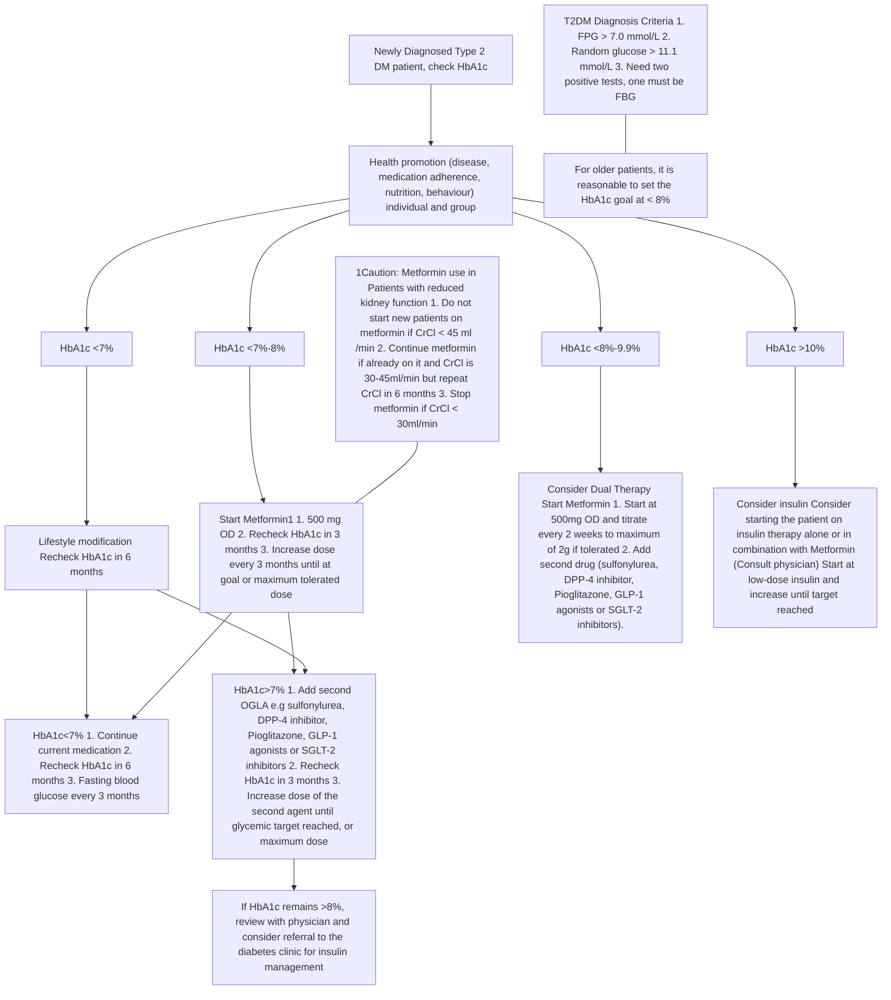

**T2DM Diagnosis Criteria**
1. FPG > 7.0 mmol/L
2. Random glucose > 11.1 mmol/L
3. Need two positive tests, one must be FBG

**For older patients, it is reasonable to set the HbA1c goal at < 8%**

**<sup>1</sup>Caution: Metformin use in Patients with reduced kidney function**
1. Do not start new patients on metformin if CrCl < 45 ml /min
2. Continue metformin if already on it and CrCl is 30-45ml/min but repeat CrCl in 6 months
3. Stop metformin if CrCl < 30ml/min

<!-- page: 35 | printed: 25 -->

## **Oral Agents Used in the Management of Type 2 Diabetes**

| Name of Drug | Minimum dose | Max daily dose | Frequency | Major Side Effects | Contraindications/ use with caution |
| --- | --- | --- | --- | --- | --- |
| A. Sulphonylureas Mechanism of action: Stimulate the pancreas to release insulin (regardless of time and glucose levels) |  |  |  |  |  |
| Glibenclamide | 2.5 mg | 15 mg | OD or BD | Hypoglycemia, weight gain skin rashes | Caution in liver and renal disease |
| Gliclazide MR | 30 mg | 120 mg | OD | Hypoglycemia, weight gain skin rashes | Pregnancy, caution in liver disease |
| Glimepiride | 1 mg | 4 mg | OD | Hypoglycemia weight gain skin rashes | Pregnancy, caution in liver and renal disease |
| Glipizide | 5 mg | 40 mg | OD or BD | Hypoglycemia weight gain skin rashes | Pregnancy, caution in liver and renal disease |
| B. Biguanide Mechanism of action: (i)Reduce glucose production in liver (ii) cause (mild) reduction in peripheral insulin resistance |  |  |  |  |  |
| Metformin | 500 mg | 2000 mg | OD or BD | Abdominal pain, nausea, loose bowel motions, lactic acidosis Vitamin B12 deficiency with prolonged use. | Renal failure, GFR<30 ml/min Heart failure stage 3 or 4 and liver failure |
| C. Thiazolidinediones Mechanism of action: (i) Improved insulin sensitivity in muscle, adipose tissue and liver (ii)Reduce glucose output from liver (iii)Change fat distribution by decreasing visceral fat and increasing peripheral fat |  |  |  |  |  |
| Pioglitazone | 15 mg | 45 mg | OD | Liver impairment, fluid retention weight gain, dilutional anemia, osteoporosis | Heart failure and liver failure; pregnancy, Bone fractures |
| D. Meglitinides Mechanism of action: Stimulate pancreas to release more insulin (possibly related to blood glucose level) |  |  |  |  |  |
| Repaglinide | 1.0 mg | 16 mg | BD, TDS or QID (Before meals) | Liver impairment, fluid retention weight gain, dilutional anemia |  |
| E. Alpha glucosidase inhibitors Mechanism of action: Slow digestion of complex sugars (sucrose and starch) and therefore delays absorption, leading to slow post-meal rise in blood glucose |  |  |  |  |  |
| Acarbose | 25 mg | 300 mg | TID (during meal) | Dyspepsia loose bowel motions, flatulence | None |
| F. DPP 4 inhibitors (Gliptins) Mechanism of action: Improve pancreatic islet glucose sensing →Increase glucose-medicated insulin secretion and suppresses glucagon secretion | F. DPP 4 inhibitors (Gliptins) Mechanism of action: Improve pancreatic islet glucose sensing →Increase glucose-medicated insulin secretion and suppresses glucagon secretion | F. DPP 4 inhibitors (Gliptins) Mechanism of action: Improve pancreatic islet glucose sensing →Increase glucose-medicated insulin secretion and suppresses glucagon secretion | F. DPP 4 inhibitors (Gliptins) Mechanism of action: Improve pancreatic islet glucose sensing →Increase glucose-medicated insulin secretion and suppresses glucagon secretion | F. DPP 4 inhibitors (Gliptins) Mechanism of action: Improve pancreatic islet glucose sensing →Increase glucose-medicated insulin secretion and suppresses glucagon secretion | F. DPP 4 inhibitors (Gliptins) Mechanism of action: Improve pancreatic islet glucose sensing →Increase glucose-medicated insulin secretion and suppresses glucagon secretion |
| Vildagliptin | 50 mg | 100 mg | OD or BD | Urticaria, angioedema, and immune mediated dermatologic effects. Acute Pancreatitis, Risk of hypoglycemia | Pancreatitis Allergy, Pregnancy, Lactation Caution with heart failure (Saxagliptin) |
| Sitagliptin |  | 100 mg | OD |  |  |
| Saxagliptin | 5 mg | 10 mg | OD |  |  |
| Linagliptin | 5 mg | 5 mg | OD |  |  |
| G. SGLT-2 inhibitors Mechanism of action: Suppress renal glucose reabsorption by blocking the sodium-glucose co-transporter 2 (SGLT-2) resulting in increased urinary glucose excretion |  |  |  |  |  |
| Canagliflozin | 100 mg | 300 mg | OD | Polyurea, UTI, DKA, genital candidiasis, hypotension | Renal failure (action dependent on normal GFR) Or sensitivity to active ingredients or it’s excipients |
| Dapagliflozin | 5 mg | 10 mg | OD |  |  |
| Empagliflozin | 10 mg | 25 mg | OD |  |  |

<!-- page: 36 | printed: 26 -->

## **Pharmacotherapy Progression in Type 2 Diabetes**

| F. DPP 4 inhibitors (Gliptins) Mechanism of action: Improve pancreatic islet glucose sensing →Increase glucose-medicated insulin secretion and suppresses glucagon secretion | F. DPP 4 inhibitors (Gliptins) Mechanism of action: Improve pancreatic islet glucose sensing →Increase glucose-medicated insulin secretion and suppresses glucagon secretion | F. DPP 4 inhibitors (Gliptins) Mechanism of action: Improve pancreatic islet glucose sensing →Increase glucose-medicated insulin secretion and suppresses glucagon secretion | F. DPP 4 inhibitors (Gliptins) Mechanism of action: Improve pancreatic islet glucose sensing →Increase glucose-medicated insulin secretion and suppresses glucagon secretion | F. DPP 4 inhibitors (Gliptins) Mechanism of action: Improve pancreatic islet glucose sensing →Increase glucose-medicated insulin secretion and suppresses glucagon secretion | F. DPP 4 inhibitors (Gliptins) Mechanism of action: Improve pancreatic islet glucose sensing →Increase glucose-medicated insulin secretion and suppresses glucagon secretion |
| --- | --- | --- | --- | --- | --- |
| Vildagliptin | 50 mg | 100 mg | OD or BD | Urticaria, angioedema, and immune mediated dermatologic effects. Acute Pancreatitis, Risk of hypoglycemia | Pancreatitis Allergy, Pregnancy, Lactation Caution with heart failure (Saxagliptin) |
| Sitagliptin |  | 100 mg | OD |  |  |
| Saxagliptin | 5 mg | 10 mg | OD |  |  |
| Linagliptin | 5 mg | 5 mg | OD |  |  |
| G. SGLT-2 inhibitors Mechanism of action: Suppress renal glucose reabsorption by blocking the sodium-glucose co-transporter 2 (SGLT-2) resulting in increased urinary glucose excretion |  |  |  |  |  |
| Canagliflozin | 100 mg | 300 mg | OD | Polyurea, UTI, DKA, genital candidiasis, hypotension | Renal failure (action dependent on normal GFR) Or sensitivity to active ingredients or it’s excipients |
| Dapagliflozin | 5 mg | 10 mg | OD |  |  |
| Empagliflozin | 10 mg | 25 mg | OD |  |  |

<!-- page: 37 | printed: 27 -->

# Insulin Therapy in Type 2 Diabetes

Diabetes is a progressive condition, and many patients with type 2 diabetes eventually require and benefit from insulin therapy. Early patient education about expected disease progression, and avoidance of threats of future insulin therapy is important thus easing the transition to insulin therapy.

| Indications For Insulin | When Should Insulin Be Initiated? | Good Practice |
| --- | --- | --- |
| Poor glycaemic control- HbA1c still despite previous attempts to improve with lifestyle modification and maximum oral therapy |  |  |

- Patient is symptomatic (weight loss, polyuria, polydipsia, recurrent infections)
- Steroid-induced diabetes
- Patient unable to tolerate or has contraindication to OGLAs
- Gestational diabetes or diabetes in pregnancy not controlled on OGLAs
- Painful neuropathy
- Foot ulceration and infection|* As soon as there is evidence of sub-optimal glycaemic control
* After reviewing patient's ability to change their lifestyle and medication concordance
* Following a full discussion with the patient that includes identifying barriers to insulin initiation e.g. occupational issues, fear of weight gain, fear of hypoglycaemia and fear of injections|- Insulin initiation should be part of a structured educational programme for the patient and competent health care staff should have sufficient time for the initial initiation of insulin and follow-up of the patient until the glycaemic control is optimized
- The decision to start insulin should be done in partnership with the person and the choice of insulin regimen should cater for the individual needs
- The person initiating the insulin therapy should be trained and competent to do so in line with the National guidelines, and should consult with the Physician/diabetologist
- Ensure that there are educational materials and support literature available for the patient starting insulin
- Patients requiring insulin prior to pregnancy should be referred to the gynaecologist|

Indications for Insulin Therapy in Type 2 DM

<!-- page: 38 -->

## **Stepwise approach to insulin initiation in Type 2 DM**

**Flowchart: Stepwise approach to insulin initiation in Type 2 DM**

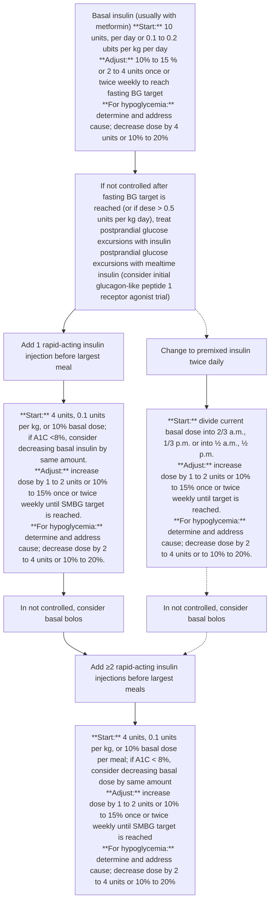

**Number of injections**
* 2
* 3+

**Patient complexity**
* Moderate
* High

**Flexibility**
* More flexible
* Less flexible

**NB: For Clients Already on a Single Injectable Agent e.g Basal Insulin, consider Escalation to any of the following**
1. Combination basal insulin and GLP-1RA therapy
2. Premix (twice daily) insulin.
3. Basal-plus insulin therapy (adding one or more prandial doses of insulin to basal insulin)

**For all three options, metformin should be retained; consider stopping the other oral agents to reduce the cost and complexity of the regimen.**

<!-- page: 39 | printed: 29 -->

## **Adjusting dose of premixed insulin in type 2 DM**

**

| Fasting Glucose before Breakfast (in the absence of nocturnal hypos | Lunch Pre Meal value | Evening Pre Meal value | Before Bed Value |
| --- | --- | --- | --- |
| INSULIN This dose will affect pre-lunch and pre-evening meal glucose levels |  | INSULIN This will affect bedtime and morning fasting glucose levels |  |
| Target 4 to 7 mmol/L | Target 4 to 7 mmol/L | Target 4 to 7 mmol/L | Target 6 to 8 mmol/L |
| Blood Glucose Monitoring out of range? | Blood Glucose Monitoring out of range? | Blood Glucose Monitoring out of range? | Blood Glucose Monitoring out of range? |
| High = Increase previous evening’s insulin by 2 units or 10% whichever is greater | High = Increase breakfast insulin by 2 units or 10% whichever is greater | High = Increase previous evening’s insulin by 2 units or 10% whichever is greater | High = Increase evening meal insulin but not if blood tests at breakfast are 4-5 mmol/L |
| Low = Decrease previous evening’s insulin by 2 units or | Low = Decrease breakfast insulin by 2 | Low = Decrease breakfast insulin by 2 | Low = Decrease evening meal insulin |

**

### **Management of Type 1 Diabetes**

All children and adolescents with type 1 diabetes require insulin. Poorly controlled type 1 diabetes increases the risk of stunted growth and diabetes complications, including diabetic ketoacidosis.

| Fasting Glucose before Breakfast (in the absence of nocturnal hypos | Lunch Pre Meal value | Evening Pre Meal value | Before Bed Value |
| --- | --- | --- | --- |
| INSULIN This dose will affect pre-lunch and pre-evening meal glucose levels |  | INSULIN This will affect bedtime and morning fasting glucose levels |  |
| Target 4 to 7 mmol/L | Target 4 to 7 mmol/L | Target 4 to 7 mmol/L | Target 6 to 8 mmol/L |
| Blood Glucose Monitoring out of range? | Blood Glucose Monitoring out of range? | Blood Glucose Monitoring out of range? | Blood Glucose Monitoring out of range? |
| High = Increase previous evening’s insulin by 2 units or 10% whichever is greater | High = Increase breakfast insulin by 2 units or 10% whichever is greater | High = Increase previous evening’s insulin by 2 units or 10% whichever is greater | High = Increase evening meal insulin but not if blood tests at breakfast are 4-5 mmol/L |
| Low = Decrease previous evening’s insulin by 2 units or | Low = Decrease breakfast insulin by 2 | Low = Decrease breakfast insulin by 2 | Low = Decrease evening meal insulin |

<!-- page: 40 | printed: 30 -->

| **Classification** | **Sign / Symptom** | **Associated Condition / Severity** |
| --- | --- | --- |
| **Severe Symptoms (with coma)** | Severe hyperglycaemia which may progress to neurological compromise, seizures, and coma | Diabetic Ketoacidosis (DKA) or Hyperosmolar Hyperglycaemic State (HHS) |

## **Diagnosis of T1DM**

**Flowchart: Diagnosis of T1DM flowchart**

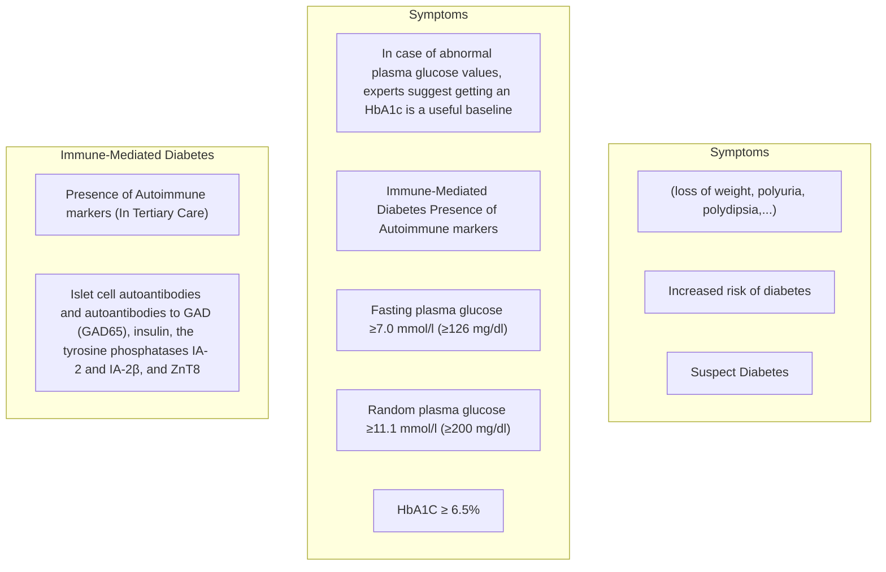

## **Insulin Therapy for Type 1 Diabetes**

### **Insulin requirements (to use STG pediatric guidelines table)**
The ‘correct’ dose of insulin is that which achieves the best attainable glycemic control for an individual child or adolescent, without causing obvious hypoglycemia and resulting in normal growth and development. Where glycaemic control is not achieved despite an adequate support programme consider referral to a tertiary center.

### **Initiating therapy in a child who is not in DKA**
Breakfast and one-third before the evening meal. This may be given as pre-mixed insulin or short acting and intermediate acting insulin separately.

**Note:** Insulin requirements can decrease transiently following the initiation of insulin treatment. It is important to advise the family of the transient nature of the honeymoon phase to avoid the false hope that diabetes is spontaneously disappearing.

<!-- page: 41 | printed: 31 -->

## **Insulin Regimens**

### **Basal-bolus regimen (PREFERRED REGIMEN)**
Short acting insulin 15 - 30 minutes before a meal or rapid acting insulin with main meals e.g. breakfast, lunch and main evening meal; intermediate acting insulin before bed.

* Normally, 30 - 40% of the total daily dose of insulin is given at bedtime as intermediate acting insulin. The remaining insulin is given prior to breakfast, lunch and evening meal in the form of short acting insulin.

### **Basal-bolus regimen**
Short acting insulin is indicated in the child (especially <5years of age) with erratic eating habits despite adequate education.

### **Insulin Dosage Regimen**

| **Breakfast** | Short acting insulin | 20% of total daily dose (if able to count carbohydrates: give 1 unit per 15 g) |
| --- | --- | --- |
| **Lunch** | Short acting insulin | 20% of total daily dose |
| **Supper** | Short acting insulin | 20% of total daily dose |
| **At night (± 21h00)** | Intermediate acting (ideally this ought to be a basal insulin acting over 24hours) | 40% of total daily dose |

**OR**

| **Breakfast** | Short acting insulin (30% of morning dose)<br/>+intermediate acting (70% of morning dose) | ⅔ of total daily dose |
| --- | --- | --- |
| **Lunch** | Short acting insulin (1/3 of evening dose) | ⅓ of total daily dose |
| **At night (± 21h00)** | Intermediate acting (2/3 of evening dose) | ⅓ of total daily dose |

**OR**

### **Three injections daily**
* A mixture of short and intermediate acting (premixed 70:30) insulin before breakfast; short acting insulin alone before an afternoon snack or main evening meal; intermediate acting insulin before bed; or variations of this regimen may be used at times.
* This requires that the caregiver is aware of three different insulin preparations and can differentiate between them.
* Three injections daily.

<!-- page: 42 | printed: 32 -->

## **OR**

* Two injections daily.
* A mixture (premixed combination) of short and intermediate acting insulins (before breakfast and the main evening meal).
* The total daily dose is divided so that 2/3 is given in the morning and 1/3 in the evening.
* The morning or evening dose is then again split between the intermediate-acting and the short-acting insulin in a 70:30 ratio which is pre-mixed.
* The regimen is less flexible, but it is easier to give administration instructions

## **Insulin Dosage Regimen**

| Insulin dose to be increased if glucose too high Insulin dosage to be reduced if glucose too low | Timing of the unsatisfactory blood glucose level<br/>Before Breakfast<br/>Supper (in case of premixed insulin) or 21h00 dose: intermediate acting insulin \*\*Timing of the unsatisfactory blood glucose level | Before Lunch<br/>Breakfast dose: short acting insulin | Before Supper<br/>Breakfast dose: intermediate acting insulin | At ± 21h00<br/>Supper dose: short acting insulin |
| --- | --- | --- | --- | --- |
| Basal-bolus regimen |  |  |  |  |
| Insulin dose to be increased if glucose too high Insulin dose decrease if glucose too low | 21h00 dose: intermediate acting insulin | Breakfast dose: rapid (or short acting) insulin | Lunch dose: rapid (or short acting) insulin | Supper dose: rapid (or short acting) insulin |

## **Insulin Type and Action**

| Insulin Type<br/>Rapid-acting | Preparations<br/>Aspart, Glulisine, Lispro | Onset of Action<br/>15-30 minutes | Peak of Action<br/>1-2 hours | Duration of Action<br/>3-5 hours | When to give<br/>Immediately prior to meal |
| --- | --- | --- | --- | --- | --- |
| Short-acting (Regular) | Actrapid, Humulin R, Insuman Rapid | 30-60 minutes | 2-4 hours | 5-8 hours | 30 minutes prior to meal |
| Intermediate acting | Humulin NPH, Prota- phane, Insulatard | 2-4 hours | 4-10 hours | 12-24 hours | 30 minutes prior to meal |
| Insulin Type | Preparations | Onset of Action | Peak of Action | Duration of Action | When to give |
| Long-acting | Detemir | 1-2 hours | 6-12 hours | 20-24 hours | Once or twice daily |
|  | Glargine | 2-4 hours | Relatively peakless | 24 hours or less | Once or twice daily |
|  | Basaglar | 1-2 hours | 4-12 hours | 24 hours | Once or twice daily |
| Mixed | Rapid/long-acting mix or Short/long-acting mix 30/70 (Actraphane) or 25/75 | 30 minutes | 4-12 hours | 8-24 hours | 30 minutes prior to meal |

<!-- page: 43 | printed: 33 -->

## **How to inject insulin with a Syringe**

Wash your hands.
Check the insulin for lumps, crystals or discoloring.
Gentle or cloudy insulin between your hands until it is uniformly cloudy.
Never shake insulin.

Wipe the top of the insulin vial with a clean cloth/swab

Pull the plunger down to let units of air into the syringe. The units of air should equal the units of insulin that you plan to inject.

Push the air into the insulin bottle.
Leave the needle in the bottle.

Turn the insulin bottle and syringe upside down.
Be sure the needle is in the insulin, not in the air space inside the bottle.
Pull the plunger down to get units of insulin into

Look for air bubbles in the syringe.
If there are air bubbles, push the insulin back into the bottle and start again from step 5.

When you have the right insulin units with no air bubbles, pull the syringe out of the bottle.

Clean the injection site using a clean swab/cloth and let the site dry before injecting

Pinch up the area of skin that you wiped.
Hold the syringe like a pencil.
Be sure the needle does not touch anything.

Push the needle into the pinched skin at a 90 degree angle. Push the plunger to inject the insulin.
Release the pinch, then pull the syringe needle out of your skin.
If you notice a drop of blood, press a finger on the injection spot for a few seconds.

Place the used syringe into a sharp container.
Do not reuse the syringe

### **Recommended sites for insulin injection**

**Injection technique using an insulin syringe** (Source: Optimizing Injection Technique in Diabetes Management Recommendations for Best Practice in Injection Technique, FIT guidelines South Africa, 1st edition

<!-- page: 44 | printed: 34 -->

## **Management of Diabetes Emergencies**

| **Management of Diabetic Emergencies** |  |
| --- | --- |
| **1. Introduction**<br/>Diabetic ketoacidosis (DKA) and hyperosmolar hyperglycemic state (HHS) are two of the most serious acute complications of diabetes. DKA being characterized by ketoacidosis and hyperglycemia, while HHS usually has more severe hyperglycemia without ketoacidosis |  |
| **DKA & HHS: Diagnosis** | **DKA & HHS: Evaluation and Monitoring** |
| Based on clinical evaluation and immediate bedside investigations. Features include polyuria, polydipsia, nausea, abdominal pain, fruity odor, confusion, Kussmaul breathing, dehydration<br/><br/>**Diabetic Ketoacidosis**<br/>• Hyperglycemia: BG >13.9mmol/L<br/>• Euglycemia<250mg/dl (pregnancy, SGLT2 use)<br/>• Ketonuria or ketonemia(>3mmol/L): highly positive<br/>• Acidosis pH: <7.3, low HCO3- :<10 ≤ 15 mEq/L<br/>• Anion gap: >12(see formula)<br/><br/>**Hyperosmolar Hyperglycemic State**<br/>• Severe Hyperglycemia: BG:>600>1000 mg/dl 33.3mmol/L<br/>• Hyperosmolality: Effective serum osmolality >320 mOsm/kg (see formula)<br/>• Neurologic signs: focal signs, obtundation, seizure, coma | • Vital signs, volume status (decreased skin turgor, dry axillae & oral mucosa, low JVP, tachycardia and hypotension), mental status<br/>• Immediately: serum blood glucose, urine ketones<br/>• Additional testing: FBC, electrolytes, FT, ABG<br/>• Evaluate for precipitating causes: SEPTIC SCREEN (urinalysis, blood cultures), cardiac enzymes, ECG, CXR<br/>• Pregnancy test if indicated<br/><br/>**Monitoring**<br/>• **BG hourly**<br/>• **Urinary ketones and serum pH for DKA and Serum Osms for HHS 4hourly**<br/>• **Electrolytes, primarily Na+ and K+ 4hourly**<br/>• Mental status: expect improvement with treatment if DKA or HHS are the causes. Consider further evaluation if not improving<br/>• Input/output, hydration status, **vital signs hourly** |

| **Criteria for resolution** |  | **Transition to long-acting insulin** |
| --- | --- | --- |
| DKA:<br/>BG < 15mmol/L+ 2 or more of:<br/>HCO3- ≥ 15 mEq/L or<br/>pH > 7.3 or<br/>anion gap ≤ 12mEq/L<br/>Neg urine ketones if above not available<br/>(confirm repeat in 1-2 hrs) | HHS:<br/>BG <<br/>Improved mental<br/>status<br/>Effective Osmolality<br/>≤ 315 mOsm/kg | Continue continuous IV for 1-2 hrs after long acting started<br/>• 0.4-0.6 u/kg for insulin naive patients<br/>• NPH/Regular: based on inpatient DM protocol<br/>• Hold regular insulin if patient is not eating<br/>• May resume home regimen if previously on insulin |
| **Alternative Subcutaneous Insulin Protocol** **(This regimen is not well validated and is modified from other protocols.**<br/>**Continuous IV is preferred as standard of care when available)** |  |  |

<!-- page: 45 | printed: 35 -->

| If continuous infusion not available, for mild/<br/>moderate DKA:<br/>• Initial IV Bolus: 0.1 IU/kg given<br/>intravenously<br/><br/>• Maintenance: 0.1 IU/kg subcutaneous<br/>q1-2 hr. (start immediately following<br/>bolus) | • When BG <250 mg/dL, reduce dose by 50%<br/><br/>• \*\*Continue until resolution of DKA or HHS\*\* |
| --- | --- |
| **Useful Formulas** |  |
| • Calculated Anion Gap (>12 is elevated)<br/>\[Na+] – \[Cl- + HCO3-]<br/><br/>• Effective Serum Osmolality: 2x\[Na+K]<br/>+urea glucose *(usually <330mosmol/kg<br/>in DKA and > 350mosmol/kg in HHS)* | • Corrected Serum Sodium: \[Na+] + 1.6x \[glucose (mg/dL) -100]/100<br/><br/>• Free Water Deficit: 0.6 x weight (kg) x\[ (Na+/140) -1] |

## **Diabetic Emergencies**

### **Algorithm for Management of DKA and HHS**

#### **01 Diabetic Ketoacidosis (DKA) — All 3 criteria required**

| **Criterion** | **Threshold** | **Notes** |
| --- | --- | --- |
| Blood Glucose | >11 mmol/L (or known DM) | Can occur at lower levels in pregnancy |
| Venous pH / HCO₃ - | pH <7.3 OR HCO₃ - <15 mmol/L | VBG preferred over ABG |
| Ketonaemia | ≥3 mmol/L (serum) | Ketonuria ≥2+ if no POC ketone meter |
| Severity | Mild: pH 7.25–7.30<br/>Moderate: pH 7.00–7.24<br/>Severe: pH <7.00 | Severe cases need ICU-level care |

#### **02 Hyperosmolar Hyperglycaemic State (HHS) — All 3 criteria required**

| **Criterion** | **Threshold** | **Notes** |
| --- | --- | --- |
| Blood Glucose | >30 mmol/L | Often 50–80 mmol/L at presentation |
| Serum Osmolality | ≥320 mOsm/kg | Formula: 2(Na++K+) + glucose |
| Acidosis / Ketones | Absent / mild: pH >7.3, HCO₃- >15 | Mixed DKA/HHS can occur |
| Osmolality target | Reduce by 3–8 mOsm/kg/hr | Do not fall below 310 in first 24 hrs |

**WARNING: Do NOT delay treatment to await full investigation results. Start fluids and check K<sup>+</sup> immediately. Insulin is CONTRAINDICATED if K<sup>+</sup> <3.5 mmol/L**

<!-- page: 46 | printed: 36 -->

## **02 IMMEDIATE ASSESSMENT (0–30 MINUTES)**

| **History & Examination** | **Urgent Investigations** |
| --- | --- |
| → Airway, Breathing, Circulation, GCS | → Capillary BGL + urine/blood ketones |
| → Precipitant: infection, omitted insulin, new DM, MI | → Venous blood gas (VBG): pH, HCO₃, lactate |
| → Weight (actual or estimate) for fluid calculation | → U\&E: Na+, K+, Cl-, urea, creatinine |
| → Catheterise if unconscious or anuric | → FBC + differential, blood cultures if febrile |
| → Temperature, HR, BP, SpO₂, RR | → Urine MCS, CXR, ECG |
| → Kussmaul breathing, acetone breath (DKA) | → HIV rapid test if status unknown |
| → Neurological exam — focal deficits (HHS: thrombosis) | → Calculated serum osmolality |
|  | → Phosphate & magnesium if available |

### **03 IV FLUID RESUSCITATION**

Use 0.9% NaCl (Normal Saline) as first-line. Switch to 0.45% NaCl in HHS once glucose <20 mmol/L and osmolality falling. Add 5% Dextrose when glucose <14 mmol/L (DKA) or <15 mmol/L (HHS) to allow continued insulin without hypoglycaemia.

| **Time** | **DKA Regimen** | **HHS Regimen** | **Rate Guide** |
| --- | --- | --- | --- |
| 0–60 min | 0.9% NaCl — 1 L over 30–60 min<br/>If SBP <90: 500 ml bolus, repeat once | 0.9% NaCl — 1 L over 60 min<br/>Slower if elderly/cardiac risk | \~15–20<br/>ml/kg |
| 1–4 hr | 0.9% NaCl — 500 ml/hr x2 hrs, then 250 ml/hr | 0.9% NaCl — 500 ml/hr (adjust to deficit) | 250–500<br/>ml/hr |
| 4–12 hr | 0.9% NaCl 125–250 ml/hr; switch to 0.45%<br/>NaCl if corrected Na+ rising | 0.45% NaCl 250 ml/hr once osmolality<br/>falling; correct deficit over 48 hrs | 125–250<br/>ml/hr |
| BGL <14 (DKA)/<br/><15 (HHS) | Switch to 0.9% NaCl + 5% Dextrose OR 0.45%<br/>NaCl + 5% Dextrose<br/>*Continue insulin — use dextrose to maintain<br/>target glucose range* | 150 ml/hr |  |

**WARNING:** HHS: Total deficit can be 8–15 litres. Correct over 48–72 hours. Rapid correction risks cerebral oedema and cardiac failure. Reassess every 2 hours. Target osmolality reduction 3–8 mOsm/kg/hr.

<!-- page: 47 | printed: 37 -->

## **04 POTASSIUM REPLACEMENT PROTOCOL**

| Serum K+ (mmol/L) | Action | KCl per Litre Fluid | Rate |
| --- | --- | --- | --- |
| <3.5 | HOLD INSULIN – replace K+ urgently first<br/>Recheck K+ in 1 hour before restarting<br/>insulin | 40 mmol KCl (central line<br/>only for >20 mmol/hr) | Replace until K+ ≥3.5 |
| 3.5–5.5 | Normal – proceed with insulin. Monitor<br/>every 2 hours. | 20 – 40 mmol KCl per litre | 10 – 20 mmol/hr |
| >5.5 | Hold K+ supplementation. Recheck in 2<br/>hours | No KCl – monitor for hyperkalaemia | 10 – 20 mmol/hr |

### **Potassium Safety Rules**

→ NEVER give undiluted KCl IV — fatal if bolused

→ Rates >20 mmol/hr require cardiac monitoring and central venous access

→ Initial K<sup>+</sup> may appear high/normal despite total body depletion — watch closely as insulin drives K<sup>+</sup> intracellularly

→ Hypokalaemia is the leading cause of preventable death in DKA

## **05 INSULIN PROTOCOL**

| **DKA — Insulin Infusion** | **HHS — Insulin Protocol** |
| --- | --- |
| 1. Bolus (only if K+ ≥3.5):<br/>0.1 unit/kg soluble (regular) insulin IV stat | STEP 1: Fluids only for first 1–2 hours — NO insulin<br/>Glucose will fall with fluids alone. Early insulin<br/>causes rapid osmolality drop → cerebral oedema |
| 2. Continuous infusion:<br/>0.1 unit/kg/hr soluble insulin IV<br/>Dilute 50 units in 50 ml 0.9% NaCl (1 unit/ml) via syring<br/>pump. If no pump: 50 units in 500 ml NS (0.1 unit/ml) | STEP 2: Start insulin only when:<br/>• Glucose NOT falling >5 mmol/L/hr with fluids<br/>alone, AND<br/>• Adequate fluid resuscitation is underway<br/>Start at 0.05 unit/kg/hr (lower than DKA) |
| 3. When glucose <14 mmol/L:<br/>Reduce to 0.05 unit/kg/hr + add 5% Dextrose to fluids<br/>Target BGL: 10–14 mmol/L until ketones clear / pH >7.3 | STEP 3: Target glucose reduction:<br/>3–4 mmol/L/hr. Target BGL: 10–15 mmol/L<br/>NEVER drop >5 mmol/L/hr |

**WARNING:** Avoid SC insulin during IV fluid resuscitation — poor absorption due to vasoconstriction and dehydration. Do not stop insulin to treat hypoglycaemia — reduce rate and add dextrose.

## **06 BICARBONATE (DKA ONLY — RESTRICTED USE)**

**WARNING:** Do NOT routinely give bicarbonate in DKA — associated with paradoxical CNS acidosis, hypokalaemia, and worsened cerebral oedema.

<!-- page: 48 | printed: 38 -->

| **Indication** | **Regimen** |
| --- | --- |
| pH <6.9 OR life-threatening hyperkalaemia<br/>(K+ >6.5 with ECG changes | • 100 mmol (100 ml of 8.4%) NaHCO₃ IV over 30 minutes<br/>• Add 20 mmol KCl to each infusion<br/>• Repeat VBG after 60 min; maximum 2 doses<br/>• Not recommended in HHS |

## **07 MONITORING SCHEDULE**

| Frequency | Parameter | Frequency | Parameter |
| --- | --- | --- | --- |
| Every 1 hour | Capillary blood glucose, fluid balance<br/>(in/out), HR, BP, SpO₂, RR | Every 4 hours | Full U\&E + creatinine, reassess fluid<br/>plan, neurological status |
| Every 2 hour | Serum K+, Na+, urea; Venous blood gas;<br/>Blood or urine ketones | Continuous | ECG if K+ abnormal or arrhythmia<br/>present |
| Urinary output | Target >0.5 ml/kg/hr. Catheterise if<br/>anuric or GCS <13 | Every 1–2 hr (HHS) | GCS – declining = cerebral oedema:<br/>STOP fluids and escalate |

| **Corrected Sodium in Hyperglycaemia** |
| --- |
| → Measured Na+ is falsely low in hyperglycaemia |
| → Add 1.6 mmol/L to measured Na+ for every 5.5 mmol/L glucose above 5.5 mmol/L |
| → If corrected Na+ is rising despite resuscitation – switch to 0.45% NaCl |
| → Persistent hypernatraemia in HHS suggests under-resuscitation |

## **08 RESOLUTION CRITERIA & TRANSITION TO SC INSULIN**

| **DKA Resolution — ALL required** | **HHS Resolution — ALL required** |
| --- | --- |
| • Blood glucose <14 mmol/L | • Serum osmolality <310 mOsm/kg |
| • Venous pH >7.3 | • Blood glucose <15 mmol/L |
| • HCO₃- >15 mmol/L | • Clinically well – normal GCS |
| • Ketonaemia <0.6 mmol/L (or ketonuria <1+) | • Patient eating and drinking |
| • Patient able to eat and drink | • No further vomiting |

## **Transition to Subcutaneous Insulin – 3-Step Protocol**

| **Step 1** | **Step 2** | **Step 3** |
| --- | --- | --- |
| Give SC insulin dose at mealtime.<br/>Ensure patient has eaten before<br/>injecting | Continue IV insulin infusion for at least<br/>30–60 minutes **AFTER** SC injection to<br/>avoid gap. | Known DM: resume pre-admission<br/>regimen. New DM: start basal-bolus<br/>0.5 unit/kg/day (50% basal, 50% bolus<br/>divided 3 meals). |

<!-- page: 49 | printed: 39 -->

## **Complications to Anticipate & Manage**

**

| Complication | Recognition | Management |
| --- | --- | --- |
| Cerebral Oedema | Declining GCS, headache, bradycardia after initial improvement | Reduce fluids; Mannitol 0.5–1 g/kg IV; Urgent transfer to higher level |
| Hypokalaemia | Commonest preventable death. ECG: U waves, ST depression, QT prolongation | Check K+ every 2 hrs, replace aggressively per protocol (Section 04) |
| Hypoglycaemia | Glucose falling too rapidly or <4 mmol/L | Add dextrose to fluids; NEVER stop insulin — reduce rate instead |
| Hyperchloraemic Acidosis | Non-anion gap acidosis despite DKA treatment, large NS volumes given | Switch to balanced crystalloid (Ringer’s Lactate) if available; reduce NS |
| Thromboembolism (HHS) | High risk in HHS — may be clinically silent | LMWH prophylaxis: enoxaparin 40 mg SC daily (no contraindication). TED stockings |
| Pulmonary Oedema | Crackles on auscultation, SpO2 falling, worsening dyspnoea | Reduce fluid rate; furosemide if fluid overloaded; CXR; oxygen |
| Acute Kidney Injury | Urine output <0.5 ml/kg/hr persisting after resuscitation | Ensure adequate fluids; avoid nephrotoxins; urgent nephrology review if severe |
| Infection / Sepsis | Fever, leukocytosis, clinical signs of source | Empirical antibiotics: co-amoxiclav or ceftriaxone; cultures before ABx; check HIV |

**

**WARNING: ESCALATE TO HIGHER LEVEL OF CARE: GCS <13, pH <7.0, K+ <2.5 or >7.0, SBP <80 not responding to fluids, declining despite 4 hours of treatment, suspected cerebral oedema, pregnancy with DKA, or need for ICU monitoring. Contact Mbabane Government Hospital or Raleigh Fitkin Memorial Hospital referral pathway.**

### **Discharge Criteria & Patient Education**

| Complication | Recognition | Management |
| --- | --- | --- |
| Cerebral Oedema | Declining GCS, headache, bradycardia after initial improvement | Reduce fluids; Mannitol 0.5–1 g/kg IV; Urgent transfer to higher level |
| Hypokalaemia | Commonest preventable death. ECG: U waves, ST depression, QT prolongation | Check K+ every 2 hrs, replace aggressively per protocol (Section 04) |
| Hypoglycaemia | Glucose falling too rapidly or <4 mmol/L | Add dextrose to fluids; NEVER stop insulin — reduce rate instead |
| Hyperchloraemic Acidosis | Non-anion gap acidosis despite DKA treatment, large NS volumes given | Switch to balanced crystalloid (Ringer’s Lactate) if available; reduce NS |
| Thromboembolism (HHS) | High risk in HHS — may be clinically silent | LMWH prophylaxis: enoxaparin 40 mg SC daily (no contraindication). TED stockings |
| Pulmonary Oedema | Crackles on auscultation, SpO2 falling, worsening dyspnoea | Reduce fluid rate; furosemide if fluid overloaded; CXR; oxygen |
| Acute Kidney Injury | Urine output <0.5 ml/kg/hr persisting after resuscitation | Ensure adequate fluids; avoid nephrotoxins; urgent nephrology review if severe |
| Infection / Sepsis | Fever, leukocytosis, clinical signs of source | Empirical antibiotics: co-amoxiclav or ceftriaxone; cultures before ABx; check HIV |

<!-- page: 50 | printed: 40 -->

## **Algorithm for DKA**

**Flowchart: Algorithm for DKA**

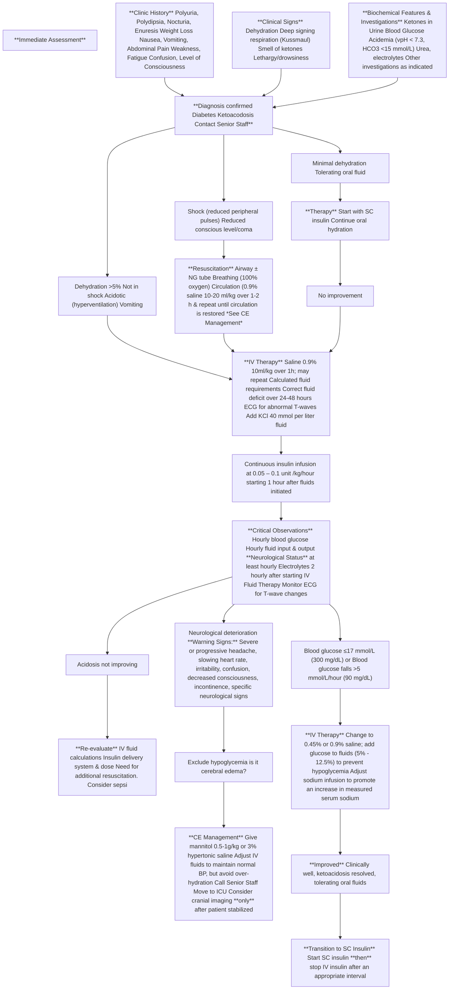

<!-- page: 51 | printed: 41 -->

## **Hypoglycemia**

Hypoglycemia is a medical emergency and should be treated promptly if serious complications are to be avoided. It is characterized by blood glucose levels <4 mmol/L. Some patients might experience hypoglycemic symptoms at higher blood glucose levels and clinicians should individualize care.

### **Common Causes**

* Increased physical activity without adjustment in food or insulin
* Delay or omission of meals/snacks
* Poor injection technique
* Insulin overdose
* Inadequate carbohydrate intake
* Excessive alcohol use
* Sulphonylurea overdose
* Use of long-acting oral glucose-lowering agents
* Herbal medications causing liver failure when combined with diabetes drugs (timbita)

| **Category** | **Adrenergic (Early) Symptoms** | **Neuroglycopenic (Late) Symptoms** |
| --- | --- | --- |
| **Clinical Presentation** | • Severe hunger<br/>• Cold, clammy skin<br/>• Profuse sweating<br/>• Palpitations<br/>• Tremors<br/>• Weakness<br/>• Headache | • Irritability<br/>• Confusion<br/>• Disorientation<br/>• Seizures<br/>• Coma<br/>• Sudden collapse (common in Type 1 DM or in hypoglycaemia unawareness) |

### **Management of Hypoglycaemia**

|  | **Blood glucose** | **Description** | **Action** |
| --- | --- | --- | --- |
| Level 1 (MILD)<br/>Hypoglycemia alert | ≤ 3.9 mmol/L<br/>but ≥ 3.0 mmol/L | Requires treatment with fast-acting carbohydrate<br/>Patient alert and able to eat | • Treat with oral glucose<br/>• Give a sugary snack and recheck blood glucose in 15 min<br/>• If blood glucose remains ≤ 3.9 mmol/L, repeat the previous step.<br/>• Give a carbohydrate meal when blood glucose is ≥ 5.0 mmol/L |
| Level 2 (MODERATE)<br/>Clinically significant hypo-glycaemia | < 3.0 mmol/L | Indicates serious, clinically significant hypoglycemia<br/>Patient may be alert or may have reduced consciousness | • Treat with iv glucose<br/>• Give 10 ml 50% glucose iv and recheck blood glucose in 2 min<br/>• If blood glucose remains <5mmol/L, repeat the previous step |
|  |  |  | • Give an infusion of 10% glucose iv if more than 2 doses of iv glucose required<br/>• Give a carbohydrate meal when blood glucose is ≥ 5.0 mmol/L and the patient is alert and able to eat<br/>• Observe for 4 hrs, checking blood glucose every 1 hr |
| Level 3 SEVERE hypoglycemia | No specific value | Associated with severe cognitive impairment requiring external help for recovery<br/>Patient has reduced consciousness | • Treat as for Level 2 hypoglycaemia<br/>• Likely to need hospital admission |

<!-- page: 52 | printed: 42 -->

## **Glycemic Control in Non-Critical Hospitalized Adult Patients Protocol**

In patient hyperglycemia is defined as random blood glucose level ≥ 7.8mmol/l in a noncritical hospitalized patient. An Admission HBA1c: Recommended for all patients with diabetes or hyperglycemia (>7.8 mmol/L) if not performed in the last 3 months. This is because even moderate hyperglycaemia is associated with increased risk of infection, prolonged hospital stays and higher mortality rates.

**BASAL-BOLUS + CORRECTION** approach is recommended for glycemic control in the hospitalized client. It has a physiological approach, i.e. mimics the healthy pancreas by addressing baseline needs and mealtime spikes, prevents hyperglycemia before it happens and reduces glycemic variability.

NB: Sole reliance on Sliding Scale Insulin (SSI) is **strongly discouraged** by ADA & SEMDSA.

## **Total Daily Insulin (TDI) Starting Dose by Patient Type**

| **Patient Type** | **Clinical Characteristics** | **Insulin Sensitivity** | **Recommended TDI Starting Dose** |
| --- | --- | --- | --- |
| Insulin-naive, normal weight | Newly diagnosed; BMI 18-30;<br/>eating reliably; normal renal<br/>function | Normal sensitivity | 0.3 - 0.4 units/kg/day |
| Insulin-sensitive / high-risk<br/>for hypoglycaemia | Elderly (>65); renal/hepatic<br/>impairment; frail; underweight;<br/>NPO | High sensitivity | 0.15 - 0.2 units/kg/day<br/>(basal-only: 0.1-0.2)<br/>Reduce PM NPH by 20-30% if<br/>nocturnal hypoglycaemia risk |
| Obese / overweight type 2<br/>diabetes | BMI >30; known insulin resistance | Insulin-resistant | 0.5 - 0.6 units/kg/day |

<!-- page: 53 | printed: 43 -->

| CBG Reading<br/>< 3.9 mmol/L<br/>3.9 – 8.3 mmol/L | PRE-MEAL DOSE Sensitive (BMI <25 or TDI <50 units/d)<br/>Follow Hypoglycaemia Protocol<br/>Give scheduled insulin only — no correction dose required | PRE-MEAL DOSE Average (BMI 25–30 or TDI 50–90 units/d)<br/>Follow Hypoglycaemia Protocol<br/>Give scheduled insulin only — no correction dose required | PRE-MEAL DOSE Resistant (BMI >30 or TDI >90 units/d)<br/>Follow Hypoglycaemia Protocol<br/>Give scheduled insulin only — no correction dose required | BEDTIME DOSE (Eating patients only)<br/>Follow Hypoglycaemia Protocol<br/>Give scheduled insulin only — no correction dose required |
| --- | --- | --- | --- | --- |
| 8.4 – 11.1 mmol/L | 1 units | 2 units | 3 units | 0 units |
| 11.2 – 13.9 mmol/L | 2 units | 4 units | 6 units | 1 unit |
| 14.0 – 16.7 mmol/L | 3 units | 6 units | 9 units | 2 units |
| 16.8 – 19.4 mmol/L | 4 units | 8 units | 12 units | 3 units |
| 19.5 – 22.2 mmol/L | 5 units + CALL | 10 units + CALL | 15 units + CALL | 3 units + CALL |
| >22.2 mmol/L | 6 units + CALL | 12 units + CALL | 18 units + CALL | 3 units + CALL |

## **Capillary Blood Glucose (CBG) — Insulin Correction Dose Scale**

**

| CBG Reading<br/>< 3.9 mmol/L<br/>3.9 – 8.3 mmol/L | PRE-MEAL DOSE Sensitive (BMI <25 or TDI <50 units/d)<br/>Follow Hypoglycaemia Protocol<br/>Give scheduled insulin only — no correction dose required | PRE-MEAL DOSE Average (BMI 25–30 or TDI 50–90 units/d)<br/>Follow Hypoglycaemia Protocol<br/>Give scheduled insulin only — no correction dose required | PRE-MEAL DOSE Resistant (BMI >30 or TDI >90 units/d)<br/>Follow Hypoglycaemia Protocol<br/>Give scheduled insulin only — no correction dose required | BEDTIME DOSE (Eating patients only)<br/>Follow Hypoglycaemia Protocol<br/>Give scheduled insulin only — no correction dose required |
| --- | --- | --- | --- | --- |
| 8.4 – 11.1 mmol/L | 1 units | 2 units | 3 units | 0 units |
| 11.2 – 13.9 mmol/L | 2 units | 4 units | 6 units | 1 unit |
| 14.0 – 16.7 mmol/L | 3 units | 6 units | 9 units | 2 units |
| 16.8 – 19.4 mmol/L | 4 units | 8 units | 12 units | 3 units |
| 19.5 – 22.2 mmol/L | 5 units + CALL | 10 units + CALL | 15 units + CALL | 3 units + CALL |
| >22.2 mmol/L | 6 units + CALL | 12 units + CALL | 18 units + CALL | 3 units + CALL |

**

### **Key Notes:**
* Correction dose is ADDED to the scheduled (basal bolus) insulin dose.
* Bedtime correction doses apply to eating patients only; omit for NPO patients.
* “+ CALL” = notify prescriber immediately for clinical review.
* NPO patients: consider IV fluids and TPN; consult endocrinologist. Administer SC (subcutaneous) insulin only as directed.
* If hypoglycaemia occurs or is recurrent, step DOWN one sensitivity level (Resistant → Average → Sensitive).
* Reassess TDI and correction scale level daily based on glucose trends and clinical status.
Adapted from: Umpierrez et al. & Magaji et al. | TDI = Total Daily Insulin | NPO = Nil Per Os | SC = Subcutaneous | TPN = Total Parenteral Nutrition

### **Key Notes:**
\* Correction doses based on fasting or pre-meal BG readings only.
* Correction dose is ADDED to scheduled (basal bolus) insulin dose.
* Bedtime correction doses should be REDUCED by 50%.
* If patient develops hypoglycaemia, step DOWN one scale level (Resistant → Standard → Sensitive).
* NPO patients: reduce bolus insulin and use Level 1 correction scale; reassess TDI daily.
Adapted from: Umpierrez et al. and Magaji et al. | TDI = Total Daily Insulin | NPO = Nil Per Os | T2DM = Type 2 Diabetes Mellitus

<!-- page: 54 | printed: 44 -->

## **Correction /sliding scale – selection of low, medium or high insulin dose**

* The sliding scale insulin is designed to be given occasionally in addition to the scheduled bolus dose to correct for unexpected hyperglycemia; it should not be given routinely **OR BY ITSELF**
* Add up all insulin over 24 hours from all components of pre-admission regimen and choose the appropriate dose scale according to the 24 hour insulin use. Consider starting at low dose for patients at high risk of hypoglycaemia such as patients with renal dysfunction, or hypoglycaemia unawareness, insulin naive patients and the elderly.
* Correction/sliding scale insulin: If correction insulin is being given frequently, the basal and nutritional insulin doses should be reassessed.
* During initiation of the insulin regimen, the basal dose for the next day can also be increased by carefully adding 50% of correction doses used the previous day (do not include the nutritional component), and moving to high, medium, or low based on response to correction doses.

| **INSULIN SUBCUTANEOUS: BASAL, BOLUS & CORRECTION (SLIDING SCALE)**<br/>**For Adult patients who are NPO\*, TPN\*\*, Eating meals, Bolus or Continuous tube feedings**<br/>**Not used for ICU patients, DKA, Hyperosmolar state** |  |  |
| --- | --- | --- |
| Initiate protocol for adult patients with known diabetes mellitus and anyone with two or more random (e.g.: 6 hours apart) blood glucose readings > 10mmol/l (order Hb A1C if none obtained). |  |  |
| **GOAL OF THERAPY:** |  |  |
| To minimize the need to use correction insulin doses in the form of sliding scale also to provide insulin as regularly scheduled basal and bolus insulin for more efficient control of blood glucose. | To maintain Capillary Blood Glucose (CBG): (7.8-10.0 mmol/L) |  |
| **MONITORING** |  |  |
| Measure CBG:<br/>• Eating meals patients: before meals and at bedtime.<br/>• Bolus tube feeding patients: before each feeding.<br/>• NPO or Continuous tube feeding patients: every 4 hours (rapid insulin), every 6 hours (regular insulin). | In case of high morning blood sugar measure CBG at 3:00 a.m. to distinguish between Somogyi effect and the dawn phenomenon. |  |
| **MEDICATIONS**(6) |  |  |
| Discontinue all previous antihyperglycemic agents (injection/oral).<br/><br/>\[ ] Yes \[ ] No<br/><br/>If yes, continue to calculate insulin dose | Calculate initial Total Daily Insulin (TDI) per day<br/>• 0.25 units per kg: Stage chronic kidney disease not on dialysis<br/>• 0.3 units per kg: underweight (BMI < 18.5), older age (≥65 years), hemodialysis.<br/>• 0.4 units per kg: normal weight (BMI between 18.5 and 24.9)<br/>• 0.5 units per kg: overweight (BMI 25.0 to 29.9)<br/>• ≥ 0.6 units per kg: obese (BMI ≥30); glucocorticoids; insulin resistance |  |
| **BASAL Insulin (Longer acting):** |  |  |
| Order 50 % of the TDI | Should be given even if NPO\* | ***Reduce dose by 25% if NPO\*/poor intake/glycemia well controlled*** |
|  |  | units subcutaneous at . |
|  |  | units subcutaneous Q24 or Q12 hours at . |

<!-- page: 55 | printed: 45 -->

| **BOLUS Insulin (Shorter acting):** |  |  |  |
| --- | --- | --- | --- |
| Order 50 % of the TDI | HOLD IF NPO\*,<br/>TPN\*\*, low oral intake. | Divided equally before each<br/>meals/bolus feed. | If continuous feed every 4<br/>hours (rapid insulin), every<br/>6 hours (regular insulin). |
| **Insulin REGULAR** |  | units SC 30 minutes **BEFORE** each meals/bolus feed or every 6 hours if<br/>continuous feed. |  |
| **CORRECTION/SLIDING SCALE (Shorter acting): y(4)** |  |  |  |
| SHOULD<br/>be ordered<br/>and given<br/>even if<br/>NPO\*. | Eating meals patients: before meals and at bedtime (prefer rapid<br/>acting insulin).<br/>• Insulin REGULAR SC 30 minutes before meals | Bolus feed<br/>patients:<br/>before each<br/>feeding | TPN\*\*, NPO\* or<br/>Continuous tube feeding<br/>patients: every 4 hours<br/>(rapid acting insulin),<br/>every 6 hours (regular<br/>insulin). |

## **Chronic Microvascular Complications**

| **Complication** | **Who Should Be** **Screened** | **Screening/Detection** **Method** | **Treatment/Management** **Principles** | **Urgent Referral/** **Action Criteria** |
| --- | --- | --- | --- | --- |
| Diabetes Nephropathy | Type 1 diabetes: duration > 5 years.<br/>Type 2 diabetes: at diagnosis. | Yearly check for proteinuria (reagent strips). If positive, exclude/treat UTIs, then refer if persistent.<br/>Yearly check for microalbuminuria (reagent strips or ACR). Measure serum creatinine bi-annually. | Optimize glycaemic control (with caution in advanced disease).<br/>Aggressive BP control (<125/75 mmHg).<br/>Use ACEI or ARBs as first- line (contraindicated in pregnancy).<br/>Stop tobacco use.<br/>Avoid nephrotoxic drugs (e.g., NSAIDs, Aminoglycosides).<br/>Metformin should not be used if eGFR<30 mL/min/1.73 m2 | Persistent microalbuminuria.<br/>Inability to optimize blood pressure.<br/>Intolerance of ACEI/ ARBs or >30% increase in creatinine within 3 months.<br/>Consider other causes if: Extreme proteinuria (>6 g/day), persistent haematuria, rapidly falling eGFR, low eGFR with low/no proteinuria, diabetes <5 years |
| Diabetes Eye Disease (Retinopathy & Cataracts | Type 2 diabetes: at presentation. Type 1 diabetes: >5 years duration (or at presentation if uncontrolled). | Full eye examination including visual acuity and fundoscopy (preferably dilated) at initial contact. Refer if no capacity. Repeat examinations annually or more frequently if retinopathy is progressing.<br/>Women planning pregnancy and during the first trimester require a comprehensive exam.<br/>Type 1 pregnant women: fundoscopy every trimester. | Intensify management of blood pressure, glycaemia, and lipids.<br/>Stop smoking.<br/>Patients with proliferative diabetic retinopathy should avoid weight-bearing exercises and require guided exercises. | Sudden deterioration of vision.<br/>‘Floater’ sensation reported by patient.<br/>Fundoscopy findings of dot or blot haemorrhages 1 disc- width away from the macula.<br/>Cataract present.<br/>Proliferative or exudative retinopathy |
| Diabetes Neuropathy (Motor, Sensory, Autonomic) | Not specified as a screening criterion, but assessment is part of clinical care. | Detailed history (numbness, tingling, pain). Examination of the feet: test for sensation using 10g monofilament, 128 Hz tuning fork, or cotton wool. Lying-and-standing BP and pulse rate to check for postural hypotension. | Improve glycaemic control. Exclude or treat other contributory factors (e.g., alcohol, B12 deficiency, smoking, HIV). Symptomatic Treatment(see peripheral neuropathy guidelines) | Referral to secondary and/or tertiary center once symptomatic peripheral neuropathy is diagnosed. |

<!-- page: 56 | printed: 46 -->

## Management of Comorbidities and Complications

- Hypertension: target BP: if >130/80, Treat with ACEI (e.g., captopril) or ARB (e.g., losartan)
- Retinopathy: refer to ophthalmologist
- Nephropathy: if persistent proteinuria, start ACEI and refer to an Internist/Nephrologist
- Neuropathy: do foot exam at every visit
- Statins: All Diabetic patients above 35-75years, for other, if LDL-C:70-189mg/dl
- Aspirin therapy (75-162 mg/day) may be considered as a primary prevention strategy in those with diabetes who are at increased CV risk

## Diet Education

- ½ of the plate: non-starch Vegetables
- Carbohydrates: a small portion of 1 carbohydrate variety at each meal, then alternate (maize, rice, cassava, potatoes, sweet potato)
- Portion of protein (beans, fish, meat)
- Small amount of oil
- 1 or 2 varieties of fruits
- Avoid sugar, sweets, biscuits, cakes, juice.

<!-- page: 57 | printed: 47 -->

## **BLOOD GLUCOSE LEVELS**
FASTING: 6mmo1/l or below
2 hours after eating:
Below 8mmo1/l

image: circular food plate diagram

## **FOR GOOD HEALTH FOLLOW TIPS**
### **VEGETABLES / SALAD Half your plate!**
Raw or cooked vegetables, as many green vegetables as possible (At least 3 veg daily). Citrus fruit, berries, fruit with edible skins.

#### **STARCH (¼ Plate)**
Low GI rice, Durum wheat pasta, baby potatoes, sweet potatoes, madumbies, cooled & reheated samp & meali meal, seed bread, Low GI cereals.

#### **PROTEINS (¼ Plate)**
Fish, chicken, lean meat, eggs, low fat cottage cheese, low fat cheese (very thinly sliced) low fat, milk, maas or yoghurt, beans, lentils, soya. Sugar free peanut butter.

#### **FATS (Use ANY oils sparingly!)**
Olives, olive oil, canala oil, seeds, nuts, avocado, butter, margarine, ghee, sunflower oil, any bottled oils, low fat sauces, low fat salad dressings.

#### **Snack between meals:**
A piece of fruit, nuts, low fat yoghurt, lean game biltong

#### **Drink plenty of water**

**Diabetes**
**South Africa** **Ph: 0861 222 717**

### **Follow-up**

#### **At every visit**
Weight, Vital Signs, (BMI, BP,) Physical Exams (foot exam,) Risk Factors, Assess Complications.

#### **3-6months**
HbA1c
Urine protein

#### **Annually**
Eye exam
Creatinine if CKD already established then refer to nephrology guidelines

#### **Lifestyle modifications as above plus**

### **<u>Diabetes in Pregnancy</u>**
Hyperglycemia that is first detected during pregnancy should be classified either as Diabetes Mellitus in Pregnancy (DIP) or as Gestational Diabetes Mellitus (GDM).

<!-- page: 58 | printed: 48 -->

**

|  | Diabetes in Pregnancy | Gestational Diabetes Mellitus (GDM) |
| --- | --- | --- |
| Definition | Pregnancy in a woman known to have pre-existing diabetes (Type 1 or Type 2), or hyperglycaemia first detected in pregnancy that meets WHO criteria for diabetes in the non-pregnant state | Hyperglycaemia first detected during pregnancy (usually in 2nd or 3rd trimester) that does not meet WHO criteria for diabetes in the non-pregnant state |
| Timing of Onset | May occur at any time, including the 1st trimester | Typically develops in the 2nd or 3rd trimes-ter |
| Underlying Type | Usually Type 1 or Type 2 Diabetes Mellitus | Pregnancy-induced glucose intolerance |
| Diagnostic Criteria (WHO / IADPSG) | Fasting Plasma Glucose (FPG) ≥ 7.0 mmol/L OR | Any one of the following (on 75 g OGTT): • Fasting: ≥ 5.1 mmol/L • 1-hour: ≥ 10.0 mmol/L • 2-hour: ≥ 8.5 mmol/L |
| Management Focus | 2-hour OGTT (75 g glucose) ≥ 11.1 mmol/L OR Random Plasma Glucose ≥ 11.1 mmol/L with symptoms | • Dietary modification and physical activity • Monitor blood glucose regularly and start on Metformin if glycaemic control not reached • Insulin therapy if lifestyle and Metformin measures fail • Postpartum screening for Type 2 DM |
| Postpartum Follow-Up | • Optimize pre-existing diabetes control before and during pregnancy • Frequent glucose monitoring • Adjust insulin regimen as needed • Fetal growth and anomaly surveillance | Reassess glycaemic status 6–12 weeks postpartum; repeat OGTT every year to detect Type 2 DM |

**

|  | Diabetes in Pregnancy | Gestational Diabetes Mellitus (GDM) |
| --- | --- | --- |
| Definition | Pregnancy in a woman known to have pre-existing diabetes (Type 1 or Type 2), or hyperglycaemia first detected in pregnancy that meets WHO criteria for diabetes in the non-pregnant state | Hyperglycaemia first detected during pregnancy (usually in 2nd or 3rd trimester) that does not meet WHO criteria for diabetes in the non-pregnant state |
| Timing of Onset | May occur at any time, including the 1st trimester | Typically develops in the 2nd or 3rd trimes-ter |
| Underlying Type | Usually Type 1 or Type 2 Diabetes Mellitus | Pregnancy-induced glucose intolerance |
| Diagnostic Criteria (WHO / IADPSG) | Fasting Plasma Glucose (FPG) ≥ 7.0 mmol/L OR | Any one of the following (on 75 g OGTT): • Fasting: ≥ 5.1 mmol/L • 1-hour: ≥ 10.0 mmol/L • 2-hour: ≥ 8.5 mmol/L |
| Management Focus | 2-hour OGTT (75 g glucose) ≥ 11.1 mmol/L OR Random Plasma Glucose ≥ 11.1 mmol/L with symptoms | • Dietary modification and physical activity • Monitor blood glucose regularly and start on Metformin if glycaemic control not reached • Insulin therapy if lifestyle and Metformin measures fail • Postpartum screening for Type 2 DM |
| Postpartum Follow-Up | • Optimize pre-existing diabetes control before and during pregnancy • Frequent glucose monitoring • Adjust insulin regimen as needed • Fetal growth and anomaly surveillance | Reassess glycaemic status 6–12 weeks postpartum; repeat OGTT every year to detect Type 2 DM |

**Flowchart: Diabetes in Pregnancy classification flowchart**

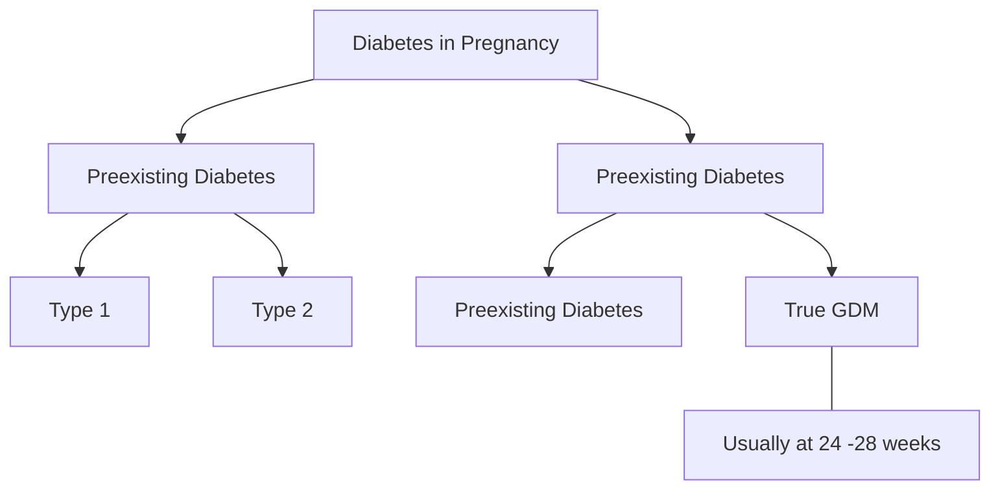

<!-- page: 59 | printed: 49 -->

| **Screening** |  |  |
| --- | --- | --- |
| • Universal screening (screening every pregnant woman) is recommended.<br/>• If the woman has more than one risk factor, do an RBS/FBS at first contact.<br/>• Screening should be done at **24-28 weeks** (or at first contact if patient presents late).<br/>• Perform a 75-g OGTT - Administer 75 g of glucose orally after an 8-hr. Overnight fast and do a blood glucose level after 1 hour and 2 hours (1 standard level teaspoon=5 g). |  |  |
| **Risk factors for GDM** |  |  |
| • Previous GDM<br/>• Maternal age > 35 years | • Intermediate hyperglycaemia or Impaired glucose tolerance<br/>o HbA1C ≥ 5.7%, impaired glucose tolerance or impaired fasting glucose |  |
| • Family history of diabetes<br/>(first-degree relative with diabetes)<br/>• Obesity (BMI > 30 kg/m²)<br/>• Previous macrosomia (birthweight > 4000g)<br/>• Polycystic Ovary Syndrome<br/>• Latrogenic: glucocorticoids and antipsychotic medication<br/>• Hypertension | o HbA1C >6.5%, diagnosis of preexisting diabetes<br/>**Note: symptoms may be unspecific** |  |
| **Management of GDM** |  |  |
| **Lifestyle Modification** | **Pharmacotherapy** | **Glycemic Goal** |
| • Exercise 30-60 min moderate intensity<br/>• Diet: regular meal plan; 3 moderate-sized meals, 4 snacks,<br/>• Low sugar |  | • Fasting and pre-prandial blood glucose concentration: <95 mg/dL **(5.3 mmol/L)**<br/>• One-hour postprandial blood glucose concentration: <140 mg/dL **(7.8 mmol/L)**<br/>• Two-hour postprandial glucose concentration: <120 mg/dL **(6.7 mmol/L)**<br/>**Check HbA1c every 4-6 weeks, Goal below 6.5%** |
| **Complications** |  |  |
| **Complications** | **Maternal-Neonatal** | **Fetal** |
| Short Term | • Preeclampsia<br/>• Gestational hypertension<br/>• Hydramnios<br/>• Urinary tract/vaginal infections<br/>• Cesarean delivery<br/>• Traumatic labor/perineal tears<br/>• Postpartum hemorrhage<br/>• Difficulty initiating and/or maintaining breastfeeding | • Stillbirth or Neonatal death<br/>• Preterm birth<br/>• Congenital malformations<br/>• Macrosomia<br/>• Cardiomyopathy<br/>• Birth trauma: Shoulder dystocia<br/>Bone fracture or Brachial plexus injury<br/>• Hypoglycemia<br/>• Hyperbilirubinemia<br/>• Respiratory distress syndrome |
| **Complications** |  |  |
| **Complications** | **Maternal-Neonatal** | **Fetal** |
| Long Term | • Recurrence of GDM<br/>• Type 2 diabetes mellitus<br/>• Hypertension<br/>• Ischemic heart disease<br/>• Nonalcoholic fatty liver disease<br/>• Dyslipidemia<br/>• Chronic kidney disease<br/>• Metabolic syndrome<br/>• Hyperinsulinemia | • Childhood obesity<br/>• Excess abdominal adiposity<br/>• Higher blood pressure<br/>• Possible earlier onset cardiovascular disease<br/>• Possible attention-deficit hyperactivity disorder<br/>• Autism spectrum disorder |
| **Preconception Plan** |  |  |
| Prior Pregnancy | • Optimize modifiable risk factors (eg. BMI, diet, physical activity).<br/>• Screening GLYCAEMIA in high-risk women<br/>• For preexisting DM: Maintain HbA1c below 6% if and appropriate drugs: Insulin and metformin.<br/>• Screen for complications |  |
| During Pregnancy | • Healthy diet, regular exercise >> unless there are obstetric contraindications.<br/>• Possible personalized gestational weight gain.<br/>• High-risk women: detect early DM in pregnancy (if preconception positive screening)<br/>• Follow the protocol for all at 24 to 28 weeks gestation according to recommended screening and diagnostic criteria.<br/>• Delivery at 38 weeks is advised if the sugars are well controlled. If poorly controlled consult a specialist on timing of delivery.<br/>• Consider steroid administration for lung maturation if early delivery is indicated.<br/>• If steroids are administered at any point in the pregnancy, anticipate difficult glycaemic control and insulin therapy is advised.<br/>• Aim target blood glucose level 4-7 mmol/L during active labour and delivery.<br/>• Anticipate maternal and foetal/neonatal complications at delivery and plan for necessary interventions. |  |
| Postpartum | • Early postpartum OGTT to assess glucose status.<br/>• Regular long-term follow-up focused on diabetes and cardiovascular risk factor modification.<br/>• Family lifestyle support: optimizing diet, physical activity, and weight in the offspring. |  |

<!-- page: 60 | printed: 50 -->

<!-- page: 61 -->

| Gestational DM PHARMACOTHERAPY DOSING SCHEDULE<br/>Agent | Gestational DM PHARMACOTHERAPY DOSING SCHEDULE<br/>Indication | Gestational DM PHARMACOTHERAPY DOSING SCHEDULE<br/>Starting Dose | Gestational DM PHARMACOTHERAPY DOSING SCHEDULE<br/>Titration | Gestational DM PHARMACOTHERAPY DOSING SCHEDULE<br/>Timing | Gestational DM PHARMACOTHERAPY DOSING SCHEDULE<br/>Max Dose / Notes |
| --- | --- | --- | --- | --- | --- |
| METFORMIN (Oral – First Line) |  |  |  |  |  |
| Metformin 500 mg | Lifestyle measures failed after 1–2 weeks; FBG ≥5.3 or 2hr PPG ≥6.7 mmol/L | 500 mg once daily | Add 500 mg every 1 – 2 weeks as tolerated | With evening meal | 2000–2500 mg/day in 2–3 divided doses |
| Metformin (Week 2) | Targets not met on 500 mg daily | 500 mg twice daily | Increase to 3× daily if still not at target by Week 3 | Morning + evening meal | \~46% will still require insulin – reassess every 1–2 weeks |
| INSULIN (Injectable — Gold Standard) |  |  |  |  |  |
| NPH Insulin (Humulin N / Insulatard) | Fasting hyperglycaemia: FBG ≥5.3 mmol/L despite metformin | 0.1–0.2 units/kg at bedtime | Increase by 2 units every 3 days until FBG <5.3 mmol/L | Bedtime (22:00-23:00) | Formulary standard in SA & Eswatini public sector |
| Regular Insulin (Actrapid / Humulin R) | Postprandial hyperglycaemia: 2hr PPG ≥6.7 mmol/L | 4 units before highest-carb meal | Increase by 2 units every 3 days until 2hr PPG <6.7 mmol/L | 30 min before meal | Extend to all 3 meals if multiple postprandial readings elevated |
| Basal-Bolus (NPH + Regular) | Both fasting & postprandial elevated | NPH 0.1–0.2 u/kg bedtime + 4 u Regular before meals | Titrate each component separately; 2 units every 3 days | NPH at bedtime; Regular 30 min pre-meal | Most physiological regimen; preferred for poorly controlled GDM |
| Insulin (Specialist) | Severe: FBG ≥7.0 mmol/L at diagnosis | 0.2–0.3 u/kg/day total; split 2/3 AM + 1/3 PM (NPH) | Adjust based on full daily glucose profile | Split dose AM + bedtime | Refer to specialist (Mbabane GH or RFM Hospital in Eswatini) |
| GLUCOSE TARGETS & MONITORING |  |  |  |  |  |
| Fasting BG | < 5.3 mmol/L | 1-hr Postprandial | < 7.8 mmol/L | 2-hr Postprandial | < 6.7 mmol/L |
| POSTPARTUM |  |  |  |  |  |
| All agents | Discontinue ALL pharmacotherapy at delivery | — | 75g OGTT at 6–12 weeks postpartum to screen for persistent T2DM | — | Annual fasting glucose screening recommended long-term |

<!-- page: 62 -->

## **Diabetes in Special Populations**

### **The Elderly and Frail**

* Screening for diabetes complications should be individualized in older adults. Particular attention should be paid to complications that would lead to functional impairment.
* In elderly patients review the Geriatric 5Ms: medications, mental state, mobility, multi-complexity/comorbidity, and what matters most to the patient. To place 5MS table here.

### **Diabetes in HIV**

* A dose adjustment of Metformin should be considered when co-administering DTG with Metformin to maintain glycemic control
* Monitor renal function and blood glucose are recommended when metformin and DTG are co-administered. As metformin is eliminated, patients with moderate renal impairment may be at increased risk for lactic acidosis due to increased metformin concentrations

| **DRUG INTERACTION TABLE**<br/>**Source: University of Liverpool, hiv-druginteractions.org** |  |  |  |  |  |  |  |  |  |  |
| --- | --- | --- | --- | --- | --- | --- | --- | --- | --- | --- |
| **Antidiabetic Agent** | **TDF/**<br/>**TAF** | **AZT** | **3TC** | **FTC** | **EFV** | **NVP** | **DTG** | **LPV/r** | **ATV/r** | **DRV/r** |
| **Metformin** |  |  |  |  |  |  | ↑ |  |  |  |
| **Glibencamide** |  |  |  |  | ↓ | ↓ |  | ↓ | ↓ | ↓ |
| **Glipizide** |  |  |  |  | ↑ |  |  | ↓ | ↓ | ↓ |
| **Gliquidone** |  |  |  |  | ↑ |  |  | ↓ | ↓ | ↓ |
| **Gliclazide** |  |  |  |  | ↑ |  |  | ↓ | ↓ | ↓ |
| **Glimepiride** |  |  |  |  | ↑ |  |  | ↓ | ↓ | ↓ |
| **\*Essential medicines list included atenolol, metoprolol, carvedilol as alternatives** |  |  |  |  |  |  |  |  |  |  |
| \[ ] **No interaction** |  |  |  |  |  |  |  |  |  |  |
| \[ ] Potential interaction with increased or decreased levels of the sulfonylurea which may require dose adjustment of the sulfonylurea. Monitor blood glucose and adjust the sulfonylurea dosage as needed |  |  |  |  |  |  |  |  |  |  |
| \[ ] **CAUTION should be exercised when co-administering metformin with DTG as metformin levels are increased and dose reduction of metformin should be considered.** The US prescribing information recommends limiting the total daily dose of metformin to 1,000 mg when co-administered with DTG. **Renal monitoring is recommended as PLHIV with renal impairment are at increased risk of lactic acidosis due to increased metformin levels in the presence of DTG.** |  |  |  |  |  |  |  |  |  |  |
| ↑ Increase in antidiabetic agent level<br/>↓ Decrease in antidiabetic agent level |  |  |  |  |  |  |  |  |  |  |

\*\*Refer to National HIV Management Guidelines\*\*

<!-- page: 63 | printed: 53 -->

# **Diabetes and TB**

- Anti-TB drugs can influence the metabolism of anti-diabetic medications.
- Rifampicin induces enzyme cytochrome p450 hence, increases the metabolism of most oral hypoglycaemic agents, which may worsen hyperglycaemia.
- Isoniazid inhibits enzyme cytochrome p450 and prolongs the effect of oral anti-diabetic drugs.
- Bedaquiline is also an enzyme inducer, hence reduces the effect of antidiabetic drugs.

## Diabetes in Special Populations

| HIV/TB Co-infection | Resource-Limited Settings |
| --- | --- |
| - Screen for HIV if status unknown (rapid test on admission) - Immune reconstitution can unmask T1DM - ARVs (especially older PI-based) can cause insulin resistance - Opportunistic infections (PCP, cryptococcal, TB) are common DKA precipitants - Maintain ARTs during crisis - liaise with HIV team | - No blood ketones: use urine ketones (≥2+ = significant) - No VBG: treat on clinical picture + glucose + ketones - No syringe pump: 50 units in 500 ml NS (0.1 unit/ml) + drip control - No 0.45% NaCl: use 0.9% NaCl throughout with closer monitoring - Validate POC glucose meters for high glucose ranges >30 mmol/L |
| Pregnancy | Elderly Patients (HHS) |
| - DKA can occur at lower glucose (euglycaemic DKA in pregnancy) - Involve obstetric team immediately - Fetal monitoring from 24 weeks onwards - Higher insulin requirements - do not underdose - Avoid bicarbonate unless pH <7.0 | - Reduced physiological reserve - higher risk of fluid overload - More gradual fluid replacement over 48-72 hours - Increased thromboembolic risk - early LMWH prophylaxis - Exclude silent MI, stroke, UTI, pneumonia as precipitant - Assess cognition, falls risk, social support before discharge |

## Management of Osteoporosis and Fragility Fractures

### Definition(s) and Classification of Osteoporosis

The conceptual definition of osteoporosis was made by the World Health Organization (WHO) in 1994 as a "progressive systemic skeletal disease characterized by low bone mass and micro-architectural deterioration of bone tissue, with a consequent increase in bone fragility and susceptibility to fracture, which usually involves the wrist, spine, hip, pelvis, ribs or humerus".

<!-- page: 64 | printed: 54 -->

## **Risks Factors for Osteoporosis and Fragility Fractures**

| **Lifestyle Factors**<br/>**Alcohol (two or more drinks per day)\*\***<br/>**Smoking\*\***<br/>**Low calcium intake**<br/>**Inadequate physical activity**<br/>**Immobilisation**<br/>**Vitamin D insufficiency**<br/>**Malnutrition**<br/>**Low Body Mass (BMI < 20)\*\*** | **Falling**<br/>**High salt/protein intake**<br/>**High caffeine intake**<br/>**Excessive exercise**<br/>**Excess Vitamin A**<br/>**Vitamin C, K, B6 and B12 deficiencies**<br/>**Trace element deficiencies** |
| --- | --- |
| **Genetic and Ethnic Factors**<br/>**Elderly females\*\***<br/>**White, Asian and mixed race**<br/>**Family history of hip fracture\*\***<br/>**Osteogenesis imperfecta**<br/>**Marfan syndrome**<br/>**Ehlers-Danlos syndrome**<br/>**Haemochromatosis** | Porphyria<br/>Homocystinuria<br/>Idiopathic hypercalciuria<br/>Gaucher’s disease<br/>Riley-Day syndrome<br/>Menkes disease |
| **Diseases** |  |
| **Hypogonadism**<br/>**Premature menopause**<br/>**Anorexia nervosa/bulimia**<br/>**Athlete’s amenorrhoea** | Delayed puberty<br/>Turner’s syndrome<br/>Klinefelter’s syndrome<br/>Kallmann’s syndrome |
| Gastrointestinal disorders<br/>Gastric bypass<br/>Coeliac disease<br/>Gastrectomy | Inflammatory bowel disease<br/>Chronic liver disease<br/>Pancreatic disease |
| Endocrinopathies<br/>Cushing’s syndrome<br/>Diabetes mellitus | Hyperthyroidism<br/>Acromegaly<br/>Addison’s disease<br/>Prolactinoma |
| **Haematological Disorders**<br/>Multiple myeloma<br/>Systemic mastocytosis<br/>Thalassaemia | Leukaemia and lymphomas<br/>Sickle cell disease<br/>Haemophilia |
| **Rheumatology and Immunology**<br/>Rheumatoid arthritis\*\* | Psoriasis<br/>Systemic lupus erythematosus<br/>Ankylosing spondylitis |
| ***Miscellaneous*** | Amyloidosis |
| **Alcoholism** | Sarcoidosis |
| **Malignancy** | Post-transplant bone disease |
| **Fracture after age 40 years\*\*** | Organ failure: lung, liver, kidney, heart |
| **Parenteral nutrition** | Pregnancy-associated osteoporosis |
| ***Bone toxic drugs (see table below)*** |  |

<!-- page: 65 | printed: 55 -->

## **Drugs Associated with increased risk of Osteoporosis and Risk of Fractures**

| **Increase Risk of Osteoporosis** |  |
| --- | --- |
| **Glucocorticoids** |  |
| **Excessive Thyroid Replacement Therapy** |  |
| **Anticonvulsants** |  |
| **Thiazolidinediones (Pioglitazone, Rosiglitazone)** |  |
| **Aromatase Inhibitors** |  |
| **Gonadotrophin-releasing Hormone Analogues** |  |
| **Chemotherapy** |  |
| **Immunosuppressives (Cyclosporine, Methotrexate)** |  |
| **Heparin/warfarin** |  |
| **Chronic Lithium Therapy** |  |
| **Prolonged Parenteral Nutrition** |  |
| **Aluminium** |  |
| ***Increased Risk of Falling*** |  |
| **Sedatives and Hypnotics** |  |
| **Antidepressants** |  |
| **Antihypertensive Drugs** |  |
| **Hypoglycaemic Agents** |  |

***May also cause osteomalacia***

<!-- page: 66 | printed: 56 -->

## **Classification of Osteoporosis**

| **Definition** | **Criteria** |
| --- | --- |
| **Normal** | BMD or BMC value (measured with DXA at either the spine, total hip or femur neck)<br/>within 1 SD of the young adult reference mean (T-score\* at or above -1.0) |
| **Low Bone mass** | BMD or BMC value more than 1 SD, but less than 2.5 (osteopenia) SD below the<br/>young adult mean (T-score between -1.0 and - 2.5) |
| **Osteoporosis** | BMD or BMC value is 2.5 SD or more below the young adult mean |
| **Severe osteoporosis** | BMD or BMC value more than 2.5 SD below the young adult mean, plus one or more<br/>fragility fractures |
| **These criteria were updated in 2008 and differ from those proposed by the WHO in 1994 by specifying a<br/>single reference site (the femoral neck) to measure BMD, providing a young normal reference range for<br/>women and men (the NHANES III reference data for femoral neck measurements in women aged 20-29<br/>years), and by accommodating diagnostic criteria for men (see 6.2.1 and 6.3).<br/>\*\* When standard deviation (SD) units are used in relation to the young healthy adult population, this is<br/>referred to as the T-score.** |  |

### **Diagnosis of Osteoporosis**

The diagnosis of osteoporosis typically involves a combination of clinical assessment, medical history, and bone density testing. Here are the key steps in the diagnosis of osteoporosis:

#### **Patient Assessment**

##### **Clinical and Laboratory Assessment**

A detailed general and dietary history, full physical examination and appropriate laboratory assessment are required in all patients prior to the initiation of treatment for osteoporosis.

|  | **Initial** | **3-6** **Monthly Visit** | **Annually** |
| --- | --- | --- | --- |
| **History** |  |  |  |
| Symptoms of underlying disease as cause of osteoporosis<br/>(endocrinopathies, malignancies, systemic diseases, bone-toxic drugs)<br/>● CRF and falls risk assessment |  |  |  |
| **Relevant family history** | **x** |  | **x** |
| Other risk factors | **x** | **x** | **x** |
| **Relevant Medical History** |  |  |  |
| Co-morbid conditions | **X** |  | **X** |
| Symptoms of complications | **X** | **X** | **X** |
| Cardiovascular, neurological | **X** | **X** | **X** |
| **Drugs** |  |  |  |
| Current | **X** |  | **X** |
| Side-effects and adherence | **X** | **X** | **X** |
| Allergies | **X** |  | **X** |
| **Lifestyle** |  |  |  |
| Weight history | **X** | **X** | **X** |
| Physical activity | **X** | **X** | **X** |
| Diet | **X** | **X** | **X** |
| Smoking | **X** | **X** | **X** |
| Alcohol | **X** | **X** | **X** |
| **Psychosocial** |  |  |  |
| Occupation | **X** |  | **X** |
| Family and community support | **X** |  | **X** |
| Depression | **X** | **X** | **X** |
| **Home Monitoring Chart (if relevant)** |  |  |  |
| History of falls | **X** | **X** | **X** |

<!-- page: 67 | printed: 57 -->

| Examination<br/>Physical Examination | Initial | 3-6 Monthly Visit | Annually |
| --- | --- | --- | --- |
| Weight | x | x | x |
| Height | x |  | x |
| BMI (kg/m²) | x | x | x |
| Waist circumference (cm) | x | x | x |
| Blood pressure | x | x | x |
| Cardiovascular examination | x |  | x |
| Neurological examination (assess for neuropathy) | x |  | x |
| Examination<br/>Eye Examination | Initial | 3-6 Monthly Visit | Annually |
| - Visual acuity | x |  | x |
| - Nystagmus |  |  |  |
| - Retinal examination \*Fundoscopy to r/o papilledema | x |  | x |
| Ear Examination |  |  |  |
| - Hearing | x |  | x |
| - Vertigo assessment\* | x |  | x |

<!-- page: 68 -->

\*Clinician may use any of the following procedures1:

1. **The Dix–Hallpike manoeuvre:** The patient sits at the edge of the bed and the examiner turns the patient’s head 30 - 45 degrees to the side being tested. The patient needs to keep their eyes open and focus on a stable point, and then quickly lie supine and hyperextend the neck. Horizontal nystagmus denotes a positive test. This test can induce vertigo, so patients should be warned about this before the test is performed.
2. **Orthostatic blood pressure testing:** A drop in the systolic blood pressure by more than 20 mm/Hg from a lying down to standing position is significant for a postural drop. This is seen in patients who are dehydrated or who present with autonomic dysfunction. Autonomic dysfunction can occur acutely and be driven by vertigo.
3. **Head impulse test:** The patient is asked to look at the examiner’s nose and the examiner quickly turns the patient’s head 10–20 degrees. It is abnormal if eyes move rapidly and repetitively, failing to re-fixate to the examiner’s nose. A positive test indicates disrupted vestibule-ocular reflex.

| Investigations | Initial | 3-6 Monthly Visit | Annually |
| --- | --- | --- | --- |
| Blood |  |  |  |
| Serum calcium, albumin, phosphate, PTH and ALP. | x |  | x |
| 25OHD (all elderly, institutionalised, non-sun exposed, malnourished). |  |  |  |
| Serum thyroid stimulating hormone (TSH). | x |  | x |
| Full blood count and ESR. | x |  | x |
| Serum protein electrophoresis. | x |  | x |
| Serum follicle-stimulating hormone (FSH), and estradiol in premenopausal women or women when menopausal state is unknown. | x |  | x |
| Serum total testosterone\* in men. | x |  | x |
| Serum creatinine, urea and calculation of eGFR |  |  |  |
| Urine Dipstix |  |  |  |
| Protein | x |  | x |
| Urine calcium and creatinine (preferably a 24-hour collection). | x |  | x |
| Glucose & Ketones | x |  | x |
| Optional assessment • Serum or urine bone turnover markers • Liver transaminases (alcohol abuse/liver disease is suspected). • Serum T4 and T3 (thyroid disease is suspected/TSH level is abnormal). • Bone biopsy with quantitative histomorphometry (osteomalacia suspected). • Bone marrow aspiration, isotope bone scan, cancer markers. ᵻ where clinically indicated \*If positive findings determined at first contact screening | xᵻ |  | x\* |
| ECG |  |  |  |
| Vertebral fracture assessment: standard X-rays or DXA-VFA. • Bone mass measurement: spine and hip (distal radius if spine and hip data invalid). \*Conduct this test every two years | x x |  | x\* x\* |

<!-- page: 69 -->

<!-- page: 70 -->

Below is a useful algorithm for assessment of Osteoporosis in patients

## **Algorithm for the Assessment of Patients with Osteoporosis**

### **Algorithm for the Management of Osteoporosis in Post-menopausal Women and Men aged 50 years and Older**

**Flowchart: Clinical Risk Factors and Osteoporosis Assessment Algorithm**

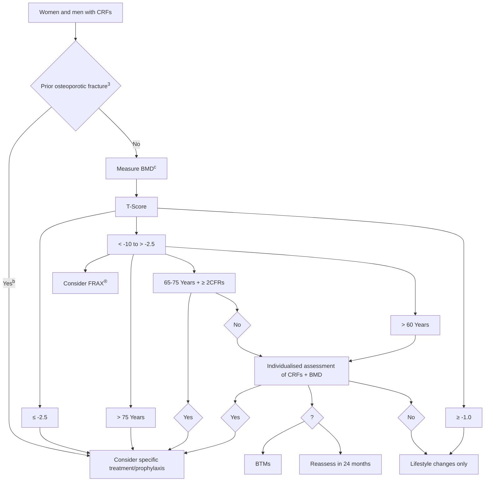

**Clinical Risk Factors:**
* Advanced age
* Prior fracture
* Family History
* Excessive learners
* Diet/alcohol/smoking
* Fall propensity
* Secondary osteoporoses

<!-- page: 71 | printed: 61 -->

## **Non-Pharmacological Management of Osteoporosis**

Postmenopausal women, and men age ≥50 years, with osteoporosis or who are at risk of fragility fracture are recommended:

1. A healthy, nutrient-rich balanced diet
2. An adequate intake of calcium (minimum 700mg daily) preferably achieved through dietary intake or otherwise by supplementation
3. To consume Vitamin D from foods be prescribed Vitamin D supplements of at least 800IU/day if they have identified Vitamin D insufficiency or risk factors for Vitamin D insufficiency.
4. A combination of regular weight-bearing and muscle strengthening exercise, tailored according to the individual patient’s needs and ability.
5. Advice about smoking and alcohol cessation
6. A falls assessment should be undertaken in all patients with osteoporosis and fragility fractures; those at risk should be offered exercise programmes to improve balance and/or that contain a combined exercise protocol

### **Pharmacological Management of Osteoporosis**

| DRUG CLASS AND NAME<br/>BISPHOSPHONATES | TYPICAL DOSAGE | COMMON SIDE EFFECTS |
| --- | --- | --- |
| - ALENDRONATE (FOSAMAX) | 70 mg once weekly or 10 mg daily | Esophageal irritation, musculoskeletal pain, nausea, abdominal pain |
| - RISEDRONATE (ACTONEL) | 35 mg once weekly or 150 mg once monthly | Abdominal pain, musculoskeletal pain, nausea |
| - IBANDRONATE (BONIVA) | 150 mg once monthly | Gastrointestinal irritation, musculoskeletal pain |
| - ZOLEDRONIC ACID (RECLAST) | 5 mg once annually as an intravenous infusion | Flu-like symptoms, renal impairment, hypocalcemia |
| SELECTIVE ESTROGEN RECEPTOR MODULATORS (SERMS) |  |  |
| - RALOXIFENE (EVISTA) | 60 mg daily | Hot flashes, leg cramps, increased risk of blood clots |
| HORMONE REPLACEMENT THERAPY (HRT) |  |  |
| - CONJUGATED ESTROGENS (PREMARIN) | Dosage varies | Increased risk of breast cancer, blood clots, stroke, and other side effects |
| CALCITONIN (MIACALCIN) | Typically, 200 IU daily as nasal spray | Nasal irritation, epistaxis (nosebleeds), flushing |
| PARATHYROID HORMONE ANALOGS |  |  |
| - TERIPARATIDE (FORTEO) | 20 mcg once daily (subcutaneous) | Dizziness, leg cramps, injection site reactions |
| - ABALOPARATIDE (TYMLOS) | 80 mcg once daily (subcutaneous) | Hypercalcemia, dizziness, nausea, headache |
| MONOCLONAL ANTIBODIES |  |  |
| - DENOSUMAB (PROLIA) | 60 mg once every six months (subcutaneous) | Infections, back pain, dermatitis, hypocalcemia |

<!-- page: 72 | printed: 62 -->

# Thyroid Disorders

## **Hypothyroidism**
Definition(s) and Classification of Hypothyroidism
Hypothyroidism results from thyroid hormone deficiency most commonly due to iodine deficiency.
- **Primary:** comprises more than 90% of cases of hypothyroidism, presents with low fT4 and high TSH
  - ✓ Chronic lymphocytic (autoimmune) thyroiditis/Hashimoto's thyroiditis (after the hyperthyroid phase of thyroiditis) – Autoimmune destruction of functional thyroid tissue with patchy lymphocytic infiltration
  - ✓ Postpartum thyroiditis
  - ✓ Subacute (granulomatous) thyroiditis
  - ✓ Drug-induced hypothyroidism
  - ✓ Latrogenic (postsurgical) hypothyroidism
- **Secondary (Central):** results due to hypothalamic-pituitary failure, presents with low fT4 and TSH could be low, inappropriately normal or slightly high.

## **Diagnostic Criteria**
The symptoms depend on the deficiency of thyroid hormone, but can include:

| System Affected | Common Symptoms |
| --- | --- |
| General & Metabolic | - Fatigue - Weight gain - Trouble tolerating cold - Slowed heart rate Increased cholesterol levels |
| Skin, Hair & Nails | - Dry, rough skin - Dry or thinning hair - Hair loss |
| Musculoskeletal | - Joint pain - Muscle pain or weakness |
| Reproductive (Female) | - Heavy or irregular menstrual periods - Fertility problems |
| Neurological & Psychological | - Depression - Memory loss |
| Gastrointestinal & Voice | - Constipation - Hoarse voice |

Investigations: Thyroid hormone profile
Diagnosis: Maybe be primary or secondary hypothyroidism (see definition)

## **Management of Hypothyroidism**
- TSH level persistently >10mU/L; treat all patients due to, increased likelihood of progression to overt disease and a higher risk of congestive heart failure, cardiovascular disease and mortality.
- TSH levels (4.5–10mU/L); consider, treatment in patients younger than 65 with increased cardiovascular risk (e.g., previous cardiovascular disease, hypertension, documented diastolic dysfunction, atherosclerotic risk factors (dyslipidaemia, diabetes mellitus, smoker), goitre, positive antithyroid peroxidase antibodies, evidence of autoimmune thyroiditis by ultrasound, pregnancy, or infertility), particularly when TSH level is persistently >7mU/L.

<!-- page: 73 | printed: 63 -->

- Levothyroxine therapy could be considered also for symptomatic middle-aged patients for a short period of time. If a clear beneficial effect is observed, levothyroxine therapy could be maintained.
- Persistently mildly increased TSH levels (>4.5-10mU/L) with positive Thyroid Antibody and thyroid sonographic findings typical of autoimmune thyroiditis.

## **Pharmacological Treatment**

Initial dose:

Clinical Hypothyroidism
**D:** levothyroxine 1.6–1.8μg/kg ideal body weight

Subclinical Hypothyroidism
**D:** levothyroxine 1.1–1.2μg/kg is recommended
- Take at least after 2 hours fast, 30 minutes before food intake. Alternatively, at bedtime (3 or more hours after the evening meal).
- When initiating therapy in young healthy adults with overt hypothyroidism, consider beginning treatment with full replacement doses
- Routine use of combined therapy with levothyroxine and triiodothyronine for hypothyroid patients is not recommended
- Assess TSH and adjust dosage when there are large changes in body weight, with aging, and with pregnancy.
- There is no convincing evidence to support routine use of thyroid extracts, L-T3 monotherapy, compounded thyroid hormones, iodine containing preparations, dietary supplementation, and over the counter preparations in the management of hypothyroidism.

## **Monitoring**

- TSH monitoring 6-8weeks after any levothyroxine dose change, and yearly life-long monitoring once euthyroidism is achieved (target TSH 0.2-4.0um/l). FT4 can be measured in early stages of treatment.
- In patients with central hypothyroidism, assessments of serum free T4 should guide therapy and targeted to exceed the mid normal range value for the assay being used.
- Wait for TSH equilibration-TSH equilibration requires eight to 12 weeks after any thyroxine dosage change. Once a stable dose is achieved-yearly TSH is sufficient.

## **In Pregnancy**

When the elevation of the TSH level is confirmed, free T4 should be measured to classify the hypothyroidism as clinical or overt (OH) and subclinical (SH).
- TSH > 2.5-10.0mU/L with normal free T4: SH.
- TSH > 2.5-10.0mU/L with low levels of free T4: OH.
- TSH =10.0mU/L, despite the level of free T4: OH

<!-- page: 74 | printed: 64 -->

<mark>Refer all clients with hypothyroidism planning to conceive and all pregnant hypothyroidism clients to the OBGYN team.
Women in reproductive period should be euthyroid before conceiving, as the hypothyroidism is associated with neural development. Dose may be doubled during pregnancy and returned to normal dose after delivery</mark>

## **Complications & Emergencies associated with Hypothyroidism Myxedema coma – profound hypothyroidism**

**Clinical Presentation:** hypothermia, hypotension, hypoventilation, changes in mental status (coma rare), hyponatremia, hypoglycemia

**Medical history:** often precipitated by infection or major cardiopulmonary or neurologic illness

**Management principles:** supportive care is most important. Slow metabolism of drugs can lead to coma. Correction of hypothyroidism takes time.
- Load 5-8 mcg/kg T4 IV, then 50-100 mcg IV daily
- May also give 5-10 mcg T3 IV q8h if unstable with bradycardia and/or hypothermia (T3 more arrhythmogenic)

**Where IV is not available, give:**
- Liothyronine, Oral (crushed via NGT). Initially 10-20 mcg, depending on the patient's condition, with subsequent doses determined by the response (average 20 mcg q8h with close clinical and biochemical monitoring until there is sustained improvement).
- Maintain oral thyroxine alone, after an overlap period of a few days.

## **Hypothyroidism in Paediatric Population**

### Congenital Hypothyroidism

**Description**
- Congenital deficiency of thyroid hormone due to:
- Aplasia/hypoplasia or ectopia of the thyroid gland,
- Thyroglobulin defects,
- Defects in thyroid hormone biosynthesis, or
- Intrauterine exposure to antithyroid medicines.

Congenital hypothyroidism is one of the common treatable causes of preventable intellectual disability in children. Congenital hypothyroidism must be treated as early as possible to avoid intellectual impairment. Symptoms and signs in neonates are unreliable, thus screening is essential for ensuring early intervention.

<!-- page: 75 | printed: 65 -->

## **Diagnostic Criteria**

### **Clinical**

| Category | Features |
| --- | --- |
| General | Lethargy, Somnolence, Delayed physical and mental development, Subnormal temperature |
| Skin/Hair | Dry skin, Coarse and scanty hair |
| Facial/Head | Wide open fontanelles, Enlarged tongue (macroglossia), Periorbital oedema, Coarse cry, Hoarse voice, Goitre |
| Growth/Development | Delayed dentition, short and thick neck, Broad hands, Hypotonia |
| Cardiovascular | Bradycardia |
| Abdomen | Abdominal distension, Umbilical hernia, Constipation |
| Extremities | Oedema of extremities and genitals |
| Haematologic | Anaemia |
| Respiratory | Apnoeic episodes |
| Feeding | Feeding difficulties |
| Other | Prolonged unconjugated hyperbilirubinemia |

### **Investigations**

When suspected, perform a TSH test.
> If elevated, perform a free T4.
Delay in diagnosis and treatment is associated with irreversible neurodevelopmental damage.

### **General and Supportive Measures**

* ✔ Routine screening of all newborns for congenital hypothyroidism.
* ✔ Growth and neurodevelopmental assessment.
* ✔ Regular follow-up.

### **Pharmacological Treatment**

For neonates, start as soon as possible, ideally within the first three weeks after birth:
* Levothyroxine, oral, 10–15 mcg/kg as a single daily dose on an empty stomach.
    - ✔ Adjust dosage to blood levels of free T4 (in the upper-half of the reference range) and normalise the TSH, especially in the first 3 years of life. Check TSH only 6 weeks after adjusting the thyroxine dose.
    - ✔ Continue treatment indefinitely.

<!-- page: 76 | printed: 66 -->

# Referral
All patients for confirmation of diagnosis, but initiation of therapy should not be delayed.

## <u>Hypothyroidism In Older Children And Adolescents Description</u>
Acquired hypothyroidism in childhood and adolescents may be due to: auto-immune thyroiditis, goitrogen induced, iodine deficiency, post-surgery, radioactive iodine, infiltrations, medicines.

## Diagnostic Criteria

### Clinical
**Clinical**
Low growth velocity or short stature with short limbs associated with a normal or elevated BMI. Subtle features with cold intolerance, dry skin, brittle hair, pallor and myxoedema.

### Investigations
**Investigations**
Elevated TSH and low thyroxine levels.

## Pharmacological Treatment

**Levothyroxine, oral, once daily on an empty stomach**

| Age Group | Dose |
| --- | --- |
| 1-6 months | 8-10mcg/kg |
| 6-12 months | 6-8mcg/kg |
| 1-5 years | 5-6mcg/kg |
| 6-12 years | 4-5mcg/kg |
| >12 years | 2-3mcg/kg |

## Referral
- All cases for investigation and initiation of therapy.

## Hyperthyroidism
Definition(s) and Classification of Hyperthyroidism

Hyperthyroidism is a set of disorders that involve excess synthesis and secretion of thyroid hormones by the thyroid gland, which leads to the hypermetabolic condition of thyrotoxicosis

- **Diffuse toxic goiter/Graves' disease** – autoimmune disorder with TSH-receptor stimulating Abs, is the most common form and accounts for more than 60% of cases
- **Thyroiditis** – thyrotoxic phase of subacute/granulomatous or painless/lymphocytic. Which is due to a temporary excess release of thyroid hormone
- **Toxic Multinodular Goiter/Plummer Disease** – occurs more commonly in the elderly with longstanding goiter

<!-- page: 77 | printed: 67 -->

- **Toxic adenoma** – caused by a single hyperfunctioning follicular thyroid adenoma from a benign monoclonal tumor that usually is > 2.5cm diameter
- **Other aetiologies:** Genetic, infection, excessive iodine uptake, drugs (like amiodarone), hCG- secreting tumors (choriocarcinoma), gestation, and metastatic follicular thyroid carcinoma.

## Clinical Manifestations
- **Common symptoms:** nervousness, anxiety, increased perspiration, heat intolerance, hyperactivity, palpitations, weight loss, frequent bowel movements, an enlargement in the neck called goitre, trouble sleeping, fatigue
- **Common signs:** tachycardia, systolic hypertension with wide pulse pressure, warm-moist- smooth skin, lid lag, hand tremor, muscle weakness

**Graves' disease:** characterized by the triad.
- ✓ Goiter; diffuse, non-tender, with thyroid bruit
- ✓ Exophthalmos/Ophthalmopathy; seen in 50-90%. Periorbital edema, lid retraction, proptosis, conjunctivitis, and diplopia associated with smoking. Stare and lid lag seen in any type of hyperthyroidism.
- ✓ Pretibial myxedema; infiltrative dermopathy.
- Acropachy is the rarest extrathyroidal manifestation of Graves' disease and presents with clubbing of the fingers and toes.
- Examining the thyroid will reveal a diffuse non-nodular enlargement of the thyroid in Graves' disease; a diffuse non-symmetric nodular enlargement can be seen in toxic multinodular goiter, and a single large nodule can be palpated in cases of a toxic adenoma. An exquisitely tender thyroid can be noted in subacute thyroiditis.

## <u>Diagnosis</u>
The diagnosis of hyperthyroidism involves a combination of clinical evaluation and various tests.

**The following are steps commonly taken to diagnose the condition:**
- **Clinical Evaluation:** symptoms, which may include weight loss and tachycardia, palpitations, tiredness, anterior neck swelling.
- **Hormone Blood Tests:** Blood tests can measure levels of TSH, thyroid hormones and thyroid antibody tests.
- **Imaging Studies:** Imaging techniques such as Thyroid scan.

<!-- page: 78 | printed: 68 -->

## **An Algorithm for the approach to a patient with suspected hyperthyroidism**

### **Diagnostic Algorithm for Primary Hyperthyroidism**

**Flowchart: Diagnostic Algorithm for Primary Hyperthyroidism**

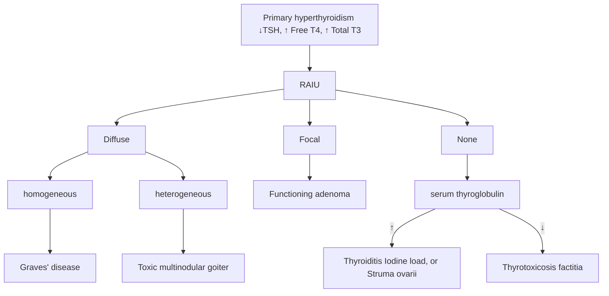

### **Non-Pharmacological Management of Hyperthyroidism**

#### **Patient Education**
* Lifestyle modifications including maintaining normal weight, not smoking, no ingestion of alcoholic beverages, physical activity.
* At every encounter, the clinician should educate the patient and in the case of children, the parents about the disease process, management, goals, and long-term complications

#### **Management of Hyperthyroidism**
There are three definitive treatments for hyperthyroidism: Antithyroid drug therapy, radioactive iodine therapy (RAI), and surgical/subtotal thyroidectomy.

<!-- page: 79 | printed: 69 -->

## **Antithyroid Drug Therapy**

| **Medicine** | **Dosing** | **Comment** |
| --- | --- | --- |
| **D:** propylthiouracil\* | 500–1000mg load, then<br/>250mg 4hourly | Blocks new hormone synthesis Blocks T4–to–T3<br/>conversion<br/>Breastfeeding clients: propylthiouracil (up to a maximum<br/>dose of 450 mg/day) |
| **C:** carbimazole | 40–60 mg/day | Blocks new hormone synthesis Breastfeeding clients:<br/>carbimazole (up to maximum 15mg/day) |
| **A:** propranolol | 60–80mg every 4hourly | Consider invasive monitoring in congestive heart failure<br/>patients Blocks T4–to–T3 conversion in high doses.<br/>Alternate medicine: esmolol infusion |
| **B:** iodine (saturated<br/>solution of potassium<br/>iodide) | 5drops (0.25mL or 250mg)<br/>(PO) 6hourly | Do not start until 1hour after antithyroid medicines<br/>Blocks new hormone synthesis Blocks thyroid hormone<br/>release |
| **A:** hydrocortisone | 300 mg intravenous load,<br/>then 100mg 8hourly | May block T4–to–T3 conversion Prophylaxis against<br/>relative adrenal insufficiency Alternative medicine:<br/>dexamethasone |
| **Note**<br/>**In thyroid storm, propylthiouracil is preferred to carbimazole** |  |  |

### **Radioactive Iodine**

Potassium iodide (**B**) should be given in the immediate preoperative period as 5–7drops (0.25– 0.35 mL) Lugol’s solution (8 mg iodide/drop) or 1–2 drops (0.05–0.1 mL) saturated solution of potassium iodide (50 mg iodide/drop) three times daily mixed in water or juice for 10 days before surgery

### **Treatment targets of Hyperthyroidism**

* Monitoring: TSH levels remain suppressed for almost six months in patients with Graves’ disease, so evaluation of free T4 and/or total T3 levels should be done every 4 to 6 weeks.
* These drugs should be continued for **at least 12-18 months**. Reassessed at 12-18 months for discontinuation of antithyroid drugs.

<!-- page: 80 -->

**Flowchart: TSH and FT4/FT3 diagnostic flowchart**

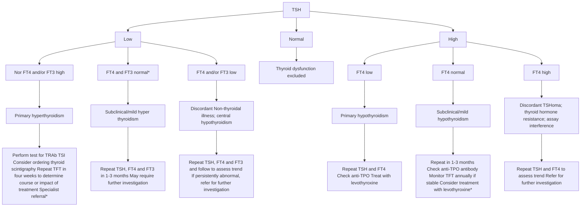

## **Emergencies in Hyperthyroidism**

### **Thyroid Storm/Thyrotoxic Crisis**

#### **Clinical Presentation**
This rare, but potentially life-threatening syndrome is characterised by exaggerated manifestations of hyperthyroidism, particularly **hyperthermia**, **severe tachycardia, with or without cardiac failure, severe agitation, possible jaundice, and mental disorientation, culminating in stupor and coma.**

#### **Diagnosis**
**Burch–Wartofsky Point Scale (BWPS) for Diagnosis of Thyroid Storm**

<!-- page: 81 | printed: 71 -->

| Category<br/>Thermoregulatory Dysfunction<br/>Central Nervous System Effects | Feature<br/>Temperature (°C)<br/>Manifestations | Criteria<br/>37.2–37.7 → 5 37.8–38.3 → 10 3 8.4–38.8 → 15 38.9–39.4 → 20 39.5–39.9 → 25 ≥40.0 → 30<br/>Mild (agitation) → 10 Moderate (delirium, psychosis, extreme lethargy) → 20 Severe (seizure, coma) → 30 | Score (points)<br/>5–30<br/>0–30 |
| --- | --- | --- | --- |
| Gastrointestinal - Hepatic Dysfunction | Symptoms | Moderate (diarrhoea, nausea/vomiting, abdominal pain) → 10 Severe (jaundice) → 20 | 0–20 |
| Cardiovascular Dysfunction | Tachycardia (bpm) | 90–109 → 5 110–119 → 10 120–129 → 15 130–139 → 20 ≥140 → 25 | 5–25 |
| Cardiovascular Dysfunction | Atrial Fibrillation | Present → 10 | 0–10 |
| Cardiovascular Dysfunction | Congestive Heart Failure | Mild (pedal edema) → 5 Moderate (bibasilar rales) → 10 Severe (pulmonary edema) → 15 | 0–15 |
| Precipitating Event | Trigger (e.g., infection, surgery, trauma, withdrawal of antithyroid drugs) | Present → 10 | 0–10 |

| **Total Score** | **Interpretation** |
| --- | --- |
| **≥45** | **Thyroid Storm - Highly Likely** |
| 25 - 44 | Impending Storm |
| <25 | Unlikely Thyroid Storm |

<!-- page: 82 -->

## **Management of Thyroid Storm**

### **Thyroid Storm: Recognition and Management**

**Flowchart: Thyroid Storm management flowchart**

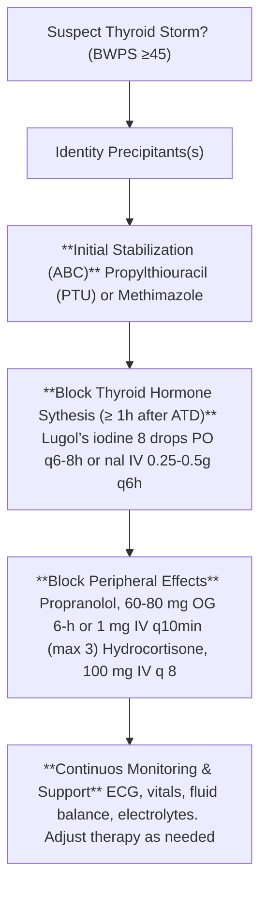

In addition to general supportive measures, therapy should be directed at the thyroid gland and the hypermetabolism and tachycardia. **Patients should be monitored in an intensive or high care setting.** The underlying precipitant should be actively treated and managed. Prevention is key, by correcting thyroid functions, prior to elective surgery.

| **Step** | **Therapeutic Target** | **Drug / Intervention** | **Dose / Notes** |
| --- | --- | --- | --- |
| Block Thyroid<br/>Hormone Synthesis | Antithyroid drugs<br/>(ATDs) | Propylthiouracil (PTU): 500–1000 mg loading,<br/>then 250 mg q4h Preferred early as it inhibits<br/>T4→T3 conversion Methimazole: 60–80 mg/day if<br/>PTU unavailable | Start immediately on<br/>diagnosis |
| Block Hormone Release (Give ≥1 hr after ATD) | Iodine therapy | Lugol's iodine: 8 drops q6–8h Sodium iodide IV: 0.25–0.5 g q6h Administer ≥1 hr after ATD to avoid iodine-fueled synthesis. | Reduces preformed hormone release |
| Block Peripheral Effects | Beta-blockade Corticosteroid therapy | Propranolol: 60–80 mg PO q6h or 1 mg IV q10min (max 3 doses) Esmolol IV infusion alternative in heart failure Hydrocortisone: 100 mg IV q8h Reduces T4→T3 conversion and prevents adrenal crisis | Controls adrenergic effects, protects against adrenal failure |

<!-- page: 83 | printed: 73 -->

# Management of Hyperthyroidism in Special Populations Hyperthyroidism in Pregnancy

## Introduction
A disease characterized by increased functional activity of the thyroid gland and increased secretion of thyroid hormones; It causes an increase in basal metabolism and other alterations at the systemic level occurring during pregnancy.

## Signs and Symptoms
Signs and symptoms are the same with the following additional symptoms:
- Difficulty gaining weight
- Intrauterine growth retardation (especially if associated with hypertensive disorders)
- Increased risk of miscarriage
- Premature birth
- Hyperemesis gravidarum

TSH-receptor antibodies are increased in pregnancy and the effects on the mother are typical of Graves' disease (exophthalmos, myxedema and goiter).

TSH-receptor antibodies cross the blood-placental barrier, binding to the fetal thyroid, producing fetal hyperthyroidism (regardless of maternal thyroid status).

The expression of this antibody is associated with:
- Fetal arrhythmia
- Hydrops Fetalis
- Malformations: alteration of the ossification nuclei and craniosynostosis.
- Stillbirth.
- Intrauterine growth restriction.
- "Norm inserted" placental abruption.

<!-- page: 84 | printed: 74 -->

# Causes of Hyperthyroidism in Pregnancy

## 1. **Transient Gestational Hyperthyroidism**
- The most common cause of hyperthyroidism in pregnancy.
- It occurs only in the 1<sup>st</sup> trimester and resolves spontaneously in the 2<sup>nd</sup> trimester.
- It is not associated with autoimmunity or fetal impact by antibodies.
- Treatment is supportive and with low-dose beta-blockers. Antithyroid drugs are not required.

## 2. **Graves' Disease**
- It is the thyroid pathology with the greatest impact on pregnancy.
- It can occur before and in the 3 trimesters of pregnancy.
- The diagnosis is made by the presence of hyperthyroidism + TSH-receptor antibodies. Patients usually present the diagnosis outside of pregnancy.
- Treatment is with antithyroid drugs and, if necessary, with low-dose beta-blockers.

## Diagnosis of Hyperthyroidism
- TSH is considered the gold standard for the diagnosis of thyroid pathologies during pregnancy. In the case of clinical hyperthyroidism, TSH will be suppressed and T4 will be increased. In the event of suppressed TSH, anti-TSH receptor antibodies should always be requested to determine if client has Graves disease.

## Monitoring and Treatment of Hyperthyroidism in Pregnancy
**Use of anti-thyroid medication:** All anti-thyroid drugs have an impact on pregnancy. They are all teratogenic and it is always necessary to find the right balance between anti-thyroid and thyroid function, to reduce the risk of fetal complications.

<!-- page: 85 | printed: 75 -->

## **Management of Hyperthyroidism in Pregnancy**

**Flowchart: Management of Hyperthyroidism in Pregnancy**

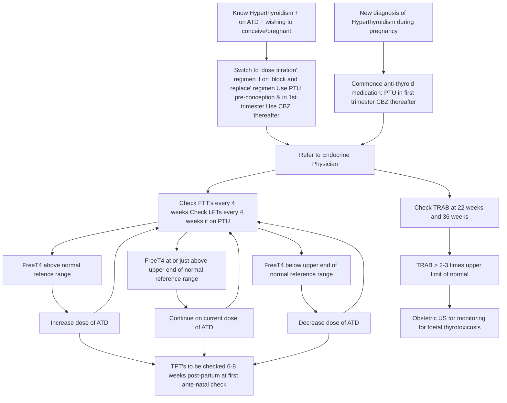

Reference: Girling JC. Thyroid disease in pregnancy. The Obstetrician and Gynaecologist 2008; 10:237-243.

<!-- page: 86 | printed: 76 -->

(a) **Propylthiouracil:** this is the medication of choice during the 1st trimester up to 16 weeks, as it has a lower risk of malformations, and these are less severe. Recommended dose( 50mg 2-3times) daily used during 1st trimester.

(b) **Methimazole:** It is more potent than PTU and is associated with greater severity. You may have METHYLMETHIMAZOLE EMBRYOPATHY recommended dose is 5-10mg/day from 16 weeks gestation.

(c) **Carbimazole:** is not recommended during the 1st trimester but patients can be switched to carbimazole after 16 weeks gestation. Recommended dose (5-15mg/day).

If there are positive anti-TSH receptors greater than 3 times the normal in the 2nd and 3rd trimesters, tests should be performed to rule out **FETAL HYPERTHYROIDISM**:

1. **Fetal ultrasound (request for details on):**
   a. Sign of craniosynostosis
   b. Early ossification nucleus
   c. Search for signs of fetal goiter: week 22-24 and week 30-34.

2. **Fetal heart rate evaluation** for fetal tachycardia or arrhythmias, from week 28 onwards (request one per week).
   A long strip of at least 10 minutes will be made.
   **FETAL GOITER** is an early sign of the impact of anti-TSH receptor antibodies. Refer to tertiary level for specialist care.

<u>Hyperthyroidism, Graves Disease</u>

**Description**
Hyperthyroidism is a pathological syndrome in which tissue is exposed to excessive amounts of circulating thyroid hormones. The most common cause is Grave's disease, although thyroiditis may also present with thyrotoxicosis.

**Diagnostic Criteria**

**Clinical**
- Poor school performance
- Weight loss
- Tremor
- Palpitations
- Proptosis
- Heat intolerance
- Fatigue
- Warm moist hands

<!-- page: 87 -->

- Tachycardia
- Nervousness or anxiety
- Thyromegaly

**Investigations**
Elevated thyroxine (T4) and suppressed TSH.

**Medicine Treatment**
- Carbimazole, oral, 0.5 mg/kg once daily.
  **AND**
  To block sympathetic hyperactivity:
- Atenolol, oral, 1–2 mg/kg as a single daily dose. For children less than 10 kg:
- Propranolol, oral, 0.2–0.5 mg/kg 6–12 hourly.
  ✓ Maximum dose: 1.5 mg/kg/dose 6–12 hourly.

**Referral**
All patients for confirmation of diagnosis, initiation and follow-up of therapy.

**Cushing's Syndrome**
Cushing syndrome is a clinical condition resulting from prolonged exposure to excessive glucocorticoids from either endogenous or exogenous sources. The most common cause of Cushing's syndrome is from the administration of exogenous sources.

**Classification**
Cushing syndrome can be divided into two categories based on pathophysiology, ACTH dependent or ACTH – Independent
- <u>ACTH-dependent States</u>
  ✓ Pituitary Adenoma (Cushing's Disease) 90-95%
  ✓ Ectopic ACTH Syndrome
- <u>ACTH-independent States</u>
  ✓ Adrenal adenoma
  ✓ Adrenal carcinoma
  ✓ Exogenous Sources

<!-- page: 88 | printed: 78 -->

- <u>Glucocorticoid intake</u>
  - ✓ Psychiatric Conditions (Pseudo-Cushing Disorders)
  - ✓ Depression
  - ✓ Alcoholism
  - ✓ High Cortisol Secretion Rate without Convincing Clinical Features of Cushing Syndrome
  - ✓ Pregnancy

## Symptoms and signs of Cushing's Syndrome
- The symptoms and signs of Cushing's syndrome result directly from chronic exposure to excess glucocorticoid
- Establishing the diagnosis is often difficult because none of the symptoms or signs are pathognomonic of the syndrome.
- An important clinical clue to the presence of glucocorticoid excess is the simultaneous development and increasing severity of several of these symptoms.

## Common presenting symptoms include
- Central obesity
- Facial plethora
- Weakness of the proximal muscles
- Easily bruises and striae
- Hirsutism
- Glucose intolerance

## Diagnosis of Cushing's Syndrome
At least two first-line tests should be abnormal to establish the diagnosis of Cushing's syndrome
- The low-dose dexamethasone suppression tests
- 24hrs urinary cortisol,
- Late night salivary cortisol
- Differential Diagnostic Testing to established, the cause of Cushing's syndrome
  - ✓ Morning serum ACTH
  - ✓ High dose dexamethasone suppression test

## Imaging diagnosis
- Pituitary CT - sensitivity of about 50% for identifying microadenomas
- MRI pituitary sensitivity up to 100%
- Adrenal ultrasonography/CT for suspected Adrenal source

<!-- page: 89 | printed: 79 -->

# Treatment of Cushing's syndrome
Without therapy, Cushing's syndrome is often fatal.
- Typically, due to CV, HTN or infectious complications.
- With therapy Symptoms improve over 2-12 months.

# Definitive Therapy
Surgery by source when possible
- Adrenal source - Adrenalectomy
- Pituitary source - Transphenoidal resection
- Ectopic source - Tumor Resection

# Medical Therapy
S: metyrapone (PO) 30mg/kg, maximum dose 3,000mg, administered at midnight usually with a snack

<!-- page: 90 | printed: 80 -->

## **CHAPTER 3**
## **CARDIOLOGY**

### **Hypertension**
#### **Definition(s) and Classification of Hypertension**

##### **Definition of Hypertension**
Hypertension is defined as a systolic blood pressure [SBP] of 140 mmHg or more, or a diastolic blood pressure [DBP] of 90 mmHg or more (3). This must be measured on 3 separate occasions, if possible, a minimum of 3 BP readings at a minimum of 2 minutes apart must be taken at the 1st visit (3), to confirm hypertension, except for severe hypertension (SBP ≥ 180 mmHg and/or DBP ≥ 120 mmHg).

|  | **Office/Clinic**<br/>**BP/healthcare Setting** | **Home/non-**<br/>**healthcare setting** |
| --- | --- | --- |
| Normotensive | No Hypertension | No Hypertension |
| Sustained Hypertension | Hypertension | Hypertension |
| Masked Hypertension | No Hypertension | Hypertension |
| White Coat Hypertension | Hypertension | No Hypertension |

**Other Definitions:**
**Target Organ Damage:**
Damage to organs such as the heart, brain, kidneys, and eyes. Examples are left ventricular hypertrophy, chronic kidney disease, hypertensive retinopathy, or increased urine albumin: creatinine ratio.

##### **Classification of Hypertension**
The classification of office BP is shown below.

**Classification of Office BP and definitions of Hypertension Grades**

| **Category** | **Systolic (mmHg)** |  | **Diastolic (mmHg)** |
| --- | --- | --- | --- |
| **Optimal** | <120 | and | <80 |
| **Normal** | 120-129 | and | 80-84 |
| **High-normal** | 130-139 | and/or | 85-89 |
| **Grade I Hypertension** | 140-159 | and/or | 90-99 |
| **Grade 2 Hypertension** | 160-179 | and/or | 100-109 |
| **Grade 3 Hypertension** | ≥180 | and/or | ≥110 |
| **Isolated Systolic** |  |  |  |
| **Hypertension\*** | ≥140 | and | <90 |
| **Isolated Diastolic<br/>Hypertension\*** | <140 | and | ≥90 |

<!-- page: 91 | printed: 81 -->

The BP category is defined by the highest level of BP, whether systolic or diastolic.
*Isolated systolic or diastolic hypertension is graded 1, 2 or 3 according to SBP and DBP values in the ranges indicated. The same classification is used for adolescents ≥16 years old.

In addition to grades of hypertension, which are based on BP values, the stages of hypertension are distinguished as follows:
- Stage 1: Uncomplicated hypertension (i.e. without HMOD or established CVD, including CKD stage 1 and 2).
- Stage 2: Presence of HMOD or CKD grade 3 or diabetes.
- Stage 3: Established CVD or CKD stages 4 or 5

**Screening and Diagnosis of Hypertension**
- **All** Adults ≥ 18 years should have at least one BP measurement done at a health facility annually.

**Pay Close Attention to the Following Populations**
- Persons with h/o prior heart attack or stroke
- Persons with h/o diabetes
- Persons who consume alcohol
- Persons who are obese
- Persons who use tobacco
- History of PIH and/or Eclampsia
- Those who a family history of hypertension, heart attack, stroke
- CVD risk ≥ 30%

## How to measure blood pressure correctly

**Checklist:**
- No exercise, smoking, caffeine or food 30 min before
- Quiet environment
- Comfortable temperature
- 3-5 min rest before measurement
- No talking before or during measurements
- Take 3 measurements at 1 min intervals and use the average of the last two

| **Back supported** |
| --- |
| **Suitable cuff size** |
| **Bare arm resting at heart level** |
| **Feet flat on floor** |

<!-- page: 92 | printed: 82 -->

## **Diagnosis of Hypertension**

### **Diagnostic Criteria**
A diagnosis of Hypertension is confirmed on the following criteria:
A systolic blood pressure [SBP] of 140 mmHg or more, or a diastolic blood pressure [DBP] of 90 mmHg or more. This must be measured on 2-3 separate visits within 4 weeks. A minimum of 3 BP readings at a minimum of 2 minutes apart must be taken at each visit.

**A single clinic blood pressure of ≥180/110 mmHg with evidence of cardiovascular disease confirms hypertension.**

**NB: If there is evidence of target organ damage without hypertension diagnosis, conduct investigations for other causes of target organ damage.**
**For those in whom hypertension is not diagnosed, monitor blood pressure readings annually. In all these patients reinforce a dietary approach to stop hypertension (DASH) diet and lifestyle modification.**

### **Patient Assessment**
At every visit, patients with hypertension should have a medical history taken, undergo a clinical examination and have blood and urine evaluation done as needed. Follow up management should be individualised.

| **Component** | **Initial Visit** | **3–6** **Monthly** | **Annually** |
| --- | --- | --- | --- |
| **Patient History** |  |  |  |
| Blood pressure history: duration, previous levels, medications (current/previous/over-the-counter), adherence, intolerance/allergies, pregnancy/OC-related hypertension | ✓ | ✓ | ✓ |
| Risk factors: CVD, stroke/TIA, diabetes, CKD, dyslipidemia, smoking, alcohol, diet, physical activity, weight, mental health, family history | ✓ | ✓ | ✓ |
| Symptoms: chest pain, dyspnea, palpitations, edema, headache, visual changes, nocturia, dizziness; symptoms of secondary causes | ✓ | As indicated | ✓ |
| Psychosocial: occupation, family/community support, mental status, cognition | ✓ | ✓ | ✓ |
| **Physical Examination** |  |  |  |
| Blood pressure | ✓ | ✓ | ✓ |
| Weight / BMI / Height | ✓ | ✓ | ✓ |
| Cardiovascular & systemic exam: pulse, JVP, heart sounds, edema, bruits, thyroid, obesity, retinopathy, PVD | ✓ | As indicated | ✓ |
| **Laboratory Tests** |  |  |  |
| Serum: glucose/HbA1c, kidney function, lipids, HIV | ✓ |  | ✓ |
| Urine: glucose, protein, albumin-creatinine ratio (UACR) | ✓ |  | ✓ |
| Additional (if indicated): aldosterone-renin ratio, metanephrines,<br/>cortisol, uric acid, LFTs | ✓ |  | — |
| **Imaging & Special Tests** |  |  |  |
| ECG, CXR, Echocardiogram, Renal/adrenal imaging, Fundoscopy,<br/>Brain CT/MRI, Carotid ultrasound, ABI | As indicated | — | As<br/>indicated |
| Health Promotion & Other Tasks |  |  |  |
| BP monitoring & education | ✓ |  | ✓ |
| Lifestyle modification (smoking/alcohol cessation, diet, exercise) | ✓ |  | ✓ |
| Family planning & preconception counselling | ✓ |  | ✓ |
| Medication review & adjustment | ✓ |  | ✓ |
| Vaccinations | ✓ |  | — |
| Erectile dysfunction assessment | ✓ |  | ✓ |
| Cardiovascular risk assessment | ✓ |  | — |

<!-- page: 93 | printed: 83 -->

## **Investigations per Level of Health Facility**

| **Health Center** | **Regional Hospital** | **Referral Hospital** |
| --- | --- | --- |
| • Urea, creatinine, glycemia, HbA1c, Sodium, Potassium, Chloride, CBC, Albuminuria<br/>ECG<br/>• CXR<br/>• Urine chemistry & urine Albumin-Creatinine ratio<br/>• Lipid profile<br/>• Fundus exam if indicated. | • ECG<br/>• **Echocardiogram\* (by a trained *clinician)***<br/>• CXR<br/>• Urine chemistry & urine Albumin-Creatinine ratio<br/>• Urea creatinine, serum electrolytes<br/>• Lipid profile<br/>• Glycaemia, HbA1c, CBC<br/>• Fundus exam if indicated.<br/>• Abdominal Ultrasound Ankle-brachial index | Same as Regional Hospital:<br/>Additional exams if indicated<br/>• Transthoracic heart ultrasound by a cardiologist,<br/>• Stress ECG if indicated,<br/>• Abdominal ultrasound (focus on abdominal aorta and Kidney ultrasound including Doppler),<br/>• Coronary Calcium score, Ankle-brachial index, Carotid artery ultrasound, ABPM measurement |

<!-- page: 94 | printed: 84 -->

## **Non-Pharmacological Management of Hypertension**

Lifestyle modifications are recommended as they have demonstrated benefit in lowering blood pressure:

| **Risk Factor** | **Recommendations** |
| --- | --- |
| **Alcohol** | If you do not drink alcohol DO NOT START AVOID or STOP Drinking!!!<br/>**Alcohol: There is no safe level of alcohol.** |
| **Alcohol** | Smoking cessation is highly recommended irrespective of conventional or electronic cigarettes.<br/>The 5 As of smoking cessation: Ask, Advice, Assess, Assist, Arrange |
| **Physical<br/>Activity** | Advice patients to attain an ideal BMI is 18.5-24.9 kg/m². The following are recommended:<br/>Regular aerobic exercise ≥30min-60min /day OR<br/>Moderate intensity exercise on ≥150mins/week)<br/>**\*High intensity exercise not recommended for uncontrolled HTN (SBP >160mmHg)** |
| **Diet** | A Dietary Approaches to Stop Hypertension (DASH) diet is recommended and entails:<br/>\* Reduce salt intake. Consume ≤5g **(1 teaspoon of table salt per day!)**<br/>\*Strategies to suggest for reduced salt intake include:<br/>Choose unsalted nuts or seeds, dried beans, peas, and lentils.<br/>Avoid canned vegetables with added salt. Keeping the saltshaker off the table<br/>Avoid salt when cooking or before you taste your food. Using spices and herbs to enhance the<br/>natural flavours of food.<br/>Check nutrition labels<br/>Avoid processed, prepared, and pre-packaged foods |

### **Pharmacological Management of Hypertension**

**Flowchart: Pharmacological Management of Hypertension flowchart**

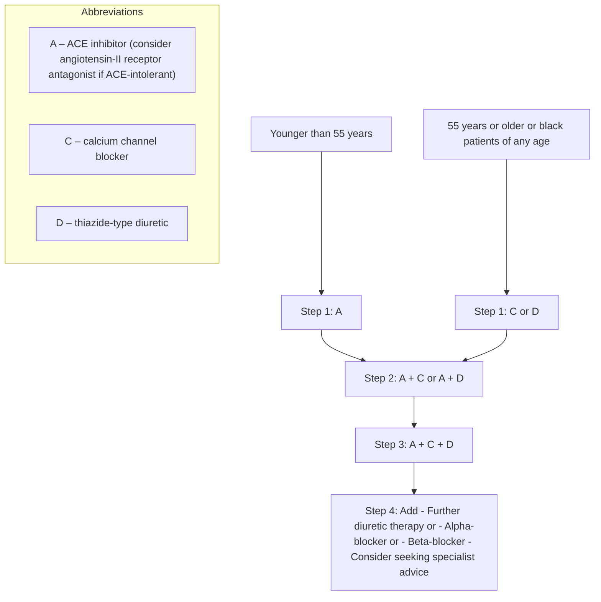

**Abbreviations:**
A – ACE inhibitor (consider angiotensin-II receptor antagonist if ACE-intolerant)
C – calcium channel blocker
D – thiazide-type diuretic

Black patients are those of African or Caribbean descent, and not mixed-race, Asian or Chinene patients

**Key:** ACE= angiotensin-converting enzyme; BHS=British Hypertension Society; NICE= National Institute for Health and Clinical Excellence

Reproduced with permission from: National Institute for Health and Clinical Excellence. CG 34 Hypertension: management of hypertension in adults in primary care. London: NICE, 2006. www.nice.org.uk/CG34

<!-- page: 95 | printed: 85 -->

## **First Line: Any of these unless there are compelling contra-indications.**

CCB (Nifedipine, Amlodipine)
ACE inhibitor (Captopril, Enalapril, Lisinopril)
ARB if not on an ACE [DO NOT COMBINE THE TWO!!!!!] (Irbesartan, Telmisartan, Losartan) Diuretic (Thiazide or Thiazide like diuretic) (hydrochlorothiazide, Indapamide)

### **Second Line**

Betablockers (Carvedilol, Propranolol, Nebivolol, Metoprolol, Labetalol) Alpha blockers (prazosin, doxazocin)

### **Third Line**

Aldosterone Antagonists (Spironolactone)

### **Antihypertensive Drug Classes: A Comprehensive Comparison**

| Drug Class<br/>ACE Inhibitors (ACE-I) | Example<br/>Enalapril, Captopril, Lisinopril | Mechanism of Action<br/>Decreases mortality in HF, effective for hypertension, post-MI LV dysfunction, slows diabetic nephropathy/ retin opathy. | Mechanism of Action Key Benefits<br/>Decreases mortality in HF, effective for hypertension, post-MI LV dysfunction, slows diabetic nephropathy/ retin opathy. | Common Side Effects<br/>Hypotension, hyperkalemia, cough (bradykinin-induced), angioedema, fetal anomalies, reversible kidney decline. | Dosing and Prescription<br/>Enalapril: 5-40mg once a day Lisinopril: 5-40mg once a day Captopril: 12.5-150mg in 2-3 divided doses | Important Notes<br/>Universal in HF treatment; cough is a common reason for discontinuation. Interacts with potassium supplements/s paring diuretics, diuretics, and NSAIDs. |
| --- | --- | --- | --- | --- | --- | --- |
| Angiotensin Receptor Blockers (ARBs) | Irbesartan, Valsartan, Telmisartan, Losartan | Bind to and inhibit the angioten sin II type 1 receptor, leading to vasodilation and renal sodium excretion | Effective for hypertension, CKD, slows diabetic nephropathy/ retin opathy; alternative to ACE-I for cough. | Generally well tolerated, lower incidence of cough/angioe dema than ACE-I, hypotension, renal failure | Valsartan: 80-320mg once a day Telmisartan: 40-80mg once a day Irbesartan: 150-300mg once a day Losartan: 50-100mg once a day | ACE Inhibitor s (ACE-I) |

<!-- page: 96 | printed: 86 -->

| Antihypertensive | Usual dosage | Remarks |
| --- | --- | --- |
| Beta-blockers |  |  |
| Atenolol | 25-100mg daily | Atenolol: Not recommended as monotherapy Side effects: bradycardia, postural hypotension, worsening of heart failure, bronchospasm, cold extremities |
| Carvedilol | 12.5-50mg daily in one or two doses |  |
| Labetalol | 100-200mg twice daily |  |
| Metoprolol | 50-100mg once or twice a daily CR 23.75-190mg once daily |  |
| Propranolol | 40-320mg daily in two or three doses |  |
| Other Antihypertensives |  |  |
| Amiloride | 2.5-5mg daily | Action: Aldosterone antagonist or potassium sparing diuretics Use: resistant hypertension or hyperaldosteronism Adverse effects: hyperkalemia |
| Spironolactone | 12.5-50mg daily |  |
| Clonidine | 50-300mcg daily | Adverse effects: postural hypotension, bradycardia, dry mouth |
| Hydralazine | 50-100mg daily in two doses | Adverse effects: Palpitation, flushing, headache, edema |

**

| Antihypertensive | Usual dosage | Remarks |
| --- | --- | --- |
| Beta-blockers |  |  |
| Atenolol | 25-100mg daily | Atenolol: Not recommended as monotherapy Side effects: bradycardia, postural hypotension, worsening of heart failure, bronchospasm, cold extremities |
| Carvedilol | 12.5-50mg daily in one or two doses |  |
| Labetalol | 100-200mg twice daily |  |
| Metoprolol | 50-100mg once or twice a daily CR 23.75-190mg once daily |  |
| Propranolol | 40-320mg daily in two or three doses |  |
| Other Antihypertensives |  |  |
| Amiloride | 2.5-5mg daily | Action: Aldosterone antagonist or potassium sparing diuretics Use: resistant hypertension or hyperaldosteronism Adverse effects: hyperkalemia |
| Spironolactone | 12.5-50mg daily |  |
| Clonidine | 50-300mcg daily | Adverse effects: postural hypotension, bradycardia, dry mouth |
| Hydralazine | 50-100mg daily in two doses | Adverse effects: Palpitation, flushing, headache, edema |

**

<!-- page: 97 | printed: 87 -->

| **Antihypertensive** | **Usual dosage** | **Remarks** |
| --- | --- | --- |
| **Other Antihypertensives** |  |  |
| **Methyldopa** | **250-2000mg daily in two to four doses** | **Adverse effects: sedation, hepatitis, hemolytic anemia** |
| **Prazosin** | **0.5-20mg daily in two or three doses** | **Action: selective alpha blocker or peripheral vasodilator<br/>Adverse effects: hypotension** |

## **Other Antihypertensives**

\*\*\*\*\*First prescription should be done by physician or by medical officer WITH physician’s discussion.

## **Treatment Targets**

| **Age Group** | **Office SBP treatment Target range (mmHg)** |  |  |  |  | **Office DBP treatment target range** |
| --- | --- | --- | --- | --- | --- | --- |
|  | **Hypertension** | **Diabetes** | **CKD** | **CAD** | **Stroke /TIA** |  |
| **18-65 years** | **Target to 130-139** or lower if tolerated<br/>**Not <120** | **Target to 130-139** or lower if tolerated<br/>**Not <120** | **Target to <140 to 130** if tolerated | **Target to 130** or lower if tolerated<br/>**Not <120** | **Target to 130** or lower if tolerated<br/>**Not <120** | **70-79** |
| **65-79 years** | **Target to 130-139** if tolerated | **Target to 130-139** if tolerated | **Target to 130-139** if tolerated | **Target to 130-139** if tolerated | **Target to 130-139** if tolerated | **70-79** |
| **≥80 years** | **Target to 130-139** if tolerated | **Target to 130-139** if tolerated | **Target to 130-139** if tolerated | **Target to 130-139** if tolerated | **Target to 130-139** if tolerated | **70-79** |
| **Office DBP treatment target range** | **70-79** | **70-79** | **70-79** | **70-79** | **70-79** |  |

## **Secondary Hypertension**

* Consider **screening for secondary hypertension** in
    (1) patients with early onset hypertension (<30 years of age) especially in the absence of hypertension risk factors (obesity, metabolic syndrome, familial history etc.),
    (2) those with resistant hypertension (3) individuals with sudden deterioration in BP control

<!-- page: 98 | printed: 88 -->

(4) hypertensive urgency and emergency
(5) those presenting with high probability of secondary hypertension based on strong clinical clues.

| **Secondary Hypertension** | **Clinical History and Physical Examination** | **Basic Biochemistry and Urine Analysis** | **Further Diagnostic Tests** |
| --- | --- | --- | --- |
| **Renal Parenchymal Disease** | • Personal/familial history of CKD | • Proteinuria, hematuria, leukocyturia on dipstick urine analysis<br/>• Decreased estimated GFR | • Kidney ultrasound |
| **Primary Aldosteronism** | • Symptoms of hypokalemia (muscle weakness, muscle cramps, tetany) | • Spontaneous hypokalemia or diuretic-induced hypokalemia on blood biochemistry (50% - 60% of patients arenormokalemic).<br/>• Elevated plasma aldosterone-renin activity ratio | • Confirmatory testing (eg, intravenous saline suppression test)<br/>• Imaging of adrenals (adrenal CT)<br/>• Adrenal vein sampling |
| **Renal Artery Stenosis** | • Abdominal bruit<br/>• Bruits over other arteries (ie, carotid and femoral arteries)<br/>• Drop in estimated GFR >30% after exposure to ACE- inhibitors/ARBs<br/>• For suspected atherosclerotic RAS, history of flash pulmonary edema or history of atherosclerotic disease or presence of cardiovascular risk factors<br/>• For suspected fibromuscular dysplasia, young women with onset of hypertension <30 years | • Decrease in estimated GFR | • Imaging of renal arteries (duplex ultrasound, abdominal CT or MR angiograms depending on availability and patient’s level of renal function) |
| Pheochromocytoma | • Headaches • Palpitations • Perspiration • Pallor • History of labile hypertension | • Increased plasma levels of metanephrines • Increased 24-hour urinary fractional excretion of metanephrines and catecholamines | • Abdominal/pelvic CT or MRI |
| Cushing’s Syndrome and Disease | • Central obesity • Purple striae • Facial rubor • Signs of skin atrophy • Easy bruising • Dorsal and supraclavicular fat pad • Proximal muscle weakness | • Hypokalemia • Increased late-night salivary cortisol | • Dexamethasone suppression tests • 24-hour urinary free cortisol • Abdominal/pituitary imaging |
| Coarctation of the Aorta | • Higher blood pressure in upper than lower extremities • Delayed or absent femoral pulses |  | • Echocardiogram • CT angiogram • Magnetic resonance angiogram |
| Obstructive Sleep Apnea | • Increased BMI • Snoring • Daytime sleepiness • Gasping or choking at night • Witnessed apneas during sleep • Nocturia |  | • Home sleep apnea testing (e.g, level 3 sleep study) • Overnight polysomnography testing |
| Thyroid Disease | • Symptoms of hyperthyroidism: heat intolerance, weight loss, tremor, palpitations • Symptoms of hypothyroidism: cold intolerance, weight gain, dry brittle hair | • TSH, Free T4 |  |

<!-- page: 99 -->

<!-- page: 100 | printed: 90 -->

**REFER!!!!! for further investigation and management of suspected secondary hypertension to a specialist centre with access to appropriate expertise and resources.**

## Resistant Hypertension

- If seated office BP >140/90 mmHg in patients managed with three or more antihypertensive medications at optimal (or maximally tolerated) doses including a diuretic, first **exclude causes of pseudo-resistance** (poor BP measurement technique, white coat effect, nonadherence, and suboptimal choices in antihypertensive therapy), and substance-induced increases in BP.
- **Screen patients for secondary causes** as appropriate.
- **Optimize the current treatment regimen** including health behaviour change and diuretic-based treatment (maximally tolerated doses of diuretics, and optimal choice of diuretic: use of thiazide-like rather than thiazide diuretics, and initiation of loop diuretics for eGFR <30 ml/min/1.73m² or clinical volume overload).
- Add a low dose of spironolactone as the **4th line agent** in those whose serum potassium is <4.5 mmol/L and whose eGFR is >45 ml/min/1.73m² to achieve BP targets. If spironolactone is contraindicated or not tolerated, amiloride, doxazosin, eplerenone, clonidine, and beta-blockers are alternatives, or any available antihypertensive class not already in use.
- **REFER!!!!!!Resistant hypertension should be managed in specialist centres with sufficient expertise, and resources necessary to diagnose and treat this condition.**

## Hypertensive Emergencies

### Definition

**Hypertensive Emergency:** High blood pressure >180/120 plus end-organ damage:
- **Neurologic:** hypertensive encephalopathy, cerebral vascular accident/cerebral infarction, subarachnoid hemorrhage, intracranial hemorrhage
- **Cardiovascular:** myocardial ischemia/infarction, acute left ventricular dysfunction, acute pulmonary edema, aortic dissection, unstable angina pectoris
- **Other:** acute renal failure/insufficiency, retinopathy, eclampsia, microangiopathic haemolytic anaemia.

**Hypertensive urgency:** SBP > 180 OR DBP >120 without end-organ damage

- Nonadherence to previously prescribed antihypertensive medications is the most common factor leading to acute severe hypertension.
- Hypertensive emergencies is managed with intravenous medications guided by the type of target-organ damage.
- Hypertensive urgencies should be managed with oral medications and arrangements for prompt follow-up.

<!-- page: 101 | printed: 91 -->

## **Hypertensive Urgency Treatment Options**

* Clonidine 0.1-0.3mg
* Labetalol 200-400mg
* Captopril 25-50mg
* Prazosin 5-10mg
* Nicardipine 0.5-1mg
* Nitroglycerin 2% topical ointment (1-2 in.)
* **AVOID NIFEDIPINE SUBLINGUAL!!!!!** \*It results in unpredictable blood pressure drops.
* Administer every 30mins till target BP reached.

Discharge when signs and symptoms abate or BP <160-180/100-110mmHg.

### **Hypertensive Emergencies**

A hypertensive emergency is the association of substantially elevated BP with acute HMOD.

| **Category** | **Details** |
| --- | --- |
| **Symptoms** | - Headaches<br/>- Visual disturbances<br/>- Chest pain - Dyspnoea<br/>- Neurologic symptoms (confusion, focal deficits, seizures)<br/>- Dizziness<br/>- Non-specific complaints (fatigue, malaise, nausea, etc.) |
| **Medical History** | - Pre-existing hypertension<br/>- Onset & duration of current symptoms<br/>- Contributing factors: • Nonadherence to antihypertensives • Lifestyle changes (diet, alcohol, stress) • Concomitant use of BP-elevating drugs (NSAIDs, corticosteroids, immunosuppressants, sympathomimetics, cocaine, antiangiogenic therapy) |
| **Physical Examination** | - Comprehensive cardiovascular assessment<br/>- Detailed neurologic examination |
| **Laboratory Analysis** | - FBC: haemoglobin, platelets<br/>- Renal function: creatinine, Na+, K+<br/>- Haemolysis markers: LDH, haptoglobin<br/>- Urinalysis: proteinuria, urine sediment |
| **Bedside/Basic Examinations** | - Fundoscopy (haemorrhages, exudates, papilloedema) - ECG |
| **Additional/Targeted Investigations** | - Troponins → if chest pain<br/>- Chest X-ray → if pulmonary congestion/fluid overload<br/>- Transthoracic echocardiogram → cardiac structure & function<br/>- CT/MRI brain → suspected cerebral haemorrhage, stroke, encephalopathy<br/>- CT- angiography thorax/abdomen → suspected acute aortic disease |
| **Secondary Causes<br/>(20-40% of cases)** | - Renal artery stenosis<br/>- Primary aldosteronism<br/>- Pheochromocytoma/paraganglioma<br/>- Cushing’s syndrome<br/>- Thyroid disease<br/>- Chronic kidney disease |

<!-- page: 102 | printed: 92 -->

## **Management Principles**

* Overall therapeutic goal is a controlled BP reduction to safer levels to prevent or limit further hypertensive damage while avoiding hypotension and related complications.
* Type of acute HMOD is the main determinant of the preferred treatment choice.
* Labetalol and nicardipine are generally safe to use in all hypertensive emergencies and should be available wherever hypertensive emergencies are being managed.
* Nitroglycerin and nitroprusside are specifically useful in hypertensive emergencies including the heart and the aorta.

## **Hypertensive emergencies requiring immediate BP-lowering with iv. drug therapy**

| **Clinical Presentation** | **Timing and BP Target** | **First-line Treatment** | **Alternative** |
| --- | --- | --- | --- |
| **Malignant hypertension with or without acute renal failure** | Several hours Reduce MAP by 20-25% | Labetalol or Nicardipine | Nitroprusside Urapidil |
| **Hypertensive encephalopathy** | Immediately reduce MAP by 20-25% | Labetalol<br/>Nicardipine | Nitroprusside |
| **Acute coronary event** | Immediately reduce SBP to <140 mmHg | Labetalol<br/>Nicardipine | Nitroprusside |
| **Acute cardiogenic pulmonary edema** | Immediately reduce SBP to <140 mmHg | Nitroprusside or nitroglycerin (with loop diuretic) | Urapidil (with loop diuretic) |
| **Acute aortic dissection** | Immediately reduce SBP to <120 mmHg and Heart rate to <60 bpm | Ismolol plus nitroprusside or nitroglycerin or nicardipine | Labetalol or Metoprolol |
| **Eclampsia and severe preeclampsia/HELLP** | Immediately reduce SBP to <160 mmHg and DBP to <105 mmHg | Labetalol or nicardipine and magnesium sulphate | Consider delivery |

<!-- page: 103 | printed: 93 -->

## **Drug type, dose, and characteristics for treatment of hypertension emergencies**

| Drug<br/>Esmolol<br/>Metoprolol | Onset of Action<br/>1 min<br/>1-2 min | Duration of Action<br/>10-30 min<br/>5-8 h | Dose<br/>0.5-1 mg/Kg IV bolus, 50-300 mcg/Kg/min IV infusion<br/>2.5-5 mg IV bolus over 2 min; may repeat every 5 min to a maximum dose of 15 mg | Contra indications<br/>Second-degree or third-degree AV block, systolic heart failure, asthma, bradycardia<br/>Second-degree or third-degree AV block, systolic heart failure, asthma, bradycardia | Adverse effects<br/>Bradycardia<br/>Bradycardia |
| --- | --- | --- | --- | --- | --- |
| Labetalol | 5-10 min | 3-6 h | 0-20 mg IV bolus in 1 min; incremental doses ≥20mg may be administered IV at 10 min intervals (max 80 mg) or 1-3 mg/min IV infusion until goal BP is reached | Second-degree or third-degree AV block, Systolic heart failure, asthma, bradycardia | Bronchoconstricti on, fetal bradycardia |
| Nicardipine | 5-15 min | 4-6 h | 5-15 mg/h IV infusion, starting dose 5 mg/h, increase-every 15-30 min with 2.5 mg until goal BP, maximum 15 mg/h | Liver failure | Headache, reflex tachycardia |
| Nitroglycerine | 1-5 min | 5-10 min | 5-200 mcg/min IV infusion, 5 mcg/min increase every min |  | Headache, reflex tachycardia |
| Nitroprusside | Immediate | 1-3 min | 0.3-0.5 mcg/Kg/min IV infusion, increase by 0.5 mcg/Kg/min every 5 min until goal BP (maximum dose 10mcg/Kg/min) | Liver/kidney failure (relative) | Cyanide intoxication |
| **Drug** | **Onset** of Action | **Duration** of Action | **Dose** | **Contra** **Indications** | **Adverse effects** |
| **Enalaprilat** | 5-15 min | 4-6 h | 0.62-1.25 mg IV bolus given over 5 min every 6h | History of angioedema |  |
| **Urapidil** | 3-5 min | 4-6 h | 12.5-25 mg IV bolus;<br/>5-40 mg/h as continuous infusion |  |  |
| **Clonidine** | 30 min | 4-6 h | 0.2-0.5 mcg/Kg/min IV |  | Sedation, rebound hypertension |
| **Phentolamine** | 1-2 min | 10-30 min | 1-5 mg IV bolus or continuous IV infusion at a rate of 0.5-20mcg/Kg/min |  | Tachyarrhythmia, chest pain |

<!-- page: 104 | printed: 94 -->

## **In-Hospital Management of Hypertension**

The spectrum of inpatient hypertension ranges from asymptomatic BP elevations with unknown clinical significance to severe elevated BP with evident hypertension mediated organ damage (HMOD) or potential life-threatening consequences.

The goal of managing elevated BP in this scenario should 30 min be to prevent possibility of HMOD and avoid unnecessary cancellation of scheduled procedures.

### **Causes of acute elevation of blood pressure in hospitalized patients**

1. Pain
2. Anxiety
3. Urinary retention
4. Acute distress
5. Anti-hypertensive withdrawal
6. Alcohol or narcotic withdrawal
7. Peri-operative period
8. Poorly controlled or undiagnosed pre-existing hypertension.
9. Hypervolemia/inadvertent use of sodium containing intravenous fluids.
10. Medications (erythropoietin, steroids, cyclosporine sympathomimetics, etc.)
11. Renal parenchymal/vascular cause
12. Endocrine causes e.g. Cushing’s syndrome, pheochromocytoma, hyperthyroidism

<!-- page: 105 | printed: 95 -->

## **Cardiovascular Risk Assessment – Indications**

| **Group** | **Criteria for Assessment** |
| --- | --- |
| **No established CVD** | **- Total cholesterol (TC) ≥ 8 mmol/L (320 mg/dL) - LDL cholesterol**<br/>**≥ 6 mmol/L (240 mg/dL) - TC/HDL-C ratio > 8**<br/>**- Persistent BP > 160–170 / 100–105 mmHg** |
| **Elevated BP (moderate)** | **BP ≥ 140/90 mmHg → manage as per national protocols** |
| **Diabetes** | **Type 1 or Type 2 with overt nephropathy or other significant renal disease** |
| **Renal disease** | **Known renal failure or renal impairment** |
| **Established CVD** | **Angina pectoris, coronary heart disease (CHD), myocardial infarction (MI),**<br/>**transient ischemic attack (TIA), stroke, peripheral vascular disease (PVD),**<br/>**prior coronary revascularization, or carotid endarterectomy** |
| **Target organ damage** | **Left ventricular hypertrophy (LVH) on ECG or hypertensive retinopathy**<br/>**(Grade III or IV)** |

### **Adjunct Therapies in the Management of Hypertension**

#### **Lipid-Lowering drugs**

Lipid-lowering therapy is recommended in patients without prior cardiovascular events stratified at moderate to high absolute CVD risk, treating to an LDL cholesterol target of <2.0 mmol/L.

In secondary prevention, stains are beneficial in patients with:
* Coronary heart disease where statins therapy is recommended to achieve LDL cholesterol levels <1.8 mmol/L.
* Post-stroke where statin therapy is recommended for all patients post ischemic stroke or TIA (not used routinely for hemorrhagic stroke)
* Heart failure patients where statin therapy is also recommended to reduce risk of ischemic events and subsequent chronic heart failure in those not contraindicated.
* Diabetes, where statin therapy is recommended to achieve LDL cholesterol target of <1.8 mmol/L.

<!-- page: 106 | printed: 96 -->

| 1. Age (Years) | Man | Woman |
| --- | --- | --- |
| 30-34 | 0 |  |
| 35-39 | 2 | 2 |
| 40-44 | 5 | 4 |
| 45-49 | 6 | 5 |
| 50-54 | 8 | 7 |
| 55-59 | 10 | 8 |
| 60-64 | 11 | 9 |
| 65-69 | 12 | 10 |
| 70-74 | 14 | 11 |
| 75-79 | 15 | 12 |

| 2. Total Cholesterol (mmol/L) | Man | Woman |
| --- | --- | --- |
| <4.1 | 0 | 0 |
| 4.1-5.19 | 1 | 1 |
| 5.2-6.19 | 2 | 3 |
| 6.2-7.2 | 3 | 4 |
| >7.2 | 4 | 5 |

| 3. HDL Cholesterol (mmol/L) | Man | Woman |
| --- | --- | --- |
| >1.5 | -2 | -2 |
| 1.3-1.49 | -1 | -1 |
| 1.2-1.29 | 0 | 0 |
| 0.9-1.19 | 1 | 1 |
| <0.9 | 2 | 2 |

| 4. On treatment Systolic BP (mm Hg) | Man |  | Women |  |
| --- | --- | --- | --- | --- |
|  | Not on BP Treatment | On BP Treatment | Not on BP Treatment | On BP Treatment |
| <120 | -2 | 0 | -3 | -1 |
| 120-129 | 0 | 2 | 0 | 2 |
| 130-139 | 1 | 3 | 1 | 3 |
| 140-149 | 2 | 4 | 2 | 5 |
| 150-159 | 2 | 4 | 4 | 6 |
| ≥160 | 3 | 5 | 5 | 7 |

| Other Factor | Man | Woman |
| --- | --- | --- |
| **5. Smoker** | 4 | 3 |
| **6. Diabetes** | 3 | 4 |

## **BMI**

The Ideal weight should be maintained at ≥ 25 kg/m<sup>2</sup>

Goal: Weight reduction to achieve BMI > 25kg/m<sup>2</sup>

* If the CVD risk score is ≥ 10%, then manage the CVD risk.
* If the CVD risk score is <10%, and no CVD risk factors, then reassess the CVD risk after 5 years

| **Calculate Score** |  |
| --- | --- |
| 1. Sex and Age |  |
| 2. Total Cholesterol |  |
| 3. HDL Cholesterol |  |
| 4. On treatment Systolic BP |  |
| 5. Smoker |  |
| 6. Diabetes |  |
| **Total CVD Risk Score** |  |

<!-- page: 107 | printed: 97 -->

| CVD Risk Score<br/>**(man)** | CVD Risk Score<br/>**(woman)** |  | CVD<br/>Risk | **Explain to Patient** |
| --- | --- | --- | --- | --- |
| <11 | <13 |  | <10% | There is less than 1 in 10 chance that in the next 10 years, that he/she may have a heart attack |
| 11 - 14 | 13 -17 |  | 10-20% | There is a 1 in 10 -1 in 5 chance that in the next 10 years, that he/she may have a heart attack |
| ≥ 15 | ≥ 18 |  | >20% | There is more than 1 in 5 chance that in the next 10 years, that he/she may have a Myocardial (heart attack) |

| Risk Level | >20% | 10 - 20% | 5 - 10% | <5% |
| --- | --- | --- | --- | --- |
| Counsel | Consultation on diet (which includes lipid-lowering diet), physical activity, smoking cessation and avoiding harmful use of alcohol |  |  |  |
| Treat HTN | Consider drug treatment if persistent<br/>BP ≥ 130/80mmHg | Consider if persistent<br/>BP ≥ 140/90mmHg | Consider if<br/>BP ≥ 140/90mmHg |  |
| Lipid Lowering | Give a statin |  |  |  |

1. Use a formal estimation of cardiovascular risk to discuss prognosis and healthcare options with people with hypertension, both for raised blood pressure and other modifiable risk factors.
2. Estimate cardiovascular risk in line with the WHO recommendations on identifying and assessing cardiovascular disease risk. (See desk guides).
3. Use the clinic blood pressure measurements to calculate cardiovascular risk.

**Antiplatelet Therapy:** Aspirin should be considered for secondary prevention of cardiovascular events and for those aged 40-59 years at high risk of an event (>10%) with well-controlled blood pressure. Aspirin is not recommended for CVD prevention in patients with hypertension at low-moderate risk and aged 60 years and above, where harm may outweigh benefits.

## **Hypertension and Other Comorbidities**

* In addition to BP control, the therapeutic strategy should include lifestyle changes, body weight control and the effective treatment of the other risk factors to reduce the residual cardiovascular risk.
* Lifestyle changes are recommended in patients with Hypertension and other Comorbidities.

<!-- page: 108 | printed: 98 -->

* LDL-cholesterol should be reduced according to risk profile:
    (1) >50% and <70 mg/dL (1.8 mmol/L) in hypertension and CVD, CKD, DM or no CVD and high risk.
    (2) >50% and <100 mg/dL (2.6 mmol/L) in high-risk patients.
    (3) <115 mg/dL (3 mmol/L) in moderate-risk patients.
* Fasting serum glucose levels should be reduced below 126 mg/dL (7 mmol/L) or HbA1c below 7% (53 mmol/mol). s-UA should be maintained below 6.5 mg/dL (0.387 mmol/L), and <6 mg/dL (0.357 mmol/L) in patients with gout.
* Antiplatelet therapy should be considered in patients with CVD (secondary prevention only)

## **How to use Aspirin for CV Disease Primary Prevention**

**Flowchart: Aspirin Primary Prevention decision tree**

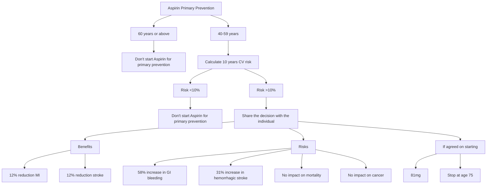

<!-- page: 109 | printed: 99 -->

# Management in Special Populations

## (a) **Hypertension in pregnancy**

### **Classification of Hypertension in Pregnancy**

(i) **Preexisting Hypertension:** Starts before pregnancy or <20 weeks of gestation and lasts >6 weeks postpartum with proteinuria.

(ii) **Pregnancy Induced Hypertension (PIH):** Starts >20 weeks of gestation and lasts <6 weeks postpartum.

(iii) **Preexisting Hypertension plus Superimposed PIH with Proteinuria.**

(iv) **Preeclampsia:** Hypertension with proteinuria (>300 mg/24 h or ACR >30 mg/mmol [265 mg/g]). Predisposing factors are preexisting hypertension, hypertensive disease during previous pregnancy, diabetes, renal disease, first- or multiple pregnancy, autoimmune disease (SLE). Risks are foetal growth restriction, preterm birth.

(v) **Eclampsia:** Hypertension in pregnancy with seizures, severe headaches, visual disturbance, abdominal pain, nausea and vomiting, low urinary output: Immediate treatment and delivery required.

********HELLP (haemolysis, elevated liver enzymes, low platelets) syndrome: REFER!!!!Immediately for treatment and delivery required.**

### **Treatment of Hypertension in Pregnancy**

## **Mild Hypertension**

Drug treatment is recommended at persistent BP >150/95 mm Hg in all pregnant women.
Drug treatment is recommended at persistent BP >140/90 mm Hg in gestational hypertension, preexisting hypertension with superimposed gestational hypertension; hypertension with subclinical HMOD at any time during pregnancy.

*First Choices:* methyldopa, beta-blockers (labetalol), and dihydropyridine-calcium channel blockers (DHP- CCBs) (nifedipine [not capsular], nicardipine).
*Contraindicated:* RAS blockers (ACE-I, ARB, direct renin inhibitors [DRI]) due to adverse foetal and neonatal outcomes

## **Severe Hypertension**

At BP >170 mm Hg systolic and/or >110 mm Hg diastolic: immediate hospitalization is indicated (emergency).
Treatment with intravenous labetalol (alternative intravenous nicardipine, esmolol, hydralazine, urapidil), oral methyldopa or DHP-CCBs (nifedipine [not capsular] nicardipine). Add magnesium (hypertensive crisis to prevent eclampsia).

**In pulmonary oedema: Nitroglycerin intravenous infusion. Sodium-nitroprusside should be avoided due to the danger of foetal cyanide poisoning with prolonged treatment.**

## **Delivery in gestational hypertension or pre-eclampsia:** At week 37 in asymptomatic women. Expedite delivery in women with visual disturbances, haemostatic disorders.

<!-- page: 110 | printed: 100 -->

# **Blood Pressure Post-partum:** If hypertension persists, any of recommended drugs except methyldopa (postpartum depression).

# **Breastfeeding:** All antihypertensives excreted into breast milk at low concentrations. Avoid atenolol, propranolol, nifedipine (high concentration in milk). Prefer long acting CCBs.

# **Long-term consequences of gestational hypertension:** Increased risk of hypertension and CVD (stroke, ischemic heart disease) in later life.

## (b) **Hypertension in Elderly**
Hypertension remains a risk factor for cardiovascular morbidity and mortality in older patients, however the balance of benefits and harms when considering antihypertensive drugs in this group are often reported as unclear. Many trials demonstrating the benefit of blood pressure lowering therapy do not involve older patients and, while these patients will benefit from reducing their risk of a cardiovascular event, intense treatment has the possibility of increasing adverse effects such as syncope and falls, that may counteract any benefit from blood pressure reduction.

# **Drug of Choice**
There are many trials showing the beneficial effects of treatment in older patients using thiazide diuretics, beta-blockers, calcium channel blockers, ACE inhibitors or ARBs. A prospective analysis from the Blood Pressure Lowering Treatment Trialists Collaboration compared the benefits of different antihypertensive therapies in those under and over 65 years of age and found no evidence that different classes are effective in the younger versus older patients (11).

## # Recommendations for Treatment of Hypertension in Elderly
- For patients aged 65 and above
  - ✓ For those with isolated systolic hypertension the primary goal of treatment is to lower SBP in the 140 to 150 mmHg range. However, a reduction of office SBP in the 130 to 139 mmHg range may be considered if well tolerated, albeit cautiously if DBP is already below 70 mmHg.
  - ✓ Office BP should be lowered to a SBP in the 140 to 150 mmHg range and to a DBP. However, reduction of office SBP between 130 to 139 mmHg may be considered if well tolerated, albeit cautiously if DBP is already below 70 mmHg.
- When starting treatment in older patients, drugs should be commenced at the lowest dose and titrated slowly as adverse effects increase with age.
- In older persons where treatment is being targeted to <120 mmHg systolic, close follow-up of patients is recommended to identify treatment-related adverse effects including hypotension, syncope, electrolyte abnormalities and acute kidney injury.
- Clinical judgement should be used to assess the benefit of treatment against the risk of adverse effects in all older patients with lower grades of hypertension.

<!-- page: 111 | printed: 101 -->

(c) **Hypertension in Pediatric Population**: The presence of hypertension in children is usually indicative of an underlying disease process (secondary hypertension). In children, approximately 5 - 25% of cases of secondary hypertension are attributed to Reno vascular disease.

## Signs and Symptoms
- Oedemic, hematuria, proteinuria
- Headache, convulsions
- Coma and visual symptoms
- Acute heart failure and pulmonary edema
- Acute respiratory distress
- Some children may be asymptomatic

## Diagnosis Clinical
- Investigations: FBC, urinalysis, urea, creatinine, Electrolytes (Na+, K+) proteinuria, renal ultrasound + Doppler,
- ECG
- Echocardiogram, fundoscopy

## Note: Investigations should be based on etiology.

**Hypertension** is defined as systolic and/or diastolic blood pressure the 95th percentile for gender, age, and height percentile on at least three consecutive occasions. A sustained blood pressure of > 115/80 is abnormal in children between 6 weeks and 6 years of age. A sustained blood pressure of >130/90 mmHg in a child older than 13 years is defined as hypertension. Measure blood pressure with the child in a sitting or supine position with the entire arm in line with the level of the heart. **Severe hypertension suggests renal disease**.

**Hypertensive Emergency/Crisis** exists when CNS signs of hypertension appear, such as encephalopathy, convulsions, retinal haemorrhages or blindness. Great care is required to reduce the blood pressure in a controlled manner to avoid potentially serious consequences of impaired autoregulation of cerebral blood flow.

**Hypertensive urgency** is defined as a significant elevation of blood pressure without accompanying end- organ damage. Patients are generally symptomatic with complaints of headache, blurred vision and nausea, despite the lack of end-organ involvement.

<!-- page: 112 | printed: 102 -->

drawing: diagram showing proper placement of a blood pressure cuff on an arm with labels for Acromion, Mid Upper Arm Circumference (MUAC), Olecranon, and Cuff Bladder dimensions

## **How to measure BP in Paediatric Client**

A valid assessment of the blood pressure is of extreme importance. The blood pressure is measured by standard auscultation technique in children >1 year of age.

Measure the BP in at least one limb, preferably the right upper arm. If hypertension is present, measure BP in all four limbs.

One should use the widest cuff that can be applied to the upper arm. The cuff bladder must encircle at least 80% of the upper arm and should cover at least 40% of the distance between the acromion and the olecranon.

### **Categories of Hypertension**

* Normal: below 90th percentile.
* Elevated Blood Pressure: 90th–95th percentile or BP >120/80 mmHg.
* Stage 1 Hypertension: >95th–99th percentile plus 12 mmHg.
  \*\*\*In adolescents if BP >140/90 mmHg, even <95th percentile
* Stage 2 Hypertension: >99th percentile plus 5 mmHg.

<!-- page: 113 | printed: 103 -->

| *Age Group* | Most Common Causes of Secondary Hypertension |
| --- | --- |
| **Newborn** | Renal abnormalities, Coarctation of the Aorta, Renal Artery Stenosis, Renal Artery or Vein Thrombosis |
| ***First Year*** | *Coarctation of the aorta, Renal vascular disease, Tumor (Neuroblastoma), Medications (steroids)* |
| **1-6 Years** | Renal vascular diseases, Renal parenchymal diseases (glomerulonephritis, hemolytic uremic syndrome), Coarctation of the Aorta, Medications (steroids), Essential hypertension, Tumor |
| **6-15 Years** | Renal vascular diseases, Renal parenchymal diseases (glomerulonephritis, hemolytic uremic syndrome), Essential hypertension, Coarctation of the aorta, Endocrine causes, Nutritional causes (obesity), Tumor (pheochromocytoma) |

## **Management**
- Refer/Admit patient to pediatric high dependency unit
- Monitor BP every 60 minutes for 24 hours
- Insert peripheral line for drugs
- Bed rest
- Control fluid intake and output (restriction)
- Restrict dietary sodium
- Manage end organ effects
- Do not combine drugs of the same class
- Furosemide, IV, 1–2 mg/kg as a bolus slowly over 5 minutes
- If oliguric, maximum dose: 5 mg/kg/dose
- Nifedipine 0.25-0.5mg/kg (max: 10mg) sublingual. May be repeated 6 hours later, thereafter every 12 hours OR amlodipine, oral, 0.2 mg/kg/dose daily. OR Hydralazine 0.2-0.6mg/kg/dose. The dose can be repeated every 4 hours.
- Refer the patient to a specialist

## **Recommendations**
- For acute or chronic hypertension blood pressure needs to be lowered cautiously
- Aim to reduce the SBP slowly over the next 24 - 48 hours
- Do not decrease BP to < 95th percentile in first 24 hours
- Advise a change in lifestyle
- Institute and monitor a weight reduction programme for obese individuals
- Regular aerobic exercise is recommended in essential hypertension
- Dietary advice
- Limit salt and saturated fat intake
- Increase dietary fiber intake
- For all children with no CKD and no proteinuria – target BP <90th percentile for age, sex and height
- For all children with CKD with or without proteinuria – target less than 50th percentile for age, sex and height.

<!-- page: 114 | printed: 104 -->

## **Blood Pressure in Children Correlates with body size and Increases with age**

| **Age of Child** | **95th Percentile of Systolic and Diastolic Blood Pressure** |  |
| --- | --- | --- |
|  | **First 12 Hours** | **First Week** |
| Newborn prem | 65/45 mmHg | 80/50 mmHg |
| Newborn Full term | 80/50 mmHg | 100/70 mmHg |
|  | **Systolic mmhg** | **Diastolic mmHg** |
| 8 weeks - 6 Years | 115 | 80 |
| 8 Years | 120 | 82 |
| 9 Years | 125 | 84 |
| 10 Years | 130 | 86 |
| 12 Years | 135 | 88 |
| 14 Years | 140 | 90 |

### **95th percentile of systolic and diastolic BP in relation to the height of child**

| Height cm | Systolic mmHg | Diastolic mmHg |
| --- | --- | --- |
| 110 | 114 | 70 |
| 110 | 116 | 72 |
| 120 | 118 | 74 |
| 130 | 120 | 74 |
| 140 | 125 | 75 |
| 150 | 130 | 75 |
| 160 | 135 (131) | 77 |
| 170 | 140 (133) | 80 |
| 180 | 145 (135) | 83 |

### **Appendix 1: Criteria for Hypertension Based on Office, Ambulatory (ABPM), and Home Blood Pressure (HBPM) Measurement**

|  | **SBP/DBP, mm Hg** |
| --- | --- |
| Office BP | ≥140 and/or ≥90 |
| ABPM |  |
| 24-h average | ≥130 and/or ≥80 |
| Day time (or awake) average | ≥135 and/or ≥85 |
| Night time (or sleep) average | ≥120 and/or ≥70 |
| HBPM | ≥135 and/or ≥85 |

<!-- page: 115 | printed: 105 -->

## **Appendix 2: Drug/Substance Exacerbators and Inducers of Hypertension**

| **Drug/Substance** | **Comments on Specific Drugs and Substances\*** |
| --- | --- |
| **Nonsteroidal<br/>Anti-Inflammatory<br/>Drugs (NSAIDs)** | No difference or an increase of up to 3/1 mm Hg with celecoxib 3/1 mm Hg increase<br/>with nonselective NSAIDs<br/>No increase in blood pressure with aspirin<br/>NSAIDs can antagonize the effects of RAAS-inhibitors and beta blockers |
| **Combined Oral<br/>Contraceptive Pill** | 6/3 mm Hg increase with high doses of estrogen (>50 mcg of estrogen and<br/>1–4 mcg progestin) |
| **Antidepressants** | 2/1 mm Hg increase with SNRI (selective norepinephrine and serotonin reuptake<br/>inhibitors)<br/>Increased odds ratio of 3.19 of hypertension with tricyclic antidepressant use<br/>No increases in blood pressure with SSRI (selective serotonin reuptake inhibitors) |
| **Acetaminophen** | Increased relative risk of 1.34 of hypertension with almost daily acetaminophen use |
| **Other Medications** | Steroids<br/>Antiretroviral therapy: inconsistent study findings for increased blood pressure<br/>Sympathomimetics: pseudoephedrine, cocaine, amphetamines Antimigraine<br/>serotonergic<br/>Recombinant human erythropoietin Calcineurin inhibitors<br/>Anti-angiogenesis and kinase inhibitors<br/>11 β-hydroxysteroid dehydrogenase type 2 inhibitors |
| **Herbal and Other<br/>Substances** | Alcohol, ma-huang, ginseng at high doses, liquorice, St. John’s wort, yohimbine |

\*Average increase in blood pressure or risk of hypertension. However, the effect of these medications/ substances on blood pressure may highly vary between individuals.

<!-- page: 116 | printed: 106 -->

# HEART FAILURE

**Definition:** Heart Failure is a clinical syndrome arising from the inability of the heart to generate enough cardiac output to meet metabolic demands or the ability to only do so on high filling pressure. It is characterized by typical symptoms (e.g. breathlessness, ankle and pedal oedema, and fatigue) that may be accompanied by signs (e.g. elevated jugular venous pressure, pulmonary crackles and peripheral oedema) caused by a structural and/or functional cardiac abnormality, resulting in a reduced cardiac output and/or elevated intracardiac pressures at rest or during stress.

## Classification of Heart Failure

## **NYHA classification of Heart Failure in adults**

NYHA classification - the stages of heart failure:
- Class I - no symptoms and no limitation in ordinary physical activity, e.g. Shortness of breath when walking, climbing stairs, etc.
- Class II - mild symptoms (mild shortness of breath and/or angina) and slight limitation during ordinary activity.
- Class III - marked limitation in activity due to symptoms, even during less-than-ordinary activity, e.g. Walking short distances (20-100 m), comfortable only at rest.
- Class IV - severe limitations. Experiences symptoms even while at rest. Mostly bedbound patients.
- No NYHA class listed or unable to determine.

## **The Modified Ross Classification of Heart Failure in Children**

| Class of Symptoms | Symptoms noted on history |
| --- | --- |
| **Class I** | No symptoms/limitations |
| **Class II** | Mild tachypnea/sweating during feeds in infants/dyspnea on exertion in older children but no growth failure |
| **Class III** | Significant tachypnea or sweating during feeds/marked dyspnea on exertion/ prolonged feeding time with growth failure |
| **Class IV** | Symptoms (tachypnea, retractions, grunting, and sweating) even at rest with growth failure |

HF is defined based on EF by HFrEF (EF≤40%), HFmrEF (EF41-49%), HFpEF(EF>50%).

<!-- page: 117 | printed: 107 -->

## **Algorithm for Diagnosis and Management of Heart Failure**

**Flowchart: Algorithm for Diagnosis and Management of Heart Failure**

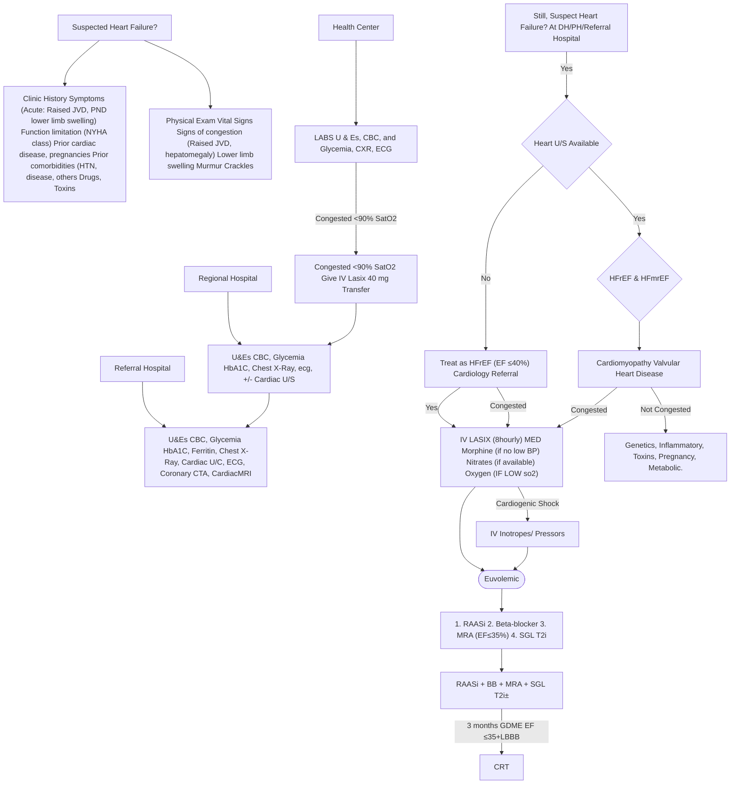

<!-- page: 118 | printed: 108 -->

## **Algorithm for Diagnosis and Management of Heart Failure**

**Flowchart: Algorithm for Diagnosis and Management of Heart Failure**

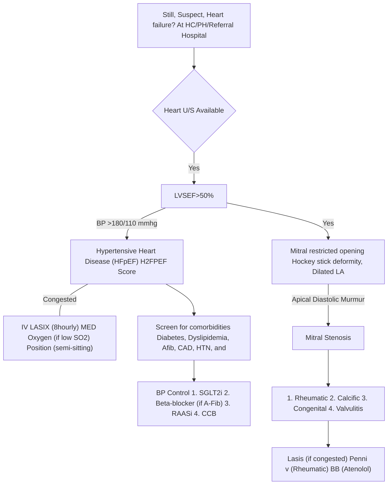

<!-- page: 119 | printed: 109 -->

## **Still, Suspect Heart Failure? At HC/PH/Referral Hospital**

**Flowchart: Clinical decision tree for heart failure diagnosis and management**

```mermaid
flowchart TD
    A(["Still, Suspect Heart Failure? At HC/PH/Referral Hospital"])
    B{"Heart U/S Available"}
    C["IV LASIX (8hourly) MED Oxygen (iflow SO2) Position (semi-sitting)"]
    D["LVSEF > 50%"]
    E["Valvular Heart Diseases & CHD"]
    F["1. Lasix (if overloaded) 2. RAASI (high BP or LV remodeling) 3. +/- Penniv 4. Cardiology consult"]
    G["Dilated RV+D Shape Sign TAPSE <1.7cm"]
    H["Right Heart Failure"]
    I["1. Lasix (If congested) 2. Screen for the cause of Pulmonary HTN (Acute/Chronic Lung disease, PE, other...)"]
    J["Pericardial Affusion"]
    K["Pericardial Disease"]
    L["1. Pericardiocentesis ( if tamponade): Refer to Cardiologist 2. Screen and treat the cause: Infections (TB, HIV, CMV, EBV) Metabolic (Thyroid disorders, Uremia) Malignancy. Connective tissue disease 3. Others"]
    M["Heart Failure Unlikely & Normal Heart U/S"]
    N["Consider other Plausible Diagnosis"]
    O["**Precipitants of Acute Heart Failure** 1. Dietary Indiscretion (ETOH, High salt) 2. Medical Non-Adherence 3. Renal Failure (Acute/CKD progression) 4. New drugs (BB, CCB, NSAIDS, Others) 5. Arrhythmias, valve dysfunctions 6. New Infection (Pneumonia, Others.) 7. Myocardial ischemia/infraction, PE 8. Metabolic (Thyroid, DKA, pancreatitis) 9. Hypertensive Crisis."]
    A --> B
    B -- "Yes" --> D
    E -- "Congested" --> C
    D -- "BP Normal, High" --> E
    E --> F
    D -- "Yes" --> G
    G -- "Loud P2" --> H
    H --> I
    G --> J
    J --> K
    K --> L
    J --> M
    M --> N
    N --> O
```

\*\*\*\* **Inotropes: Iv dobutamine or dopamine 200mg Dose: 10-20 mcg/kg/min Ex: In 70kg adult take (2 ampoules) put in 50 cc NS in Syringe pump rate (5.25-10.5cc/h) or if no syringe pump take (5 ampoules) in 500 CC NS to run in 24hours = 21cc/h ≈ 7 gouttes (drip)/min keep MAP ≥ 65**

<!-- page: 120 | printed: 110 -->

| **Condition** | **Signs** | **Management** | **Disposition** |
| --- | --- | --- | --- |
| **Decompensated<br/>Heart Failure** | • SBP >80 mmHg Warm<br/>extremities<br/>- Not confused<br/>- Good urine output | • Furosemide 40 mg IV once - If no<br/>improvement in 30 min → 80 mg IV<br/>once - Avoid beta-blockers (unless<br/>RHD) - ACE-I, hydralazine, or CCB<br/>if SBP >180 - Labs: Urea/Cr, K+,<br/>CBC, electrolytes | Admit to ward |
| **Decompensated HF<br/>+ Cardiogenic<br/>Shock** | • SBP <80 mmHg - Warm<br/>extremities - Not confused<br/>- Good urine output | • As above (1–3) - Add digoxin 0.125<br/>mg | Admit to ward |

| **Volume Status** | **Management** |
| --- | --- |
| Hypovolemia | Decrease or stop furosemide |
| Euvolemia | Maintain current dose of furosemide |
| Hypervolemia (NYHA I or II) | Start or increase oral furosemide |

## **Drugs Used in Management of Heart Failure:**

### **Diuretics Dosage in Heart Failure**

| **Drug** | **Starting Dose** | **Target Dose** | **Maximum Dose** |
| --- | --- | --- | --- |
| Furosemide | Adult: 20mg once daily<br/>Pediatric: 1 mg/kg/dose PO or IV | As required<br/>May increase to QID | 240mg twice daily |
| Torsemide | Adult: 10mg once daily<br/>Pediatric: safety and efficacy not established | As required | 200mg once daily |
| Metolazone | Adult: 2.5mg once daily<br/>Pediatric: 0.2 mg/kg/dose PO | As required | 10mg once daily |
| Hydrochlorothiazide | Adult dose: 25mg once daily<br/>Pediatric dose: 2 mg/kg/day PO divided BID | As required | 50mg once daily |

### **ACEI/ARB’S dosage in Heart Failure**

| **Drug** | **Starting Dose** | **Target Dose** |
| --- | --- | --- |
| Enalapril | Adult dose: 2.5 mg twice daily<br/>Pediatric dose: 0.1 mg/kg/d<br/>PO divided OD/BID, not to exceed 0.5 mg/kg/d | 10mg twice daily |
| Ramipril | 1.25mg once daily<br/>Pediatric doses not established | 10mg once daily |
| Losartan | Adult dose: 25mg daily. Pediatric doses not established | 150mg daily |

<!-- page: 121 | printed: 111 -->

Contraindications to the use of ACEI and ARB are bilateral renal stenosis, history of angioedema, pregnancy, and known allergy to the drugs. **Seek specialist advice when serum potassium of >5mmol/l and serum creatinine >2.25mg/dl and symptomatic hypotension.** Half the ACEI/ARB dose if creatinine increases more than 50% compared to baseline. Stop ACEI/ARB if the increase is more than 100% and serum potassium is more than 5.5 mmol/l.

## **Beta-blockers dosage in Heart Failure**

| **Drug** | **Starting dose** | **Target dose** |
| --- | --- | --- |
| Carvedilol | Adult dose: 3.125 mg twice daily<br/>Pediatric dose: therapeutic dosage range of 0.2-0.4 mg/ kg/dose<br/>PO BID; initiate with a lower dose and gradually increase dose<br/>QID 2-3 weeks to a therapeutic range | 25 mg twice daily |

## **Aldosterone Antagonists dosage in Heart Failure**

| **Drug** | **Starting dose** | **Target dose** |
| --- | --- | --- |
| Spironolactone | 12.5 to 25mg once daily<br/>Pediatric dose: 1-3.3 mg/kg/day PO in single or divided doses |  |

Recommend an aldosterone antagonist (Spironolactone) in selected patients with decreased EF and NYHA class II to IV. These patients should be monitored carefully for renal function and potassium concentration. Patients should have a serum creatinine of 2.5mg/dl or lower in men and 2.0mg/dl or lower in women and the serum potassium should be <5.0meq/l.

## **Strategies for Treatment of ATRIAL FIBRILLATION**

| **Strategies** | **Drugs and Considerations** |
| --- | --- |
| **Rate control** – for hemodynamically stable patients with chronic AF and fast AV conduction | Digoxin, calcium channel blockers, betablockers |
| **Rhythm control** – for hemodynamically unstable patients with AF of recent onset | **Electrical cardioversion**<br/>Pharmacological cardioversion – amiodarone |
| **Anticoagulation** – for all patients | Warfarin to achieve INR of 2-3 |

## **Digoxin in Atrial Fibrillation**

Rapid digitalizing (loading-dose) regimen

* IV: 8-12 mcg/kg (0.008-0.012 mg/kg) total loading dose; administer 50% initially; then may cautiously give 1/4 the loading dose q 6-8 hr twice; perform a careful assessment of clinical response and toxicity before each dose
* PO: 10-15 mcg/kg total loading dose; administer 50% initially; then may cautiously give 1/4 the loading dose q 6-8 hr twice; perform a careful assessment of clinical response and toxicity before each dose

<!-- page: 122 -->

## **Maintenance**

* PO: 3.4-5.1 mcg/kg/day or 0.125-0.5 mg/day PO; may increase the dose every 2 weeks based on clinical response, serum drug levels, and toxicity
* IV: 0.1-0.4 mg OD; IM route not preferred due to severe injection site reaction

## **Digoxin in Heart Failure**

Preterm infants: 0.005 mg/kg/d PO divided into two doses or 75% of this dose IV.
For children above the age of 10 years: 0.005 mg/kg/d PO daily or 75% of this dose IV. For adults: 0.125-0.25 mg PO q day.
A loading dose to initiate digoxin therapy in patients with heart failure is not necessary.

## **Inotropic Agents and Vasodilators for Acute Decompensated Heart Failure**

| **Inotrope** | **Dose** | **Comments** |
| --- | --- | --- |
| Dobutamine | 5-10 mcg/kg/min IV | Gradually titrate upward to desired effect |
| Dopamine | 5-10 mcg/kg/min IV (usual dosage;<br/>maximal dosage may be up to 28 mcg/kg/min) | Gradually titrate upward to desired effect |
| Epinephrine | 0.01-0.03 mcg/kg/min IV | Not to exceed 0.1-0.3 mcg/kg/min |
| Nitroglycerin | Pediatric dose:<br/>0.1-0.5 mcg/kg/min IV<br/><br/>Adult dose:<br/>20 mcg/min to an effective dose of 40 to 400 mcg/min | Watch for hypotension, headache and tolerance with continuous use after 24 hours |

## **ISCHEMIC HEART DISEASES**

The IHD is a broad term and includes individuals with chronic stable angina, asymptomatic ischemia, prior myocardial infarction, and prior coronary revascularization, as well as individuals with non- obstructive coronary atherosclerosis, including micro vascular disease. The common clinical presentation of IHD is chronic stable angina. A stabilized, frequently asymptomatic phase following an acute coronary syndrome (ACS) is also classified as IHD.

## **Diagnosis**

### **Clinical History of Angina:**

A detailed clinical history of angina includes assessing the magnitude, location, severity, duration, and precipitating factors of angina. The presence of a typical nature of the discomfort, precipitating factors and relieving factors should be suggestive of angina. Retrosternal chest pain, heaviness, pressure type with radiation to neck, jaw, epigastrium, shoulder, and left arm. Patients are usually asymptomatic at rest and chest pain is precipitated by exercise, cold weather, or emotional stress with a duration of 2 to 10 min and relieved by rest or taking sublingual nitrates. In addition to chest discomfort, dyspnoea, palpitations, syncope or fatigue may also be present and sometimes may be the only symptom. Physical examination is required to corroborate and strengthen the diagnosis.

<!-- page: 123 | printed: 113 -->

## **Investigations:**

1. ECG to look for ischemic changes
2. X-ray Chest to rule out other causes of chest pain
3. Echocardiography to look for regional wall motion abnormalities and evaluation of ventricular function
4. Basic laboratory investigations: complete blood count, kidney function test, lipid profile, blood glucose
5. Stress testing in low to intermediate pretest probability of CAD (refer to tertiary center): Tread mill exercise testing: for those who can exercise
   Pharmacological stress testing: who cannot exercise to an adequate workload
6. Referral for CT coronary angiogram: in low to intermediate pretest probability of CAD
7. Referral for an invasive coronary angiogram is indicated in patients with frequent, significant symptoms, patients with high-risk features on non-invasive testing

| **Non-Pharmacological Management** | **Pharmacological Management** |
| --- | --- |
| 1. **Smoking cessation** – Complete cessation is essential. | 1. **Short-acting nitrates** – For immediate relief of angina (e.g., sublingual GTN). |
| 2. **Exercise therapy** – ≥30 min moderate-intensity aerobic exercise ≥3 times/week. | 2. **Beta-blockers** – First-line for long-term symptom control and heart rate reduction. |
| 3. **Weight management** – Aim for BMI <22.9 kg/m²; waist circumference <90 cm (men), <80 cm (women). | 3. **Calcium Channel Blockers (CCBs)** – Alternative or addition to beta-blockers. Avoid combining non-DHP CCBs with beta-blockers if risk of AV block. |
| 4. **Lipid control** – Use statins (atorvastatin 20–80 mg/day or rosuvastatin 10–40 mg/day) to achieve LDL-C <70 mg/dL | 4. **Add-on agents** – If symptoms persist or beta-blockers/CCBs are contraindicated: |

Blood pressure control – Target <130/80 mmHg.
Ivabradine – For patients with HR >70 bpm who can’t tolerate beta-blockers or in whom BBs are ineffective (refer to cardiologist).
Glycaemic control – HbA1c target <7.0% in diabetic patients.
Dietary counselling – Promote heart-healthy nutrition.

4. **Add-on agents** – If symptoms persist or beta- blockers/CCBs are contraindicated:

<!-- page: 124 | printed: 114 -->

## **Approach to Patient with Chest Pain**

**Flowchart: Approach to Patient with Chest Pain**

```mermaid
flowchart TD
    A["Initial assessment with vitals (BP, all peripheral pulses, RR, Temp, JVP, SP02) Physical examination with systemic examinations (CVS, respiratory system, GIS)"]
    B["Hemodynamically unstable"]
    C["Hemodynamically stable"]
    D["**Stabilize and immediately assess for** STEMI Aortic dissection Massive Pulmonary Embolism Pericardial Tamponade"]
    E["**Evaluate the causes of chest pain**"]
    F["**Obtain 12-lead ECG ECHO, CXR**"]
    G["ECG diagnostic or suggestive of ACS"]
    H["YES"]
    I["Does the patient have typical or atypical angina pattern1, radiation, diaphoresis, cardiac risk factors"]
    J["ST elevation"]
    K["**STEMI**"]
    L["ST depression and/or t wave inversion"]
    M["Check cardiac Markers Tropinin, CPKMB Check at baseline and repeat at 6 hrs"]
    N["H/o suggestive, Cardiac enzyme positive and ECG changes = NSTEMI"]
    O["Cardiac marker negative, new onset, crescendo, rest angina Unstable Angina"]
    P["History and ECG suggestive of ACS"]
    Q["**Pericarditis**"]
    R["NO"]
    S["**X-ray Chest or Echo**"]
    T["X-ray Chest: Area of lucency lung parenchyma and chest wall: **Pneumothorax** Infiltrate (and Hx and labs c/w infection: **Pneumonia**"]
    U["Widened mediastinum (and hx c/w Aortic dissection) and Flap in Echo Refer for Dedicated imaging to assess for AoD (CT Aortogram): **Aortic Dissection**"]
    V["Assess Risk for Pulmonary Embolism"]
    W["**If ECG, Xray, Cardiac Marker, Echo Normal** Rule out other causes of chest pain based on History and available investigation Those patients with Nonspecific chest pain, Nonspecific chest pain, NO ECG changes at presentation and during discharge at emergencies, normal cardiac enzyme to be discharged and follow up in OPD."]
    X["Low risk: Send Ddimer, X-ray evaluation"]
    Y["Elevated D dimer, Echo Dilated RA, RV, Mcconel sign"]
    Z["High Risk for Pulmonary Embolism D dimer elevated CT pulmonary Angiogram: To r/o PE"]
    AA["High Risk for Pulmonary Embolism D dimer elevated Refer to CT pulmonary Angiogram: To r/o Pulmonary embolism"]
    A --> B
    A --> C
    B --> D
    C --> E
    D --> F
    A --> F
    F --> G
    G --> H
    H --> I
    I --> J
    J --> K
    I --> L
    L --> M
    M --> N
    M --> O
    I --> P
    I --> Q
    P --> R
    R --> S
    S --> T
    S --> U
    S --> V
    V --> W
    V --> X
    V --> Y
    V --> Z
    Y --> AA
```

<!-- page: 125 | printed: 115 -->

## **Recommendations on event prevention:**

1. Daily low-dose aspirin 75 mg OD is recommended in all IHD patients if not contraindicated.
2. Clopidogrel 75 mg PO OD is recommended in patients with aspirin intolerance.
3. High-intensity statins should be prescribed in all patients with IHD irrespective of lipid levels.

All stable angina patients with diabetes, hypertension, heart failure or chronic kidney disease should be receive ACEIS/ARBS if no contraindications.

### **ACUTE CORONARY SYNDROMES**

#### **Visual Illustration for Acute Coronary Syndromes (ACS)**

| I. Clinical setting symptoms and viral signs | LOW | MI | HIGH |  |  |  |
| --- | --- | --- | --- | --- | --- | --- |
|  | icon: clinical setting symptoms | icon: clinical setting symptoms | icon: clinical setting symptoms |  |  |  |
| II. ECG | Normal ECG | ST depression (mild) | ST depression | ST elevation |  |  |
| III. Troponin level at 0 h |  | – | –/+ | + | ++ | +++ |
| IV. Troponin change (within 1,2, or 3 h) |  | – | –/+ | + | ++ | If any of the above, consider direct rule-in |
| Triage decision | Rule-out MI |  | Observe |  | Rule-in MI |  |
| Diagnosis | Noncardiac |  | Unstable angina | Other cardiac | NSTEMI | STEMI |

<!-- page: 126 | printed: 116 -->

| ●<br/>**Very High Risk** | - Hemodynamic instability or **cardiogenic shock - Refractory or recurrent chest pain** despite treatment - **Life-threatening arrhythmias - Mechanical complications** of MI - **Heart failure** due to NSTE-ACS - ST depression >1 mm in ≥6 leads plus ST elevation in aVR and/or V1 | **Immediate invasive strategy**<br/>(within 2 hours) |  | - Dual antiplatelet therapy (Aspirin + P2Y12 inhibitor)<br/>- Anticoagulant (e.g. enoxaparin or UFH)<br/>- Beta-blocker (if not contraindicated)<br/>- Nitrates<br/>- Statins<br/>- Oxygen if SpO₂ <90% |
| --- | --- | --- | --- | --- |
| ●<br/>**High Risk** | - Diagnosis of **NSTEMI - Dynamic** or new contiguous ST/T changes - **Transient ST-segment elevation - GRACE risk score >140** | **Early invasive strategy**<br/>(within 24 hours) | - Dual antiplatelet therapy (Aspirin + P2Y12 inhibitor)<br/>- Anticoagulant (e.g. enoxaparin or UFH)<br/>- Beta-blocker (if not contraindicated)<br/>- Nitrates - Statins - Oxygen if SpO₂ <90% |  |

**Refer all patients with very high and high-risk criteria to a tertiary care center after initial stabilization.**

## **Algorithm for ACS Management**

| ***STEP 1:* SUSPECT ACS — Presentations** |  |
| --- | --- |
| **Classic Presentations:**<br/>• Chest pain, pressure, tightness, or heaviness<br/>• Radiation to left arm, jaw, neck, or back<br/>• Dyspnea, diaphoresis, palpitations<br/>• Nausea/vomiting, epigastric discomfort<br/>• Syncope or near-syncope |  |
| **Atypical (Especially in Women, Elderly, Diabetics):**<br/>• Fatigue, weakness, malaise<br/>• Isolated dyspnea without chest pain<br/>• Epigastric pain resembling indigestion.<br/>• Jaw or arm pain without chest discomfort |  |

<!-- page: 127 | printed: 117 -->

| **STEP 2: IMMEDIATE ACTIONS (0–10 minutes)** |  |
| --- | --- |
| **Monitoring** | • Continuous 12-lead ECG, cardiac monitoring<br/>• Blood pressure, SpO₂, HR monitoring<br/>• IV access × 2 — large bore |
| **Oxygen Monitoring** | • Administer ONLY if SpO₂ < 90%; avoid routine O₂ |
| **Aspirin** | • 162–325 mg PO — chewed immediately<br/>• Hold if true allergy (use Clopidogrel 300 mg instead) |
| **Nitrates** | • SL NTG 0.4 mg q5 min × 3 doses<br/>• HOLD if: SBP < 90 mmHg, HR < 50 or > 100, RV infarct, recent PDE5 inhibitor use |
| **Morphine** | • 2–4 mg IV if pain uncontrolled after nitrates<br/>• Use cautiously — associated with possible increased mortality in some studies |
| **Labs** | • Troponin I or T (high-sensitivity preferred), CK-MB<br/>• BMP, CBC, coagulation (PT/INR/aPTT), BNP/NT-proBNP<br/>• Lipid panel, HbA1c if diabetic history<br/>• Type & Screen |

## **STEP 3: 12-LEAD ECG + SERIAL TROPONINS (< 10 minutes)**

* Obtain and interpret 12-lead ECG within 10 minutes of arrival
* Repeat ECG every 15–30 min if initial non-diagnostic
* Right-sided leads (V3R–V4R) if inferior ST elevation — rule out RV infarct
* Serial troponins: 0h, 3h, 6h (standard) OR 0h and 1–2h (high-sensitivity)
* Chest X-ray (portable) to assess for pulmonary edema, aortic dissection
* Bedside echo if hemodynamically unstable

## **INTERPRET ECG → CLASSIFY ACS TYPE**

| **STEMI / New LBBB** | **NSTEMI / Unstable Angina** |
| --- | --- |
| **ECG Criteria:**<br/>• ST elevation ≥1mm in ≥2 contiguous leads<br/>• New or presumed new LBBB.<br/>• Posterior ST depression in V1–V3 | **ECG + Troponin:**<br/>• ST depression or T-wave inversion ± ↑ Troponin = NSTEMI<br/>• Normal ECG + ↑Troponin = NSTEMI<br/>• Normal ECG + normal Troponin + symptoms = UA |
| **ACTIVATE CATH LAB NOW**<br/><br/>**Primary PCI (preferred):**<br/>• Door-to-balloon < 90 min (first medical contact < 120 min)<br/>• Transfer to PCI-capable center if needed | **RISK STRATIFY — TIMI or GRACE Score**<br/>**High-Risk Features (Early Invasive Strategy):**<br/>• Ongoing/refractory chest pain<br/>• Hemodynamic or electrical instability<br/>• Elevated troponin or rising pattern<br/>• New ST changes > 0.5 mm<br/>• TIMI score ≥3 or GRACE score > 140<br/>• → Angiography within 2–24 hours |
| **Fibrinolysis (if PCI not available):**<br/>• Door-to-needle < 30 min<br/>• No contraindications (recent surgery, stroke, bleeding)<br/>• Transfer post-lysis within 3–24h for angiography | • Low-Risk (Conservative/Ischemia-Guided):<br/>• No high-risk features<br/>• TIMI score 0–2, GRACE score < 109<br/>• → Stress testing before discharge or outpatient |
| **Antiplatelet:**<br/>• ASA 162–325 mg PLUS P2Y₁₂ inhibitor:<br/>• Ticagrelor 180 mg loading (preferred) OR<br/>• Clopidogrel 600 mg loading | **Antiplatelet:**<br/>• **ASA + Ticagrelor 180 mg OR Clopidogrel 300–600 mg** |
| **Anticoagulation:**<br/>• UFH: 60 units/kg IV bolus (max 4000 units)<br/>• Enoxaparin 0.5 mg/kg IV<br/>• Bivalirudin (alternative for PCI) | **Anticoagulation:**<br/>• Enoxaparin 1 mg/kg SC q12h<br/>• Fondaparinux 2.5 mg SC daily (preferred if conservative)<br/>• UFH infusion if invasive strategy planned |
| **Adjunctive:**<br/>• GP IIb/IIIa inhibitor if high thrombus burden<br/>• DO NOT delay reperfusion for workup | **Beta-Blocker:**<br/>• Start within 24h if no contraindications (HF, bradycardia, heart block, severe reactive airway disease) |

<!-- page: 128 | printed: 118 -->

| **STEP 5: IN-HOSPITAL MANAGEMENT (All ACS)** |  |
| --- | --- |
| **Beta-Blocker** | • Metoprolol succinate/tartrate — initiate orally within 24h<br/>• Target HR 50–60 bpm; avoid if decompensated HF, bradycardia, or high- degree AV block |
| **ACEi / ARB** | • Start within 24h in all ACS, especially EF < 40%, HTN, or DM<br/>• Ramipril, Lisinopril, or Enalapril preferred; use ARB if ACEi intolerant |
| **Statin** | • High-intensity: Atorvastatin 40–80 mg OR Rosuvastatin 20–40 mg<br/>• Initiate regardless of baseline LDL; target LDL < 70 mg/dL (< 55 preferred) |
| **Complications** | • Continuous telemetry ≥ 24h; watch for arrhythmias, AV block.<br/>• Serial ECGs and troponins until peak identified.<br/>• Echocardiogram to assess EF and wall motion.<br/>• Daily weights; strict fluid balance. |
| **Complications** | • Arrhythmias: VF/VT → defibrillation; AV block → pacing<br/>• Acute HF/Pulmonary edema: diuresis, afterload reduction, consider IABP.<br/>• Cardiogenic shock: vasopressors, mechanical support (IABP, Impella)<br/>• Mechanical (papillary rupture, VSD, free wall rupture): urgent surgery<br/>• Pericarditis / Dressler syndrome: NSAIDs, colchicine |
| ***STEP 6:* DISCHARGE & SECONDARY PREVENTION** |  |
| **DAPT** | • ASA 75–100 mg indefinitely<br/>• P2Y¹² (Ticagrelor or Clopidogrel) for 12 months post-ACS<br/>• Consider extended DAPT (> 12 months) in high ischemic, low bleeding risk patients |
| **Medications** | • High-intensity statin therapy — lifelong<br/>• ACEi or ARB — especially if EF ≤40%<br/>• Beta-blocker — continue for minimum 3 years, indefinitely if reduced EF<br/>• Aldosterone antagonist (Eplerenone/Spironolactone) if EF ≤35% + HF or<br/>• DM<br/>• SGLT2 inhibitor if DM or HFrEF for added cardio protection |
| **Lifestyle** | • Smoking cessation — most effective single intervention<br/>• Mediterranean or DASH diet<br/>• Moderate aerobic exercise 150 min/week after cardiac rehab clearance<br/>• Weight management: target BMI 18.5–24.9<br/>• Blood pressure control: target < 130/80 mmHg<br/>• Diabetes management: HbA1c < 7% target |
| **Follow-up** | • Cardiac rehabilitation enrollment — strongly recommended for all ACS.<br/>• Cardiology follow-up within 1–2 weeks of discharge<br/>• Repeat echo at 6–12 weeks if EF reduced or not assessed.<br/>• Assess for ICD if EF remains ≤35% after 3 months of optimal therapy.<br/>• Ongoing lipid and renal function monitoring |

<!-- page: 129 | printed: 119 -->

## **Please note the following.**

1. Angina pain is retrosternal, pressure-like sensation that lasts 5 to 20 min. It radiates to the neck, jaw, back and left arm.
2. Atypical presentations with nausea, vomiting, dyspnoea or diaphoresis are more common in women, diabetic and elderly patients.
3. A 12-lead ECG is a bedside procedure. It should be done at the emergency in less than 10 min after patient arrival and presented to the medical doctor as soon as possible to make the decision.
4. The ACS patient’s family or bystander should call the nearest ambulance service as soon as possible; all ACS patients should be transported to the hospital by ambulance.
5. **When the health facility (health centre, primary clinic) does not have an electrocardiography machine, suspected ACS patients should be immediately referred after receiving 300mg Aspirin orally (chewable).**
6. Enoxaparin or Unfractionated Heparin shouldn’t be given prior to transfer if the invasive coronary angiography (PCI) is expected in less than 12 hours.
7. Beta-Blockers: Atenolol 25mg od or carvedilol 12.5 mg

<!-- page: 130 | printed: 120 -->

# Contraindications for Fibrinolytic Therapy

| Absolute Contraindications | Relative Contraindications |
| --- | --- |
| - Previous intra-cranial hemorrhage (ICH) - Stroke of unknown origin at any time - Ischemic stroke in the past 6 months - Central nervous system damage - Malignant intracranial neoplasm - Other intracranial lesions (aneurysm or av malformation) - History of the closed head or facial trauma within 3 months - Major trauma/surgery within the preceding 3 weeks suspected aortic dissection - Active bleeding or know bleeding diathesis (excluding menses) - Gastrointestinal bleeding within the past month non-compressible punctures in | - Previous ischemic stroke beyond 12 months - Transient ischemic attack in the preceding 6 months - Oral anticoagulation therapy - Pregnancy or within 1 week postpartum - Recent (2-4 weeks) internal bleeding - Prolonged or trauma CPR - Active peptic ulcer (only if the ulcer is actively bleeding; if only stool occult blood positivity, may be considered for thrombolysis) - Severe uncontrolled hypertension (SBP >180mm Hg and or DBP > 110 mm Hg) - Patients presenting with hypertension should be administered beta-blockers, nitroglycerin and analgesics promptly to lower blood pressure and reduce risk of ICH following thrombolysis - Patients on warfarin therapy have higher rates of hemorrhage: higher the INH, the higher risk of advanced liver disease - . Infective endocarditis |

## <u>Stroke Management</u>

### **Definition(s) and Classification of Stroke**

**Definition**
Stroke is the acute neurologic injury that results from brain vessel flow blockade either from ischemia or hemorrhage.

**Classification**
Stroke is classified into two major types and one minor type:
- Brain ischemia (80%) due to thrombosis, embolism, or systemic hypoperfusion.
- Brain hemorrhage (20%) due to intracerebral hemorrhage (ICH) or subarachnoid hemorrhage (SAH).
- Transient ischemic attack (TIA): temporary neurologic symptoms, which last less than 24 hours.

<!-- page: 131 | printed: 121 -->

# Diagnosis of Stroke

## **STEP 1: RECOGNIZE STROKE — BE-FAST + Symptoms**

### **BE-FAST Screening Tool:**
- B — Balance: Sudden loss of balance or coordination
- E — Eyes: Sudden vision change (blurred, double, or loss of vision in one or both eyes)
- F — Face: Facial drooping or asymmetry — ask patient to smile
- A — Arms: Arm weakness or drift — ask patient to raise both arms
- S — Speech: Slurred, confused, or inability to speak or understand
- T — Time: Call emergency services **IMMEDIATELY** — note exact time of last known well (LKW)

### **Additional Symptoms to Recognize:**
- Sudden severe headache with no known cause ("thunderclap") — consider SAH
- Sudden confusion or altered level of consciousness
- Unilateral numbness or weakness (face, arm, or leg)
- Difficulty walking, dizziness, or loss of coordination
- Transient symptoms resolving < 24h = TIA — treat as emergency

## **STEP 2: EMS & PRE-HOSPITAL ACTIONS**

| Priority | * Activate Stroke Management |
| --- | --- |
| Assessment | - Cincinnati Prehospital Stroke Scale (CPSS): Facial droop, arm drift, speech |

- LAPSS or FAST-ED if available
- Blood glucose
- 12-lead ECG (rule out AF as cause, detect STEMI mimics)|

|Management|* Airway: Protect airway; supplemental O₂ only if SpO₂ < 94%
* IV access × 2; NS (not dextrose unless hypoglycaemic)
* Position: HOB 0–15° unless airway concern
* Do NOT lower BP in unless > 220/120 and clear hypertensive emergency
* NPO – aspiration risk|


<!-- page: 132 | printed: 122 -->

## **Emergency Management of Stroke**

**Arrange brain CT < 1 hours of arrival**
**National Institutes of Health Stroke Scale (NIHSS) to stratify the severity of stroke**

* Score < 6: mild stroke
* Score 6-24: moderate to severe stroke
* Score >25: severe stroke.

| ***STEP 3:* ED ARRIVAL — DOOR-TO-CT < 25 MIN** |  |
| --- | --- |
| **Immediate (0–10 min)** | • Activate Stroke Team / Neurology alert<br/>• Rapid triage — priority 1<br/>• IV access × 2, blood draws (see Labs below)<br/>• 12-lead ECG, continuous cardiac monitoring<br/>• Vitals: BP both arms, SpO₂, temperature, glucose<br/>• NIH Stroke Scale (NIHSS) assessment by trained provider |
| **Labs (Immediate)** | • Glucose (point-of-care STAT — must be done before tPA decision)<br/>• CBC, BMP, coagulation (PT/INR/aPTT), type & screen<br/>• Troponin, liver function tests<br/>• Pregnancy test (women of childbearing age)<br/>• Toxicology screen if altered consciousness |
| **Imaging (< 25 min)** | • Non-contrast CT head STAT — rule out hemorrhage<br/>• CT Angiography (CTA) head + neck if tPA candidate or large vessel occlusion (LVO) suspected<br/>• CT Perfusion (CTP) if extended window (6–24h) or uncertain onset<br/>• MRI/DWI preferred if available and does not delay tPA; better for posterior fossa |

| **ISCHEMIC STROKE (\~87%)** | **HEMORRHAGIC STROKE (\~13%)** |
| --- | --- |
| **CT: No hemorrhage visible**<br/><br/>**IV tPA (Alteplase) — 0–4.5h Window:**<br/>• 0.9 mg/kg IV (max 90 mg): 10% bolus over 1 min, remainder over 60 min<br/>• Onset ≤ 4.5h from LKW (or wake-up stroke with DWI/FLAIR mismatch)<br/>• BP must be < 185/110 before administration | **CT: Hyperdense lesion = blood**<br/><br/>**Intracerebral Hemorrhage (ICH):**<br/>• Reverse anticoagulation IMMEDIATELY<br/>• Warfarin: Vitamin K 10 mg IV + 4-factor PCC (25–50 units/kg)<br/>• DOAC: PCC or specific reversal agent (Idarucizumab for Dabigatran; Andexanet alfa for Xa inhibitors)<br/>• Heparin: Protamine sulfate 1 mg per 100 units UFH<br/>• Antiplatelet reversal: Desmopressin 0.4 mcg/kg IV if urgent surgery |
| **tPA Absolute Contraindications:**<br/>• Hemorrhage on CT or prior intracranial hemorrhage<br/>• BP > 185/110 mmHg (uncontrolled after treatment)<br/>• INR > 1.7, aPTT > 40s, platelets < 100,000<br/>• Recent surgery/trauma < 14 days (serious), < 3 months (head/spine)<br/>• Active internal bleeding<br/>• Glucose < 50 or > 400 mg/dL<br/>• NIHSS = 0 (resolved) or rapidly improving | **BP Control (ICH):**<br/>• Target SBP 130–150 mmHg within 1h of presentation<br/>• IV Labetalol, Nicardipine, or Clevidipine infusion<br/>• Avoid rapid drops > 90 mmHg in chronic hypertensives |
| **Mechanical Thrombectomy (LVO) — 0–24h:**<br/>• Confirmed LVO on CTA: ICA, M1, M2, basilar artery<br/>• 0–6h: All eligible LVO patients (mRS 0–1 premorbid)<br/>• 6–24h: DAWN / DEFUSE-3 criteria (CTP or MRI mismatch)<br/>• Target door-to-puncture < 60 min; reperfusion < 90 min<br/>• Alteplase + thrombectomy — do NOT delay tPA for thrombectomy | **Surgical Considerations:**<br/>• Neurosurgery consultation for all ICH<br/>• Evacuation if: cerebellar hemorrhage > 3 cm, posterior fossa compression, obstructive hydrocephalus<br/>• Lobar ICH > 30 mL with neurological deterioration<br/>• EVD for hydrocephalus with impaired consciousness |
| **Antiplatelet Therapy (if tPA NOT given):**<br/>• Aspirin 325 mg PO within 24–48h of onset<br/>• Dual antiplatelet (ASA + Clopidogrel 75 mg) for 21 days for minor stroke/high-risk TIA (NIHSS ≤3, ABCD² ≥4 | **Subarachnoid Hemorrhage (SAH):**<br/>• “Thunderclap” headache — worst of life<br/>• CT head (90% sensitive within 6h); LP if CT negative<br/>• CTA or DSA to identify aneurysm<br/>• Nimodipine 60 mg PO q4h for 21 days (vasospasm prevention)<br/>• Neurosurgical/Neurointerventional: coiling or clipping<br/>• ICP management, euvolemia, avoid hyponatremia |

<!-- page: 133 | printed: 123 -->

| **STEP 4: ACUTE STROKE UNIT MANAGEMENT (All Stroke Types)** |  |
| --- | --- |
| **BP Targets** | • Ischemic + tPA given: Maintain < 180/105 mmHg for ≥24h post-tPA<br/>• Ischemic + NO tPA: Permissive hypertension; treat only if BP > 220/120 or end-organ damage<br/>• ICH: Target SBP 130–150 mmHg<br/>• SAH: Avoid hypotension; SBP 140–160 mmHg until aneurysm secured |
| **Glucose** | • Target blood glucose **7.8–10.0 mmol/L**<br/>• Avoid hypoglycaemia < **3.3 mmol/L** (worsens ischemic penumbra)<br/>• Insulin infusion if persistent hyperglycaemia > **10.0 mmol/L** |
| **Temperature** | • Treat fever aggressively: target normothermia (< 37.5°C)<br/>• Acetaminophen 650 mg q4–6h; cooling blankets if refractory<br/>• Investigate source: aspiration pneumonia, UTI, DVT |
| **Airway / O₂** | • Supplemental O₂ only if SpO₂ < 94%<br/>• Intubation if GCS ≤8, airway not protected, or respiratory failure<br/>• Swallow evaluation before oral intake (bedside or formal SLP assessment)<br/>• HOB 30–45° to reduce aspiration risk (except permissive hypotension phase) |
| **Neuro Monitoring** | • Neuro checks q1h for first 24h, then q4h if stable<br/>• Repeat CT head at 24h post-tPA or if neurological deterioration<br/>• Continuous EEG if seizure suspected or altered consciousness without clear cause<br/>• ICP monitoring if cerebral edema, large infarct, or haemorrhagic transformation |
| **DVT Prophylaxis** | • Pneumatic compression devices from admission (all stroke patients)<br/>• Ischemic stroke: Add LMWH (Enoxaparin 40 mg SC daily) after 48h if no haemorrhagic transformation<br/>• ICH: Mechanical prophylaxis only for first 48–72h; LMWH after imaging confirms stability |
| **Fluids** | • Normal saline (isotonic); avoid hypotonic fluids (worsen cerebral edema)<br/>• Euvolemia — target CVP 8–12, avoid dehydration<br/>• NPO if dysphagia; NG tube for medications and nutrition |

<!-- page: 134 | printed: 124 -->

| ***STEP 5: SECONDARY* PREVENTION & ETIOLOGY WORKUP** |  |
| --- | --- |
| **Etiology Workup** | • Prolonged cardiac monitoring ≥24h (preferably 72h) for paroxysmal AF detection<br/>• Echocardiogram: Transthoracic (TTE) ± Transoesophageal (TEE) for cardioembolic source<br/>• MRI brain with DWI for infarct characterization<br/>• Carotid duplex ultrasound for ipsilateral carotid stenosis<br/>• Fasting lipid panel, HbA1c, homocysteine if cryptogenic<br/>• Hypercoagulable workup (young patients, cryptogenic): Factor V Leiden, antiphospholipid Ab, Protein C/S<br/>• TOAST classification: Large artery, Cardioembolic, Small vessel, Other, Cryptogenic |
| **Antiplatelet (Ischemic)** | • Minor stroke/TIA: DAPT (ASA 81 mg + Clopidogrel 75 mg) × 21 days, then monotherapy<br/>• Moderate-severe stroke: ASA 81 mg monotherapy (or Clopidogrel if ASA-intolerant)<br/>• Do NOT use DAPT long-term (> 3 months) — increases bleeding risk without benefit |
| **Anticoag (AF/Embolic)** | • AF-related stroke: Start DOAC 3–14 days after stroke (1–2 weeks for severe strokes)<br/>• DOAC preferred over warfarin: Apixaban, Rivaroxaban, Dabigatran, or Edoxaban<br/>• Cardioembolic (non-AF): Warfarin (INR 2–3) for mechanical valves; DOAC for others<br/>• Patent Foramen Ovale (PFO) + cryptogenic stroke < 60 years: Consider closure device |
| **Carotid Disease** | • Symptomatic stenosis 50–99%: Carotid endarterectomy (CEA) within 2 weeks of event<br/>• Asymptomatic stenosis > 70%: CEA vs. CAS individualized decision<br/>• Carotid artery stenting (CAS) alternative in high surgical-risk patients |
| **BP Control** | • Long-term target: < 130/80 mmHg for most stroke patients<br/>• Restart or initiate antihypertensive therapy 24–48h after acute phase<br/>• Preferred agents: ACEi or ARB, Thiazide diuretics, or combination |
| **Lipids & Lifestyle** | • High-intensity statin: Atorvastatin 40–80 mg or Rosuvastatin 20–40 mg; target LDL < 70 mg/dL<br/>• Smoking cessation — most impactful modifiable risk factor<br/>• Diabetes management: HbA1c < 7%<br/>• Mediterranean diet; limit alcohol; weight management<br/>• Regular aerobic exercise 150 min/week after rehabilitation clearance |

<!-- page: 135 | printed: 125 -->

| **STEP 6: REHABILITATION & DISCHARGE PLANNING** |  |
| --- | --- |
| **Early Rehab** | • Mobilization within 24–48h of ischemic stroke if stable (avoid in severe stroke or ICH)<br/>• Physical therapy, occupational therapy, speech-language pathology — begin in acute phase<br/>• Dysphagia screening before any oral intake; formal SLP evaluation if any concern<br/>• Nutritional support: NG tube if oral intake unsafe; dietitian referral |
| **Rehab Team** | • Physiatrist, PT, OT, SLP, neuropsychology, social work, case management<br/>• Inpatient rehabilitation facility (IRF) if patient can tolerate 3 hours therapy/day<br/>• Skilled nursing facility (SNF) if medical needs require nursing oversight<br/>• Home therapy if good function and support system |
| **Discharge Planning** | • Antiplatelet or anticoagulation medication reconciliation and education<br/>• BP log; home BP monitoring device<br/>• Fall risk assessment; assistive device provision<br/>• Driving: Typically prohibited for 3–6 months; assess per local regulations<br/>• Outpatient neurology follow-up within 2–4 weeks<br/>• Stroke support groups and caregiver education |
| **Prognosis Tools** | • mRS (Modified Rankin Scale) at discharge and 90-day follow-up<br/>• Barthel Index for ADL independence<br/>• NIHSS trajectory: improvement correlates with functional outcome |

<!-- page: 136 | printed: 126 -->

## **KEY TIME TARGETS**

**Door-to-CT:** < 25 minutes
**Door-to-Needle (tPA):** < 60 minutes
**Door-to-Puncture (Thrombectomy):** < 60 min
**tPA Window:** ≤4.5 hours from LKW
**Thrombectomy Window:** ≤24 hours (selected)
**CEA for TIA/Minor Stroke:** < 2 weeks

**Flowchart: Stroke management flowchart**

```mermaid
flowchart TD
    A["Primary Clinic Health Center"]
    B["Identify signs and symptoms of stroke. Take vital signs, check glucose level support ABCs and give oxygen if available"]
    C["Take vital signs, support ABCs, and give oxygen if needed . Establish time of symptoms onset. Check glucose level Transfer to Hospital"]
    D["Regional and Referral H"]
    E["Take vital signs, support ABCs, and give oxygen if needed Obtain IV Access, Do FBC, U&E, PT & PPT Lipid profile, HbA1c and Glycemia Treat hypo and hyperglycemia (according to protocol) Obtain a 12 leads ECG Emergent Brain CT/MRI Assess stroke severity scales (NIH Stroke Scale or Canadian Neurological Scale) See Neurologist"]
    F["Does CT/MRI show Hemorrhage?"]
    G["Probable or confirmed acute ischemic stroke"]
    H["Consult neurologist & neurosurgeon"]
    I["Repeat brain CT/MRI in first negative CT Brain"]
    J["Consider other plausible diagnoses"]
    K["Confirmed Ischemic Stroke"]
    A --> B
    A --> C
    A --> D
    C --> E
    D --> E
    E --> F
    F -- "No Hemorrhage" --> G
    F -- "Hemorrhage" --> H
    G --> I
    I -- "No Ishchemic changes" --> J
    I -- "Ishchemic changes" --> K
```

image: SPOT A STROKE infographic

**F**
**FACE**
ONE SIDE OF THE FACE IS DROPPING

**A**
**ARM**
ARM OR LEG WEAKNESS

**S**
**SPEECH**
SPEECH DIFFICULTY

**T**
**TIME**
TIME TO CALL FOR AMBULANCE IMMEDIATELY

<!-- page: 137 | printed: 127 -->

## **Is the patient a candidate for thrombolytic therapy**

| **rtPA Eligibility Criteria**<br/>Recombinant Tissue Plasminogen Activator . Acute Ischemic Stroke |  |
| --- | --- |
| ✓ **INCLUSION — All must be met** | ✘ **EXCLUSION — Any = contraindicated** |
| • Ischemic stroke diagnosed | • Acute/severe head trauma within 3 months |
| • Onset < 4.5 hours | • Ischemic stroke within 3 months |
| • Age 18–80 years old | • Previous ICH |
|  | • Suspected SAH |
|  | • Intracerebral tumor |
|  | • Intracranial/intraspinal surgery within 3 months |
|  | • Active internal bleeding |
|  | • GI malignancy or serious GI bleed within 3 months |
|  | • Extensive hypoattenuation or hemorrhage on CT |
|  | • Known bleeding diathesis |
|  | • Aortic dissection |
|  | • Infective endocarditis |
|  | • Recent myocardial infarction |
|  | • Heparin within 48h (APTT prolonged) or LMWH<br/>within 24h |
|  | • Direct thrombin or factor Xa inhibitor within 48h |
|  | • NIHSS < 6 or > 25 |
|  | • BP > 185/110 mmHg |
|  | • Platelets < 100,000/mm³ |
|  | • Glucose > 22.2 mmol/L or < 2.7 mmol/L |

<!-- page: 138 -->

## Is the Patient a candidate for thrombolytic therapy?

**Acute Stroke Management** **Thrombolytic Contra-indications** **Secondary Stroke Prevention**

01. **IV Alteplate** (0.9m/kg infused 10% bolus in 1min, rest over 1 hour) given if **3-4.5 hours** from Stroke symptoms onset. No anticoagulation or anti-platelets within 24h of lysis.

02. **IV labetalol** (if **SBP** > 220 MMhg or DBP > 120 mmHg or active ischemic coronary heart disease, heart failure, aortic dissection, hypertensive encephalopathy, pre/eclampsia, 15 % lowering during the first 24 h and if lysiskeen BP < 180/105 mmHg

03. **Endovascular thrombectomy**

04. **Cerebral edema**: HOB> 30o Iv Mannitol, or Hemi-craniectomy.

| **Absolute** **contra-indications** | **Relative** **contra-indications** |
| --- | --- |
| 1. Any prior ICH | 1. Severe HTN SBP > 180 or DBP > 110 mmhg |
| 2. Intracranial neoplasm, aneurysm, AVM | 2. Ischemic stroke > 3 months |
| 3. Ischemic stroke within 3 months, 2 months’ head/spine surgery | 3. CPR > 10min trauma/major surgery w/in 3 weeks |
| 4. Bleeding diathesis | 4. Internal bleed within 2-4 weeks, active PUD |
| 5. Suspected aortic dissection | 5. Pregnancy |
| 6. Severe Uncontrolled HTN | 6. Non compressible vascular Punctures |
|  | 7. Plates < 100k, INR 1.7, PTT >40, glycemia < 50 mg/dl |

01. **Anti-platelets**: AAS 100mg OD

02. **Anti-coagulants**: consider in (A fib (CHA2DS2Vasc score), cardiac and paradoxical emboli (except endocarditis), hyper-coagulable state) ex: NOACs (rivaroxaban 20mg OD) or Warfarin (INR 2-3)

03. **Stain**: Atorvastatin 40-80mg od, or Rosuvastatin 20mg od (for life)

04. **Blood pressure reduction** (24-48 h after stroke onset, goal blood pressure < 130/< 180 see Hypertension protocol

05. **Carotid re-vascularization**

06. **DST prophylaxis**: S/c Lovenox 40 mg od

07. **Lifestyle modification** Smoking cessation, management of obesity, diabetes, and metabolic syndrome, alcohol moderation/cessation.

<!-- page: 139 | printed: 129 -->

## **Pharmacological Management of Stroke**

| Stroke Type | Drug Class | Drug | Dosage & Frequency | Contraindications | Side Effects |
| --- | --- | --- | --- | --- | --- |
| TIA (Dual Therapy × 3 weeks | Antiplatelet | Aspirin | Loading: 150 mg OD STAT Maintenance: 150 mg OD po If peptic ulcer: Ecotrin 81 mg OD po | Peptic ulcer Active bleeding Children: varicella/flu (Reye’s syndrome) | Nausea / Dyspepsia Heartburn / GI ulcer Dizziness / Tinnitus |
|  | Antiplatelet | Clopidogrel | Loading: 300 mg OD STAT Maintenance: 75 mg OD po | Active bleeding ICH Coagulation disorders | Purpura / Epistaxis Edema Headache |
| Ischaemic Stroke (Monotherapy) | Antiplatelet | Aspirin | Loading: 300 mg STAT po Maintenance: 150 mg OD po If peptic ulcer: Ecotrin 81 mg OD po | Peptic ulcer Active bleeding Children: varicella/flu (Reye’s syndrome) | Nausea / Dyspepsia Heartburn / GI ulcer Dizziness / Tinnitus |
|  | Antiplatelet | Clopidogrel | Loading: 300 mg OD po Maintenance: 75 mg OD po | Active bleeding ICH Coagulation disorders | Purpura / Epistaxis Edema Headache |
|  | Anticoagulant (if AF + high CV risk) | Warfarin | 5 mg OD po Target INR: 2–3 Monitor INR regularly | Active bleeding Thrombocytopenia Pregnancy Malignant hypertension Endocarditis / Coagulopathy | Purpura / Epistaxis Anaemia Vasculitis Rash / Hepatitis |
| Haemorrhagic Stroke NO antiplatelets or anticoagulants | Osmotic Diuretic (if raised ICP) | Mannitol | 0.25–1 g/kg IV bolus Every 6 hours | Pulmonary congestion / oedema Congestive Heart Failure Severe dehydration | Dehydration / Tachycardia Pulmonary oedema Chest pain / Diarrhoea |

<!-- page: 140 | printed: 130 -->

# **General Management (all stroke types):** Control BP — prefer CCB / ACEI / ARB (diuretics NOT first line) | Hydration with isotonic solutions 0.5–1 L/day

## **Adjunct Management of Stroke**

### **TIA and Ischemic stroke Rehabilitation and follow-up**

Home blood pressure monitoring should be considered for guiding the management of BP-lowering treatment. physiotherapy, occupational therapy, speech therapy

## **Complications of Stroke**
a. **Acute brain edema and raised intracranial pressure**
b. **Seizures**
c. **Prevention of DVT and PE**
   Prophylaxis with low-molecular-weight heparins or subcutaneous low-dose unfractionated heparin (5 000 IU twice daily) is indicated in patients at high risk of DVT or PE (e.g. due to immobilisation, obesity, diabetes, previous stroke).
d. **Aspiration pneumonia**
e. **Pressure ulcers**
f. **Falls**
g. **Vascular dementia**

### a. **Lifestyle Modification**
- Abstention of smoking
- Weight reduction for obesity patients
- Regular physical activity ≥30 minutes of moderate-intensity exercise daily
- Low salt, low oil, high fiber diet
- Reduce alcohol intake

### b. **Management of Comorbidities**
- *Hypertension* – lifestyle modification and pharmacotherapy. Target blood pressure control < 130/80 but SBP NOT <120
- *Diabetes mellitus* – control blood sugar, HbA1C< 6.5. Target blood pressure control <130/80 mmHg. Use statin to reduce the risk of stroke. Angiotensin-converting enzyme inhibitor or angiotensin receptor antagonist (usually in combination with a diuretic) are preferred.
- *Dyslipidemia* – diet control and pharmacotherapy(statin).
- *Cardiac disease* - Patients with mechanical heart valves, prescribe warfarin and INR target: 2.5-3.5. For patients with atrial fibrillation, use CHADS2 score to stratify the risk of stroke. For moderate or greater risk of stroke, initiate warfarin, and target INR 2.0-3.0. For Lower-risk patients, initiate aspirin 150 mg OD po.

<!-- page: 141 | printed: 131 -->

# Management in Special Populations

(a) **Stroke in pregnancy:** Stroke in pregnancy might results from PIH, gestational diabetes, pre-eclampsia, eclampsia, and hyper- coagulopathy in pregnancy.

(b) **Stroke in HIV:** HIV with low CD4 and high viral load is a strong risk factor of stroke. Antiretroviral Therapy (ART) can reduce incidence of stroke in HIV.

(c) **Stroke in paediatric population:** Stroke in paediatrics usually results from congenital causes, e.g.: congenital heart defects, hereditary coagulopathy, and vascular dysplasia; or infectious origin: rheumatic valvular heart disease which cause embolic stroke. Classical cardiovascular risk factors don't contribute much. ALL SUSPECTED PEDIATRIC STROKE CASES SHOULD BE REFERRED IMMEDIATELY

## ACUTE RHEUMATIC FEVER

Acute Rheumatic Fever (ARF) is a non-suppurative inflammatory sequel of group A Streptococcus (GAS) pharyngitis. ARF presents as fever, polyarthritis, pan carditis, chorea, and skin manifestations, occurring after a 2 to 3-week latent period. ARF is more common in children aged 5–15 years. Rheumatic fever (RF) and Rheumatic Heart Disease represent a huge public health burden in developing countries with significant morbidity and mortality.

## Signs and Symptoms

The typical attack of ARF follows an episode of streptococcal pharyngitis after a latent period of 2 to 3 weeks. However, 1/3rd of the ARF develop after asymptomatic GAS infection. The major manifestations are carditis, arthritis, chorea, subcutaneous nodules, and erythema marginatum, independent of their severity. The minor manifestations are frequent and mostly related to the underlying systemic inflammation.

1. **Carditis:** Presents as sub-clinical to severe presentation with symptoms of heart failure such as shortness of breath, orthopnea, paroxysmal nocturnal dyspnea, palpitation and has fulminating evolution and is usually diagnosed within the first 3 weeks of the acute episode. Endocarditis is the diagnostic hallmark of rheumatic carditis, being expressed by valvitis and mitral regurgitation is the dominant valvular lesion in over 90% of patients. It may be associated with aortic regurgitation. Isolated aortic regurgitation is seen in less than 5% of cases. Rheumatic carditis is characterized by pancarditis. However, pericarditis may rarely occur as a part of pancarditis which can present as chest pain and can produce mild pericardial effusion and myocarditis rarely. **Subclinical carditis:** Silent carditis, diagnosed by doppler echocardiography has been accepted as part of the spectrum of rheumatic carditis. The echocardiographic findings for subclinical RHD are mentioned in the annexure.

2. **Arthritis:** Polyarthritis is the most frequent major manifestation seen in older children, adolescents and adults. Polyarthritis is non-suppurative, asymmetric, migratory, and self- limited, which usually involves small joints of the hands and feet, but the shoulders, and hips are less commonly affected and the spine is rarely involved. Tenderness and severe pain, out of proportion to the findings of the physical examination, are the most prominent features. Redness, swelling and heat are usually less marked. Salicylates and nonsteroidal anti-inflammatory agents produce a marked and prompt relief of the symptoms and signs. Monoarthritis and polyarthralgia (after excluding other cause) has been also included as major criterion in revised Jones criteria for moderate-and high-risk populations.

<!-- page: 142 -->

3. **Sydenham’s Chorea:** Usually affects children and adolescents, more commonly in pre-pubertal females. The latent period, after the streptococcal infection, is longer varying from 1 to 7 months. Chorea may occur as an isolated manifestation, the so called pure chorea, or less frequently in association with carditis or arthritis which is usually a self-limited disorder, characterized by muscular weakness, hypotonia, and emotional instability, besides involuntary and purposeless but conscious movements of the skeletal muscles. One-fifth of patients have hemichorea, with the manifestations limited to one side of the body.

4. **Subcutaneous Nodules:** Subcutaneous nodules are seen over the extensor surface of joints and bony prominences, and are small, firm, painless, and freely movable under the skin.

5. **Erythema Marginatum:** Erythema marginatum is a very uncommon manifestation which is seen as a macular rash over the trunk, blanches on pressure, has a serpiginous or circular form, is painless and non-pruritic.

## **Diagnosis of Acute Rheumatic Fever (ARF)**

**Flowchart: Diagnosis of Acute Rheumatic Fever (ARF) by Revised Jones criteria**

```mermaid
flowchart TD
    A["Diagnosis of Acute Rheumatic Fever (ARF)"] --> B["By Revised Jones criteria:"]
    B --> C["Major Manifestations: CARDITIS: CLINICAL/ SUBCLINICAL. POLYARTHRITIS/ MIGRATORY ATHRITIS SYDENHAMS CHOREA ERYTHEMA MARGINATUM"]
    B --> D["Minor Manifestations: 1. Fever (more than or equal to 38°C) 2. Monoarthralgia 3. Prolonged PR interval in ECG 4. Increased acute phase reactants (raised ESR more than or equal to 30mm/hour or raised CRP more than or equal to 3.0 mg/dl)"]
    B --> E["Evidence of Preceding GAS infection: 1. GAS on throat swab (positive culture) 2. Raised ASO titre 3. Raised Anti DNase B 4. Positive quick strep test"]
    C --> F["The diagnosis of ARF can be confirmed in the presence of the following situations: 1. Two major manifestations and any evidence of preceding GAS infection OR 2. One major and two minor manifestations and any evidence of preceding GAS infection OR 3. Presence of Rheumatic chorea"]
    D --> F
    E --> F
```

**DIAGNOSIS:** Diagnosis of ARF is based on revised Jones criteria 2015, as ABOVE

<!-- page: 143 | printed: 133 -->

# RHEUMATIC HEART DISEASE

Rheumatic Heart Disease (RHD) is a sequela of Acute Rheumatic Fever (ARF). The interval between the initial episode of RF and clinical evidence of valvular involvement is variable, ranging from a few years to more than 20 years. About 25% of all patients with RHD have isolated mitral stenosis (MS), and about 40% have combined MS and mitral regurgitation (MR). Multivalvular involvement is seen in 38% of patients, with the aortic valve affected in about 35% and the tricuspid valve in about 6%. Isolated MR accounts for 10–15% of chronic RHD patients. The pulmonic valve is rarely affected.

## Symptoms
**Symptoms**
Gradually progressive dyspnea on exertion is the most common symptom of Rheumatic MS. Other symptoms are paroxysmal nocturnal dyspnoea, orthopnea, hemoptysis, palpitation, and swelling of limbs. Symptoms of chronic MR include exertional palpitation, dyspnea, fatigue, and pedal edema whereas acute MR presents symptoms of pulmonary edema. Rheumatic aortic stenosis (AS) patients are often asymptomatic, and most patients are diagnosed incidentally. These patients can present with angina pectoris, syncope, and dyspnea. Chronic rheumatic aortic regurgitation (AR) patients are usually asymptomatic or can present with palpitation, shortness of breath, and angina.

## Signs of RHD
**Signs of RHD**
a. **Mitral Stenosis:**
Mitral facies may be observed, i.e. a patchy, pinkish-purple appearance of the cheeks resulting from dilated venules. The arterial pulse has a normal or decreased pulse volume and a normal contour. Jugular venous pressure is normal in MS unless there is associated atrial fibrillation, pulmonary arterial hypertension, or right ventricular failure. Loud 1st heart sound (S1), opening snap, and mid- diastolic rumbling murmur are the typical auscultatory features in MS. The murmur is best heard with the bell of a stethoscope applied to the apical area with the patient lying supine on the left lateral decubitus position.

b. **Mitral Regurgitation:**
Cardiomegaly with displaced apical impulse, soft S1, loud S2 if pulmonary artery hypertension, presence of S3, pan systolic murmur in mitral area, mid-diastolic flow murmur at the mitral area

c. **Aortic Stenosis:**
Small volume and slow upstroke arterial pulse with Pulsus Parvus Tardus. On auscultation, there is an aortic ejection systolic murmur at the right 2nd intercostal space radiating to carotids and expiratory splitting of S2.

d. **Aortic Regurgitation:**
The left ventricular apical impulse is displaced and hyperdynamic with early diastolic murmur at the aortic and neo-aortic area or diastolic murmur at the mitral area (Austin Flint murmur). Patient with significant AR has peripheral signs of aortic regurgitation.

<!-- page: 144 -->

## **Diagnostic findings according to diagnostic modality**

| **Valvular Lesion** | **Chest X-ray Findings** | **ECG Findings** |
| --- | --- | --- |
| **Mitral Stenosis** | - Straightening of left heart border<br/>- Double right heart border<br/>- Splaying of carina<br/>- Pulmonary venous congestion (e.g., Kerley B lines, bat wings) | - P mitrale (broad, notched P wave in lead II)<br/>- Atrial fibrillation common (AF) |
| **Mitral Regurgitation** | - Enlarged Left Atrium (LA) and Left Ventricle (LV)<br/>- Pulmonary venous congestion | - Features of LA and LV enlargement<br/>- Atrial fibrillation may be present |
| **Aortic Stenosis** | Possible aortic valve calcification | - Left ventricular hypertrophy (LVH)<br/>- ± T-wave inversion in V6 |
| **Aortic Regurgitation** | - LV-type cardiomegaly<br/>- Features of pulmonary venous hypertension | - LV enlargement features |
| **Echocardiogram:**<br/>Echocardiogram is done to confirm the diagnosis and evaluation of chamber size, valve morphology, valve stenosis or regurgitation, and ventricular function and detail will be mentioned in the echocardiographic manual |  |  |

Rheumatic Heart Disease (RHD) is defined as valvular damage caused by abnormal immune response to GAS infection in childhood. Valves affected are Mitral, Aortic, Tricuspid and rarely Pulmonic.

<!-- page: 145 | printed: 135 -->

## **Algorithm with the Initial Evaluation and Management of RHD in Children**

**Flowchart: Algorithm with the Initial Evaluation and Management of RHD in Children**

```mermaid
flowchart TD
    A["Acute Rheumatic Fever"]
    B["Rheumatic Heart Disease"]
    C["2-4 weeks after Group A Streptococcus Diagnosis based on Revised Jones Criteria: **Major Manifestations** • Pancarditis • Subcutaneous nodules • Sydenham chorea • Erythema marginatum • Arthritis (usually migratory polyarthritis) **Minor Manifestations** • Fever 38°C • Prolonged PR interval (on EKG) • ESR 60 mm in type first hour and/ or CRO 3.0 mg/dL • Arthrlgia **Diagnosis:** Initial ARF: 2 major OR 1 major plus 2 minor
    **Diagnosis: Recurrent ARF:** criteria for initial ARF OR 3 minor"]
    D["Still prevalent in resource-limited settings Sequela of untreated ARF Definitive diagnosis made by echocardiography"]
    E["**Mitral valve involvement (most common):** - Mitral regurgitation/mitral stenosis - The clinical presentation includes dysonea, postural nocturnal dyspnea, systolic murmur at the apex, hepatomegaly, LL adema -
    **Secondary Prevention: Extencilline:** © If<27 kg: 600,000 IU IM single dose every 28 days © If <27 kg: 1.2M IU single dose every 28 days - Treat as indicated in the HF algorithm - Pediatric cardiologist to decide the indication and timing of cardiac surgery"]
    F["**Aortic valve involvement (commonly associated with a mitral valve)** - Aortic regurgitation Aortic stenosis - The clinical presentation includes wide pulses pressure, syncope, thrill, diastolic/systolic (AR/AS) murmur, hepatomegaly, LL edema - **Secondary Prevention: Extencilline:** © If<27 kg: 600,000 IU IM single dose every 28 days © If>27 kg: 1.2M IU IM single dose every 28 days - Treat as indicated in the HF algorithm - Pediatric cardiologist to decide the indication and timing of cardiac surgery"]
    G["**Tricuspid valve involvement (less common, very rarely isolated)** - The clinical presentation includes dyspnea, orthopnea, postrul nocturnal dyspnea, postural nocturnal dyspnea, systolic murmur LLSB, hepatomegaly, LL edema - **Secondary Prevention: Extencilline:** © If<27 kg: 600,000 IU IM single dose every 28 days © If>27 kg: 1.2M IU IM single dose every 28 days - Treat as indicated in the HF algorithm - Pediatric cardiologist to decide the indication and timing of cardiac surgery"]
    H["**Management** **+ Primary prevention: Penicillin V:** © If <27 Kg: 250 mg 2 to 3 times daily for 10 days © If > 27 kg: 500 mg 2 to 3 times daily for 10 days
    **+ Secondary prevention: Extencilline:** © If>27 kg: 600,000 IU IM single dose every 28 days © If>27 kg: 1.2M IU IM single dose every 28 days
    **+ If allergic to Penicillins:** azithromycin 6 mg/kg/day, maximum dose 250 mg
    **Supportive treatment: Arthritis:** >2 years old: Ibuprofen P.O. 10 to 20 mg/kg/day every 12 hours (maximum daily dose: 1000mg)"]
    A --> C
    C --> H
    A --> B
    B --> D
    D --> E
    D --> F
    D --> G
```

\*To prevent pain associated with Extencillin Injection the drug must be mixed with low-dose lidocaine hydrochloride 1% (3.5 - 5mls) solution

<!-- page: 146 | printed: 136 -->

***To prevent pain associated with Penicillin G(extencilline) injection the drug must be mixed with low-dose lidocaine hydrochloride 1% (3.5 – 5mls) solution**

**Heart Failure (HF):** Diuretics relieve pulmonary congestion, peripheral edema, and symptoms of dyspnea. Digitalis, beta-blocker, and diltiazem are useful to control ventricular rate in patients with AF. Vasodilators such as ACE-I and ARBs help to control hypertension and help alleviate symptoms in patients with AR.

**Anticoagulation (monitoring and dose adjustment):** Anticoagulation with warfarin is indicated in patients with atrial fibrillation or left atrial /left atrial appendage clot, and previous history of thromboembolism. Warfarin is usually started with 2 to 5 mg per day and the dose is adjusted to target INR of 2-3. Anticoagulation with warfarin should be continued for lifelong after metallic valve replacement and for the initial first 3 months after biological valve replacement.

**Referral for intervention (PTMC/Repair /Replacement):** All asymptomatic or symptomatic severe valvular heart disease should be referred for further evaluation and intervention in a tertiary center.

<mark>**Referral back and continuation of care at the First Level Hospitals:**</mark> Continue secondary prophylaxis of RHD and other drugs as per guidelines. Monitor and follow up for the progression of valvular heart disease and possible adjustment of medical management. Patients with RHD should be followed up on a regular basis. Asymptomatic patients with severe mitral regurgitation and LVEF >60% and severe aortic stenosis should be followed every 6 months by clinical and echocardiography examinations. Asymptomatic patients with clinically significant mitral stenosis and severe AR with normal LVEF should be followed up yearly. Asymptomatic patients with mild to moderate valvular heart disease and preserved LV function can be followed every year

<!-- page: 147 | printed: 137 -->

## **Algorithm for Management of Rheumatic Heart Disease (RHD) at Secondary Care Level**

**Flowchart: Algorithm for Management of Rheumatic Heart Disease (RHD) at Secondary Care Level**

```mermaid
flowchart TD
    A["Suspect RHD if a patient presents with the following"]
    B["At Health Centre New onset dyspnoea, fatigue or palpitations"]
    C["Transfer to DH Order CXR, FBC, RFTs, 12-lead ECG. Confirm diagnosis with **Echocardiography**"]
    D["**Mitral Stenosis**"]
    E["**Mitral Regurgitation**"]
    F["**Aortic Insufficiency**"]
    G["**Aortic Stenosis**"]
    H["Fast and irregular pulse Hyperactive precordium Loud murmur Distended jugular veins Ankle/leg edema."]
    I["If leaflets and sub-valvular thickening, commissural fusion, calcification and accelerated forward flow on colour doppler. Left atrium is usually dilated."]
    J["If leaflets and sub-valvular thickening, restricted leaflet motion, accelerated backward flow on colour doppler; LV dilation +/- dysfunction."]
    K["If thickened cusps with rolled edges; accelerated backward flow on colour doppler; most of the time it is associated with rheumatic mitral valve lesion (s) LV dilation +/- dysfunction."]
    L["If thickened cusps with rolled edges; accelerated forward flow on colour doppler; most of the time it is associated with rheumatic mitral valve lesion (s)"]
    M["Start PO Atenolol 25mg if HR>90bpm and BP >90/60 mmHg, PO Penicillin V 250mg BID; check for A Fib to start Warfarin 5mg OD. Therapeutic range INR (2-3). If in pulmonary oedema, admit for IV Furosemide. Early referral for Ballon Mitral Valvotomy (BMV)"]
    N["EF<60%: treat per HFrEF protocol, add Penicillin V 250mg BID, urgent referral to a Cardiologist. EF>60%: Low dose PO Furosemide, Penicillin V 250mg BID, non-urgent referral to a Cardiologist."]
    O["EF<60% treat per HFrEF protocol, add Penicillin V 250mg BID, urgent referral to a Cardiologist. EF>60% Low dose PO Furosemide, Penicillin V 250mg BID, non-urgent referral to a Cardiologist."]
    P["Aortic Stenisis is a surgical condition. Refer patient to a cardiologist to quantity severity and plan surgery. Afterload reduction should be avoided unless AI or MR is associated."]
    A --> B
    B --> C
    B --> H
    C --> D
    C --> E
    C --> F
    C --> G
    D --> I
    I --> M
    E --> J
    J --> N
    F --> K
    K --> O
    G --> L
    L --> P
```

image: Echocardiography images

<!-- page: 148 | printed: 138 -->

**Please note the following.**
**Women should be educated and offered reproductive health service upon RHD diagnosis. Patients on Warfarin should have their INR checked regularly and kept within their therapeutic range. Estimate RVSP by TR jet CW if you can inform management; don’t forget to check TV rheumatic changes. Mixed Mitral or Aortic valve disease can be challenging in less experienced practitioner, consult for management. Secondary prophylaxis with Penicillin is recommended until 40 years of age.**

## **CONGENITAL HEART DISEASES**

Congenital heart disease, is a problem in the structure of the heart that is present at birth and is “a gross structural abnormality of the heart or intrathoracic great vessels that is actually or potentially of functional significance.” The defect can involve the septum within the heart, outflow tracts, valves & great vessels in isolation or in combination sometimes resulting in a severe form of complex defect. Congenital Heart Disease can be Acyanotic or Cyanotic.

These guidelines focus on early diagnosis and referral to tertiary institution for further management.
1. Acyanotic CHD (SpO2 > 94% at room air)
2. Cyanotic CHD (the child has the potential to turn bluish discoloration at rest or during exertion, SpO2 < 93% at room air)

### **Screening and Diagnosis**

**Flowchart: Congenital Heart Diseases Screening flowchart**

```mermaid
flowchart TD
    A["CONGENITAL HEART DISEASES SCREENING"]
    B["Measure O2 Sat in the right hand and any foot of all newborns between 24-36 hours of age."]
    C["O2 Sat < 90% in the right hand or any foot = **Abnormal**"]
    D["O2 Sat between 90-94% in right hand **and** any foot or >3% difference between right hand and any foot = **Indefinite**"]
    E["O2 Sat ≥95% in the right hand or any foot **and** ≤3% difference between right hand and any foot = **Normal**"]
    F["**Repeat measurements in 1 hour**"]
    G["O2 Sat < 90% in the right hand or any foot = **Abnormal**"]
    H["O2 Sat between 90-94% in right hand **and** any foot or >3% difference between right hand and any foot = **Indefinite**"]
    I["O2 Sat ≥95% in the right hand or any foot **and** ≤3% difference between right hand and any foot = **Normal**"]
    J["**Repeat measurements in 1 hour**"]
    K["2 Sat between 90-94% in right any foot = **Abnormal** difference between right hand and any foot = Indefinite"]
    L["O2 Sat ≥95% in the right hand or any foot **and** ≤3% difference between right hand and any foot = Normal"]
    M["**Screening Failed** Pediatric cardiologist consult"]
    N["**Screening Passed** Pediatric cardiologist consult"]
    A --> B
    B --> C
    B --> D
    B --> E
    C --> M
    D --> F
    E --> N
    F --> G
    F --> H
    F --> I
    G --> M
    H --> J
    I --> N
    J --> K
    J --> L
    K --> M
    L --> N
```

<!-- page: 149 | printed: 139 -->

## **Approach to suspected congenital heart disease**

Blue since birth/ soon after birth and persistent blue, worsened by crying
Poor feeding/ intermittent feeding, excessive sweating during feeding, crying and sleeping
Precordial bulge, exercise intolerance
Recurrent Lower Respiratory Tract Infection
Recurrent episodes of Heart failure
Squatting, cynatic spell, loss of consciousness
Chest pain, shortness of breath and palpitation during rest and on exertion

**Flowchart: Clinical decision tree for suspected congenital heart disease**

```mermaid
flowchart TD
    A["Blue since birth/ soon after birth and persistent blue, worsened by crying Poor feeding/ intermittent feeding, excessive sweating during feeding, crying and sleeping Precordial bulge, exercise intolerance Recurrent Lower Respiratory Tract Infection Recurrent episodes of Heart failure Squatting, cynatic spell, loss of consciousness Chest pain, shortness of breath and palpitation during rest and on exertion"]
    B["Acyanotic CHD"]
    C["Central cynanosis/ Hypoxia"]
    D["Cyanotic CHD Pulmonary Diseases Consider non-cardiac causes like sepsis"]
    E["Chest X-ray EKG Echocardior"]
    F["Cyanotic"]
    G["Hyperoxia test formal or informal (15L of 02), 02 Sat"]
    H["Pulmonary Disease / Non-cardiac causes N.B: The hyperoxia test is not a definitive test, it does not completely exclude CHD"]
    A --> C
    C -- "No" --> B
    C -- "Yes" --> D
    B --> E
    D --> G
    G -- "No" --> F
    F --> E
    G -- "Yes" --> H
```

* Get the weight and height of the child.
* Examination of the child in supine position (look for Dysmorphic facies, presence of extracardiac congenital malformations, chest deformity, precordial activity, right ventricular heave, chest indrawing, raised JVP, swelling of abdomen and legs, palpable liver, clubbing on upper and lower limbs
* Measure blood pressure
* Feel all peripheral pulses
* Check SpO2 of upper and lower limbs
* Auscultate for heart rate, rhythm, gallop, cardiac murmur, respiratory rate, and chest crackles.

<!-- page: 150 | printed: 140 -->

**Flowchart: Acyanotic and Cyanotic CHD flowchart**

```mermaid
flowchart TD
    A["Acyanotic CHD"]
    B["Pressure overload: Clinical manifestations depend on the severity of the obstruction"]
    C["Volume Overload: Clinical manifestations depend on the severity of the of the left-to right shunt"]
    D["Pulmonary stenosis"]
    E["Aortic stenosis"]
    F["Coarctation of the aorta"]
    G["ASD"]
    H["VSD/AVSD"]
    I["PDA/AOW"]
    J["If critical, ductal dependents! Presents in the first days of life in shock If non-critical: Tachypnea, poor weight gain, poor feeding, ejection murmur over the pulmonary area"]
    K["If critical, ductal dependents! Presents in the first days of life in shock If non-critical: Tachypnea, poor weight gain, poor feeding, ejection murmur over the pulmonary area"]
    L["If critical, ductal dependents! Presents in the first days of life in shock If non-critical: HTN on upper limbs, radial artery to femoral artery pulse delay, systolic mummer irradiating at the back"]
    M["Asymptomatic, can present with recurrent chest infections and poor weight gain Physical findings: no respiratory distress, ejection murmur (most of the time absent) pulmonary area, fixed split of S2"]
    N["Symptoms appear first weeks of life: Diaphoresis, poor weight gain, poor feeding, tachypnea, and tachycardia Physical findings: chest retraction, holosystolic murmur at LLSB, hepatomegaly, Harrison sulcus"]
    O["Symptoms appear first weeks of life: Diaphoresis, poor weight gain, poor feeding, tachypnea, and tachycardia Physical findings: Chest retraction, continuous murmur at the left infraclavicular area, hepatomegaly"]
    P["1. General measures: Nutritional Support, prevention from URTI and IE 2. Medical treatment if in heart failure: Lasix 1-3mg/kg/day Aldactone 1-3mg/kg/day Captopril (with caution) 0.3-0.5mg/kg/day 3. Treat surgically or by catheterization the underlying pathology"]
    Q["Cyanotic CHD"]
    R["Decreased pulmonary blood flow"]
    S["Increased pulmonary blood flow"]
    T["Others"]
    U["TOF"]
    V["Tricuspid Valve Diseases"]
    W["Pulmonary Valve Atresia"]
    X["TGA"]
    Y["Truncus Arteriosus"]
    Z["TAPVR"]
    AA["Clinical features: - Depending on the severity of the RVOTO - Tet spells, squatting, poor weight gain - Cyanosis, SEM ULSB, no hepatomegaly Imaging: - Chest x-ray: normal heart size with a boot shape, oligemic lungs - EKG, RAD, RAE, RVH"]
    AB["Types: - Tricuspid atresia - Tricuspid stenosis - Ebstein anommal Management: A pediatric cardiologist to assess the associated anomalies and recommend the proper medical and surgical management"]
    AC["- Severe form of TOF. - Ductal dependent and /or with MAPCAS. - Early presentation, marked central cyanosis, single and loud S2, continuous murmur radiating to the back and axillae - Very challenging surgical management and poor outcome"]
    AD["- Often associated with other cardiac anomalies. - Early presentation, absent or mid respiratory distress disproportionate to the high levels of cyanosis, absent or systolic murmur Imaging: - Chest x-ray. “egg on a string” appearance - EKG: often normal Management: PGEI, balloon atrial septostomy, astial switch"]
    AE["- Presentation in the first days of life, mild to moderate cyanosis, symptoms, and signs of heart failure - Chest x-rays: cardiomegaly, increased pulmonary vascular markings - Treat as indicated in the HF algorithm - Surgical repair before PAH irreversible"]
    AF["- Early presentation if obstructed TAPVR with severe respiratory distress, marked cyanosis and shock - If unobstructed, Right HF symptoms and signs, fixed split S2, SEM, ULSB, hepatomegaly - Treat as indicated in the HF algorithm - Surgical repair and when the patient is stable"]
    AG["- HLHS, interrupted aortic arch, complex CHD - Variable-associated cardiac anomalies. - Symptoms depending on the importance of the pulmonary. - If in HF, treat as indicated in the HF algorithm. - Pediatric cardiologist to decide the indication and timing of cardiac surgery."]
    AH["Management: - Tet spells: Knee-chest position, administer oxygen, IV Fluids: 10-20mV/ kg NS, Propranolol 0.1mg/kg/ dose. Definitive Management: Pediatric cardiologist to decide on the indication and timing of cardiac surgery"]
    A --> B
    A --> C
    B --> D
    B --> E
    B --> F
    C --> G
    C --> H
    C --> I
    D --> J
    E --> K
    F --> L
    G --> M
    H --> N
    I --> O
    J --> P
    K --> P
    L --> P
    M --> P
    N --> P
    O --> P
    Q --> R
    Q --> S
    Q --> T
    R --> U
    R --> V
    R --> W
    S --> X
    S --> Y
    S --> Z
    T --> AG
    U --> AA
    V --> AB
    W --> AC
    X --> AD
    Y --> AE
    Z --> AF
    AA --> AH
```

**All suspected cases of CHD should be referred to a tertiary centre after proper counselling**

<!-- page: 151 | printed: 141 -->

## **CHAPTER 4**
## **DERMATOLOGY**

### **Atopic Dermatitis AD (Eczema)**

Chronic, pruritic inflammatory skin condition that occurs most frequently in children but may also affect adults. It follows a relapsing course. AD is often associated with elevated serum immunoglobulin levels and a family history of Type 1 allergies such as Allergic Rhinitis and Asthma.

#### **Classification of AD**

i. Acute
ii. Chronic
iii. Acute on Chronic

#### **Screening and Diagnosis of AD**

##### **Clinical Manifestations of AD**

Clinical presentation is highly variable, depending upon the patient’s age, ethnicity, and the disease activity.
* Dry skin and severe pruritus are cardinal signs of AD

#### <u>**Classification and Characteristics</u> of AD**

| **Stage** | **Key Characteristics** |
| --- | --- |
| **Acute Eczema** | - Intensely **pruritic (itchy)**<br/>- **Erythematous papules** and **vesicles**<br/>- **Exudation** and crusting |
| **Subacute Eczema** | - Features **overlap** between acute and chronic stages<br/>- Lesions are slightly **elevated, red, brownish, or purplish**<br/>- **Variable scaling** |
| **Chronic Eczema** | - **Dry, scaly, or excoriated** papules/plaques<br/>- **Skin thickening** from chronic scratching<br/>- May lead to **fissuring** and **lichenification** |

#### **Symptoms in the different Age Groups**

| **Age Group** | **Typical Symptoms** | **Common Sites /**<br/>**Distribution** | **Additional Notes** |
| --- | --- | --- | --- |
| **Infants & Young Children**<br/>**(0–2 years)** | Pruritic, red, scaly, crusted<br/>lesions | Extensor surfaces, cheeks,<br/>scalp; may be diffuse | Diaper area usually spared |
| **Older Children &<br/>Adolescents** | Lichenified plaques | Flexural areas: antecubital<br/>& popliteal fossae, volar<br/>wrist, ankles, neck | Chronic scratching can<br/>lead to thickened skin |
| **Adults** | Localized, lichenified<br/>lesions | Mainly skin flexures | Lesions more persistent;<br/>may be less widespread |

<!-- page: 152 | printed: 142 -->

## **Risk Factors**

* Genetic factors - Positive family history of atopy (eczema, asthma, or allergic rhinitis)
* Mutation in the filaggrin (FLG) gene resulting defective epidermal barrier

## **Diagnosis of AD**

### **Diagnostic Criteria:**

**A. **Clients must present with PRURITIS plus 3 or more of the following**:**

* History of flexural dermatitis or involvement of cheeks and/or extensor surfaces in children aged up to 18 months
* Visible flexural dermatitis involving the skin creases (or involvement of cheeks and/or extensor surfaces in children aged up to 18 months)
* History of generally dry skin in the past year
* Personal history of asthma or hay fever (or history of atopic disease in a first degree relative in children aged under 4)
* Onset under the age of two

### **Patient Assessment**

| **Patient History** | **Initial visit** | **3-6 monthly visit** | **Annually** |
| --- | --- | --- | --- |
| History | Pruritus, dry skin, dermatitis affecting specific areas which are age dependent (as above). | Skin assessment and follow up | Skin assessment and follow up |
|  | Chronic and relapsing history. |  |  |
|  | Personal or family history of atopy<br/>History of triggers e.g., emotional factors and environmental factors, food, and skin irritants |  |  |
| Patient History<br/>Risk factor assessment<br/>Other relevant medical history Symptoms/signs of | Initial visit<br/>Assess for triggers through history taking<br/>History of atopy and food allergies | 3-6 monthly visit | Annually |
| Drugs | Current medication being used and their effects |  |  |
| Lifestyle | Skin care Avoidance of triggers |  |  |
| Psychosocial | Psychotherapy recommendation |  |  |

<!-- page: 153 | printed: 143 -->

| Physical Examination | Initial visit | 3-6 monthly visit | Annually |
| --- | --- | --- | --- |
| Integument and appendages | Complete skin exam | Complete skin exam | Complete skin exam |

| **Laboratory** **Investigations** | Initial visit | 3-6 monthly visit | Annually |
| --- | --- | --- | --- |
| Serum | IgE |  |  |
| Further testing for secondary dermatological conditions if suspected: | Skin biopsy, skin scrapings for KOH |  |  |

| **Radiological & Other** Investigations | Initial visit | 3-6 monthly visit | Annually |
| --- | --- | --- | --- |
| Dermatoscopy (Initial visit thereafter as needed) | X |  |  |
| Other Tests | MC\&S if secondary infection is suspected |  |  |
| **Other Assessments** | **Initial visit** | **3-6 monthly visit** | **Annually** |
| Lifestyle management | Patient literacy on how to void<br/>triggers and exacerbators |  |  |
| Preconception counselling<br/>and family planning | N/A |  |  |
| Medication review and<br/>adjustment | Review of medications the<br/>patient is currently on | Review of medications<br/>the patient is currently<br/>on | Review of medications<br/>the patient is currently<br/>on |

<!-- page: 154 | printed: 144 -->

## **Non-Pharmacological Management of AD**

* **Moisturisers**
    - [x] Thick plain, plain, alcohol free and fragrance-free moisturiser, with high oil and low water content
    - [x] Avoid contamination of moisturisers during use
    - [x] Apply moisturiser liberally as frequently as necessary and immediately after bathing
    - [x] Avoid moisturisers containing fragrance, plant, or food products (vegetable, nut, or olive oils)
* **Occlusive dressings using wet wraps**
* **Bath and shower using lukewarm water once daily and limited to 5 minutes to avoid skin flares. Pat dry after bathing**
* **Avoid antibacterial cleansers (may lead to bacterial resistance)**
* **Avoid synthetic fibers**
* **Avoid identifiable triggers**
    - [x] Synthetic fibers, psychological stressors, soap containing cleansers, alcohol, antibiotics.
    - [x] Fragrance and alcohol containing moisturisers
    - [x] Avoid adding Dettol and Savlon during bathing

## **Pharmacological Management of AD**

### **Pharmacological Management of AD**

Pharmacological management of AD should be based on a stepwise approach as follows:

1. **Topical Corticosteroids** are the mainstay of AD treatment (patients should be educated about the different steroid potencies to minimize complications of steroid use). Corticosteroids must be used once or twice daily.
    a. Preparations of very weak or moderate strength are used for sensitive areas such as the face and genital area.
        i. Low potency - hydrocortisone cream, ointment
    b. Moderate or potent strength corticosteroids are used on other areas of the body.
        i. Moderate potency - beclomethasone dipropionate (cream, ointment) methylprednisolone aceponate 1%
        ii. potent - betamethasone valerate
        iii. very potent - clobetasol propionate

<!-- page: 155 | printed: 145 -->

2. **Topical Calcineurin Inhibitors** are used for sensitive areas such as the face and nappy area as well as for maintenance and mild flares- tacrolimus (protopic ointment) and pimecrolimus (elidel cream or ointment)

3. **Phototherapy**

4. **Systemic therapy** for severe disease (to be initiated by specialist).
    a. Ciclosporin
    b. Azathioprine
    c. Systemic corticosteroids (short term use only)
    d. Methotrexate
    e. Mycophenolate mofetil
    f. Biologics

## **Summary of Patient Management**

**Flowchart: Summary of Patient Management flowchart**

```mermaid
flowchart TD
    A["Assess disease history, extent and severity Assess impact on patient and family's quality of life"]
    B["Educate patient & carer about eczema cares, trigger avoidance, recognising and responding to eczema flares & infections"]
    C["Mild eczema"]
    D["Moderate or Severe eczema"]
    E["Follow Eczema Management Plan 1. Daily bathing 2. Moisturises applied top to toe atleast twice per day 3. Trigger avoidance advice"]
    F["Assess for skin infections & compliance with correct eczema treatments"]
    G["Unwell or febrile"]
    H["Well or febrile"]
    I["Follow-up within two week"]
    J["Commence eczema flare treatment • Increase moisturiser use atleast four times daily • Eczema baths • Topical steroids • Wet dressings and compresses • Commence oral antimicrobials if appropriate"]
    K["Consider hospitalisation and/or IV antimicrobials"]
    L["Follow-up within one week"]
    M["Support optimal care at home e.g consider referral to community based services"]
    A --> B
    B -- "Mild eczema" --> E
    B -- "Moderate or Severe eczema" --> F
    E --> I
    I -- "Not Improved" --> F
    F -- "Unwell or febrile" --> K
    F -- "Well or febrile" --> J
    J --> L
    L -- "Not Improved" --> K
    L -- "Improved" --> M
    I -- "Improved" --> M
```

<!-- page: 156 | printed: 146 -->

5. **Antimicrobials** are used to treat infections if present.
    a. Bacterial infection- Flucloxacillin, Augmentin, Cefaclor
    b. Herpes Simplex Virus- Acyclovir

6. Antihistamines (non sedating for morning and sedating for nighttime).
## **AD IN SPECIAL POPULATIONS**
(a) **AD in pregnancy**
    - Topical corticosteroid, antihistamines, bland cleanser, and moisturisers
(b) **AD in elderly and frail**
    - Use potent topical corticosteroids and systemic immunosuppressants with caution
(c) **AD conditions in HIV/TB**
    - Avoid systemic immunosuppressants in active TB
(d) **Dermatological conditions in Paediatric populations**
    - Treat as described in above guidelines.

## **Psoriasis**

### **Definition of Psoriasis**

Psoriasis is a common, chronic, and recurrent multisystem immune-mediated inflammatory disease of the skin characterised by circumscribed, erythematous, dry, scaling plaques of various sizes. The lesions are covered by silvery white scales

| **Type** | **Description** |
| --- | --- |
| 1. Plaque Psoriasis | - Most common type (80–90% of cases)<br/>- Thick, silvery or waxy scales on localized or generalized plaques |
| 2. Guttate Psoriasis | - Small, ‘teardrop’-shaped lesions with widespread distribution<br/>- Often triggered by streptococcal throat infection<br/>- Common in children |
| 3. Flexural (Inverse)<br/>Psoriasis | - Affects skin folds: genitocrural area, navel, axillae, sub-mammary region<br/>- Lesions are red, shiny, well-demarcated, and lack scaling |
| 4. Pustular Psoriasis | - Sterile pustules, either generalized or localized (commonly on palms and soles) |
| 5. Erythrodermic<br/>Psoriasis | - Generalized skin redness (erythroderma)<br/>- Severe and potentially life-threatening<br/>- May follow worsening of existing psoriasis or be the first sign |
| 6. Palmoplantar<br/>Psoriasis | - Sterile, yellow pustules with erythema and scaling localized to palms and soles |

<!-- page: 157 | printed: 147 -->

## **Diagnosis of Psoriasis**

### **Clinical Manifestations of Psoriasis**

| Clinical Manifestation | Clinical Findings |
| --- | --- |
| **Plaque psoriasis** | Well circumscribed, erythematous, scaly plaques > 0.5 cm in diameter, either as single lesions or as generalized disease Classified further according to anatomic sites |
| • ***Flexural*** | Also known as intertriginous or inverse psoriasis<br/>Well circumscribed, minimally scaly, thin plaques localized to the skin folds (inframammary, axillary, groin, genital, natal cleft regions) |
| • ***Nail*** | Can present without concomitant skin plaques<br/>Pitting, distal onycholysis, subungual hyperkeratosis, oil drop sign, splinter hemorrhages, leukonychia, crumbling, red lunula<br/>Nail involvement is a predictor of psoriatic arthritis |
| • ***Scalp*** | One of the most common sites of psoriasis<br/>Often difficult to treat |
| • ***Palmoplantar*** | Localized to the hands and soles of feet<br/>Confluent redness and scaling without obvious plaques to poorly defined scaly or fissured areas to large plaques covering the palm or sole |
| **Other Variants** |  |
| • ***Guttate*** | Acute eruption of “dewdrop,” salmon-pink, fine-scaled, small papules on the trunk or limbs<br/>Can follow history of group A streptococcal pharyngitis or perianal group A streptococcus dermatitis |

| Clinical Manifestation | Clinical Findings |
| --- | --- |
| ***Pustular*** | Sheets of monomorphic pustules on painful, inflamed skin Most commonly localized to the palms or soles |
| ***Erythroderma*** | Acute or subacute onset of generalized erythema covering 90% or more of the patient’s entire body with little scaling<br/>Might be associated with hypothermia, hypoalbuminemia, electrolyte imbalances, and high-output cardiac failure<br/>Life-threatening emergency |
| ***Annular*** | Well demarcated erythematous scaly plaques with central clearing |

<!-- page: 158 | printed: 148 -->

# **Patient Assessment**

- Assess for disease severity though total body examination (including hair and nails)
- Assess the impact of the disease on the physical, psychological and wellbeing of the patient
- Assess for psoriatic arthritis
- Assess for comorbid conditions
  ***Following assessment in a non-specialist setting, refer people for dermatology specialist advice if:
  - If there is diagnostic uncertainty OR
  - Psoriasis covering >10% BSA (severe psoriasis) OR
  - Any type of psoriasis that cannot be controlled with topical therapy OR
  - Any type of psoriasis is having a major impact on a person's physical, psychological, or social wellbeing OR
  - Psoriasis having a major functional or cosmetic impact on the patient, e.g., nail or facial psoriasis.

# **Non-Pharmacological Management of Psoriasis**

1. Avoidance of triggers
  - Stress, streptococcal infections, certain medications (lithium, beta-blockers, and antimalarial drugs), alcohol, smoking, obesity, and injury to skin
2. Sun exposure (heliotherapy), morning and late afternoon to avoid side effects
3. Psychotherapy
4. Soaking in warm water can soften the plaques and lift the scales
5. Soap substitutes or bath oils (less irritating and moisturises the skin)

## <u>Pharmacological Management</u>

Treatment paradigms are conventionally based on the morphological type and severity of psoriasis. Starting with topical agents followed by phototherapy and then systemic agents is recommended. First line systemic therapy is indicated if topical therapy is impractical.

## Measures of Disease Severity

| Severity | Measures\* |
| --- | --- |
| **Mild** | < 3% BSA†<br/>Disease with a minimal effect on the patient's QoL; patient can achieve an acceptable level of symptomatic control by routine skin care measures and topical therapy |
| **Moderate** | 3% to 10% BSA†<br/>Disease that cannot be, or would not be expected to be, controlled to an acceptable degree by routine skin care measures or disease that substantially affects the patient's QoL, either because of the extent of the disease, physical discomfort (pain or pruritus), or location (e.g., the face, hands, feet, or genitals) |
| **Severe** | > 10% BSA†<br/>Disease that cannot be, or would not be expected to be, satisfactorily controlled by topical therapy and that causes severe degradation of the patient's |

<!-- page: 159 | printed: 149 -->

## **First Line**

| Treatment Level<br/>Topical Agents | Type/Drug<br/>Emollients/Moisturisers<br/>Keratolytic Agents | Key Details<br/>- Soften plaques and add moisture to the skin - Used regularly and liberally<br/>- Reduce scale - Examples: Urea (5–40%), Salicylic acid (0.5–10%), Propylene glyco - Higher concentrations (20–40%) for palms/soles |
| --- | --- | --- |
| First Line Topical Therapy | Topical Corticosteroids | First-line topical therapy- Selection depends on psoriasis type and location: Weak: face, flexures, genitals (sensitive sites) Palmoplantar psoriasis requires very potent steroid due to thicker skin on the palms and sole Mid-to-potent: severe body plaques-May be combined with vitamin D, salicylic acid, or antifungals |
|  | Coal Tar (10%) | Useful for large plaques and scalp psoriasis |
|  | Dithranol | Effective for chronic plaque psoriasis |
|  | Calcineurin Inhibitors | Useful for sensitive areas (e.g., face, flexures) |

\*\*\*refer for phototherapy where possible

| **Type** | **Key Details** |
| --- | --- |
| **UVB / UVA** | **Conventional phototherapy** |
| **Narrow Band UVB** | **More targeted, with fewer side effects** |

### **Systemic Agents in the Treatment of Psoriasis**

Choice of treatment is largely based on disease severity, the presence of comorbid conditions, such as psoriatic arthritis and treatment history (e.g. responsiveness to topical therapy, tolerability). Topical therapy is the standard treatment for mild to moderate disease. Systemic therapy is reserved for moderate to severe disease. See table below.

#### **Systemic Agents in the Treatment of Psoriasis- Second Line Therapy**

| **Drug** | **Key Details** |
| --- | --- |
| Methotrexate | - Effective for all severe forms- Dose: 5-25 mg/week<br/>- Requires folic acid (daily except MTX day) - Monitor with routine labs |
| Cyclosporine A | - Dose: 2.5-5 mg/kg/day, divided<br/>- Rapid clearance<br/>- Monitor for nephrotoxicity, hypertension, lipids, gingival hyperplasia |
| Acitretin | - Dose: 0.5–1 mg/kg/day, titrated<br/>- High risk of adverse effects<br/>- Teratogenic: contraindicated in women of childbearing age<br/>- Requires strict monitoring |
| Biologics | - Reserved for refractory or severe disease<br/>- Examples include TNF inhibitors, IL-17 inhibitors, IL-23 inhibitors, depending on patient profile and comorbidities |

<!-- page: 160 | printed: 150 -->

## **Pharmacological Management of Psoriasis should be based on a step wise approach**

**Algorithm of psoriasis diagnosis and treatment. NSAID: non-steroidal anti-inflammatory druys; DMARD: disease modifying antirheumatic drug**

**Flowchart: Psoriasis treatment algorithm**

```mermaid
flowchart TD
    A(["Psoriasis Patient"]) --> B["Assessment of disease activity index, complications and impletentation of patient education"]
    B --> C["Joint Symptoms"]
    B --> D["Erythrodermic and pustular psoriasis"]
    B --> E["Psoriasis vulgaris"]
    C --> F["Confirming diagnosis Recording severity Complications"]
    F --> G["NSAIS"]
    F --> H["DMARD"]
    G --> I["Invalid"]
    H --> I
    I --> J["Biological Agents"]
    E --> K["Mild"]
    E --> L["Moderate-severe"]
    K --> M["Topical Agents"]
    D --> N["Topical therapy Systemic treatment Phototherapy"]
    N --> O["Invalid"]
    O --> J
```

<!-- page: 161 | printed: 151 -->

# **Management in Special Populations**

## *Psoriasis in pregnancy*
- Avoid teratogenic drugs such as methotrexate, topical and systemic retinoids as well as are to be avoided.
- Low to mid-potency topical corticosteroids are recommended to avoid low birth weight.

## *Dermatological conditions in elderly and frail*
- Same as normal population, however topical corticosteroids are used with caution because of thin skin.
- Systemic therapy is used with caution in order to minimise renal and hepatic side effects. Hepatic and renal impairment is common, use systemic treatment with caution.

## *Dermatological conditions in HIV/TB*
- Systemic immunosuppressant is to be avoided in active TB and poorly controlled HIV.

## *Dermatological conditions in paediatric population*
- Treat cautiously according to age, treatment same as in adults
- Strict monitoring is advised

<!-- page: 162 | printed: 152 -->

# CHAPTER 5
## GASTROENTEROLOGY AND HEPATOLOGY

### **Chronic Liver Disease**
- Chronic Liver Disease (CLD): Progressive liver injury lasting >6 months leading to fibrosis and cirrhosis.
- Common causes:
  - ✓ Viral hepatitis (B, C)
  - ✓ Alcohol-related liver disease
  - ✓ Non-alcoholic fatty liver disease (NAFLD)
  - ✓ Autoimmune hepatitis, metabolic/genetic diseases

### **Clinical Presentation**

#### **CLD Symptoms**
- Fatigue, malaise, anorexia, weight loss
- Nausea, vomiting
- Abdominal discomfort

#### **Signs**
- Jaundice
- Hepatomegaly, splenomegaly
- Spider angiomas, palmar erythema
- Ascites
- Bruising, easy bleeding

#### **Cirrhosis**
- Signs of portal hypertension: varices, ascites, splenomegaly
- Muscle wasting, gynecomastia

#### **Hepatic Encephalopathy**
- Cognitive impairment: confusion, sleep disturbances, personality changes
- Asterixis (flapping tremor)
- Fetor hepaticus

<!-- page: 163 | printed: 153 -->

drawing: Annotated human body diagram showing signs of liver cirrhosis

| **Symptoms of Liver Cirrhosis** |  |
| --- | --- |
| • General Malaise, fatigue<br/>• Anorexia/weight loss<br/>• Feeling of enlarged abdomen<br/>• Swollen abdomen/leg | • Nose bleed/ bleeding from lower limbs<br/>• Jaundice/itch<br/>• Hand Tremors |

| **Physical Findings** |  |
| --- | --- |
| • Skin Pigmentation<br/>• Xanthoma<br/>• Spider angioma<br/>• Palmar erythema<br/>• Finger clubbing<br/>• (hepatopulmonary sydrome)<br/>• Caput medusae<br/>• Gynecomastia<br/>• Fever | • Hepatoceleoma<br/>• Hepatic halitosis (dimethylsulphide, ketons in the expired breath)<br/>• Jaundice<br/>• Ascites, lower thigh edema<br/>• Hepatic encephalopathy<br/>• Bleeding plaque / purpura |

## **Investigations**

| Investigation<br/>Liver function tests (AST, ALT, ALP, GGT, bilirubin, albumin | Purpose<br/>Assess hepatocellular injury, cholestasis, and synthetic function |
| --- | --- |
| Coagulation Profile (INR) | Evaluate liver synthetic function and risk of bleeding |
| Complete blood count | Detect anaemia, leukopenia, or thrombocytopenia |
| Viral hepatitis screen (HBsAg, HCV Ab) | Identify viral causes of chronic liver disease |
| Renal function (Creatinine, BUN) | Assess kidney function, important in advanced liver disease |
| Abdominal Ultrasound | Evaluate liver size, texture, ascites, and portal hypertension |
| Elastography (FibroScan) | Assess degree of liver fibrosis/non-invasively stage disease |
| Upper GI endoscopy | Detect and manage oesophageal or gastric varices |
| Child-Pugh Score (A, B, C) | Assess severity of cirrhosis and prognosis |

## **Child-Pugh Staging**

| **Parameter** | **1 Point** | **2 Points** | **3 Points** |
| --- | --- | --- | --- |
| **Total bilirubin (µmol/L) (mg/dL)** | <34 (<2) | 34–50 (2–3) | >50 (>3) |
| **Serum albumin (g/L)** | >35 | 28–35 | <28 |
| **Prothrombin time prolongation (sec) or INR** | <4 sec or INR <1.7 | 4–6 sec or INR 1.7–2.3 | >6 sec or INR >2.3 |
| **Ascites** | None | Mild (controlled) | Moderate to severe (poorly controlled) |
| **Hepatic encephalopathy** | None | Grade I–II (mild/moderate) | Grade III–IV (severe) |

<!-- page: 164 | printed: 154 -->

| **Class Points Prognosis** |  |  |
| --- | --- | --- |
| A | 5–6 | Well-compensated disease |
| B | 7–9 | Significant functional compromise |
| C | 10–15 | Decompensated disease, poor prognosis |

### **Diagnosis & Classification**

| **Condition** | **Key Features** | **Diagnostics** | **Classification/Stage** |
| --- | --- | --- | --- |
| CLD | Chronic liver injury, mild symptoms | LFTs, US, Fibroscan | Early vs advanced fibrosis |
| Compensated Cirrhosis | Few symptoms, labs may be abnormal | LFTs, US, Fibroscan, Endoscopy | Child-Pugh A |
| Decompensated Cirrhosis | Ascites, variceal bleed, encephalopathy | Labs + imaging + endoscopy | Child-Pugh B/C |

## **Diagnosis and Management of Chronic Liver Disease**

### **General Management Principles**

* **Lifestyle:**
    - Avoid alcohol, hepatotoxic drugs
    - Vaccinations: Hep A, B, influenza, pneumococcal
    - Nutrition: Adequate protein, low sodium if ascites

* **Monitoring:**
    - Liver function, coagulation, renal function
    - Screening for HCC: Ultrasound ± AFP every 6 months in cirrhotic clients
    - Variceal surveillance

### **Management of Complications**

| **Complication** | **Management** |
| --- | --- |
| **Ascites** | - Sodium restriction: <2 g/day<br/>- Diuretics: Spironolactone ± Furosemide<br/>- Large-volume paracentesis for tense ascites<br/>- Monitor electrolytes and renal function |
| **Variceal Bleeding** | - Resuscitation: IV fluids, blood products<br/>- IV antibiotics prophylaxis (e.g., Ceftriaxone)<br/>- Endoscopic variceal ligation<br/>- Non-selective beta-blockers for prophylaxis |
| **Infections** | - Spontaneous bacterial peritonitis (SBP): Ceftriaxone IV<br/>- Early recognition vital<br/>- Monitor for other infections (UTI, pneumonia, skin infections) |

<!-- page: 165 | printed: 155 -->

## **Hepatic Encephalopathy Grading (West Haven)**

* Grade 0: Minimal, normal exam
* Grade 1: Mild confusion, sleep disturbance
* Grade 2: Lethargy, disorientation
* Grade 3: Somnolent but arousable
* Grade 4: Coma

**Flowchart: Hepatic Encephalopathy Grading (West Haven) flowchart**

```mermaid
flowchart TD
    A["Unimpaired<br/>1. No signs or symptoms<br/>2. Normal psychometric or neuropsychological tests"]
    B["Grade 0-1<br/>1. Also known as minimal or covert hepatic encephalopathy<br/>2. No overt clinical symptoms to mild decrease in attention span, awareness, altered sleep rhythm<br/>3. Abnormal psychometric or neuropsychological tests"]
    C["Grade 2<br/>1. Obvious personality change, inappropriate behaviour, asterixis, dyspraxia, disoriented, lethargy<br/>2. Objectively disoriented to time"]
    D["Grade 3<br/>1. Somnolence, gross disorientation, bizarre behaviour<br/>2. Objectively disoriented to time and space"]
    E["Grade 4<br/>1. Coma"]
    A --> B
    B --> C
    C --> D
    D --> E
```

## **Management**

* Identify and treat precipitating factors:
* Infection, GI bleed, constipation, drugs
* Lactulose orally or rectally (goal: 2-3 soft stools/day)
* Rifaximin if recurrent
* Supportive care: hydration, nutrition

## **Monitoring**

* Mental status, electrolytes, renal function

## **Pharmacological Treatment Table for CLD**

| Drug/Class<br/>Lactulose<br/>Rifaximin | Indication<br/>HE<br/>Recurrent HE | Dose/Notes<br/>20–30 mL PO TID<br/>550 mg PO BID | Monitoring<br/>Stool frequency, electrolytes<br/>Liver function |
| --- | --- | --- | --- |
| Spironolactone | Ascites | 100 mg PO daily, titrate | K+, renal function |
| Furosemide | Ascites | 40 mg PO daily, titrate | K+, renal function |
| NSBB (Propranolol) | Varices prophylaxis | 20–40 mg BID, titrate | HR, BP |

## **Referral to higher-level care if:**

* Decompensated Cirrhosis (Child-Pugh B/C)
* Refractory Ascites
* Recurrent Variceal Bleed
* Severe Hepatic Encephalopathy

<!-- page: 166 | printed: 156 -->

## **Follow-up**
* Stable CLD: 6–12 monthly review
* Cirrhosis: 3–6 monthly, labs + ultrasound
* HE: Close monitoring until stabilized

## **Peptic Ulcer Disease**
Refers to acid related peptic ulceration involving the lower oesophagus, stomach and duodenum as a result of active inflammation induced by acid – pepsin leading to disruption of the mucosal integrity causing local defect or excavation

## **Gastroesophageal Reflux Disease (GERD)**
It is a disorder resulting from gastric acid-pepsin activity and other gastric contents reflux into the oesophagus due to incompetent barriers at the gastroesophageal junction leading to active inflammation of the distal third of the oesophagus (prolonged contact with acid can evolve to stricture)

## **Clinical Presentation**
* Heartburn and regurgitation are cardinal symptoms.
* Odynophagia, dysphagia, weight loss and bleeding
* Chronic cough, laryngitis, pharyngitis
* Chronic bronchitis, asthma, COPD, pneumonia, chronic sinusitis and dental decay

## **Investigations**
* Endoscopic evidence mucosal ulceration
* Histological evidence of chronic active inflammation
* Positive finding with a gold standard 24-hours oesophageal pH testing.

| **Condition** | **Drug & Dose** | **Duration** | **Notes** |
| --- | --- | --- | --- |
| **Non-erosive,<br/>symptomatic** | **Omeprazole** 20 mg PO<br/>once daily (A) | 8 weeks | — |
|  | **Esomeprazole** 20–40 mg PO<br/>once daily (S) | 8 weeks | — |
| **Erosive esophagitis** | **Pantoprazole** 40 mg PO<br/>once daily (C) | 8-10 weeks | For refractory cases, continue up<br/>to 6 months |
| **Lifestyle modifications** | — | Continuous | Avoid smoking, alcohol, NSAIDs,<br/>and other known triggers |

<!-- page: 167 | printed: 157 -->

**Referral:** Refer to next level centre with adequate expertise and facility for refractory cases or cases with alarming symptoms (red flags) such as bleeding, anaemia, early satiety, progressive dysphagia or odynophagia, unexplained weight loss, recurrent vomiting or family history of gastrointestinal (GI) cancers, age ≥ 40 years.

## Gastroduodenal Ulcers (PUD)
This is a disorder resulting from breakdown of mucosal defence mechanisms against hydrochloric acid and proteolytic enzymes, most commonly secondary to H. Pylori infection or NSAID use.

## Clinical Presentation
- Burning epigastric abdominal pains, usually relived by antacids.
- Anorexia, early satiety, bloating,
- Hematemesis or melena stools
- Weight loss

## **Investigations**
- Endoscopic evidence of gastric or duodenal mucosal ulceration

## **Pharmacological Treatment**
**A:** omeprazole (PO) 20mg 24hourly for 8weeks
**OR**
**C:** pantoprazole (PO) 40mg 24hourly for 8weeks
**OR**
S: esomeprazole (PO) 20mg 24hourly for 8weeks
**AND**
**A:** antacid liquid (PO) 10-15ml 12hourly to 8hourly for 7-14days
**For bleeding PUD: refer to **higher centres****
**C:** pantoprazole (IV) 80mg stat then 40mg 12hourly for 2-3days, then (PO) as above if bleeding stops
**OR**
**S:** esomeprazole (IV) 40mg 12hourly for 2-3days, then (PO) as above if bleeding stops

## <u>**Helicobacter Pylori Related Peptic Ulcer Disease**</u>
*Helicobacter pylori* is a ubiquitous organism that is present in about 50% of the global population. Chronic infection with H pylori causes atrophic and even metaplastic changes in the stomach, and it has a known association with peptic ulcer disease. The most common route of H pylori infection is either oral-to-oral or faecal-to-oral contact.

## Clinical Presentation
- Heartburn and regurgitation are cardinal symptoms.
- Odynophagia, dysphagia, weight loss and bleeding
- Chronic cough, laryngitis, pharyngitis
- Chronic bronchitis, asthma, COPD, pneumonia, chronic sinusitis and dental decay

<!-- page: 168 -->

## **Investigations**

* Positive stool antigen test (Stop PPI 2 weeks before testing)
* Positive urease breath test
* Positive urease test on endoscopic biopsy sample
* Identification of the pathogen by histopathology examination

## **Pharmacological Treatment**

Triple therapy is indicated for complete eradication of the organism.

**Note:**
H.pylori diagnostic tests should be repeated 5 weeks after the last dose of eradication therapy, and the PPI should be stopped 2weeks before testing the H.pylori stool antigen test to confirm eradication.

## **Gastritis**

This is an inflammatory mucosal response to injury from variety of agents and mechanisms including infections, drugs, alcohol, acute stress, radiation, allergy, acid and bile, ischemia or direct trauma. The inflammation may involve the entire stomach (pangastritis) or a region of the stomach (antral gastritis) while the severity of inflammation may be erosive or non-erosive.

| Therapy Type & Indication | Drug & Dose | Frequency | Duration | Notes |
| --- | --- | --- | --- | --- |
| Triple Therapy (Complete eradication) | Omeprazole 20 mg PO | 12 hourly | 10–14 days | — |
|  | Amoxicillin 1000 mg PO | 12 hourly | 10–14 days | — |
|  | Metronidazole 400 mg PO | 12 hourly | 10–14 days | — |
| Alternative Triple Therapy | Lansoprazole 30 mg PO | 12 hourly | 10–14 days | — |
|  | Clarithromycin 500 mg PO | 12 hourly | 10–14 days | — |
|  | Tinidazole 500 mg PO | 12 hourly | 14 days | — |
| Concomitant Therapy | Omeprazole 20 mg PO | 12 hourly | 7 days | — |
|  | Amoxicillin 1000 mg PO | 12 hourly | 7 days | — |
|  | Metronidazole 400 mg PO | 12 hourly | 7 days | — |
|  | Clarithromycin 500 mg PO | 12 hourly | 7 days | — |
| Bismuth-Based Therapy (Treatment failure) | Pantoprazole 40 mg PO OR Esomeprazole 40 mg PO | 12 hourly | 10–14 days | — |
|  | Bismuth subsalicylate 525 mg PO | 6 hourly | 10–14 days | — |
|  | Metronidazole 250 mg PO (6 hourly) OR 500 mg PO (8 hourly) | — | 10–14 days | — |
|  | Tetracycline 500 mg PO | 6 hourly | 10–14 days | — |

<!-- page: 169 | printed: 159 -->

# **Clinical Presentation**
- Nausea, vomiting, loss of appetite, belching, and bloating
- Acute abdominal pain or abdominal discomfort
- Fever, chills, and hiccups also may be present

# **Investigations**
- Endoscopic evidence of gastric mucosal inflammation
- Histologic evidence of chronic active inflammation of biopsy specimen.

# **Non-pharmacological Treatment**
- Reduce the use of drugs known to cause gastritis (e.g., NSAIDs, alcohol)
- Stop smoking
- Reduce fatty, spicy and deep-fried foods

# **Pharmacological Treatment**
Triple therapy for H. pylori eradication if confirmed present.
Administer fluids and electrolytes as required, particularly if the patient is vomiting. Pantoprazole (IV) 40mg 6hourly 2-3days
**OR**
Esomeprazole (IV) 40mg 12hourly 2-3days
**AND**

**C:** metoclopramide (IM) 10mg 12hourly when required (for cases presenting with intractable vomiting) to relieve symptoms.
**Switch to oral PPI once patient can tolerate oral intake.**

# **Referral**
Refer to next level service with adequate expertise and facilities for complicated case with alarm features (e.g. anaemia, vomiting blood and weight loss)

# GASTROINTESTINAL BLEEDING
Intraluminal blood loss anywhere from the oropharynx to the anus. Classification: upper = above the ligament of Treitz; lower = below the ligament of Treitz

"Severe" GIB: defined as having associated shock, orthostatic hypotension, fall in haematocrit by 6% (or decrease in Hb by 2 g/dL), or requiring transfusion ≥2U PRBCs. Requires hospitalization.

*Upper GI Bleeding (UGIB)*
PUD caused by *Helicobacter pylori* infection or NSAID use is the most common cause of nonvariceal UGI bleeding.

<!-- page: 170 | printed: 160 -->

Characteristic findings are hematemesis, melena, or (infrequently) bright-red blood per rectum or a high serum BUN/creatinine ratio. Slow and/or chronic bleeding is suggested by iron deficiency and is typical of erosive disease, tumour, oesophageal ulcer, portal hypertensive gastropathy, Cameron lesion (erosions found within large hiatal hernias), and angiodysplasia.

## **Differential diagnosis of UGIB**

| **Presentation** | **Diagnosis** |
| --- | --- |
| Dyspepsia, H. pylori infection, NSAID use, anticoagulation, severe medical illness | Peptic ulcer disease |
| Stigmata of chronic liver disease, evidence of portal hypertension or risk factors for cirrhosis (alcohol use, viral hepatitis) | Variceal bleeding |
| History of heavy alcohol use and retching before hematemesis, hematemesis following weightlifting, or young adult with bulimia | Mallory-Weiss tear |
| Heartburn, regurgitation, and dysphagia; usually small-volume or occult bleeding | Esophagitis |
| Progressive dysphagia, weight loss, early satiety, or abdominal pain; usually small-volume or occult bleeding | Oesophageal or gastric cancer |
| NSAID use, heavy alcohol intake, severe medical illness; usually small-volume or occult bleeding | Gastroduodenal erosions |

## **Initial Management**

Assess severity: vital signs including orthostatic changes, JVP. Tachycardia (can be masked by βB use) suggests 10% volume loss, orthostatic hypotension 20% loss, shock >30% loss. After the patient is stabilized; upper endoscopy is required to document the source of bleeding. If upper endoscopy shows an ulcer, test for H. pylori infection.

**Resuscitation:** placement of 2 large-bore (18-gauge or larger) intravenous lines, volume replacement: NS or LR to achieve normal vital signs, urine output, and mental status.

## **Laboratory Investigations**

* FBP, LFT, RFT.
* Abdominal ultrasound
* Viral hepatitis screening
* H. pylori stool antigen

## **Pharmacological Treatment**

For variceal bleeding refer to surgical department or higher facility for further management For bleeding peptic ulcer disease

<!-- page: 171 | printed: 161 -->

Pantoprazole (IV) 40mg 12hourly for 2-3days
**OR**
Esomeprazole (IV) 40mg 12hourly for 2-3days

## **Lower GI Bleeding:**

## **Differential Diagnosis of LGIB**

**Note:**
* According to expert opinion, the blood transfusion threshold for patients with colonic bleeding is ahaemoglobin value <9 g/dL (note this is different for the evidence-based threshold for UGI bleeding).
* If the patient is hemodynamically unstable, resuscitate the patient before diagnostic studies are performed. Most episodes of LGI bleeding resolve spontaneously.
* Colonoscopy is recommended early, usually within the first 48 hours of admission, and endoscopic therapy is used to control continued bleeding.
* If colonoscopy does not identify a discrete lesion or endoscopic therapy does not control the bleeding, interventional angiography or surgery may be indicated.

| Presentation<br/>Painless, self-limited, massive haematochezia<br/>Chronic blood loss or acute painless haematochezia in an older adult patient | Diagnosis<br/>Diverticular bleeding (most common overall cause)<br/>Angiodysplasia |
| --- | --- |
| Stool positive for occult blood in an asymptomatic patient | Colonic polyp or cancer |
| Risk factors for atherosclerosis and evidence of vascular disease in an older adult patient; typically, with LLQ abdominal pain | Ischemic colitis |
| Aortic stenosis | Angiodysplasia (Heyde Syndrome) |
| History of bloody diarrhoea, tenesmus, abdominal pain, fever | IBD |
| Rapid UGI bleeding | Dieulafoy lesion (large, tortuous, submucosal arteriole) |
| Large hiatal hernia | Cameron lesion (mucosal erosions) |
| Recent liver or biliary procedure | Hemobilia |
| Necrotizing pancreatitis | Hemosuccus pancreaticus (bleeding from pancreas) |
| Aortic aneurysm repair | Aortoenteric fistula |
| Painless haematochezia in a young patient and normal upper endoscopy and colonoscopy | Meckel diverticulum |
| Mucocutaneous telangiectasias | Hereditary hemorrhagic telangiectasia |

<!-- page: 172 | printed: 162 -->

# CHAPTER 6
## INJURIES AND TRAUMA

### Head Injury
This describes a series of injuries that can occur to the scalp, skull, brain, underlying tissue and blood vessels in the head. Early and proper management is critical to avoid death or long-term morbidity.

Especially with the high prevalence of road traffic accidents and assaults, this is a common injury.

## Investigations
- Skull X-ray
- CT scan is usually more informative than simple skull radiograph.

## Management
- Initiate resuscitation measures.
- Document accurately the neurological status with the Glasgow Coma Scale or other reliable scale.
- Ensure adequate oxygenation and monitor fluid balance. Avoid over hydration.
- Review regularly every 15 to 30 minutes.
- Arrange immediate referral to a Specialized unit.
- Admit patient for hourly neurological observations
- Record hourly neurological observations to include:
  ✓ Glasgow Coma Scale
  ✓ Blood pressure, pulse and respiratory rate
  ✓ Pupil size and reaction
  ✓ Limb movements (normal, mild weakness, severe weakness, spastic flexion, extension, no response).
- Check for peripheral deep tendon reflexes.
- Carry out surgical intervention as needed.
- Rehabilitate as appropriate: Physiotherapy, occupational therapy and counselling.

**Note:**
- If there are signs of an intracranial hematoma developing (declining conscious level, pupil signs, onset of confusion) send for an urgent CT-scan of the head.
- Compound skull fracture:
  ✓ Thorough wound debridement and hemostasis as an emergency
  ✓ Cover with a broad-spectrum antibiotic.
- Depressed skull fractures:
  ✓ If it involves more than one table of the skull bone, it requires surgical elevation in theatre.

<!-- page: 173 | printed: 163 -->

* Basal skull fracture:
    - ✓ Bloody CSF coming from the ear or nose is indicative of a basal skull fracture unless other external bleeding is seen.
* Give antibiotics to cover for bacterial meningitis appropriately.
* **Note: Do not give narcotic analgesics to head injury patients. Use paracetamol**
* Convulsions must be rigorously controlled by giving anticonvulsants appropriately.

## **Burns**

### **Classification of Burns**

| Skin depth<br/>Superficial (epidermal) (FIRST DEGREE) | Cause<br/>Sunburn, flash burn or minor scald | Surface and colour<br/>Dry, erythema, and brisk capillary return No blisters | Pain<br/>Painful |
| --- | --- | --- | --- |
| Partial thickness (superficial dermal) (SECOND DEGREE) | Scald | Moist, pale pink, broken blisters, and brisk capillary return Blanches with pressure Weeping blisters | Painful to temperature and air |
| Partial thickness (mid dermal) (SECOND DEGREE) | Scald, flame and contact | Moist, dark pink, and sluggish capillary return | May or not be painful Perceptive of pressure only |
| Partial thickness (deep dermal) (SECOND DEGREE) | Scald, flame and contact | Moist, blotchy red, white, mottled, sluggish, or an absence of capillary return No blanching with pressure Easily unroofed blisters | Painless OR on deep pressure only |
| Full thickness (THIRD DEGREE) | Flame, severe scald and electrical | Dry, charred, whitish, leathery, and an absence of capillary return | Painless or on deep pressure only |

\*\*\*\*FOURTH DEGREE BURNS HAVE THE SAME CHARACTERISTICS AS THIRD DEGREE BURNS BUT EXTEND INTO FASCIA AND/OR MUSCLE

<!-- page: 174 | printed: 164 -->

| **1st Degree Burns** | • Epidermis only<br/>• Commonly caused by UV light or very short flash or flame exposure<br/>• Skin is red, dry & hypersensitive<br/>• No treatment except analgesia<br/>• Leaves no scarring on healing |
| --- | --- |
| **2nd Degree Burns** | **Superficial.**<br/>• Epidermis + **Upper bl** of Dermis<br/>• Commonly caused by scald (spill or splash)<br/>• **Red, moist, weeping**, cob blisters that **blanche** with pressure<br/>• Painful - due to nerve exposure, & heals from 7-14 days<br/>• Leaves no scarring on healing but there is potential pigmentary changes |
|  | **Deep.**<br/>• Epidermis + Upper a of Dermis<br/>• Commonly caused by scald, flame, chemicals, oil & grease<br/>• **Cheesy white, wet or waxy dry; Do not blanch**e with pressure<br/>• Healing takes > 21days<br/>• Severe scarring & risk of contractures |
| **3rd Degree Burns (Full Thickness Burns)** | • Full Epidermis + Dermis are destroyed leaving no cells to heal<br/>• Commonly caused by scald, steam, flame, chemicals, oil, grease & high voltage electricity<br/>• Grey to charred & black, **insensate**, contracted, pale, leathery tissue<br/>• Severe scarring & high risk of contractures |
| ***4th Degree Burns*** | • Muscle involvement |
| **5th Degree Burns** | • Bone involvement - Especially in epileptics who convulse during burning |

## **Total Body Surface Area (TBSA) Burns Estimation**

### **Lund and Browder Charts for area of body burnt**

| **Burnt area** | % |
| --- | --- |
| Head |  |
| Neck |  |
| Trunk (front) |  |
| Trunk (back |  |
| Arm (right) |  |
| Arm (left) |  |
| Hand (right) |  |
| Hand (left) |  |
| Buttock (right) |  |
| Buttock (left) |  |
| Genitals |  |
| Leg (right) |  |
| Leg (left) |  |
| Feet (right) |  |
| Feet (left) |  |
| **Total burn area** |  |

| Age (years) | Under 1 | 2–4 | 5–9 | 10–14 | 15 | Adult |
| --- | --- | --- | --- | --- | --- | --- |
| A — ½ of head | 9½ | 8½ | 6½ | 5½ | 4½ | 3½ |
| B — ½ of one thigh | 2¼ | 3¼ | 4 | 4½ | 4½ | 4¼ |
| C — ½ of one leg | 2½ | 2½ | 2¼ | 3 | 3¼ | 3 |

**Do not include first degree burns in the calculation of % TBSA.** The surface area of a **patient’s palm (including fingers)** is roughly **1% of TBSA**. Palmar surface can be used to estimate relatively small burns (< **15%** of total surface area) or very large burns (> 85%, when unburnt skin is counted). For **medium-sized burns**, it is **inaccurate**.

<!-- page: 175 | printed: 165 -->

## **Severe Burns Requiring Hospitalization**

| Category<br/>By Age & % TBSA<br/>Depth of Burn | Criteria<br/>- Adult: >15% TBSA - Paediatric: >10% TBSA - All burn patients <1 year of age - Children 1–2 years with >5% TBSA - Patients >2 years with partial thickness burns >10% TBSA<br/>- Any full-thickness (third-degree) burn of any size |
| --- | --- |
| Special Populations | - Very young, elderly, or infirm patients - Paediatric burns with suspected child abuse |
| Special Areas Involved | - Face, ears, eyes, hands, feet, perineum, genitalia, or major joints |
| Burn Pattern | - Circumferential burns of limbs or chest |
| Type of Burn | - High-voltage electrical burns (including lightning) - Chemical burns - Inhalation injury |
| Associated Conditions | - Concomitant trauma - Significant pre-burn illness (e.g., diabetes) - Pre-existing medical disorders complicating management or recovery - Septic burn wound |
| Electrical Burn Specifics | - Loss of consciousness - Documented arrhythmias (before/after ED arrival) - Cardiac arrest - ECG evidence of ischemia - High-voltage electrical injury |
| Referral Needs | - Burn patients requiring treatment beyond the capacity of the referring centre |

| **Stage** | **Key Actions** |
| --- | --- |
| **First Aid<br/>(Immediate Care)** | - Drench burn with cool water to prevent further damage<br/>- Remove burned clothing if easily removable<br/>- If burn area is limited → immerse in cold water for 30 min (reduces pain, oedema, tissue damage)<br/>- If burn area is large → cover with clean wraps to prevent hypothermia<br/>- Beware of Hypothermia risk: especially in young children<br/>- Critical window: first 6 hours → transport severe burn cases to hospital urgently |
| **Initial Wound Care** | - Administer tetanus prophylaxis in all cases if possible<br/>- Debride bullae (except very small burns) C excise necrotic tissue (continue over first few days)<br/>- Gentle scrubbing to remove loose tissue<br/>- Cleansing: use 0.25% chlorhexidine, 0.1% cetrimide, or other mild antiseptic (avoid alcohol-based solutions)<br/>- Apply thin layer of antibiotic cream (silver sulfadiazine)<br/>- Dress with petroleum gauze + dry gauze thick enough to prevent seepage |
| **Daily Wound Care** | - Change dressing daily (twice daily if seepage)<br/>- Remove loose tissue during each change<br/>- Inspect wounds for discoloration or haemorrhage (infection signs)<br/>- Systemic antibiotics: for haemolytic streptococcal infection or septicaemia<br/>- Pseudomonas infection → treat with systemic aminoglycosides<br/>- Topical agents:- Silver nitrate 0.5%: cheap, occlusive dressings, no eschar penetration, causes electrolyte loss C stains |

<!-- page: 176 | printed: 166 -->

- Silver sulfadiazine 1%: with single-layer dressing, limited eschar penetration, may cause neutropenia
- Mafenide acetate 11%: no dressings, penetrates eschar, may cause acidosis - Strategy: alternate agents if needed|

|**Special Care – Hands**|- Cover with silver sulfadiazine C place in loose polythene gloves/bags, secured with crepe bandage<br/>- Elevate hands for first 48 hrs → then start hand exercises<br/>- Once daily: remove gloves, bathe, inspect burns, reapply cream C gloves|
|**Surgical Care**|- If skin grafting is required → refer to a specialist after healthy granulation tissue appears|

## <u>Fluid Management in Burns</u>
It is safer to overestimate body surface area than to underestimate it. A useful rough guide is to estimate the palm of the hand excluding the fingers as being approximately 1%. The total body area is critical to the fluid management of the burn patient.

## **Amount of Fluids to be Administered**

Calculation Using the Parklands Formula
4 x Total body surface area burnt x weight in Kg = ml of fluids to be administered within the first 24 hours from the time of the burns.

<!-- page: 177 | printed: 167 -->

The total fluids calculated should be administered as indicated below:
- First 8 hours from the time of burns = 1/2 total calculated fluid
- Next 8 hours = 1/4 total calculated fluid
- Next 8 hours = 1/4 total calculated fluid

<mark>As an example, for a 80kg man with 20% burns, total fluid (80kg x 20% x4) ml = 6400 ml. Administer as follows:
- 3,200 ml within the first 8 hours
- 1,600 ml next 8 hours
- 1,600 ml over the next 8 hours</mark>

For management of a person with burns, the following is necessary:
Types of fluids to use these should either be normal saline or Hartman's solution
Monitoring should be carried out for vital signs, urine output (maintain at least 1–2ml/kg/hr) and packed cell volume.

Types of fluids used for treating burns include the following:
- Crystalloids
- Normal saline
- Ringer's lactate solution (use with caution in patients who have associated metabolic acidosis following burns)

The type of monitoring required for patients with burns includes the following:
- Vital signs
- Urine output (maintain at least 1–2ml/kg/hr)
- Urea and electrolytes
- Packed cell volume
- Blood gas analysis for severe burns.

**Special Types of Burns**
- Circumferential burns: Do an early escharotomy to prevent compartment syndrome. Elevate the affected limb and apply crepe bandage appropriately to reduce oedema
- Inhalational burns: Should be suspected if there are burned lips and/or burned nostrils, especially in cases of open fires land smoke. Give humidified air and oxygen, bronchodilators. and appropriate antibiotics. Intubation may be necessary.
- Electrical burns: These are deep burns and require specialized care.
- Chemical burns: To manage these types of burns, irrigate with plenty of water and soap.

## Management of Electrical Burns
Low voltage electrical injury tends to be associated with electrocution (cardiac arrest), while high voltage burns are associated with extensive tissue destruction rather than electrocution. The body tissues most vulnerable to electrical injury are peripheral nerves and skeletal muscles.

<!-- page: 178 | printed: 168 -->

Injury from electrical burns occurs through two main avenues:
- Electric shock resulting in cardiac arrhythmias and muscle spasm.
- Thermal injury resulting in muscle destruction.

Diagnosis of electrical burn can be made based on:
- History of contact.
- Presence of 2 contact injury points on skin.
- Presence of cardiac arrhythmias and respiratory disturbances.
- Presence of skeletal fractures secondary to muscles spasms.

**Management at levels 4 to 5:**
- Resuscitate as appropriate.
- Maintain a fluid balance and urine output.
- Initiate or continue analgesia. For severe burns, give morphine 10mg IV 6 hourly.
- If more specialized treatment is needed refer to burns unit.

**At level 6 (burns unit):**
- Cardiovert if needed. Cardioversion may be electrical or chemical.
- Maintain adequate urine output, more than 50ml/kg/hr, but raise to more than 2ml/kg/hr to avoid renal failure secondary to myoglobinæmia.
- Give anti arrhythmic drugs if needed.
- Administer tetanus toxoid as in all burns.
- Look out for compartment syndrome.

The rest of the treatment plan will follow in a similar fashion to other burns.
Skin grafting shortens the duration of hospital stay and should be performed early when necessary. Start physiotherapy and occupational therapy early.

# SPINAL INJURY
Spinal injury could involve soft tissues (muscles and ligaments), bones (vertebrae and discs), and neural tissue (spinal cord and nerves). It is important for primary assessment to establish the presence of an injury and initiates immediate treatment to avoid worsening either the primary or the secondary injury.

## Causes of Spinal Injuries
- Road traffic accidents
- Assault
- Blunt injury
- Penetrating injuries: sharp objects like knives, spears and firearms
- Sports injury
- Falling from a height

<!-- page: 179 | printed: 169 -->

Bone injury could be stable (involving only one column) or unstable (involving two or more columns) and could be associated with neurological manifestation like paraplegia or quadriplegia depending on the level of injury. The injury could be a compression fracture with retropulsion of bone fragments into the spinal canal, causing spinal cord compression or complete transection of the cord.

## **Clinical Features**

**Condition may be present as part of the multiply injured patient and caution is needed not to overlook this condition.**

**Neurogenic shock** may be present, look out for the hemodynamic triad of
* Hypotension
* Bradycardia
* Peripheral vasodilatation
Resulting from autonomic dysfunction and the interruption of sympathetic nervous system control in acute spinal cord injury.

**Spinal shock** is defined as the complete loss of all neurological functions, including reflexes and rectal tone, below a specific level that is associated with autonomic dysfunction.

## **Spinal Injury Assessment**

**Flowchart: WMS Spine Injury Assessment flowchart**

```mermaid
flowchart TD
    A["Blunt trauma with a mechanism susoicious for spine trauma"] -- "Yes" --> B["Awake, alert, & reliable"]
    B -- "Yes" --> C["Severly injured patient? Evidence of intoxication? Neurological deficit? Thoracic or other significant distracting injury?"]
    B -- "No" --> F
    C -- "Yes" --> F
    C -- "No" --> E["Significant spine pain or tenderness (7/10)?"]
    E -- "Yes" --> F["Possible Spine Injury"]
    E -- "No" --> G["Patient voluntary able to flex, extend, and rotate spine in each plane regardless of pain? 45° Cervical Spine 30° Thoracolumbar"]
    G -- "No" --> F
    G -- "Yes" --> H["No Spine Injury"]
    I["Isolated penetrating trauma"] -- "Yes" --> J["No Spine Injury"]
    WM["WMS (printed above the Possible Spine Injury box in the source)"] -.- F
```

<!-- page: 180 | printed: 170 -->

# Investigations
Plain Spinal Radiographs

<mark>Note: It is critical to maintain cervical stability during transfer and examination hence apply a cervical collar.</mark>

Do a CT scan or MRI in facilities where they are available

| Level of Care | Management |
| --- | --- |
| **Health facilities without orthopaedic surgeon** | * Give anti-inflammatory analgesics. |

* If open wound: administer tetanus toxoid (per EPI schedule) and appropriate-antibiotics.

* Maintain spinal precautions:

  * ✓ Apply cervical collar or secure on a hard board.
  * ✓ Practice log rolling always
  * ✓ Provide spinal immobilization during transport
  * ✓ Continue resuscitation during transportation.

* Perform surgical toilet for associated injuries if facilities are available before referral.

* Refer to orthopaedic and neurosurgery department for acute treatment.

* Transfer even if clinical manifestations appear minor.|

|**Health facilities with orthopaedic surgeon**|- Manage bone injuries with appropriate orthopaedic surgeries.
- Perform spinal decompression and stabilization as indicated.
- Maintain skin, bladder, and bowel care
- Initiate rehabilitation: physiotherapy, occupational therapy, prosthetic and orthotic fittings.|

## Snakebite Envenomation
Snakebite Envenomation (poisoning) is a potentially life-threatening condition that results from toxins (venom) being injected through bite or sprayed into the eyes by spitting snakes. In most snakebite incidents, the offending snake is not identified. The table below illustrates the three main envenomation syndromes seen in Eswatini. Africa: cytotoxic, neurotoxic and hemotoxic.

## Snake Venom in the Eye
Particularly from various species of spitting cobras and rinkhals, can cause local cytotoxic effects. Clinical presentation ranges from periocular swelling and mild conjunctival and corneal inflammation to frank corneal ulceration and perforation with eventual blindness.

<!-- page: 181 | printed: 171 -->

## **Medical Treatment**

### **Instil Local Anaesthetic:**
Tetracaine 1%, ophthalmic drops, instill 1 drop into the affected eye(s) before irrigation.

Irrigate the eye thoroughly for 15–20 minutes with water or sodiuchloride, 0.9% to dilute or remove the toxin. Apply chloramphenicol ointment and cover the affected eye with an eye patch.

**Note:** Do not instil polyvalent antivenom in the eye or give systemically.

### **REFERRAL**
Refer all patients to an ophthalmologist.

| Venom type | Cytotoxic | Neurotoxic | Mixed (cytotoxic and neurotoxic) | Haemotoxic |
| --- | --- | --- | --- | --- |
| Snake species | Puff adder, Gaboon adder, spitting cobras (Mozambique, black-necked, zebra), stiletto snake, night adders, horned adders | Black and green mamba, non-spitting cobras (Cape, forest, snouted) | Rinkhals, Berg adder, Peringuey’s adder, desert mountain adder, garter snakes, shield nose snake, coral snake | Boomslang, vine snakes |
| Clinical features of envenomation | Pain, swelling, bruising, blisters, necrosis, regional lymphadenopathy, hypotension, coagulopathy, compartment syndrome | Pins and needles, metallic taste, visual disturbances, ptosis, drowsiness, sweating, drooling, dysphagia, progressive weakness, respiratory paralysis | Combined cytotoxic and neurotoxic features | Spontaneous bleeding (Can present late >24 hours after bite), headaches, dizziness, fainting |
| Antivenom (when indicated) | Polyvalent antivenom for Puff adder, Gaboon adder and spitting cobras only | Polyvalent antivenom for all species | Polyvalent antivenom for rinkhals only | Boomslang monovalent antivenom for boomslang bites only |

<!-- page: 182 | printed: 172 -->

## **Management by Venom Type**

**Flowchart: Management by Venom Type**

```mermaid
flowchart TD
    subgraph "Syndrome Venom Type"
        A["PPS/PW Syndrome Mixed Cytotoxic & Neurotoxic Venom<br/>Species: Rinkhals, berg adder, desert mountain adder, garter snakes, shield-nose snake"]
        B["PPS Syndrome Cytotoxic Venom<br/>Species: Puff adders, Gaboon vipers, spitting cobra (Mozambique, black-necked, black, zebra), Stiletto snakes, night adders, horned adders"]
        C["B. Syndrome Haemotoxic Veno<br/>Species: Black and green mamba, non-spitting cobra (snouted, Cape forest)"]
        D["B. Syndrome Haemotoxic Veno<br/>Species: Boomslang, Vine Snake"]
    end
    subgraph "Supportive Treatment"
        E["IV fluids Analgesia Protect airway"]
        F["IV fluids Elevate limb Analgesia"]
        G["IV fluids Protect airway by mask or ventilation"]
        H["IV fluids Blood or Blood component therapy #"]
    end
    subgraph "Severe Envenomation Anticipated"
        I["Drowsiness Nausea Vomiting Vertigo Mild pyrexia Dyspnoea General weakness"]
        J["Severe pain, Swelling > 5cm/hour Swelling to elbow or knee by 6 hours. Swelling of whole limb in 12 hours. Bleeding abnormalities"]
        K["Metallic taste; Profuse sweating; Paraesthesia; Excessive salivation; Shortness of breath; Difficult swallowing; Ptosis; Fasciculation"]
        L["Fang punctures do not stop bleeding Severe headaches Dizziness Fainting Convulsions **NB: 20 min clot test**"]
    end
    M["**ANTIVENON ADMINISTRATION** Insert IV line (not same limb) Pretreatmen: Predose of Adrenaline 0,25mg (quarter ampoule) subcutaneously on either thigh, abdominal wall or forearm Doctor to administer antivenom No lest dose required"]
    subgraph "Antivenom Type be needed to treat life over limb"
        N["Rinkhals"]
        O["Puff adder, spitting cobras, Gabon adder"]
        P["All species"]
        Q["Boom slang"]
    end
    subgraph "Antivenom Type"
        R["**Polyvalent** Add antivenom vials in 200 mls saline To be infused over 30 minutes Example: if 8 vials are used, remove 80mls (10mls / vials) out of the saline bag and add 8 vials of antivenom"]
        S["**Polyvalent** **Atropine** **Neostigmine Cobras Only**"]
        T["**Monovalent** IV push 1 ampoule/min **OR** diluted 50/50 in isotonic fluid infused over 15-30 minutes"]
    end
    subgraph "Staring dose of Antivenom IV"
        U["**Rinkhals:** 50ml"]
        V["**Puff Adder:** 50ml - 100ml Mozambique spitting cobra: 100ml+ Gabon adder: 200ml"]
        W["**Black Mamba, snouted cobra:** 80ml - 200ml"]
        X["**Boom slang, vine snake:** 20ml"]
    end
    subgraph "Additional Antivenom"
        Y["Monitor progression of swelling hourly If swelling continues administer 2 additional ampoules of AV until swelling stops"]
        Z["Monitor neurological symptoms closely. If there is no improvement after 30 minutes, administer an additional 4 vials. Repeat as necessary"]
        AA["If the blood remain in-coagulable 6 hours after the first antivenom dose, repeat dosage, until blood coagulability is restored"]
    end
    AB["**Patient should be monotored for signs of reactions for signs of reactions and anaphylaxis** Look for urthicaria, itchiness, bronchospam and BP every 3 minutes for hypotension with continuos O2 saturation monitoring"]
    A --> E
    B --> F
    C --> G
    D --> H
    E --> I
    F --> J
    G --> K
    H --> L
    I --> M
    J --> M
    K --> M
    L --> M
    M --> N
    M --> O
    M --> P
    M --> Q
    N --> R
    O --> R
    P --> S
    Q --> T
    R --> U
    R --> V
    S --> W
    T --> X
    U --> Y
    V --> Y
    W --> Z
    X --> AA
    Y --> AB
    Z --> AB
    AA --> AB
    NA["*Analgesia: Paracetamol - NOT Aspirin or non-steroidal anti-inflammatory medicines"]
    NH["# Heparin, anti-fibrinolytic are of no value and maybe dangerous"]
    NA -.- E
    NA -.- F
    NH -.- H
```

(Adapted for the South African Snakebite Symposium 2022)
(Snake Management South African Consensus Guideline - SAA 2022)
(Swaziland Antivenom Foundation 2018)
ISO ED 00107 V1 Nov 2019 NETCARE

(Blaylock, 2005) and see also Muller et al SAMJ 2012 - use of atropine and neostigmine

**Administration of Antivenom:**
* **Give the first dose (10ml) of antivenom intravenously at the slow rate of 1-2 ml per minute. Subsequent doses may be injected into a bag of saline drip, no more than 20 ml per 500ml bag to run in 30 mins. Repeat until symptoms are resolved. Monitor breathing and other vital signs continuously. Remember not to have the drip running direct into the wounded limb which is already in danger from the pressure of swelling and should be kept elevated and well protected.**
* **Remember to have adrenaline (1:1,000) at the bedside in case of anaphylaxis. If the patient has known allergies (asthma etc.), draw up the adrenaline (0.3 - 0.5 ml for adults and 0.1 - 0.3 for children) and have antihistamine available in case allergic symptoms are overwhelming. Antihistamine is NOT recommended as routine treatment for snakebite.**
* **Monitor breathing and other vital signs continuously.**
* **DO NOT infiltrate the bite area with antivenom.**

<!-- page: 183 | printed: 173 -->

## **TRAUMATIC BRAIN INJURY**

**Intraventricular Hemorrhage:** due to tearing of sub ependymal veins, or extension from intraparenchymal or SAH
Subdural hematoma (SDH): due to torn bridging veins, are concave/crescent (banana) shaped and usually present with underlying brain injury

**Subarachnoid Hemorrhage (SAH):** due to disruption of small vessels in the pia mater.

**Traumatic Brain Injury (TBI):** an alteration in brain function, or other evidence of brain pathology, caused by an external force

### **Definition and Classification**

Traumatic brain injury is an insult to the brain from an external mechanical force, possibly leading to permanent or temporary impairment of cognitive, physical, and psychosocial factors with an associated diminished or altered state of consciousness. An external force is due to one of six entities:

* The head being struck by an object
* The head striking an object
* Acceleration/deceleration of the brain without direct external impact
* A foreign body penetrating the brain
* The force from a blast or explosion
* Other forces yet to be defined

### **Diagnosis of Traumatic Brain Injury**

#### **1. History**

An accurate history should be obtained. (height of fall, impact surface condition, damage sustained to vehicle, air bag deployment, seat belt use, history of ejection from the vehicle, or report of fatalities at the scene). Premorbid medical history, medications (especially anticoagulants, beta blockers), drug use, and/or alcohol intoxication are also important. The presence of a focal neurologic deficit, seizures, emesis, or depressed level of consciousness increases concern for underlying brain injury.

#### **2. Clinical**

TBI is classified by severity as per the Glasgow Coma Scale (GCS) as follows:

#### **Glasgow Coma Scale for All Age Groups**

| Age | 4y to Adult | Child < 4y | Infant |
| --- | --- | --- | --- |
| Eye Opening |  |  |  |
| 4 | Spontaneous | Spontaneous | Spontaneous |
| 3 | To speech | To speech | To speech |
| 2 | To pain | To pain | To pain |
| 1 | No response | No response | No response |

<!-- page: 184 | printed: 174 -->

| Age | 4y to Adult | Child < 4y |  | Infant |
| --- | --- | --- | --- | --- |
| Verbal Response |  |  |  |  |
| 5 | Oriented, social, speaks, interacts | Oriented, social, speaks, interacts |  | Coos, babbles |
| 4 | Disoriented conversation | Confused speech, disoriented, consolable, aware |  | Irritable cry |
| 3 | Speaking but nonsensical | Inappropriate words, inconsolable, unaware |  | Cries to pain |
| 2 | Moans or unintelligible sounds | Incomprehensible, agitated, restless, unaware |  | Moans to pain |
| 1 | No response | No response |  | No response |
| No Response |  |  |  |  |
| 6 | Follows commands | Normal spontaneous movements |  | Normal sponta-neous movements |
| 5 | Localizes pain | Localizes pain |  | Withdraws to touch |
| 4 | Moves or withdraws to pain | Withdraws to pain |  | Withdraws to pain |
| 3 | Decorticate flexion | Decorticate flexion |  | Decorticate flexion |
| 2 | Decerebrate extension | Decerebrate extension |  | Decerebrate extension |
| 1 | No response | No response |  | No response |
| Total Score Range: 3-15 |  | GCS 3-8: sever TBI | GCS 9-12: moderate TBI | GCS 13-15: mild TBI |

## **3. Imaging**

CT scan is the investigation of choice for head injury and cervical spine injury. Primary Brain Injury

### **Primary Brain Injury**

| Disruption of brain vessels | Hemorrhagic contusion |
| --- | --- |
| Diffuse axonal injury | Hematoma |

<!-- page: 185 | printed: 175 -->

## **Secondary Brain Injury**

| Systemic Secondary Insults<br/>Events | Systemic Secondary Insults<br/>Main courses | Systemic Secondary Insults<br/>Main courses | Intracranial Secondary Insults<br/>Events | Intracranial Secondary Insults<br/>Main courses | Intracranial Secondary Insults<br/>Main courses |
| --- | --- | --- | --- | --- | --- |
| Hypoxaemia | Hypoventilation | Aspiration pneumonia | Raised intracranial pressure and/or brain shift | Mass lesion | Hydrocephalus |
|  | Thoracic injury | Anemia |  | Vasodilation | Oedema |
| Hypotension | Hypovolemia | Sepsis |  | Impaired cerebral venous drainage (position, ET tube ties, coughing etc.) |  |
|  | Cardiac failure | Spinal cord injury |  |  |  |
| Hypercarbia | Respiratory depression |  | Vasospasm Stroke/infarction | Traumatic subarachnoid hemorrhage |  |
| Hypocarbia | Hyperventilation, spontaneous or induced |  | Seizure | Cortical brain injury |  |
| Hyperthermia | Hypermetabolism | Infection | Infection | Skull bone fracture Compound depressed skull fracture |  |
|  | Stress response |  |  |  |  |
| Hyperglycemia | Hypothermia | Stress response | Reference: Royal Sussex County Hospital ICU TBI Clinical Guideline July 2022. https\://www\.bsuh.nhs.uk/library/ wp- content/uploads/sites/8/2022/08/RSCH-TBI-guideline\_v2.pdf |  |  |
|  | IV dextrose infusion |  |  |  |  |
| Hypoglycemia | Inadequate nutrition |  |  |  |  |
| Hyponatremia | Syndrome of Inappropriate Antidiuretic Hormone Secretion Cerebral salt wasting |  |  |  |  |

### **Indication for Brain CT Scan**

#### **New Orleans Criteria and Canadian CT Head Rule Clinical Decision Rules**

| **New Orleans Criteria GCS 15** | **Canadian CT Head Rule GCS 13-15** |
| --- | --- |
| Headache | GCS <15 at 2h |
| Vomiting | Suspected open or depressed skull fracture |
| Age > 60 | Age ≥ 65y |
| Intoxication | >1 episode of vomiting |
| Persistent antegrade amnesia | Retrograde amnesia > 30 min |
| Evidence of trauma above the clavicles | Dangerous mechanism (fall >3 ft or struck as pedestrian or fall >4 stairs) |
| Seizure | Any sign of basal skull fracture |
| **Identification of patients who have an intracranial lesion on CT** |  |
| 100% sensitive, 5% specific | 83% sensitive, 38% specific |
| **Identification of patients who will need neurosurgical intervention** |  |
| 100% sensitive, 5% specific | 100% sensitive, 37% specific |

<!-- page: 186 | printed: 176 -->

## **Organization of Care**

|  | Facility Level<br/>Clinic | Facility Level<br/>Health Centre | Facility Level<br/>Regional Referral Hospital | Facility Level<br/>National Referral Hospital |
| --- | --- | --- | --- | --- |
| Vital sign monitor | x | x | x | x |
| GCS assessment | x | x | x | x |
| Blood sugar test | x | x | x | x |
| Oxygen supplement |  | x | x | x |
| Toxicology screening |  |  |  | x |
| Brain CT scan |  |  |  | x |
| Endotracheal intubation |  |  |  | x |

## **Patient Assessment**

### **Flowchart for Mild Traumatic Brain Injury**

**Flowchart: Flowchart for Mild Traumatic Brain Injury**

```mermaid
flowchart TD
    A["Patient with GCS 13-15"] --> B["History Name, Age, Sex, Race, Occupation Mechanism of Injury Time of Injury Loss of consciousness immediately post injury Subsequent level of alertness Amnesia: Retrograde, antegrate Headache: Mild, Moderate, Severe Vomiting"]
    B --> C["General and Neurologic examination Exclude systemic injuries"]
    C --> D["Cervical spine and other x-ray as indicated"]
    D --> E["Blood alcohol level Urine toxicology screen"]
    E --> F["CT scan of Head if indicated"]
    F --> G["Discharge Not meet any criteria Discuss need to return if any problem develop or issue a warning sheet”"]
    F --> H["Admit or Transfer Abnormal CT scan (haemorrhage or fracture) All penetrating head injuries Abnormal GCS score or deteriorating History of prolonged loss of consciousness Focal neurologic defect Significant alcohol/drug intoxication CSF leakage Significant associated injuries Moderate to severe headache No reliable companion at home"]
```

Advanced Trauma Life Support (ATLS) Student Manual, 10th Edition, 2018. American College of Surgeons

<!-- page: 187 | printed: 177 -->

## **Flowchart for Moderate Traumatic Brain Injury**

**Flowchart: Flowchart for Moderate Traumatic Brain Injury**

```mermaid
flowchart TD
    A["Patient with GCS 9-12"]
    B["Initial Examination Same as mild brain injury, pus baseline blood work"]
    C["CT scan of Head Admit or transfer to facility capable of definitive neurosurgical care"]
    D["Patient improves (90%) Discharge when appropriate Follow up in clinic"]
    E["Patient deteriorate (10%) If the patient stop following simple commands, repeat CT and manage per severe brain injury protocol"]
    A --> B
    B --> C
    B --> D
    C --> E
```

Advanced Trauma Life Support (ATLS) Student Manual, 10th Edition, 2018. American College of Surgeons

## **Flowchart for Severe Traumatic Brain Injury**

**Flowchart: Flowchart for Severe Traumatic Brain Injury**

```mermaid
flowchart LR
    A["Patient with GCS 3-8"]
    B["Assessment and Management ABCDEs Primary survey and resuscitation Secondary survey and AMPLE history Neurologic Examination GCS Pupillary light response Focal neurologic exam"]
    C["Admit of transfer to a facility capable of definitive neurosurgical care"]
    D["Therapeutic Agents (usually after neurosurgeon consultation) Mannitol Avoid hyperventilation in the first 24 hours unless signs of herniation Osmotic diuretics"]
    E["CT scan of Head"]
    A --> B
    B --> C
    C --> D
    C --> E
```

Advanced Trauma Life Support (ATLS) Student Manual, 10th Edition, 2018. American College of Surgeons

### **Treatment Targets**

#### **Goal Directed Therapy of Brain Injury**

| **Goal Directed Therapy - Suggested Targets** |  |  |
| --- | --- | --- |
| Pulse oximetry ≥ 90% | CPP ≥ 60 mmHg | Physiologic sodium 135 -140 mEq/L |
| SBP ≥ 90 mmHg | ICP < 20 mmHg | INR ≤ 1.4 |
| MAP ≥ 80 mmHg | PbtO2 ≥ 15 mmHg | Platelets ≥ 75 000 |
| PaCO2 35-45 mmHg | pH 7.35 – 7.45 | Hemoglobin ≥ 8 g/dL |
| Temperature 36.0-38.3 0C | Glucose 6 – 8 mmol/L) |  |

<!-- page: 188 | printed: 178 -->

## **Pharmacological Management of Traumatic Brain Injury**

### **Acute Treatment for TBI**

**Antifibrinolytics:** Tranexamic acid reduces the risk of death in mild to moderate TBI patients when treatment is given within 3 hours.

| Antifibrinolytics | Dose and Frequency | Contraindications | Side Effects |
| --- | --- | --- | --- |
| Tranexamic acid | 1g Q8H IVD | Active intravascular<br/>thrombosis.<br/>Disseminated<br/>intravascular coagulation | Headache, sinus and nasal<br/>symptoms, abdominal pain,<br/>migraine, anemia, fatigue, retinal/<br/>ocular occlusion, allergic reactions |

**Treatments for Coagulopathies/Thrombocytopenia:** Patients taking warfarin could be managed with vitamin K and fresh frozen plasma (FFP) infusion, monitoring prothrombin time/international normalized ratio (INR) 30 min after transfusion or every 4 to 6 h to ensure INR < 1.4. In patients using anti-platelet agents or with thrombocytopenia, a platelet transfusion is indicated.

**Hyperosmolar Agents:** Mannitol and hypertonic saline are commonly used in the management of intracranial hypertension and cerebral edema.

| Osmotic Diuretics | Dose and Frequency | Contraindications | Side Effects |
| --- | --- | --- | --- |
| Mannitol | 1g/kg STAT | Anuria, dehydration,<br/>heart failure, intracranial<br/>bleeding, pulmonary<br/>edema | May exacerbate CHF, headache,<br/>electrolyte imbalance, acidosis,<br/>nausea, vomiting, hypo/<br/>hypertension, tachycardia |

| Osmotic Diuretics | Dose and Frequency | Contraindications | Side Effects |
| --- | --- | --- | --- |
| 3%<br/>Hypertonic Saline | Increased ICP:<br/>1-3ml/kg Cerebral<br/>edema:<br/>0.1-1ml/kg/hr | Serum sodium level<br/>> 160mEq<br/>Serum osmolality<br/>> 320mOsm/kg H2O | Hypotension, localized<br/>phlebitis, acid base imbalance,<br/>hypernatremia, hypervolemia,<br/>hyperchloremia, pulmonary edema,<br/>fever |

<!-- page: 189 | printed: 179 -->

**Anesthetics and Sedatives:** Barbiturates and propofol have both been shown to depress cerebral metabolism, decrease oxygen consumption, lower ICP and prevent seizures. They are recommended as adjuvant therapy to control elevated ICP when refractory to maximum hyperosmolar therapy and surgical decompression.

| **Sedative-hypnotic** | **Dose and Frequency** |  | **Contraindications** | **Side Effects** |
| --- | --- | --- | --- | --- |
| Propofol | 1 - 3mg/kg STAT |  | If general anesthesia C/I,<br/>sensitivity to egg/ egg<br/>products, soybeans | Hypotension, pain at injection site,<br/>apnea, anaphylaxis, may increase<br/>triglycerides with extended dosing,<br/>propofol infusion syndrome. |

**Drugs for Prevention of Thromboembolism:** Heparin or low-molecular-weight heparin (LMWH) for the prevention of venous thromboembolism in TBI patients is generally safe if initiated within 24–48h of injury.

| **Anticoagulants** | **Dose and Frequency** |  | **Contraindications** | **Side Effects** |
| --- | --- | --- | --- | --- |
| Enoxaparin | 40mg OD (Adult) SC<br/>0.5mg/kg<br/>OD(Child)SC |  | Active bleeding | Hemorrhage, bruising,<br/>thrombocytopenia, increased<br/>AST/ALT |

**Seizure Treatment and Prophylaxis:** Prolonged seizures can worsen secondary injury. Treat acute seizures as per treatment guidelines. Give prophylactic phenytoin if the GCS is ≤10, if the patient has an abnormal head CT scan, or if the patient has had an acute seizure after the injury.

| **Anticonvulsant** | **Dose and Frequency** |  | **Contraindications** | **Side Effects** |
| --- | --- | --- | --- | --- |
| Phenytoin | Loading | 15-20mg/kg | Heart block, sinus<br/>bradycardia | Nystagmus/ ataxia, hypotension,<br/>bradycardia, arrhythmias, SJS,<br/>peripheral neuropathy, phlebitis,<br/>gum hyperplasia with long term<br/>use |
|  | Maintain | 300mg IVD OD |  |  |

**Antipyretics:** Antipyretics is used to control fever in acute TBI, preventing worse outcome. Maintenance of normothermia also improves ICP control and brain tissue oxygenation.

| **Analgesic<br/>Antipyretic** | **Dose and Frequency** | **Contraindications** | **Side Effects** |
| --- | --- | --- | --- |
| Paracetamol | 1g every 4-6 Hr Max<br/>4g in 24hours | Severe or active liver<br/>disease | Headache, nausea/ vomiting,<br/>insomnia, constipation, pruritus |

<!-- page: 190 -->

**Analgesics:** Pain management is important in TBI to avoid increased ICP. Analgesia of choice is morphine.

| **Narcotic** Analgesic | **Dose and Frequency** | **Contraindications** | **Side Effects** |
| --- | --- | --- | --- |
| Morphine | 3 – 5mg every 4 to 6 hourly | Severe asthma, respiratory depression, GI obstruction/ileus | Respiratory depression, sedation, constipation, nausea/vomiting, urinary retention, pruritus |

## **In-Hospital Management of Traumatic Brain Injury**

The Management of TBI patients’ needs multidisciplinary approach to improve outcome.

### **In-Hospital Management of Traumatic Brain Injury**

| ICP control measures: On going care | ICP control measures: On going care |
| --- | --- |
| Elevate Head of bed | 30-40 degrees (adult and child) |
| Hyperosmolar Agents | Hypertonic saline or Mannitol |
| Control Blood Pressure | Hypertensive crisis (Treat with IV Labetalol or Nicardipine) |
|  | Avoid Hypotension (IVF and vasopressors) |
| Control Blood Sugar | 6-8 mmol/L |
| Thromboembolism Prophylaxis | Enoxaparin (LMWH), compression stockings |
| Others | Enteral nutrition with target 25 - 30kcal/kg/day by day 7, Keep Hb > 7g/dL |
| Severe TBI (GCS<8) |  |
| Airway management | GCS<8: Intubation and admit to ICU |
| Ventilation | PaCO2 32-37mmHg |
| Sedation for 48-72 hours | Midazolam OR Propofol plus Morphine |
| Prophylactic AED | Phenytoin |
| Start on empiric antibiotic | Risk of nosocomial infection and meningitis |
| Stress Ulcer Prophylaxis | Proton pump inhibitors, H2 receptor blockers or sucralfate |

### **Neuro-worsening**

This is defined as:
* Decrease in the motor GCS > 2
* New loss of pupil reactivity
* Interval development of pupil asymmetry of > 2mm
* New focal motor deficit

Immediate management includes medical control of ICP and ensure that patient is normothermic and normocapnic. Hyperventilate for 30 minutes if PCO2 high (>40mmHg) and do Brain CT scan as soon as possible. Consult neuro surgical team as soon as possible.

<!-- page: 191 | printed: 181 -->

| **Mass Lesion** | **Indication for Surgical Evacuation** |
| --- | --- |
| **Epidural Hematoma (EDH)** | EDH >30 cm³ regardless of GCS<br/>GCS <9, clot thickness >15 mm, midline shift >5 mm or focal neurologic deficits |
| **Subdural Hematoma (SDH)** | SDH >1 cm<br/>SDH associated with midline shift >5 mm<br/>GCS <8 with rapid decline or ICP <20 mmHg |
| **Parenchymal Lesions** | Progressive neurologic decline Mass effect<br/>Refractory ICH<br/>GCS scores of 6-8 with frontal or temporal contusions >20 cm³<br/>Midline shift of 5 mm and/or compression of cisterns, or lesion volume >50 cm³ |

## **Traumatic Brain Injury and Other Comorbidities**

Comorbidity in traumatic brain injury (TBI) has been recognized to alter the clinical course of patients and influence short- term and long-term outcomes. Epilepsy and stroke are significantly associated with an increase in mortality post TBI.

There are also higher long term mortality rates among individuals with liver cirrhosis, heart failure, diabetes, hypertension, and renal failure compared with those without. Among other comorbid and co-occurring conditions, hypoglycemia, coagulation disorders, and sepsis are significantly associated with increased short-term mortality.

### **(g) Traumatic Brain Injury in paediatric population**

Hypoxia and hypotension should always be prevented. Children of different ages have differing blood pressure and ventilation parameters; it is important to maintain meticulous adherence to age-appropriate parameters.

Pediatric patients with traumatic brain injury more commonly develop a pattern of diffuse axonal injury and secondary cerebral edema compared with adults. Lesions requiring neurosurgical intervention are relatively rare. Intracranial injury is more frequent following dangerous mechanisms.

### **Clinical Manifestations**

Children with head trauma may present with a variety of symptoms, including:

| Impaired level of consciousness: disorientation, confusion |  |  |  |  |
| --- | --- | --- | --- | --- |
| Blurred vision | Headache | Seizures | Vomiting | Amnesia |
| Younger children may present with lethargy or irritability |  |  |  |  |

**Signs that have been particularly associated with intracranial injury include:**

* Prolonged loss of consciousness or impaired level of consciousness
* Disorientation or confusion; amnesia
* Worsening headache
* Repeated or persistent vomiting

<!-- page: 192 | printed: 182 -->

# **Initial Management Priorities**
The priority is to stabilize vital signs. A structured approach to the assessment of airway, breathing, circulation, and disability (ABCD). The possibility of abusive head trauma in infants and children needs to be considered.

# **Indications for CT scan**

## Canadian Assessment of Tomography for Childhood Head Injury

| Medium Risk | Large boggy hematma of the scalp |  |
| --- | --- | --- |
| Medium Risk | Any sign of basal skull fracture | Hemotympanum, Raccoon eyes, CSF otorrhea, Battle's sign |
|  | Dangerous mechanism of injury | Motor vehicle collision<br/>Fall from a height ≥ 91cm or down five stairs<br/>Falling from a bicycle without a helmet |
| **High Risk** | GCS score < 15 at 2h after injury Suspected open depressed skull fracture History of worsening headache<br/>Irritability on examination |  |

**Management should include:**
- Continuous monitoring of vital signs and, if possible, end-tidal CO2
- Mechanical ventilation to maintain normal oxygenation and ventilation
- Maintenance of a normal core temperature
- Providing sedation and analgesia, particularly during procedures and transport
- Fluid administration as required to maintain normovolemia and avoid hypotension

# **Post-traumatic Seizures**
Administering phenytoin as prophylaxis for post-traumatic seizures in pediatric head trauma patients is not proven effective but it is still used frequently to treat post-traumatic seizures and as prophylaxis in patients with severe head trauma.

## <u>Poisoninig</u>
Poison is any substance (liquid, solid, gas), that is harmful to the body, when ingested, inhaled, injected or absorbed through the skin. There is a variability of the clinical presentation and poisonings vary by nature of poison, victims' age group, intention, geographic region, and level of economic development. Poisons can be classified according to whether the chemical is metallic versus non-metallic, organic versus inorganic, or acidic versus alkaline.

<!-- page: 193 | printed: 183 -->

## **Common Poisons**

| **Category** | **Examples** |
| --- | --- |
| **Household Agents** | – Organophosphates,<br/>– Pesticides/herbicides (e.g. rat poison, MASTER900)<br/>– Hydrocarbons (e.g. kerosene)<br/>– Disinfectants and bleach |
| **Medicines** | – Acetylsalicylic Acid (Aspirin)<br/>– Paracetamol<br/>– Anticonvulsants (e.g. carbamazepine)<br/>– Haematinics (Iron and vitamins) |
| **Other Substances** | – Major tranquilizers<br/>– Herbal products |
| **Foods** | – Toxic mushrooms<br/>– Infected or spoiled foods |

### **General Principles of Management of Poisoning**

In managing a patient who has been exposed to toxins holistic approach should be considered. These include

#### Resuscitation and stabilization

* Airway, breathing and circulation should be reassessed and treated accordingly as a priority.

#### **Note:**

* A low respiratory rate with decreased oxygen saturations may indicate hypoventilation. A normal saturation does not exclude hypercarbia or indeed hypoxia in carbon monoxide poisoning. If in any doubt, arterial blood gases should be measured. Tachypnoea can be seen with metabolic acidosis (e.g. tricyclics, methanol), anxiety, and stimulant drug overdose and as an early feature of salicylate poisoning (respiratory alkalosis).
* Supplementary oxygen via facemask should be given to all patients initially, taking account of pulse oximetry (noting the limitations described above).
* Many drugs exhibit cardiovascular toxicity hypotension and or cardiac arrhythmias in overdose (e.g. tricyclics, b-blockers, digoxin, lithium). ECG should be recorded, intravenous access established and initial fluid resuscitation given as appropriate
* General examination may give corroborating evidence of significant ingestions or clues in unknown overdoses (SSRIs, tricyclics, phenothiazines) have serotonergic or anticholinergic effects with pupil dilatation, and extrapyramidal movements, whilst opioid type drugs will cause sedation and pin point pupils.
* Temperature, blood glucose (low in b-blocker, ethanol poisoning)
* Weight is important in identifying a toxic dose against the weight and may guide treatment, for example in paracetamol overdose.
* Examination for injury (intentional or un-intentional self-harm) suggest appropriate methods for treatment, or the presence of other substances such as alcohol.
* If clinical condition allows, an assessment of the patient’s mental state should be made.

<!-- page: 194 | printed: 184 -->

## **Use the tabulated Toxidromes to identify toxins and apply the antidotes**

| Toxidromes | Mental status | Pupils | **Vitals** | **Other** manifestations | **Examples of toxic agents** |
| --- | --- | --- | --- | --- | --- |
| Sympathomimetic | Hyperalert,<br/>agitation,<br/>hallucination,<br/>paranoia, Anxiety<br/>Delirium | Mydriasis | Hyperthermia,<br/>tachycardia,<br/>hypertension,<br/>widened pulse<br/>pressure | Diaphoresis,<br/>tremors,<br/>hyperreflexia,<br/>seizures,<br/>Hyperpyrexia | Cocaine, amphetamines,<br/>ephedrine, theophylline,<br/>caffeine, phencyclidine<br/>(PCP), Lysergic acid (LSD)<br/>Withdrawal from narcotics,<br/>benzodiazepine, alcohol,<br/>long term beta-blocker<br/>therapy |
| Cholinergic | Confusion,<br/>drowsiness,<br/>Comma,<br/>Headache,<br/>Insomnia,<br/>Giddiness | Miosis | Bradycardia,<br/>Hypotension<br/>tachypnea,<br/>hypotension,<br/>bradypnea<br/>Hypothermia, | Salivation Urinary<br/>incontinence<br/>Defaecation<br/>Gastric cramping,<br/>hypermotility<br/>Emesis, Diaphoresis,<br/>lacrimation,<br/>GI cramps,<br/>bronchoconstriction,<br/>muscle fasciculations<br/>and weakness<br/>seizures. | Organophosphate<br/>and carbamate<br/>insecticides, nerve agents,<br/>nicotine, physostigmine,<br/>edrophonium |
| Anticholinergic | Agitation,<br/>hallucinations,<br/>delirium, coma | Mydriasis | Hyperthermia,<br/>tachycardia,<br/>hypertension,<br/>tachypnea | Dry flush skin, dry<br/>mucous membranes,<br/>decrease bowel<br/>sounds, urinary<br/>retention, myoclonus | Antihistamines, TCA,<br/>antiparkinsonism<br/>agents, atropine,<br/>antispasmodics |
| Hallucinogenic | Hallucinations,<br/>perceptual<br/>distortions,<br/>depersonalizati on,<br/>agitation | Mydriasis<br/>(usually) | Hyperthermia,<br/>tachycardia,<br/>hypertension,<br/>tachypnea | Nystagmus | Phencyclidine, MDMA, MDE |
| Opioid | CNS<br/>depression, coma | Miosis | Bradypnea,<br/>apnea | Hyporeflexia,<br/>pulmonary edema,<br/>needle marks | Phencyclidine, MDMA, MDE |
| Sedative hypnotic | CNS depression,<br/>confusion, stupor,<br/>coma | Variable | Often normal;<br/>hypothermia,<br/>bradycardia,<br/>hypotension,<br/>bradypnea,<br/>apnea | Hyporeflexia | Benzodiazepines,<br/>barbiturates, alcohols,<br/>zolpidem |
| Serotonin syndrome | Confusion, agitation, coma | Mydriasis | Hyperthermia, tachycardia, hypertension, tachypnea | Tremors, myoclonus, hyperreflexia xia, clonus, diaphoresis is, flushing, trismus, rigidity, diarrhoea | MAOIs, SSRIs, meperidine, dextromethorphan, TCA |
| **Note:** PCP, Phencyclidine; LSD Lysergic acid; TCA, tricyclic antidepressant; MDMA, 3,4-methylenedioxymethamphetamine; MDEA, methylenedioxymethamphetamine; CNS, central nervous system; GI, gastrointestinal; MAOI, monoamine oxidase inhibitor; SSRI, selective serotonin reuptake inhibitor, |  |  |  |  |  |

<!-- page: 195 | printed: 185 -->

## **Toxins causing dysrhythmias**

| **Heart Rate** | **Narrow QRS** | **Wide QRS** |
| --- | --- | --- |
| Tachycardia | Amphetamines | Antihistamines |
|  | Anticholinergic agents | Cocaine |
|  | Theophylline | Propoxyphene,<br/>Sodium channel blockers and Tricyclic<br/>antidepressants |
| Bradycardia | α-Adrenergic lytic agents | β-Adrenergic blocking agents |
|  | β-Adrenergic blocking agents, Calcium<br/>channel antagonists, Cardiac glycosides,<br/>Class Ia antiarrhythmics<br/>And Sodium channel blockers | Calcium channel antagonists |
| *Note*<br/>For patients presenting with cardiac problems, consider reading ECG and use the table below to interpret<br/>possible causes; |  |  |

## **Management Protocol of a poison (specific and non-specific antidotes)**

### **Investigations**

The toxidromes are created to assist diagnosis. History may be inaccurate and hence the following laboratory tests should usually be obtained for guidance:

Complete blood count
Liver function test
Serum lactate
Arterial blood gas
Electrocardiogram
* Urine pregnancy test in all women of childbearing age
* Basic serum electrolytes, blood urea nitrogen (BUN), and creatinine

<!-- page: 196 | printed: 186 -->

*Sympathomimetics investigations* - RBG-bedside, ECG, Serum electrolytes and Renal function test, Liver function test, Creatinine kinase, Clotting screen: PT/PTT/INR, Full Blood Count, Arterial blood gas, Serum osmolality and osmolality gap. Abdominal X-ray may be useful in diagnosing.

*Cholinergic investigations* - Glucose, BUN, Electrolytes, Prothrombin time, Liver function test

| Exposure Type<br/>Ingested Poisons<br/>Gastric Decontamination | Key Features / Signs<br/>Nausea, vomiting, drowsiness, confusion, seizures, AKI, metabolic acidosis<br/>Soon after ingestion (<1–2 hours) | Immediate Management<br/>- Assess airway, breathing, circulation (ABCs) - Observe 4–24 hours- Identify the toxin<br/>- Activated charcoal preferred - Gastric lavage in selected patients | Supportive / Additional Treatment<br/>- Activated Charcoal (within 1 hr): • <1 yr: 1g/kg • 1–12 yrs: 25–50g • >12 yrs: 25–100g - Do NOT induce vomiting with kerosene, petrol, corrosives - If charcoal not available, induce vomiting only if conscious<br/>Contraindications to lavage: • Unprotected airway • Corrosive/petroleum ingestion • GI bleeding or obstruction Fluids for shock: 30ml/kg IV NaCl or lactate |
| --- | --- | --- | --- |
| Skin Contamination | Redness, burns, itching, chemical injury | - Remove clothing/personal items - Flush skin with running water for 5 min for mild irritants,15–20 min: moderate/ severe,30min: corrosives,60 min: strong alkalis | Use mild, non-abrasive soap if oily - Protect staff (gloves, apron) - Store removed clothes in sealed plastic bag |
| Eye Contamination | Tearing, redness, pain, blurred vision | - Irrigate with clean water: • 15–20 min (general) • 30 min (acid/alkali) - Use tetracaine 1–2 drops to ease irrigation | - Evert eyelids, check all surfaces - Use fluorescein stain if possible - Refer to ophthalmologist if corneal/ conjunctival injury present or further evaluation needed |
| Inhaled Poisoning | Cough, wheezing, cyanosis, respiratory distress, altered consciousness | - Move to fresh air- Ventilate the area - Give oxygen: • Mild: 2–6 L/min (nasal cannula) • Moderate: 6–10 L/min (mask) • Severe: 10–15 L/min (non- re-breather) • Apnoea: 100% O₂ via BVM | For bronchospasm: • Salbutamol PO 4 mg 6–8 hrly • Adrenaline SC/IM 25–50 mg or IV 5–25 mg • Ipratropium inhalation: – 12+ yrs: 250–500 mcg – 6–12 yrs: 250 mcg – 0–5 yrs: 125–250 mcg- CPR if cardiac arrest occurs |

Measurement of drug or toxin concentrations in body fluids is not required in most poisonings, but in some exposures, it does influence management. The list of drug concentrations that may assist patient assessment and management are shown here;

<!-- page: 197 | printed: 187 -->

## **List of drugs or toxins requiring measurement of drug concentrations**

| Paracetamol | Methanol |
| --- | --- |
| Carbamazepine | Methotrexate |
| Carbon monoxide | Organophosphorus |
| Digoxin | Paraquat |
| Ethanol | Phenobarbital |
| Ethylene glycol | Phenytoin |
| Iron | Salicylate |
| Lithium | Theophylline |

## **Supportive Care**

## **Psychosocial Intervention**

* The investigations depend on the poison ingested:
* If the toxin cannot be identified, then toxidrome (signs and symptoms) can be used

| Toxic Feature<br/>Signs of COPD<br/>Pulmonary edema | Methods to reach Diagnosis<br/>History and physical exam CXR<br/>History and physical exam, CXR, pro-BNP | Immediate Stabilization<br/>O2<br/>O2 | Definitive Management<br/>Bronchodilators, steroids<br/>Bronchodilators, steroids Nitrates, diuretics |
| --- | --- | --- | --- |
| Pulmonary embolism | History and physical exam, d-dimer, chest CT | O2 | Anticoagulation, thrombolysis (massive PE only) |
| Acute respiratory distress syndrome | History and physical exam, CXR | O2 | Ventilatory support |
| Myocardial infarction | History and physical exam, ECG | O2, nitrates, aspirin, anticoagulation | Revascularization (thrombolysis or PCI) |
| Metabolic acidosis | History and physical exam, metabolic panel, blood gas | O2 | Directed at underlying cause |

<!-- page: 198 | printed: 188 -->

## **List of common Pesticides and Chemical Poisons with their antidotes**

| Group Group | Poison / Agent | Antidote & Dose |
| --- | --- | --- |
| Agricultural Pesticides | Organophosphates (Malathion, Acephate, Dichlorvos, Dimethoate, Fenitrothion, Monocrotophos, Phorate, Quinalphos) | Atropine sulfate 2mg IM (mid-lateral outer thigh) Pralidoxime 1–2g IV infusion (10–20 mg/mL) over 15–30 min; repeat in 1hr if needed, then q12hr; or 30 mg/kg IV over 20 min followed by 4–8 mg/kg/hr maintenance infusion |
|  | Carbamates (Propoxur, Aldicarb, Carbaryl, Carbofuran, Methomyl) | Pralidoxime 1–2g IV infusion (10–20 mg/mL) over 15–30 min; repeat in 1hr if needed, then q12hr; or 30 mg/kg IV over 20 min followed by 4–8 mg/kg/hr maintenance infusion |
|  | Organochlorines (Endosulfan, Gamma benzene hexachloride, Heptachlor, Chlordane) | Cholestyramine 4g PO q12–24hr; increase over 1-month intervals. Maintenance: 8– 16 g/day PO divided q12hr (max 24 g/ day) |
|  | Rodenticides (Bromadiolone) | Vitamin K Adults: 2.5–10mg PO/SC; may increase to 25–50mg; repeat in 12–48hr. Newborn: 0.5–1mg IM within 1hr of birth |
| Industrial Chemicals | Arsenic | D-Penicillamine 30–40 mg/kg/day PO for 1–6 months (2hr before or 3hr after meals) OR Dimercaprol 3 mg/kg IM deep q4hr for 48hr, then q12hr for 10 days |
|  | Methyl alcohol | Ethanol: Loading 600 mg/kg IV (7.6 mL/kg of 10% solution) or 600–700 mg/kg PO/NG (95% solution diluted to ≤20%). Maintenance 0.15 mL/kg/hr PO (IV: 1.4 mL/kg/hr of 10% ethanol) |
|  | Ethylene glycol | Folic acid/Folinic acid: 60mg IM over 12–24hr stat, then 15mg PO q8hr for 48–72hr Ethanol: same dosing as methyl alcohol Pyridoxine HCl: 10–25mg PO q8hr, observe at 6hr Thiamine: 100mg IV; then 50–100mg/day IM or IV; then 5–30mg TID for 1 month |
|  | Cyanide | Hydroxocobalamin 70 mg/kg (usually 5g) IV infusion over 15 min; additional 5g IV may be given based on severity and clinical response |
|  | Methemoglobinemia (nitrites, nitrates, dapsone, copper, aniline, chlorates, naphthalene) | Methylene blue 1 mg/kg IV over 5–30 min. If MetHb remains >30% or symptoms persist, repeat up to 1 mg/kg 1hr after first dose |
| Drugs | Acetaminophen (Paracetamol) | N-Acetylcysteine 140 mg/kg loading dose, then 70 mg/kg q4hr for 3 days or until acetaminophen undetectable in blood |
|  | Iron | Deferoxamine 1g IM initially, then 500mg q8hr for 48hr |
|  | Benzodiazepines | Flumazenil 0.2mg IV over 15 sec, then 0.1mg at 60-sec intervals until consciousness restored. Maintain 0.3–0.6mg based on patient and benzodiazepine used |
| **Group** | Poison / Agent | **Antidote & Dose** |
|  | Opioids | Naloxone 0.4–2mg PO depending on opioid amount; repeat in 2–3 min if needed |
|  | Isoniazid | Pyridoxine 10–25mg PO q8hr for 48hr |
|  | Digoxin | Digoxin-specific antibodies (DigiFab): each 40mg vial binds 0.5mg digoxin. Dose equimolar to ingested digoxin (76–80mg FAB = 1mg digoxin) |
| **Envenomations & Bites** | Snake bite | Anti-snake venom (ASV) Polyvalent: Mild: 5 vials (50mL); Moderate: 5–10 vials (50– 100mL); Severe: 10–20 vials (100–200mL) |
|  | Dog bite (rabies exposure) | Anti-rabies human immunoglobulin 20 IU/kg |
|  | Botulism | Botulinum antitoxin: IV infusion via volumetric pump; start at 0.5 mL/min for first 30 min to minimize allergic reactions |

<!-- page: 199 | printed: 189 -->

<!-- page: 200 | printed: 190 -->

# CHAPTER 7
# NEPHROLOGY

## Acute Kidney Injury in Adults and Children

**Terms used in this guideline**
Renal angina index, Basu et al; Furosemide stress test; biomarkers (not available locally); urine sediment analysis; renal (functional) reserve – David M Thomas et al, KI 1994; renal recovery; abdominal compartment syndrome; KAPMS; WATCH-ME

**Definition(s) and Classification of Acute Kidney Injury**

**Definition of Acute Kidney Injury**
KDIGO Guidelines, Kidney International Supplement. 2012
A syndrome characterized by an acute decline in renal function, with many potential causes.
**Can occur with pre-existing chronic kidney disease (acute on chronic).**

AKI can be classified into three categories depending on the cause of AKI and on the location of injury within the renal pathway.

## Acute Kidney Injury Causes

| Kidney Region | Cause of Acute Kidney Injury |
| --- | --- |
| **Pre-Renal** | *Dehydration* - Kucatseka, diarrhoea, vomiting, sweating<br/>*Shock* - Cardiogenic, septic, haemorrhagic<br/>***Drugs*** - BP Theraphy, Non steroidal anti inflammatory drug (NSAIDS) |
| **Intrinsic Renal** | *Tubules* - acute tubular necrosis ( from ischaemia from untreated pre-renal causes, sepsis toxins like myoglobin in rhabdomyolysis, light chains in mye loma, radio-iodine contrast, drugs such as aminoglycosides, rifampicine, amphotericin B, tenofovir, traditional remedies, some Chinese medicines) OR tubulitis<br/>*Interstitium* - acute interstitial nephristitial nephritis (from drug eg rifampicin, bactrim) and from sepsis, autoimmune<br/>*Glomeruli* - glomerulonephritis eg post infection/ autoimmune - can be drug unduced<br/>*Vessels* - vasculitis, malignant hypertension, scleroderma, renal artery stenosis, pre-eclampsia |
| **Post Renal** | *Urinary tract obstruction* - cancer of the cervix, rectum, or prostate (also begin prostatic enlargement), renal stones, iatrogenic ureteric laceration, retroperitoneal fibrosis, intra-tubular crystals (eg acyclovir) |

<!-- page: 201 | printed: 191 -->

**\*\*Pre-renal AKI is not always associated with hypovolemia, therefore fluid administration should be based on clinical signs of hypovolemia \*kucatseka=enema**

<u>Criteria for diagnosis of AKI according (Kidney Disease: Improving Global Outcomes) KDIGO</u>
Increase in serum creatinine of ≥ 26.5µmol/l within 48 hours (mortality risk with this level of increase)
**OR**
**Increase in serum creatinine by ≥ x 1.5 from baseline within 1 to 7 days.**
OR
Decline in urine output to < 0.5ml/kg/hour for > 6 hours.
(\*There is currently no guidance on whether actual body weight or ideal body weight is to be used in calculating urine output. There is some evidence that using actual body weight to calculate urine output for diagnosis of AKI may result in underestimation of urine output and overestimation of AKI.
\*GFR calculations can be affected by serum creatinine values that can be low in malnutrition and acute illness
\*Fluid overload can cause a dilutional effect with falsely low serum creatinine values) KDIGO Guidelines, Kidney International Supplement. 2012

| Category | Conditions | Examples / Notes |
| --- | --- | --- |
| 1. Conditions that reduce glomerular function (pre-renal) | Hypotension / Hypovolemia | Dehydration, hemorrhage, shock |
|  | Reduced Renal Artery Perfusion | Renal artery stenosis, aortic dissection |
|  | Excessive Diuresis | Seen in diabetic emergencies, hypercalcemia, or overuse of diuretics |
|  | Renal Venous Congestion | Common in right heart failure – may need diuretics |
|  | Abdominal Compartment Syndrome | After bowel surgery, or in presence of tense ascites |
| 2. Renal Parenchymal Injury (Intrinsic) | Sepsis | Sepsis-associated acute tubular necrosis (ATN) |
|  | Drugs | NSAIDs, timbita, aminoglycosides, radiocontrast agents |
|  | Endogenous toxins | Myoglobin (rhabdomyolysis), hemoglobin (hemolysis), uric acid |
|  | Exogenous toxins | Ethylene glycol, heavy metals |
|  | Autoimmune | Lupus nephritis, ANCA vasculitis |
|  | Neoplastic | Multiple myeloma (cast nephropathy) |
| 3. Urinary Tract Obstruction (post- renal) | Nephrolithiasis | Kidney stones |
|  | Blood clots | May occur after trauma or surgery |
|  | Sloughed papillae | Seen in analgesic nephropathy, diabetes |
|  | Intrinsic obstruction | Urethral/ureteric strictures |
|  | Extrinsic compression | Pelvic tumors, retroperitoneal fibrosis, iatrogenic (e.g., ureter injury during TAH) |

<!-- page: 202 | printed: 192 -->

## **Classification of Acute Kidney Injury**

| **AKA staging** | **Urine output**<br/>**(common to both)** |
| --- | --- |
| **Serum creatinine** |  |
| **Stage 1:** Increase of more than or equal to 0.3mg/dl > 26.5 umol/l or increase to more than or equal to 150% to 200% (1.5-to 1-fold) from baseline | Less than 0.5 ml/kg/h for more than 6 hours |
| **Stage 2:** Increase to more than 200% to 300% (>2- to 3- fold) from baseline | Less than 0.5 ml/kg per hour for more than 12 hours |
| **Step 3:** Increase to more than 300% (<3-fold) from baseline, or more than equal to 4.0 mg/dl (>354 umol/l) with an acute increase of at least 0.5 mg/dl (44umol/l) or on RRT | Less than 0.3ml/kg/h for 24 hours or anuria for 12 hours |

### **Diagnosis of Acute Kidney Injury**

#### **Algorithm for Diagnosis and Management of Acute Kidney Injury**

**Flowchart: Algorithm for Diagnosis and Management of Acute Kidney Injury**

```mermaid
flowchart TD
    A["History of present illness History of fluid intake losses, cedema, severe systemic illness, shortness of breath, poor urine output or no urine output for more than 6 hours."] --> B["Physical symptoms Tachycardia, JVP, cedema encephalopathy, dry mucomembrance, weak pulses, decrease level of consciousness"]
    B --> C["Investigations Renal functions, Electrolytes, Urine sediments, Abdominal U/S, ECG if K is high"]
    C --> D["Classify AKI stage (KDGO/AKIN)"]
    D --> E["Stage 1: create x1.5 baseline, urine output <0.5 mls/kg/hour for 6 hours Stage 2: create x2 baseline, urine output <0.5 mls/kg/hour for 12 hours Stage 3: create >3x, create > 356 mmol/l urine output <0.5 mls /kg/hours for 24 hours"]
    E --> F["Confirm AKI"]
    F --> G{"Stage 3"}
    G -- "Yes" --> H(["Refer for pedestrian nephrologist in a center that can perform RRT"])
    G -- "No" --> I["Stage 1 and Stage 2"]
    I --> J["Assess volume status"]
    J --> K["Hypovolemia"]
    J --> L["Euvolemia"]
    J --> M["Hypovolemia"]
    K --> N["Pre-renal"]
    L --> O["Intrinsic renal"]
    M --> P["Pre-renal"]
    N --> Q["CBC, LFTs, CXR, ECG, UE, Echocardiogram"]
    O --> R["Serum: CBC, LDH Albumin, Hepatitis serology, UE Urine: eosinophils Renal US + Doppler"]
    P --> S["Metabolic stones profile Abdominal US/CT"]
    Q --> T["Dehydration Inadequate fluid intake GI losses (vomiting, diarrhea) Third spacing (sepsis, burns, pericarditis, NS) Salt wasting-renal/adrenal disease) Blood loss Reduced cardiac output Congestive Heart Failure Cardiac temponade Cardiogenic shock Sepsis HRS"]
    R --> U["Renal artery, stenosis, VT Vascular, Vasculatis HUS Glomeronephritides RPGN TIN Acute tubular recross (nephrotoxic drugs rhabdomyolysis radio-contrast nephropathy, uric acid nephropathy,etc)"]
    S --> V["Posterior urethral valves Nephro/urolithiasis Blood Clot Fungal bail Tumors Retroperitoneal process Fibrosis Hematoma"]
    V --> W["Need urologist and Nephrologist consult"]
    W --> X["Relieve obstruction"]
    T --> Y["Treat underlying causes, avoid nephrotoxic drugs, IV ATBs Monitor complications Monitor complications Monitor Weight, Urine output daily If possible, check UE, creatinine and plasma bicarbonate Ca, PO, FBC daily till stable"]
    U --> Y
    X --> Y
    subgraph "Management pathway"
    Z["Assess volume status Identify the causes Identify complication of AKI"]
    end
    subgraph "Volume status"
    K
    L
    M
    end
    subgraph "Causes Types of AKI"
    N
    O
    P
    end
    subgraph "Investigation"
    Q
    R
    S
    end
    subgraph "Differential Diagnosis"
    T
    U
    V
    end
    subgraph "Drug administration & monitoring"
    Y
    end
    subgraph "Referral"
    H
    AA["All referrals IN STAGE 3 but stable need to be discussed with physician and receiving facility prior to REFFERAL"]
    end
```

<!-- page: 203 | printed: 193 -->

**Flowchart: Clinical management flowchart for fluid, electrolyte, and hypertension issues**

```mermaid
flowchart TD
    A["FLUID MANAGEMENT • **Volume status:** Hypovolemia (Fluid bolus NaCl 0.9% 20ml/kg and rehydration) •
    **Euvolemic:** insensible losses (400 ml/m2 or 30ml/kg/day) +urine and GI losses •
    **Hypervolemia:** (insensible losses/ furosemide 2-4mg/kg • If Nephrotic syndrome Consider 25% Albumin 0.5 to 1g/kg/dose over 30 to 60 followed by diuretic • **Lasix 1-2 mg/kg**"]
    B["HYPERTENSION • Furosemide if fluid overload **IV start 1 to 2 mg/kg/dose, 2nd dose 6 hours later (Max 6mg/kg)** • Calcium channel blockers • **Amlodipine oral 0.05 to 0.3 mg/kg/dose OD (Max 0.6 mg/kg/dose or 10mg)** • IV Labetalol **0.2 to 1 mg/kg/dose** if severe hypertension • **N.B Avoid ACEI & ARBs in AKI**"]
    C["ELECTROLYTES AND ACIDOSIS • **Hyperkalemia:** 10% calcium gluconate 0.5-1 ml/kg over 10 min + glucose (25-5 mls of D10W with insulin 0.1 iu /kg +/- salbutamol nebu 2.5 mg < 25 and 5mg >25kg +/- sodium bicarbonate 1-2 mmol (mls)/kg over 10-30 in / calcium inesonium (kayexalate) 1g/kg 4 hours with oral lactulose 2.5 mls < 1 year, 5 mls 1-5 years, and 10mls > 5 years •
    **Hyponatremia:** If Na < 118mmol/l calculate sodium deficit • Na= 125(measured N a x weight x 0.6 give it over 2 hours as hypertonic saline 3% target 125 mmol/l •
    **Hypocacemia:** 10% calcium gluconate 0.1 mg/kg (0.5ml/kg) •
    **Acidosis:** Give 8.4% NaHCO3 deficit= (18-(measured Hco3)x0.5x weight) or NaHCO3 at 1-2 mmol/kg/dose TDS"]
    D["**Adequate nutrition** is mandatory since day 2 introduce protein gradually • **Requirements:** 95-115 kcal/kg and Protein 1.5-21 g/kg • Treat underlying causes"]
    E["**Urgent dialysis** • Hyperkalemia > 605mmol/L. not responding to medical treatment • Severe fluid overload with pulmonary edema, which is resistant to furosemide. • Urea > 40mmol/L (30mmol/L in neonate). • Severe hypo-(Na< 120mEq/L) or Hypermatremia (Na>160 mEq/L) or severe acidosis pH < 7.2 and inability to correct with HCOs due to fluid overload or refractory. • Multi-system failure • Anticipation of prolonged oliguria"]
    F["**All referrals requiring urgent RRT to be discussed with physician and receiving facility prior to REFFERAL**"]
    G["Refer to tertiary renal replacement therapy"]
    E --> A
    E --> B
    E --> C
    E --> G
    ENTRY(["Arrows from the AKI algorithm on the preceding page"]) --> A
    ENTRY --> B
    ENTRY --> C
    ENTRY --> D
```

## **Definitions of AKI, CKD, and AKD<sup>1</sup>**

| **Acronym** | **Functional Criteria** | **Structural Criteria** |
| --- | --- | --- |
| AKI | Increase in SCr by > 50% within 7 d, OR | No criteria |
|  | Increase in SCr by > 0.3 mg/dl (>26.5 umol/l) within 48 h, OR |  |
|  | Oliguria |  |
| CKD | GFR < 60ml/min per 1.73 m² for < 3 mo, OR |  |
| AKD | AKI, OR | Kidney damage > 3 mo |
|  | Decrease in GFR by > 35% or increase in SCr by > 50% for < 3 mo | Kidney damage > 3 mo |
| NKD | GFR > 60ml/min per 1.73 m² | No damage |
|  | Stable SCr without AKI/AKD/CKD |  |

AKD, acute kidney diseases and disorder s; AKI, acute kidney injury; CKD, chronic kidney disease; GFR, glomerular filtration rate; NKD, no kidney disease; SCr, serum creatinine.

<!-- page: 204 -->

## **Requirements for Acute Kidney Injury screening according to level of health facility**

| Primary Care Clinic | Health Center/Regional Hospital | Tertiary Care |
| --- | --- | --- |
| - Vital signs | - Includes all Primary Care assessments | - Includes all Health Centre/Regional Hospital assessments |
| - Weight (kg) | - Urine analysis | - Autoimmune serology (ANA, ANCA, anti-GBM) |
| - Height (m or cm) | - Urine microscopy, culture & sensitivity | - Myeloma screen (serum protein electrophoresis, urine Bence Jones proteins, serum free light chains) |
| - Urine dipstick | - Blood tests: FBC, BUN, electrolytes, CO² /bicarbonate, calcium, magnesium, phosphate, glucose, LFTs, uric acid, HIV, hepatitis B & C, RPR | - Urine stone analysis |
| - Good history & physical exam | - Estimate GFR (Cockcroft-Gault if no lab eGFR) | - CT scan, intravenous pyelogram (IVP), urodynamic studies |
| - Medication & OTC review | - Blood cultures - Abdominal ultrasound scan - Cardiac monitoring | - Urologist for de-obstruction - Kidney biopsy (histopathology within 1 week) |

### **Schematic for AKI/AKD Follow up According to Level of Health Facility**

**Schematic for acute kidney injury/ acute kidney disease and disorders (AKI/AKD) follow up.** The figure displays a potential paradigm for the care of patients who experience AKI/AKD. The timing and nature of follow -up and which specific healthcare providers should provide it. The items in each bucket. For example, a patient with CKD G4, regardless of severity of AKI, should be followed by a nephrologist in 1 week. AKI stage 3D, pressure-sick day protocol; SCr; serum creatine; UA, urine analysis; WATCH-ME, weight assessment-access-teaching-clearance,hyotension-medications. Reproduced with permission under a creative Commons Attribution License. (<u>http://creativecommons.org/licenses/by/2.0</u>) from Acute Dialysis Quality improvement goals for acute kidney injury; ADQI XXII. Available at: <u>https://WWW.ADQI.ORG/Images -charts -call.htm</u>. Accessed June 14, 2020.

**Flowchart: Schematic for AKI/AKD follow up**

```mermaid
flowchart LR
    subgraph S1 ["Stage 1 AKI of short duration (1 d)"]
        A["SCr normal or returns to baseline"]
        B["Hospital-limited event in healthy patient"]
        C["Consider KAMPS/ bundle within 1yr"]
    end
    subgraph S2 ["Duration of stage 1 AKI (1-2d)"]
        D["Limited comorbidities No prior CKD"]
        E["SCr not returning to baseline"]
        F["Consider KAMPS in 6 mo"]
    end
    subgraph S3 ["Prolonged stage 1 AKI (3-6 d) or stage 2 AKI for shorter duration (1-3d)"]
        G["Increasing comorbidities (advancing age)"]
        H["SCr persistence elevated <2% 5 of pre-existing baseline"]
        I["Labs in the next 3-6 weeks with long-term KAMPS/ nephrology appointment (within next several mo)"]
    end
    subgraph S4 ["Prolonged stage 2 AKI with UA showing injury (duration >7 d)"]
        J["Multiple comorbidities (cancer, prior AKIs, mild CKD at baseline)"]
        K["SCr persistently elevated>25 percent above prior baseline in some recovery"]
    end
    subgraph S5 ["Prolonged stage 3 AKI and persistent other forms of AKI or kidney disease."]
        L["History of prior AKI, significant CV dx, hypertension, diabetes mellitus, and advanced CKD."]
        M["Labs within days of discharge and follow –up with nephrology Appointment/KAMPS within wk"]
    end
    subgraph S6 ["AKI Stage 3D recovered and nonrecovered"]
        N["Prior CKD 4"]
        O["Recurrent AKI/AKD"]
        P["KAMPS or WATCH ME-labs within days of discharge and follow up with nephrology within 1 wk"]
    end
    S1 --- S2 --- S3 --- S4 --- S5 --- S6
```

**Non-nephrology-based care providers** **AKI/AKD severity** **Non-nephrology-based care providers**

<!-- page: 205 | printed: 195 -->

| **Assessment** **Domain** | **Details** |
| --- | --- |
| **Vital Signs** | - Pulse- Blood Pressure: Aim MAP > 65 mmHg and < 110 mmHg<br/>(MAP = DBP + 1/3 PP; PP = SBP - DBP)- Urine Output: Aim > 0.5 mL/kg/hour |
| **Patient History** | - Presenting complaint<br/>- Past medical, surgical, OBGYN, urology history<br/>- Systems enquiry: nervous, musculoskeletal, endocrine, respiratory, cardiovascular, GI, ENT, dermatological<br/>- Drug/toxin history (including OTC and herbal remedies)<br/>- Urine output history<br/>- Occupational history (e.g., laborer in hot weather) |
| **Life-Threatening** **AKI Effects** | - Pulmonary edema: SpO₂, clinical signs, arterial blood gas (ABG)<br/>- Hyperkalemia: ABG, electrolytes<br/>- Metabolic acidosis: ABG |
| ***Cardiac Monitoring*** | - ECG for: • Hyperkalemia signs • LV hypertrophy • Heart block • Myocardial ischemia |
| **Imaging:**<br/>**Abdominal** **Ultrasound** | - Exclude urinary tract obstruction (urgent de-obstruction needed)<br/>- Assess kidney size (normal: 9–12 cm), appearance, and echogenicity |
| **Urine Analysis** | - Dipstick: Specific gravity, protein, blood, leukocytes<br/>- Microscopy: • Granular casts → ATN / GN<br/>• Red cell casts / dysmorphic RBCs → RPGN • Leukocytes → Pyelonephritis / AIN |
| **Chest X-ray** | Assess for fluid overload (pulmonary edema), cardiomegaly, pericardial effusion, or cardiomyopathy- Exclude pulmonary-renal syndrome (look for infiltrates) |

## **Non-Pharmacological Management of Acute Kidney Injury**

| **Primary Care Clinic** | Health Center | Regional Hospital | Referral Hospital |
| --- | --- | --- | --- |
| Stop intake of all salt and potassium containing foods and fluids<br/>For dehydration(WATCH OUT FOR tachycardia, hypotension, capillary refill > 2 seconds, low jugular venous pressure, dry armpits, encourage fluid intake, to 10 mL/kg/day plus visible fluid losses to avoid fluid overload. Remove nephrotoxic medications avoid fluid overload in heart failure and advanced kidney failure)<br/>Avoid nephrotoxins – avoid use of herbal remedy mixes. | **As previous PLUS**<br/>Give oxygen, and nurse in semi-Fowlers’ position if patient has respiratory distress.<br/>Adequate nutritional support: enough energy and adequate protein. Consider enteric/parenteral nutrition<br/>Monitor fluid input and output.<br/>**\*MDT client care depending on underlying cause of AKI** |  |  |

<!-- page: 206 | printed: 196 -->

# Pharmacological Management of Acute Kidney Injury Management

## Treat Underlying Cause

**Adjunct therapies in the management of AKI are directed by underlying cause:**

1. Crystalloids for rehydration, preferably balanced solutions such as Ringer Lactate as some reports of poor kidney outcomes and hyperchloremic acidosis with normal saline use
2. Relieve obstruction urgently to preserve nephron function
3. Treat sepsis
4. Immunosuppressive therapy as directed
5. Treat electrolytes as indicated – hypercalcaemia
6. Treat right heart failure – diuretics
7. Relieve intra-abdominal pressures where indicated
8. Furosemide stress test may be useful for identifying patients with oliguric AKI who are likely to have progressive disease and need dialysis.
   - Bolus intravenous furosemide is given (1mg/kg in furosemide naïve patients and 1.5mg/kg in those who have been on it).
   - If >200ml urine is produced over the next 2 hours, this indicates intact renal tubular function and likelihood of renal recovery
   - If <200ml urine is produced over the next 2 hours, this predicts ongoing renal dysfunction that may require dialysis.

## Fluid Challenge/Inotropes

| Adults | Children |
| --- | --- |
| Fluid bolus of 500ml isotonic fluid (preferably Ringer Lactate) over 15 minutes and reassess progress (BP, pulse, JVP, urine output) up to a total of 2 litres to achieve mean arterial pressure >65mmHg.<br/>Start inotropes if adequate fluid challenge but still hypotensive to avoid fluid overload and to ensure tissue perfusion e.g Adrenaline 4mg(4amps) in 200 mls of N/S IV at 10ml/hr<br/>**REMEMBER** to look for hypoglycaemia/sepsis/ other associated complications and start treatment as indicated Request Intensive Care Unit review urgently | Rehydrate per protocol for age and body weight<br/>**If mild dehydration.** give oral rehydration solution at 5ml or 1 teaspoon every 5 minutes to replace losses OR 10ml/kg body weight for each loose stool;<br/>**If moderate dehydration** give 5ml oral rehydration solution every 5 minutes to total 50-100ml/kg body weight over 2-4 hours<br/>**If severe dehydration** and failed oral rehydration solution start cautious rehydration – give a bolus of 20ml/kg isotonic fluid such as Ringer Lactate intravenously. Followed by maintenance intravenous fluids per paediatric protocols.<br/>URGENT REFERRAL FOR ICU CARE. DO NOT OVERHYDRATE AS LINKED TO INCREASED MORTALITY |

<!-- page: 207 | printed: 197 -->

# Fluid overload in kidney failure:
- Intravenous furosemide at high doses (at least 120mg) but maximum of 500mg in 24 hours in adults
- Oxygen
- Isordil 5mg sublingually
- Intravenous nitrate
- Morphine 2.5mg intravenously titrated, maximum 10mg and monitor BP
- Urgent dialysis (referral to centre with access to haemodialysis)

# If hyperkalemia (≥6mmol/l): Cardiac monitor (risk of bradycardia, asystole, and ventricular arrhythmias)

| Adults | Children |
| --- | --- |
| - Stabilize myocardium with bolus IV calcium gluconate 10% at 10ml over 2 minutes (maximum 20ml). DO NOT GIVE AT SAME TIME/SAME DRIP AS SODIUM BICARBONATE. - Shift potassium with ONLY 5 units (five units) short acting insulin (Actrapid) in 50ml of dextrose 50% over 30 minutes (higher insulin amounts can accumulate in kidney failure and cause dangerous hypoglycaemia) - Shift with salbutamol nebulizer at 10-20mg every 1-2 hours (MONITOR FOR TACHYCARDIA AND ARRHYTHMIAS) - Potassium binder such as sodium polystyrene sulfonate (Kayexalate) 15 g mixed in 100ml water once daily (CAUTION – DO NOT GIVE IF BOWEL PATHOLOGY) - If overloaded - give furosemide IV at 40-80mg to aid urinary potassium loss - Urgent referral for dialysis or acute peritoneal dialysis locally per protocol. | - Stabilize myocardium with bolus IV calcium gluconate 0.5ml/kg over 2-5 minutes - \*\*Shift potassium with Dextrose 10% at 5ml/kg IV bolus BUT if severe hyperkalemia shift with Dextrose 10% at 5ml/kg IV bolus + Actrapid (short acting insulin) at 0.1 Units/kg (ESSENTIAL TO CHECK GLUCOSE EVERY 15-30 MINUTES AND CORRECT IF LOWER THAN 4 MMOL/L)\*\* - Shift potassium with sodium bicarbonate (8.4%) 1-2mmol/kg IV over 5 minutes - Shift potassium with salbutamol nebulizer – 2.5mg if <25 kg and 5mg if >25kg given 1-2 hourly (MONITOR FOR TACHYCARDIA AND ARRHYTHMIAS) - DO NOT GIVE KAYEXALATE TO CHILDREN AS CAN CAUSE NECROTISING ENTEROCOLITIS - If fluid overloaded - give Furosemide IV at 1- 2mg/kg; can repeat after 6 hours (individual dose not to exceed 6mg/kg) - Urgent referral for dialysis or acute peritoneal dialysis locally per protocol whilst awaiting transfer or Specialist review. |

<mark>
**Note:**
Indications for dialysis include pulmonary oedema, Hyperkalaemia, metabolic acidosis not responding to medical therapy and uremic encephalopathy or pericarditis.
Acute poisoning with a dialysable substance is another indication.
Patients with AKD will be followed regularly to monitor and prevent CKD. A weekly kidney assessment (creatinine and/or urinalysis) for one month and then monthly for 2 months and then 6-monthly thereafter is a suggested regime when there is no CKD.
Do not put up a drip and do not give a fluid infusion if the patient is fluid overloaded or urine does not increase with iv. fluids
</mark>

<!-- page: 208 | printed: 198 -->

## **Clinical contexts for fluid administration in patients with or at risk of AKI**

| **Clinical context** | **Reasons for fluid administration and** **potential benefits** | **Challenges and risks of fluid administration** |
| --- | --- | --- |
| **Age and demographics**<br/><br/>Children<br/><br/>Adults | • Diseases with volume losses<br/><br/>• Indications likely to be context-dependent | • Narrow window between hypovolemia and fluid overload<br/>• Clear adverse effects of fluid overload<br/>• Adverse effects of “one size fits all” approach to fluid management<br/>• Uncertain definition of clinically significant fluid overload<br/>• In patients with heart disease, poor cardiac reserve to tolerate hypovolemia and hypervolemia<br/>• In patients with diastolic dysfunction, risk of potentiating venous hypertension and renal congestion in fluid overload |
| **Settings**<br/><br/>Resource-limited<br/><br/>Pre-hospital Ward/ICU | • Specific condition including diarrheal illness<br/><br/>• Impetus toward early resuscitation<br/><br/>• Dynamic phases of illness associated with hypovolemia | • Differing spectrum of disease<br/>• Potentially delayed presentation to secondary care<br/>• Limited range of therapeutic options<br/>• Lack of advanced hemodynamic monitoring<br/>• Inappropriate administration of maintenance fluid<br/>• Risk of “fluid-creep” leading to insidious fluid overload |
| **Comorbid diseases**<br/><br/>CKD<br/><br/>CHF or severe valvular disease | • Inability to conserve salt and water<br/><br/>• Poor cardiac reserve to tolerate hypovolemia | • Risk of hypovolemia<br/>• Inability to handle fluid excess<br/>• Predisposition to AKI<br/>• Potentiation of adverse effects of fluid overload<br/>• Potentially pre-existing interstitial edema<br/>• Higher CVP associated with worsening kidney function<br/>• Precipitation of fluid accumulation |
| **Acute conditions**<br/>Dehydration<br/>Hypovolemia<br/>Hemorrhage<br/>Sepsis<br/>Cardiogenic shock<br/>Major surgery<br/>Nephrotoxic exposure<br/>Abdominal compartment syndrome<br/>ARDS<br/>Rhabdomyolysis/crush injury | • Acute free water deficit<br/>• Salt and water deficit<br/>• Acutely impaired oxygen delivery<br/>• Intravascular hypovolemia<br/>• Inability to tolerate hypovolemia<br/>• Venodilation due to inotropic drugs<br/>• Anesthesia-induced venodilation and vasodilation<br/>• Perioperative fluid losses<br/>• Dilution of filtered toxins<br/>• Maintenance of visceral and renal perfusion<br/>• Reduced cardiac preload due to high intrathoracic pressure<br/>• Dilution of myoglobin<br/>• Intravascular hypovolemia due to fluid losses to injured muscle | • Challenges of managing relative water and sodium deficits<br/>• Need for consensus on optimal endpoints of resuscitation<br/>• Dilution of hemoglobin may offset effects of fluid resuscitation on oxygen delivery<br/>• Endothelial dysfunction, capillary leak, fluid losses to interstitium and vasodilation<br/>• Lack of evidence for goal-directed hemodynamic therapy<br/>• Risk of pulmonary edema<br/>• Association between high CVP and adverse kidney outcome<br/>• Inappropriate administration of maintenance fluid and “fluid creep” leading to insidious fluid overload<br/>• Risk of fluid overload<br/>• Risk of venous hypertension<br/>• Risk of worsening alveolar edema<br/>• Development/worsening of compartment syndrome |
| **Timing**<br/>Biomarker-positive states<br/>AKI stage<br/>Oliguria/anuria | • Prevention of progression to overt AKI<br/>• Reversal of early AKI<br/>• Oliguria as an indication of acute compensated hypovolemia | • Presence of early renal injury does not signify need for volume replacement<br/>• Inappropriate attempts to "reverse" established AKI resulting in fluid overload<br/>• Multiple etiologies of oliguria beyond hypovolemia<br/>• Vicious cycle of fluid overload resulting in worsening kidney function |

<!-- page: 209 | printed: 199 -->

AKI, acute kidney injury, ARDS, acute respiratory distress syndrome, CHF, congestive heart failure, CKD, central venous pressure, ICU, intensive care unit

Kidney International (2020)**98**,294-309

## Complications of Acute Kidney Injury

| Short Term | Long Term |
| --- | --- |
| 1. Fluid overload related – pulmonary edema, hypertension<br/>2. Electrolyte related – hyperkalemia with risks of bradycardia and asystole or ventricular fibrillation<br/>3. Metabolic acidosis – Kussmaul respiration<br/>4. Uraemic – uraemic pericarditis (risk of tamponade especially following haemorrhagic conversion from heparin use during haemodialysis); uraemic encephalopathy (tremor, confusion, coma, seizures)<br/>5. Electrolyte related – may have hypocalcaemia (seizures, tetany – though commoner in CKD)<br/>6. Systemic toxicity from accumulation of renally cleared pharmacologic agents – e.g. Gadolinium, ethambutol | 1. Progression to CKD<br/>2. Worsening of underlying CKD<br/>3. Mortality risk<br/>4. Cardiovascular risk |

## **Management in Special Populations**

- Pregnancy related acute kidney injury (PR-AKI)
- Hypertension - Pre-eclampsia; Pregnancy induced hypertension
- Diabetes - Pre-existing; Gestational
- Pre-existing chronic kidney disease (CKD) - Reduced renal reserve
- Older age-Acute kidney injury in elderly and frail – GFR falls with age due to age related nephron loss.
- Acute kidney injury in HIV – similar principles to general but consider opportunistic infections such as (granulomatous interstitial nephritis from tuberculosis); drug related AKI – tenofovir disoproxil, cotrimoxazole; acute interstitial nephritis – rifampicin
- Acute kidney injury in TB – granulomas in renal parenchyma/bladder; possibility of acute interstitial nephritis form drugs used (rifampicin, isoniazid) and acute tubular necrosis (ATN)
- Acute kidney injury in paediatric population – similar principles to adults; avoid fluid overload in fluid resuscitation as link to adverse outcomes

<!-- page: 210 | printed: 200 -->

## **Causes of PR-AKI**

### **Causes of Pregnancy-Related Acute Kidney Injury**

image: timeline of causes of PR-AKI across pregnancy trimesters and postpartum period

#### **Disease-specific Treatment of Acute Kidney Injury in Pregnancy**

| **Causes of AKI during pregnancy** | **Treatment** |
| --- | --- |
| Hyperemesis gravidarum/prerenal causes | Hydration |
| Septic abortion/urinary tract infection | Antibiotics |
| Preeclampsia/HELLP/acute fatty liver of pregnancy | Delivery |
| Thrombotic thrombocytopenic purpura | Plasma exchange, rituximab |
| Atypical hemolytic syndrome | Eculizumab |
| Obstructive uropathy | Analgesics, stent, nephrostomy |
| Placenta abruption and hemorrhage | Control building, delivery |
| Glamerulonephritis | Steroids, immunosuppression |
| HELLP, hemolysis, elevated liver enzymes, and low platelets |  |

#### **Management of PR-AKI**

1. Risk reduction – close monitoring and hydration for hyper-emesis gravidarum
2. Monitor for urosepsis and treat early
3. Reduce pre-eclampsia risk in patients with underlying CKD – aspirin, calcium, BP control

<!-- page: 211 | printed: 201 -->

## **CHRONIC KIDNEY DISEASE**

**Definition:** Chronic Kidney Disease is structural or functional kidney damage present for >3months, with or without a decreased glomerular filtration rate (GFR).

### **Causes of CKD**

| **Category** | **Example** |
| --- | --- |
| Vascular | Hypertension, vasculitis etc. Atherosclerotic renal artery stenosis, Takayasu’s arteritis, fibromuscular dysplasia etc. |
| Glomerular Diseases | Diabetes, autoimmune diseases (e.g. lupus nephritis), chronic systemic infections (e.g. HIV, HBV, syphilis), drugs, neoplasia glomerulonephritis, glomerulopathies. |
| Tubulointerstitial Diseases | UTI, drug-induced interstitial nephritis (e.g. **traditional herbs (timbita)**, rifampicin, allopurinol, fluoroquinolones, sulphonamides, betalactam antibiotics, proton pump inhibitors, non-steroidal anti-inflammatory drugs) infective, autoimmune, toxins, neoplasms e.g. myeloma |
| Structural | Hereditary-Polycystic kidneys, renal masses, obstruction (stones, strictures), CAKUT in children – (congenital abnormalities of the kidney and urinary tract) |
| Others | Congenital - Other congenital diseases (glomerular or tubular) e.g. Alport’s s syndrome CKDu – CKD of unknown etiology amongst laborers on hot climates with no other traditional CKD risk factors? due to heat and dehydration<br/>- COVAN – COVID19 nephropathy with proteinuria<br/>- Chronic infections – HIV, hepatitis B, Hepatitis C, Syphilis, Malaria etc…. (can affect all areas of renal parenchyma)<br/>Chronic obstruction/posterior urethral valves (developmental)/vesicoureteric reflux (developmental), nephrolithiasis (kidney stones) |

\*\*\*Previous episode of acute kidney injury or acute kidney disease can lead to CKD Therefore, all patients with a history of acute kidney injury require follow up of renal function\*\*\*Many causes are potentially preventable or modifiable if detected early\*\*\*

### **Definition(s) and Classification of Chronic Kidney Disease**

| **Criteria for CKD (EITHER OF THE FOLLOWING PRESENT FOR >3 months)** |  |
| --- | --- |
| Markers of kidney damage<br/>(one or more) | Albuminuria (AER>30 mg/24 hours; ACR > 30 mg/mg \[> 3mg/mmol]<br/>Urine sediment abnormalities<br/>Electrolyte and other abnormalities due to tubular disorders<br/>Abnormalities detected by histology<br/>Structural abnormalities detected by imaging<br/>History of kidney transplant |
| Decreased GFR | GFR<60ml/min/1.73.m2 (GFR Categories G3a-G5) |
| *Abbreviations: CKD, chronic kidney* disease; GFR, glomerular filtration rate |  |

<!-- page: 212 | printed: 202 -->

## **Prognosis of CKD and Albuminuria**

|  |  | **Persistent Albuminuria Categories**<br/>Description and range |  |  |  |  |  |
| --- | --- | --- | --- | --- | --- | --- | --- |
|  |  | A1 | A2 | A3 |  |  |  |
|  |  | Normal to mildly increased | Moderately increased | Severely increased |  |  |  |
|  |  | <300 mg/g<br/><30 mg/mmol | 30-300 mg/g<br/>3-30 mg/mmol | >300 mg/g<br/>>30 mg/mmol |  |  |  |
| **GDF categories**<br/>(ml/min per 1.73 m²) | Description and range | G1 | Normal or high | ≥90 |  |  |  |
|  |  | G2 | Mildly decreased | 60-89 |  |  |  |
|  |  | G3a | Mildly to moderately decreased | 45-49 |  |  |  |
|  |  | G3b | Mildly to severely decreased | 30-44 |  |  |  |
|  |  | G4 | Severely decreased | 15-29 |  |  |  |
|  |  | G5 | Kidney Failure | <15 |  |  |  |

Green, low risk (if no other markers of kidney disease, no CKD); yellow, moderately increased risk; orange

| **Direct measures of** kidney function | **Indirect measures of kidney function:** estimating equation | **Limitation** |
| --- | --- | --- |
| • Creatinine clearance<br/>• 24h urine creatinine | • eGFR | • No estimate of kidney function has been specifically validated for glomerular disease and/or nephrotic syndrome<br/>• Ethnicity is often a confounding influence<br/>• In creatinine-based formulas, hypoalbuminemia may lead to overestimation of true GFR due to increased tubular creatinine secretion(8)<br/>• Glucocorticoids may increase serum cystatin C, potentially underestimating Egfr(9)<br/>• Low muscle mass overestimates eGFR using creatinine-based formulae(10)<br/>• AKI confounds all estimates, which are only in steady-state |
| • Measured GFR\*<br/>✓ Inulin clearance (gold standard)<br/>✓ Radioisotopic plasma clearance (1)<br/>✓ 125 lothalamate; 99m Tc-DRPA; ⁵¹Cr-EDTA<br/>✓ Non-radioisotopic plasma clearance<br/>✓ Lohexol(2) | **Adults**<br/>• Cockcroft-Gault(3) (140-age) 9WT\[kg]) x 0.85, if female/serum creatinine 9mg/dl) x 72<br/>• Modification of diet in renal disease (MDRD) equations(4) (not valid for Egfr > 60ml/min/1.73m²)CKD-EPI creatinine equation (preferred)<br/>• Valid with Egfr > 60ml/min/1.73 m²<br/>• CKD-EPI-cystatin C equations(5) (valid for eGFR > 60ml/min/1.73 m²)<br/>• Full Age Spectrum (FAS) equation(7)<br/>• Valid even in eGFR > 60ml/ml/min/1.73<br/>**Children**<br/>• Schwartz equation and its modifications(6)<br/>• Full-age spectrum (FAS) formulae(7) |  |

<!-- page: 213 | printed: 203 -->

Assessment of kidney function in glomerular disease. \*In ml/min per 1.73m2. The correct coefficient for race in GFR estimating equations is controversial and discussions about this topic are ongoing .20 Please refer to the KDIGO CKD guideline for more information. 18Perrone et al.13, 2Gaspari et al.12, Cockcroft and Gault.11, 4 Stevens et al.16, 5Stevens et al.17, 6Schwartz et al.15, <sup>7</sup>Pottel et al.14 8Branten et al.19, 9Zhai et al.21, 10Levery et al.22 AKI, acute kidney injury; CKD-EPI, Chronic Kidney Disease Epidemiology Collaboration; 51Cr-EDTA, chromium-51 labeled ethylenediamine tetraacetic acid; eGFR, estimated glomerular filtration rate in ml/min per 1.73m2; 99mTc-DTPA, technetium-diethylenetriamine pentaacetic acid.

## **Screening and Diagnosis of Chronic Kidney Disease**

### **Screening Algorithm for Kidney Disease**

**Flowchart: Screening Algorithm for Kidney Disease**

```mermaid
flowchart TD
    A(["Area Population"])
    B["Risk Factors: High blood pressure Diabetes Cardiovascular disease Family history of CKD"]
    C["No markers of risk"]
    D["Do not screen"]
    E(["Screen"])
    F["Test: Blood glucose Spot urine Blood pressure Family history"]
    G["Measure: Kidney function Serum creatine or cystatin C Calculate eGFR Kidney injury Albu, inuria/proteinuria"]
    H["Determine if test results indicate CKD (eGFR < 60 ml/min/1.73 m2 or presence of albuminuria/proteinuria, ACR > 30mg/mmol)"]
    I(["Yes"])
    J(["No"])
    K["Lifestyle Modification: Smoking cessation Well-balanced diet Regular exercise Limit sodium intake < 2g/d"]
    L["Medical treatment: Blood pressure, diabetes, and lipid control ACEi/ARB therapy SGLT2 inhibition Metformin Statins"]
    M["Consideration: Drug dosing Contrast media use Hyperkalemia CKD/CVD factors Anemia Bone disease Heart failure Other (hepatitis c, metabolic acidisis, etc.)"]
    N["Retesting Follow-up office visits Referral to nephrologist when appropriate"]
    A --> B
    A --> C
    C --> D
    B --> E
    E --> F
    E --> G
    F --> H
    G --> H
    H --> I
    H --> J
    I --> K
    I --> L
    I --> M
    K --> N
    L --> N
    J -- "Rescreen based on future patient assessment" --> E
```

<!-- page: 214 -->

## **Targeted Screening**

Initial efforts for early CKD screening should target high-risk patients, such as those with:
* High blood pressure
* Diabetes
* Cardiovascular disease
* Family history of kidney disease
* History of acute kidney injury

In addition, CKD screening should be implemented in other high-risk groups, such as those with:
* Other medical conditions that impact kidney function (e.g., systemic lupus erythematosus (SLE), HIV, obesity, genetic risk factors)
* High-risk occupations and environmental exposure to nephrotoxins

Geographically targeted screening of unique at-risk populations should also be considered, especially in the setting of low socioeconomic status or poor access to healthcare.

image: CKD infographic

**CKD causes a global burden**

**CKD disproportionately affects socially disadvantaged populations**

**Determine At Risk Individuals and Populations**

**Screen for CKD in individuals with hypertension, diabetes, and /or cardiovascular disease**

**Consider other factors including**
Demographics, older age, race/ethnicity
Other systemic diseases that impact kidneys
Genetic risk factors
Environmental exposures

**Screening and Diagnosis of CKD**

**Measure kidney function**
Serum creatine
Serum cystatin c if available for accurate staging

**Measure kidney injury**
Urine albumin-to creatinine ratio (UACR)
Urine dipstick if UACR not available

<!-- page: 215 | printed: 205 -->

**Algorithm to screen, risk stratify and treat chronic kidney disease (CKD).** Based on Kidney Disease: Improving Global Outcomes (KDIGO) guidelines and adapted from Vassalotti et al. 54,55 Care for older adults or those with limited life expectancy, including necessity of screening for CKD and treatment recommendations, should be individualized based on clinical status and patient preference. If estimated glomerular filtration rate (eGFR) cr 45-49 ml/min per 1.73 m2 or in individuals with low muscle mass, chronic illness, malnutrition, or other circumstances, order cystatin C to estimate glomerular filtration rate (GFR). There are no current evidence-based recommendations regarding frequency of screening. Consider using risk equations, 9e.g., from CKD Prognosis Consortium) to estimate interval risk of developing CKD. Cause of CKD is classified based on clinical evaluation. Based on level 2 recommendation, which means most people would adopt systolic blood pressure target < 120 mm Hg while many others may opt for less-intensive approach. As there is likely to be marked variability in how individual patients weigh and value the potential benefits and harms of intensive blood pressure (BP) control (continued)

**Flowchart: CKD risk and management algorithm**

```mermaid
flowchart TD
    A["**Conditions of CKD risk** • Hypertension • Diabetes • Cardiovascular disease • AKI/hospitalization history • Family history of kidney disease • Obesity • Older age* • Other high-risk comorbidities, environmental exposures, or genetic factors"]
    B["**Consider screening for CKD** • Urinary albumin-creatinine ratio (ACR) to detect albuminuria • Serum creatinine and cystatin C<sup>b</sup> to estimate glomerular filtration rate (eGFR)"]
    C["**Is any of the following present for 3 months or more?** • eGFR < 60ml/min/1.73m<sup>2</sup> • ACR > 30mg/g (3 mg/mmol) • Markers of kidney disease"]
    D["**Classify/risk stratify CKD stage**"]
    E["Periodically repeat evaluation<sup>c</sup>"]
    F["**Identify and treat specific cause of CKDd** • **Assign eGFR category (ml/min/1.73 m<sup>2</sup>): G1= ≥ 90; G2 = 60 – 89; G3b = 30-44; G4 = 15- 29; G5 = <15** • **Assign albuminuria category:** • A1 (normal or mild†) < 30 mg/g or < 3mg/mmol; A2 (moderately†): 30-300 mg/g or 3-30 mg/mmol; A3 (severely†): > 300mg/g or > 30mg/mmol"]
    G["**Patient Safety** **All patients eGFR < 60: patient safety risk:** - Dose medications based on eGFR - Reduce risk of AKI from volume depletion - Adopt “sick day rules” as needed - Avoid dual ACEi and ARB blockade - Contrast-associated AKI prevention: • Use lowest possible radiocontrast dose • Adequate hydration before, during and after the procedure, consider isotonic saline infusion • Withhold ACEi or ARBs, diuretics, and other nephrotoxic agents before and after procedure
    **eGFR 45 – 59:** - Avoid prolonged NSAIDs
    **eGFR 30- 44:** - Avoid prolonged NSAIDs - Use metformin with close monitoring at 50% dose
    **eGFR < 30:** - Avoid any NSAIDs - Avoid bisphosphonates - Avoid metformin - Avoid PICC lines for access preservation - If on warfarin: monitor PT-INR closely given increased risk or bleeding"]
    H["**Slowing CKD progression and reducing complications** • **Treat High Blood Pressure:** - ACEi or ARB if ACR > 30mg/g or 3 mg/mmol - Diuretic often required - Dietary sodium < 2000 mg/d • **Type 2 diabetes – target HbA1c < 6.5% to < 8.0%** - For those with CKD and type 2 diabetes and metformin - If glycemic target not achieved with metformin and SGLT2 inhibition, add GLP1-RA •
    **CKD complications testing:** - Anemia – evaluate if CKD G3-G5 and Hb < 13g/dl for men and < 12g/dl for women - Treat iron deficiency first . Consider starting erythropoiesis-stimulating agents (ESAs) if Hb 9-10 gdl (avoid Hb > 11.5 g/dl) - Acidosis – correct to normal range using bicarbonate supplementation if bicarbonate < 22 mmol/l in CKD G3-G5 - CKD – mineral bone disease – CKD G3-G5 check calcium, phosphate, 25-OH vit D, and intact PTH. Supplement vitamin D deficiency • **Influenza vaccination** • **Pneumococcal and hepatitis B vaccination in CKD G4-G5** • **Screen for hepatitis C**"]
    I["**Reduction of CVD complications** • **CKD = CKD risk** • **Blood pressure systolic target < 120 mm Hg**\* - Consider BP target of < 130/80 mm Hg in kidney transplant recipients • **Start lipid-lowering therapy:** - If CKD and age ≥ 50 years, statin is recommended - If CKD and age 18-49 years, statin if known CAD, diabetes mellitus, prior stroke, or high ASCVD risk • **Aspirin for secondary prevention unless bleeding risk outweighs benefits**
    **When to refer to nephrology:** • .AKI or abrupt sustained fall in GFR • eGFR < 30 ml/min/1.73m<sup>2</sup> • Consistent significant albuminuria (ACR > 300 mg/g or 30 mg/ mmol) • Progression of CKD • Urinary red cell casts or RBC > 20 per high-power field sustained and not readily explained • CKD and hypertension refractory to treatment with 4 or more antihypertensive agents • Persistent abnormalities of serum potassium • Recurrent or extensive nephrolithiasis • Hereditary kidney disease"]
    A --> B
    B --> C
    C --> D
    C --> E
    D --> F
    F --> G
    F --> H
    F --> I
```

<!-- page: 216 | printed: 206 -->

## **KDIGO Heat Map**

The KDIGO Map is a useful tool in assessing the risk kidney disease in individuals. It uses basic results such as the estimated glomerular filtration rate (eGFR) and albuminuria (measured by albumin-to-creatinine ratio [ACR]) obtained from screening to evaluate the risk of kidney disease progression and kidney failure.

|  |  | **Prognosis of CKD by**<br/>**GFR and albuminuria**<br/>**categories: KDIGO 2012** |  | **Persistent Albuminuria Categories**<br/>Description and range |  |  |  |  |  |  |  |
| --- | --- | --- | --- | --- | --- | --- | --- | --- | --- | --- | --- |
|  |  |  |  | **A1** |  |  | **A2** |  | **A3** |  |  |
|  |  |  |  | Normal to mildly<br/>increased |  |  | Moderately<br/>increased |  | Severely<br/>increased |  |  |
|  |  |  |  | <300 mg/g<br/><30 mg/mmol |  |  | 30-300 mg/g<br/>3-30 mg/mmol |  | >300 mg/g<br/>>30 mg/mmol |  |  |
|  |  |  |  | **GDF categories**<br/>**(ml/min per 1.73 m²)** | Description and range | G1 | Normal or high | ≥90 |  | Monitor | Refer\* |
|  |  | **G2** | Mildly decreased | 60-89 |  | Monitor | Refer\* |  |  |  |  |
|  |  | **G3a** | Mildly to moderately<br/>decreased | 45-49 | Monitor | Monitor | Refer |  |  |  |  |
|  |  | **G3b** | Mildly to severely<br/>decreased | 30-44 | Monitor | Monitor | Refer |  |  |  |  |
|  |  | **G4** | Severely decreased | 15-29 | Refer\* | Refer\* | Refer |  |  |  |  |
|  |  | **G5** | Kidney Failure | <15 | Refer | Refer | Refer |  |  |  |  |

\*Referring clinicians may wish to discuss with their nephrology service depending on local arrangements regarding monitoring or referring.

<!-- page: 217 | printed: 207 -->

## **Patient Assessment**

### **Clinical Signs of CKD – always look for clues to the underlying cause**

* **CKD G1,2:** early - asymptomatic, normal acid-base and fluid balance - due to adaptive increase in function in the remaining nephrons
* **CKD G3a-b:** usually asymptomatic, low erythropoietin, low calcitriol, secondary hyperparathyroidism
* **CKD G4:** pallor (anaemia), metabolic acidosis, hypocalcaemia, hyperphosphatemia, hyperkalaemia
* **CKD G5:** uremic fetor, uremic pericarditis, fluid overload, hypertension, anorexia, nausea, dyspepsia, pruritus, may or may not have oliguria

### **Non-Pharmacological Management of Chronic Kidney Disease**

1. Smoking cessation
2. Physical exercise 150min/week
3. Low salt diet unless salt < 5g sodium chloride/1 teaspoon salt per day (unless there is a tubulopathy that is salt wasting and requires salt and fluid replacement). Low salt reduces risk of kidney stones in those prone to them, improves response to ACEI/ARB, reduces proteinuria.
4. Pre-end stage kidney failure - limit protein intake to no more than 0.8mg/kg/day
5. Avoid ultra processed foods
6. Adequate but not excessive fruit and vegetables

### **Pharmacological management CKD to slow progression**

1. Refer to figure below
2. Treat anaemia (investigate cause to exclude those other than CKD related) (aim for Hb10-12g/dl)

| G1 |  |  | G2 |  |  | G3a |  |  | G3b |  |  | G4 |  |  | G5 |  |  |
| --- | --- | --- | --- | --- | --- | --- | --- | --- | --- | --- | --- | --- | --- | --- | --- | --- | --- |
| A1 | A2 | A3 | A1 | A2 | A3 | A1 | A2 | A3 | A1 | A2 | A3 | A1 | A2 | A3 | A1 | A2 | A3 |
|  |  |  |  |  |  | **Lifestyle modification** |  |  |  |  |  |  |  |  |  |  |  |
|  |  |  |  |  |  | **Smoking cessation** |  |  |  |  |  |  |  |  |  |  |  |
|  |  |  |  |  |  | **RAS inhibitiona** |  |  |  |  |  |  |  |  |  |  |  |
|  |  |  |  |  |  | **Optimize blood pressure control** |  |  |  |  |  |  |  |  |  |  |  |
|  |  |  |  |  |  | **Statinsb** |  |  |  |  |  |  |  |  |  |  |  |
|  |  |  |  |  |  | **Optimize glycemic control** |  |  |  |  |  |  |  |  |  |  |  |
|  |  |  |  |  |  | **SGLT2 inhibitorsc** |  |  |  |  |  |  |  |  |  |  |  |
|  |  |  |  |  |  | **GLP-1 receptor agonistsd** |  |  |  |  |  |  |  |  |  |  |  |
|  |  |  |  |  |  |  |  |  |  |  | **Treat metabolic acidosis** |  |  |  |  |  |  |
|  |  |  |  |  |  | **Treat underlying cause, avoid nephrotoxins, and adjust medication dosages** |  |  |  |  |  |  |  |  |  |  |  |

**Interventions to slow chronic kidney disease (CKD) progression and/or reduce cardiovascular risk.**
<sup>a</sup>Unclear if and when to discontinue renin-angiotensin system (RAS) inhabitation in advanced CKD. <sup>b</sup>stains should be initiated for those beginning dialysis therapy. However, patients already receiving statins at the same time of dialysis initiation can continue their satin treatment. <sup>c</sup>Applies to CKD patients with type 2 diabetes only. SGLT2 inhibitor is recommended as first-line treatment with metformin and may also have benefits in persons with CKD and no diabetes.<sup>67,68</sup> Sodium-glucose contrasporter-2 (SGLT2) inhibitors should be initiated if estimated glomerular filtration rate (eGFR) 30 ml and can be continued through G4-G5 until dialysis initiation, at which point SGLT2 inhibitor should be discontinued. There is no evidence for initiation of SGLT 2inhibitors if eGFR<30ml/min per 1.73m<sup>2</sup>. <sup>d</sup>Applies to CKD patients with type 2 diabetes only. Glucagon-like peptide-1 (GLP-1) receptor agonist can be considered when SGLT2 inhibitor and/or metformin is not tolerated or by glycemic target is not reached. Dulaglutide can be used if eGFR > 15ml/min per 1.73m<sup>2</sup>; exenatide can be used if creatinine clearance > 30ml/min; there are limited data for use of liraglutide, lixisenatide, or semaglutide in severe CKD. Consult dosing recommendations for use of these agents in CKD G4 and GS.

<!-- page: 218 | printed: 208 -->

## **Principles of Chronic Kidney Disease Management**

| Category | All Stages (CKD 1–5) | Stage 1–3/4 | Stage 4–5 |
| --- | --- | --- | --- |
| Goals | Early detection, slow progression, prevent AKI, manage CV risk, adjust meds, immunize | Delay progression, prevent acute on chronic events, manage comorbidities | Prepare for RRT, manage complications |
| Screening | Screen high-risk populations (e.g., DM, HTN, elderly) | Regular renal function tests, proteinuria assessment | As in stage 1–3, plus closer nephrology follow-up |
| Risk Factor Control | Control BP, glucose, avoid nephrotoxins, lifestyle interventions | Use ACEi/ARB if proteinuria Lifestyle: diet, exercise, smoking cessation | Continue risk factor management, stricter control |
| Cardiovascular Care | Treat dyslipidaemia, hypertension, diabetes | Initiate statins if indicated | Intensify CV risk monitoring and treatment |
| Medication Management | Annual influenza, 5-year pneumococcal, Hepatitis B if seronegative | Same as all stages | Same as all stages |
| Medication Management | Review all meds for renal dosing | Monitor for dose accumulation | Dose adjustment critical due to declining GFR |
| Preventing AKI | Educate on avoiding dehydration, NSAIDs, and nephrotoxic agents | Monitor during infections or surgeries | Same, with increased vulnerability |
| Preparation for RRT | — | — | Educate on RRT options (HD, PD, transplant), plan access |
| Complication Management | Monitor anaemia, mineral-bone disorder (CKD-MBD) | Not usually required unless abnormalities begin to show | ESA for anaemia, phosphate binders, vitamin D supplementation |

### **Complications of Chronic Kidney Disease**

| **System Symptom** | Symptom | **Pathophysiology** |
| --- | --- | --- |
| Central Nervous System | 1. Uraemic<br/>encephalopathy<br/>2. Seizures | 1. Uraemic toxins<br/>2. From uremic encephalopathy, or CKD related<br/>hypoglycemia, or CKD related hypocalcemia, or<br/>CKD related hypertensive emergency |
| Peripheral Nervous<br/>System | Peripheral neuropathy | Uremic toxins |
| Dermatology | Pruritus<br/>Leukonychia<br/>Half and half nails<br/>Dry skin<br/>Pallor | Uremic toxins stimulate histamine release with<br/>stimulation of prurigenic receptors in the skin, and<br/>transmission to the thalamus via the spinal cord |
| Musculoskeletal | Renal osteodystrophy | Secondary and tertiary hyperparathyroidism |
| Musculoskeletal | Renal osteodystrophy | Secondary and tertiary hyperparathyroidism |
| Gastrointestinal | Dyspepsia | Hypergastrinemia from reduced renal excretion – with<br/>uremic gastritis |
| Genitourinary | Impotence<br/>Oligo-amenorrhea | Hyperprolactinemia, raised Luteinizing Hormone |
| Immune system | Susceptibility to infection | Uremia causes immune dysfunction |

<!-- page: 219 | printed: 209 -->

## **Indications for Renal Replacement Therapy in CKD**

Presence of symptoms or signs attributable to kidney failure (typically, but not always occur when GFR is between 5 and 10ml/min/1.73m<sup>2</sup>

* Acid-base abnormalities
* Electrolyte abnormalities
* Pruritus
* Progressive deterioration in nutritional status (anorexia, nausea, vomiting)
* Inability to control volume status (e.g. pulmonary oedema)
* Cognitive impairment
* Uncontrolled blood pressure

## **In-Hospital Management of CKD – review all medication**

* Don’t rely on the creatinine level alone as it can be misleading
* Estimate creatinine clearance in case drug dose needs reduction
* Beware of high-risk patients for drug related complications – e.g. dehydration, sepsis, elderly, heart failure, liver failure, malnutrition, HIV, polypharmacy (*request all medication packages including over the counter*)
* Consider possible drug interactions, especially with polypharmacy e.g. aminoglycosides & loop diuretics; ACEI/ARB & NSAIDs
* Avoid fixed drug combinations
* Decide on drug dosing regimen
* Monitor for nephrotoxicity (monitor creatinine levels from known baseline for future monitoring)
* Monitor for drug toxicity (drug levels)
* Correct for dialysis
* Monitor for renal recovery after acute kidney injury & readjust dose to avoid under-dosing

## **CKD and Diabetes**

### **Overview of hypoglycaemic agents usable in CKD**

* Metformin can be used up to eGFR ≥ 30ml/min/1.73m2 as risk of potentially dangerous lactic acidosis has been reported (few cases) with lower eGFR. **It reduces cardiovascular risk. Affects B12 absorption with long-term use so check levels after 4 years use.**

<!-- page: 220 | printed: 210 -->

* SGLT2 inhibitors e.g. dapagliflozin, empagliflozin – are recommended in both diabetic and non-diabetic kidney disease to slow progression of CKD. Can use in CKD4
* GLP1-RAs are cardioprotective but also reduce albuminuria and GFR decline rate in diabetic kidney disease. Can use some in CKD4
* May cautiously use non-renally cleared Sulphonylureas such as Gliclazide to avoid dangerous hypoglycemia BUT still may occur
* Dipeptidyl peptidase 4 inhibitors (DPP4 inhibitors) can be used in CKD1-5
* Thiazolidinediones (some agents can be used from CKD1-5)
* Alpha glucosidase inhibitors (can use up to stage CKD3b)
* Remember that glucose may ‘normalize’ in advanced diabetic nephropathy because kidneys contribute to gluconeogenesis and insulin clearance is reduced if low GFR

|  | Progression of CKD | ASCVD | Heart Failure | Glucose lowering efficacy | Hypoglycemia risk | Weight effects | Cost |
| --- | --- | --- | --- | --- | --- | --- | --- |
| Metformin | Neutral | Potential benefit | Potential benefit | High | Low | Neutral | Low |
| SGLT2 inhibitors | Benefitsa | Benefitsc | Benefits | Intermediate | Low | Loss | High |
| GLP-1 receptor agonists | Benefitsb | Benefitsc | Potencial benefits | High | Low | Loss | High |
| DPP-4 inhibitors | Neutral | Neutral | Potential riskc (saxagliptin) | Intermediate | Low | Neutral | High (analogs) |
| Insulin | Neutral | Neutral | Neutral | Highest | High | Gain | Low (human) |
| Sulfonylureas | Neutral | Neutral | Neutral | High | High | Gain | Low |
| Thiazolidinediones | Neutral | Potential benefit (pioglitazone | Increased risk | High | Low | Gain | Low |
| a-Glucosidase inhibitors | Neutral | Neutral | Neutral |  | Low | Neutral | Low |

|  | Neutral | Potential risk or high cost to patient |
| --- | --- | --- |
|  | Potential benefit or intermediate glucose-lowering efficacy | Increased for adverse effects |
|  | Benefits (organ protection, high efficacy, low hypoglycemia risk, weight loss, or low cost |  |

ASCD, atherosclerotic, cardiovascular disease; CKD, chronic kidney disease; DPP-4, dipeptidyl 4; GLP-1, glucagon-like peptide 1; SGLT2, sodium-glucose Cotransporter-2, T2D, type 2 diabetes
<sup>1</sup>Benefit supported by primary and secondary outcome data
<sup>2</sup>Benefit supported by secondary outcome data
<sup>3</sup>Benefit or risk is agent specific

<!-- page: 221 | printed: 211 -->

# **Fineronone in Diabetic Kidney Disease**

## **Drug Class**
- Non-steroidal mineralocorticoid receptor antagonist

## **Indication**
- Persistent albuminuria ≥30 mg/g, despite maximum tolerated dose of renin-angiotensin system inhibitor (ACE inhibitor or ARB)
- Type 2 diabetes with eGFR ≥25 ml/min/ 1.73 m²
- Normal serum potassium concentration

## **Mechanism of Action**
- Anti-inflammatory, anti-fibrotic
- Reduces GFR decline
- Reduces cardiovascular risk

## **Management in Special Populations**
(h) CKD in pregnancy in pregnancy (requires co-management by Obstetrician and Nephrologist)

| Maternal effects of CKD | Effects of CKD on foetus |
| --- | --- |
| Worsening of kidney function (higher risk if worse baseline kidney function, GFR < 40ml/min/1.73m² and proteinuria >1g/d but less if mild with little or no proteinuria & with normal BP)<br/><br/>Proteinuria (which can worsen kidney disease)<br/>Hypertension with risk of pre-eclampsia | - Intra-uterine growth retardation (IUGR) = low nephron mass = future risk of kidney disease & hypertension in baby - Pre-term deliveries - Teratogenicity (RAAS inhibitors |

## \*\*Pre-eclampsia risk reduction in CKD
- **Aspirin (81-150mg od)** -> increases vascular relaxant prostacyclin, with reduction in thrombogenic/ vasoconstrictive thromboxane A2 [trials suggest some benefit]
- **Calcium (1.5-2g daily)** benefits may help in those with low calcium levels

### (i) **CKD in elderly and Frail**
- Verify diagnosis of CKD in elderly with eGFR 45-59 ml/min/1.73m² via creatinine based GFR estimates, with UACR <30mg/g, using cystatin C based eGFR estimates if possible.
- Dose titration of drugs

### (j) **CKD in HIV/TB**
- Dose titration of medication is essential – to reduce systemic toxicity from accumulation of renally excreted drugs (for example ethambutol induced blindness), and to reduce progression of CKD from nephrotoxic drugs

<!-- page: 222 | printed: 212 -->

- Awareness of medication typically associated with AKI (that can worsen underlying CKD) – tenofovir disoproxil fumarate (preferably use tenofovir alafenamide which is associated with lower kidney impairment risk)

## (k) **CKD in Paediatric Population**

| (1) Kidney damage for ≥3 months, as evidenced by structural or functional abnormalities of the kidney, with or without decreased GFR, manifested by 1 or more of the following features: - Abnormalities in the composition of the blood or urine - Abnormalities in imaging tests - Abnormalities on kidney biopsy (2) GFR <60 mL/min/1.73 m² for ≥3 mo., with or without the other signs of kidney damage described above | - It is crucial to recognize children in the early stages of CKD for optimal evaluation and care. - Monitoring a child with CKD regularly provides an opportunity to control factors that can aggravate the progression of CKD. - The main treatable causes of CKD in children in developing countries are Urinary tract abnormalities, Acute kidney injury, and nephrotic syndrome. - The management of these diseases will be discussed separately |
| --- | --- |
| The cause should be identified for planning management strategies and prognosis. - Major causes of CKD in children are Congenital abnormalities of the kidney and urinary tract, reflux nephropathy, inherited disorders, glomerular diseases, renal stone, secondary to AKI, and Hemolytic Uremic Syndrome / thrombotic microangiopathy. |  |
| **In < 5 years of age** | **In > 5 years of age** |
| - \*\*Congenital malformations:\*\* > Hypoplastic/dysplastic kidneys > Reflux nephropathy > Obstructive uropathy > Posterior urethral valves - \*\*Metabolic/genetic disorders:\*\* > Oxalosis > Polycystic kidney disease > Congenital nephrotic syndrome > Wilms' tumor | - \*\*Glomerular disease:\*\* > Focal segmental glomerulosclerosis > Hemolytic uremic syndrome > Chronic glomerulonephritis > Alport's syndrome - \*\*Tubulointerstitial disease:\*\* > Chronic tubulointerstitial nephritis > Cystinosis > Nephronophthisis > Nephrotoxic drugs |

<!-- page: 223 | printed: 213 -->

# CKD and Contrast Media

| Gadolinium | Radioiodine contrast media |  |
| --- | --- | --- |
|  |  | Acute phosphate nephropathy- Exposure to high phosphorus levels in the presence of renal insufficiency. Usually reported following bowel preparation e.g. for colonoscopy, with sodium phosphate containing solutions |
| **Effect on Kidneys** Nephrogenic systemic fibrosis Fibrosing disorder of the skin and viscera/systemic organs, secondary to gadolinium-based contrast agents (as used for MRI scans) in patients with acute and chronic renal insufficiency First reported in patients with ESRD and AKI in 2006 (gadolinium is excreted unchanged by the kidneys) | **Effect on Kidneys** Direct toxic effect to renal tubules disrupting mitochondrial function, with generation of free radicals, causing apoptosis Vasoconstriction, reducing blood flow through medulla, with resultant ischaemia | **Effect on Kidneys** Acute presentation with severely elevated serum phosphorus levels and AKI Gradual worsening of renal function over weeks and months Renal biopsy shows tubulointerstitial calcium and phosphorus deposition and damage |
| **Management** \*Avoid in CKD stage G5 but some risk in G4 \*If needed, counsel patient and arrange for dialysis immediately after procedure and for up to 2 days post (based on gadolinium pharmacokinetics) to remove the gadolinium | **Management** \*Hold off exacerbating drugs on day of use e.g. metformin, diuretics \*Pre & post hydrate with normal saline – 1ml/kg/hour or 100ml/hour 3-12 hours pre - & post contrast (lower rates if risk of pulmonary oedema) \*Use low volume contrast that is not hyper-osmolar |  |

## Management of Acute Glomerulonephritis, including Nephrotic and Nephritic Syndromes

**Definition**
Glomerular diseases include a broad array of clinicopathological syndromes which progress to glomerulosclerosis and eventually end stage kidney disease. Glomerular disease may be a result of a primary condition of the kidney or may be secondary to a systemic disorder.

<!-- page: 224 -->

## **Classification of Acute Glomerulonephritis**

* Non-proliferative glomerulonephritides tend to cause Nephrotic Syndrome

**Flowchart: Classification of Glomerulonephritis**

```mermaid
flowchart TD
    A["Glomerulonephritis"]
    B["Non-Proliferative"]
    C["Proliferative"]
    D["Minimal Change Glomerulonephritis Abnormal Podocytes Seen on Electron Microscopy Treat with supportive care + Prednisolone Most respond well"]
    E["Membranous Glomerulonephritis (MGN) Thickened Glomerular Basement Membrane Usually idiopathic 1/3 have chronic MGN 1/3 go into remission 1/3 progress to renal failure"]
    F["IgA Nephropathy Most common type of GN in adults Macroscopic haematuria Appears 24-48hrs post URTI/GI infection IgA deposits seen in the matrix"]
    G["Rapidly Progressive Glomerulonephritis (Crescentic)"]
    H["Membranoproliferative Glomerulonephritis Primary (immune mediated) Secondary (SLE. Hep) Usually progresses to End Stage Renal Failure"]
    I["Post Infectious Glomerulonephritis Occurs weeks after URTI Usually, Strep Pyogenes Supportive treatment Resolves over 2-4 weeks"]
    J["Focal Segmental Glomerulosclerosis Segments of Glomeruli Develop Sclerosis Presents with Nephrotic Syndrome Genetic causes identified Steroids often ineffective 50% Progress to Renal Failure"]
    K["Vasculitic Disorders"]
    L["Goodpastures Syndrome Autoimmune Anti-GBM antibody Glomerulus & Lung affected Haematuria & Haemoptysis Trear with steroids +/- Steroids sparing agents"]
    M["Wegeners Granulomatosis Vasculitis Lungs, Kidney & other organs c-ANCA + ye Treat with Steroids + Cyclophosphamide"]
    N["Microscopic Polyangiitis Small vessels vasculitis p-ANCA +ye Treat with long term steroids +/- cytotoxic agents"]
    A --> B
    A --> C
    B --> D
    B --> E
    B --> J
    C --> F
    C --> G
    C --> H
    C --> I
    G --> K
    G --> L
    K --> M
    K --> N
```

### **Comparison Table of Nephritic and Nephrotic Syndrome**

**

| Nephrotic Syndrome |  | Nephritic Syndrome |
| --- | --- | --- |
| • Low serum albumin (<30g/L • Proteinuria (>3.5g/day) • Oedema • Dyslipidemia • Hypercoagulability (loss of antithrombin III) • Reduced immunity (loss of immunoglobulins) | Characteristics | • Hematuria May have dysmorphic red cells (damaged during transit through damaged glomerular filtration barrier),Or red cell casts, Granular casts – denatured cells stuck onto tubular proteins, Possible red cell casts – red cells stuck onto tubular proteins • Hypertension • Mild Proteinuria (<3.5g/day) • Mild Oedema • Temporary oliguria and uraemia |
| • Peripheral oedema (adults), facial oedema (children), frothy urine, fatigue, recurrent infections | Symptoms | • Haematuria (frnak/microscopic), mild oedema, oliguria, signs of uraemia, (fatigue,pruritus, nausea) |
| • ++++ | Protenuria | • ++ |
| • May or may not be present | Haematuria | • +++ |
| • Absent | Red Blood Cell Casts | • Present |
| • Minimal change disease (most common in children) • Membranous nephropathy (most common in adults) • Focal segmental glomerulonephritis | Causes | • IgA nephropathy • Post-streptococcal glomerulonephritis (always check acute rheumatic fever patients) • Rapid progressive glomerulonephritis (RPGN): • Anti-GBM • ANCA Vasculitis |

**

| Nephrotic Syndrome |  | Nephritic Syndrome |
| --- | --- | --- |
| • Low serum albumin (<30g/L • Proteinuria (>3.5g/day) • Oedema • Dyslipidemia • Hypercoagulability (loss of antithrombin III) • Reduced immunity (loss of immunoglobulins) | Characteristics | • Hematuria May have dysmorphic red cells (damaged during transit through damaged glomerular filtration barrier),Or red cell casts, Granular casts – denatured cells stuck onto tubular proteins, Possible red cell casts – red cells stuck onto tubular proteins • Hypertension • Mild Proteinuria (<3.5g/day) • Mild Oedema • Temporary oliguria and uraemia |
| • Peripheral oedema (adults), facial oedema (children), frothy urine, fatigue, recurrent infections | Symptoms | • Haematuria (frnak/microscopic), mild oedema, oliguria, signs of uraemia, (fatigue,pruritus, nausea) |
| • ++++ | Protenuria | • ++ |
| • May or may not be present | Haematuria | • +++ |
| • Absent | Red Blood Cell Casts | • Present |
| • Minimal change disease (most common in children) • Membranous nephropathy (most common in adults) • Focal segmental glomerulonephritis | Causes | • IgA nephropathy • Post-streptococcal glomerulonephritis (always check acute rheumatic fever patients) • Rapid progressive glomerulonephritis (RPGN): • Anti-GBM • ANCA Vasculitis |

<!-- page: 225 | printed: 215 -->

## **Screening and Diagnosis of Acute Glomerulonephritis**

| **Investigations** | **Differential Diagnosis** |
| --- | --- |
| Urine dipsticks<br/>• Urinalysis with microscopy<br/>• 24-hour urine protein<br/>• Blood urea nitrogen (BUN) and creatinine<br/>• Full blood count<br/>• Complement studies (C3, C4)<br/>• Serum lipids<br/>• Serum electrolytes<br/>• Confirm the presence of nephrotic syndrome (albumin, cholesterol, urine dipstick & spot urine protein/creatinine ratio)<br/>• Exclude an underlying systemic or exogenous cause of nephrotic syndrome, that may require treatment (diabetes, HIV, VDRL, Hep B, Lupus serology, ANA and anti-ds DNA antibody etc., underlying malignancy e.g. myeloma causing amyloidosis)<br/>• Determine renal function (creatinine, GFR – note may be falsely low because of low muscle mass)<br/>• Exclude complications of nephrotic syndrome (sepsis from urinary losses of immunoglobulins – e.g. ascitic tap, doppler studies to exclude venous thrombosis)<br/>• Determine the need for a kidney biopsy (e.g. in children deteriorating kidney function, refractory proteinuria) | 1. **Primary Nephrotic Syndromes**<br/>• Minimal Change Disease (MCD)<br/>• Focal Segmental Glomerulosclerosis (FSGS)<br/>• Membranous Nephropathy<br/>• Membranoproliferative Glomerulonephritis (MPGN)<br/>2. **Secondary Causes**<br/>• Systemic Lupus Erythematosus (SLE)<br/>• Diabetes Mellitus (Diabetic nephropathy)<br/>• Amyloidosis<br/>• Infections: such as HIV and hepatitis B, hepatitis C, and Syphilis.<br/>• Drug-Induced Nephropathy<br/>3. **Genetic and Congenital Disorders:**<br/>• Alport Syndrome.<br/>• Congenital Nephrotic Syndrome<br/>4. **Systemic Diseases**<br/>• Multiple Myeloma.<br/>• Systemic Vasculitis.<br/>• Sarcoidosis.<br/>5. **Inflammatory and Infectious Causes**<br/>• IgA Nephropathy (Berger’s Disease<br/>• Post-Infectious Glomerulonephritis<br/>6. **Others**<br/>• **Hematologic disorders:** thrombotic Microangiopathies like hemolytic-uremic syndrome (HUS) and thrombotic thrombocytopenic purpura (TTP).<br/>• **Malignancies:** Some cancers can cause paraneoplastic glomerulopathies |

|  | Health | Regional Hospital | Referral Hospital |
| --- | --- | --- | --- |
| **Patient history**<br/>**Urine dipstick**<br/>**tuberculosis screen,**<br/>**HIV, hepatitis B, C,**<br/>**RPR)** | **Patient history**<br/>**Urine dipstick**<br/>**RFTS, Urinanalysis,**<br/>**LFTS,CBC, Lipid profile**<br/>**Abdominal USS**<br/>**tuberculosis screen,**<br/>**HIV, hepatitis B, C, RPR)** | **Patient history**<br/>**Urine Dipstick**<br/>**RFTS, Urinanalysis, CBC, Lipid**<br/>**profile, LFTS, tuberculosis screen,**<br/>**HIV, hepatitis B, C, RPR)**<br/>**Abdominal USS**<br/>**Autoimmune screening, RF,**<br/>**Anti-DNase, cultures (blood, urine,**<br/>**swabs, shunt tip)**<br/>**ASOT** | **Patient history**<br/>**Urine dipstick,**<br/>**RFTS, Urinanalysis,**<br/>**CBC, Lipid profile,LFTs,**<br/>**tuberculosis screen, HIV,**<br/>**hepatitis B, C, RPR)**<br/>**Abdominal USS**<br/>**Autoimmune screening**<br/>**ASOT,RF, Anti-DNase** |

\*\*REFER ALL SUSPECTED NEPHROTIC SYNDROMES TO HIGHER LEVEL FACILITY AFTER PRIOR DISCUSSION WITH RECEIVING FACILITY

<!-- page: 226 | printed: 216 -->

It is important to note that nephrotic syndrome may present with the following ranges of proteinuria.
*See table below*

**Definition of “nephrotic syndrome”, “nephrotic-range proteinuria” and “non-nephrotic-range proteinuria”.** \*Essential. †Laboratory-specific values: Serum albumin should be measured by bromocresol purple 9BCP; colorimetric) capillary electrophoresis (CE), or immunonephelometric(iMN) methods. Bromocresol green (BCG) methods can be given erroneously high results (Clase et al.). The values of serum albumin measured by BCG are about 5.5g/l higher than those measured by the BCP, CE or iMN methods, so the definition of the degree of hypoalbuminemia required to meet a definition of NS varies according to the methods used for quantifying serum albumin concentration. ‡Variable.

| **Nephrotic Syndrome** | **Nephrotic-Range Proteinuria** | **Non-Nephrotic-Range Proteinuria** |
| --- | --- | --- |
| Proteinuria (adults)\*<br/>• >3.5g per 24h<br/>• PCR > 3000mg/g (>300mg/mmol) | Proteinuria (adults)<br/>• >3.5g per 24h<br/>• PCR > 3000mg/g (>300mg/mmol) | Variable levels of proteinuria<br/>• 0.3-3.4 g per 24h<br/>• PCR <300mg/g (<30mg/mmol) |
| Proteinuria (children)\*<br/>• >40mg/m²/h<br/>• >300mg/dl<br/>• 3+ on urine dipstick<br/>• PCR >2000mg/g (>200mg/mmol) | Proteinuria (children)\*<br/>• >40mg/m²/h<br/>• >300mg/dl<br/>• 3+ on urine dipstick<br/>• PCR >2000mg/g (>200mg/mmol) | • Serum albumin normal<br/>• No clinical symptoms |
| • Hypoalbuminemia†<br/>• Edema‡<br/>• Hyperlipidemia‡ | • Serum albumin usually normal<br/>• Edema is usually absent or minor<br/>• Serum lipids usually normal or only mildly elevated |  |

## **Management of Acute Glomerulonephritis**

1. Low salt diet
2. Adequate but not excess protein diet
3. Ideally immunise before starting immunosuppressive therapy (pneumococcal vaccine to be repeated every 5 years, hepatitis B)
4. Screen for infections before commencing immunosuppressive therapy
5. Low sugar diet for those on glucocorticoids and calcineurin inhibitors

## **Pharmacological Management of Glomerulonephritis**

| **Nephrotic Syndrome** |  |
| --- | --- |
| **Definition of Key Terms**<br/>**Remission:** Urine albumin nil or trace (or proteinuria <4 mg/m2/h) for three consecutive days<br/>**Relapse:** Urine albumin 3+ or 4+ (or proteinuria >40 mg/m2 /h) for three consecutive days, having been in remission previously<br/>**Frequent relapse:** Two or more relapses during 6 months, or more than three relapses during any 12-month period<br/>**Glucocorticoid Steroid Dependence (SDNS):** Persistent proteinuria (>2 g/g creatinine) despite high-dose prednisone therapy with 60 mg/<br/>m²<br/>(2 mg/kg) daily for 4 weeks, in the absence of infection or nonadherence to medication<br/>GN- Glomerulonephritis<br/>**SDNS - Steroid dependant nephrotic syndrome**<br/>**SSNS - Steroid sensitive nephrotic syndrome** |  |

<!-- page: 227 | printed: 217 -->

**Flowchart: Clinical management flowchart for nephrotic syndrome**

```mermaid
flowchart TD
    A["Age 3 -12 month, >12 years Gross hematuria, complement"]
    B["Intense daily prednisone a therapy 60 mg/m2 (2 mg/kg)"]
    C["Consider Kidney Biopsy"]
    D["Remission within 4"]
    E["No"]
    F["Consolidation therapy (alternate day prednisone) for 8 weeks"]
    G["40 mg/m2 (-1.5mg/kg) Q48h for 4 weeks, then 20 mg/m2 (-0.75mg/kg) Q48h for 4 weeks"]
    H["Stop"]
    I["Relapsing idiopathic nephrotic syndrome"]
    J["Infrequent relapses"]
    K["Frequent relapses or glucocorticoid dependence"]
    L["Glucocorticoid resistance"]
    M["Prednisone 60 mg/m2 daily until remission, then 40 mg/m2 alternate days for 4 weeks"]
    N["Option 1 Assess alternate day prednisone threshold"]
    O["Option 2 Start second line agent if previous long-term glucocorticoid use with signs of toxicity"]
    P["Kidney biopsy"]
    Q["Prednisone threshold <15 mg/m2 (<0.5)"]
    R["NO REMISSION"]
    S["Therapy based on histological diagnosis"]
    T["Remission"]
    U["Glucocorticoid toxicity"]
    V["Alternate day prednisone (0.1 to <0.5 mg/kg/dose)"]
    A -- "No" --> B
    A -- "Yes" --> C
    B --> D
    D -- "No" --> C
    D --> F
    F --> G
    G --> H
    I --> J
    I --> K
    I --> L
    J --> M
    K --> N
    K --> O
    L --> P
    P --> S
    N --> Q
    Q -- "NO REMISSION" --> O
    Q --> T
    T --> V
    V --> U
    U --> O
```

<!-- page: 228 | printed: 218 -->

**Flowchart: Treatment algorithm for NS in a newly nephrotic child**

```mermaid
flowchart TD
    A(["New Nephrotic"])
    B["≥12 years of age Syndromic features or family history"]
    C["≤12 years of age No syndromic features or family history"]
    D["Glucocorticoids*"]
    E["Biopsy and/or genetic testing + referral to specialty center"]
    F["No response x 4 or 6 weeks"]
    G["Complete responder"]
    H["**Genetic testing** • **Kidney biopsy** • **Calcineurin inhibitor** • **Renin-angiotensin-aldosterone system blockade**"]
    I["Glucocorticoids* X 8 or 12 weeks"]
    J["Frequent relapser"]
    K["Infrequent relapser"]
    L["Steroid-dependent"]
    M["**Cyclophosphamide** • **Levamisole** • **Mycophenolate mofetil** • **Rituximab** • **Calcineurin inhibitor**"]
    N["**Glucocorticoids*"]
    O["**Mycophenolate mofetil** • **Rituximab** • **Calcineurin inhibitor** • **Cyclophosphamide**"]
    A --> B
    A --> C
    B --> D
    C --> E
    D --> F
    D --> G
    F --> H
    G --> I
    I --> J
    I --> K
    I --> L
    J --> M
    K --> N
    L --> O
```

**Treatment algorithm for NS in a newly nephrotic child.** Therapeutic approach to a NS in children from onset. Refer to clinical trial where appropriate. Glucocorticoids: p.o. prednisone or prednisolone. NS, nephrotic syndrome

The management of glomerular disease depends on the type/cause of the disease and is individualized guided by a specialist according to the histology results obtained after renal biopsy.

## **Kidney Biopsy**

**Considerations for a kidney biopsy in patients with proteinuria and/or glomerula hematuria.** ANCA, antineutrophil cytoplasmic antibody; eGFR, estimated glomerular filtration rate; GN, glomerulonephritis, MPO, myeloperoxidase; PLAS2Rab+, M-type phospholipase A2 receptor antibody positive; Pr3, proteinase 3.

**Flowchart: Decision tree for the consideration of a kidney biopsy in patients with proteinuria and/or glomerular hematuria**

```mermaid
flowchart LR
    A["Decision tree for the consideration of a kidney biopsy in patients with proteinuria and/or glomerular hematuria"]
    B["Patients classically treated without kidney biopsy diagnosis"]
    C["**Children:** • Steroid-sensitive nephrotic syndrome ≤12 yrs old • Poststreptococcal GN"]
    D["The kidney biopsy is the gold standard for diagnostic evaluation of glomerular diseases Biopsy should be performed if the biopsy result is expected to modify treatment and/or if additional prognostic information is needed"]
    E["Examples of clinical conditions for which treatment may be considered without diagnostic confirmation by kidney biopsy: • PLA2Rab+PR3+anca VASCULITIS • Anti-glomerular basement membrane disease • Alport disease • Fabry disease • Familial focal and segmental glomerulosclerosis in families with well-characterized mutations • Biopsy contraindicated as judged by a synthesis of history, physical exam ,and laboratory testing • Systemic lupus erythematosus"]
    A --> B
    A --> D
    A --> E
    B --> C
```

<!-- page: 229 | printed: 219 -->

Referral to nephrologist may include treatment using immunosuppressant such as prednisolone, mycophenolate mofetil, cyclophosphamide, angiotensin blockade etc

# Histology based treatment of Glomerular Disease

| Histological Pattern | Treatment Regime | Special Considerations |
| --- | --- | --- |
| Minimal Change Disease | \*\*Children\*\*<br/>Steroid Sensitive<br/>Initial: \*\*A\*\*: prednisolone 60mg/m2/d) or 2mg/kg/d \[max 60mg/d] for 6 weeks \[complete 6weeks of initial treatment if remission is attained at 4weeks) Continue:<br/>\*\*A\*\*: prednisolone 40mg/m2 or 1.5mg/kg for 6weeks, if the patient has attained remission by 4weeks of initial treatment, after 6weeks of alternate days' therapy taper and stop within 6weeks (taper by 5-10mg a week)<br/>Relapsing Steroid Sensitive 0.9% sodium chloride<br/>\*\*A\*\*: prednisolone 60mg/m2 or 2mg/kg \[max 60mg/d] until in complete remission for 3 days, THEN<br/>\*\*A\*\*: prednisolone single dose on alternate days (40mg/m2 per dose or 1.5mg/kg per dose: maximum 40 mg on alternate days) for at least 4 weeks.<br/>\*\*S\*\*: levamisole (PO) 2.5mg/kg on alternate days for 12months<br/>Frequent relapse steroid dependent S: cyclophosphamide 2mg/kg/d 10-12 weeks<br/>\[max 168mg/kg cumulative dose] \*\*OR S\*\*: cyclosporine 4-5mg/kg/d (starting dose) OR S: tacrolimus 0.1mg/kg/d (starting dose) \*\*OR S\*\*: everolimus<br/>0.5-2mg 12hourly OR S: sirolimus 1- 3mg 12hourly \*\*OR\*\*<br/>\*\*S\*\*: mycophenolate mofetil 1200mg/m2/d in two divided doses<br/>\*\*S\*\*: rituximab 375-1000mg/m2<br/>Steroid resistant Nephrotic syndrome S: mycophenolate mofetil 1200mg/m2/d in two divided doses \*\*OR\*\*<br/>\*\*S\*\*: mycophenolate sodium AND A: prednisolone high dose | In children biopsy is indicated for<br/>1. Children with steroid resistant NS<br/>2. Late failure to respond following initial response<br/>3. Decreasing kidney function<br/>Monitor calcineurin inhibitor toxicity/ levels |
|  | \*\*Adults\*\*<br/>\*\*D\*\*: prednisolone (PO) 1mg/kg 24hourly (maximum 80 mg) \*\*OR\*\* alternate-day single dose of 2 mg/kg (maximum 120 mg – 4-week if remission, continue to 16 weeks if complete remission not achieved Frequent relapse/ steroid dependent/resistant for idiopathic only | Slow taper after remission over 6 months Check HBA1c monthly Screen osteoporosis |
|  | \*\*D\*\*: prednisolone (PO) 1mg/kg \[max 80mg] daily or alternate day dose 2mg/kg \[max 120mg] 4-16weeks<br/>OR Intolerance for steroids or steroid resistant<br/>\*\*S\*\*: cyclosporine 3.5-5mg/kg/d in 2divided doses OR<br/>\*\*S\*\*: tacrolimus 0.1mg/kg/day in 2 divided doses (then titrate) | Exclude secondary<br/>Slow taper after remission over 6months<br/>Monitor levels |
| Membranous nephropathy | For idiopathic membranous nephropathy only<br/>Children<br/>Alternating monthly treatment with Methyl prednisolone + Prednisolone (month 1, 3 & 5) and oral Cyclophosphamide (month 2, 4 & 6)<br/>**D:** methylprednisolone 10mg/kg for 3days, prednisolone 0.5mg/kg for 27 days<br/>**S:** cyclophosphamide 2mg/kg for 30 days<br/><br/>Alternative regimes<br/>**S:** cyclosporine 3.5-5mg/kg in two divided doses with prednisolone 0.15 mg/kg/day for 6 months S: tacrolimus 0.2mg/kg in two divided doses without prednisolone<br/><br/>Adults<br/>**S:** cyclophosphamide<br/>**A:** prednisolone 1mg/kg/day<br/>**D:** methylprednisolone IV monthly<br/><br/>Alternative regimes<br/>**S:** tacrolimus 0.1mg/kg/day in 2 divided doses for 6 months OR<br/>**S:** cyclosporine 3.5-5mg/kg/d in 2 divided doses<br/>If albumin is less than 25g/l + thrombosis risk<br/>**C:** warfarin 5mg PO \[refer to DVT anticoagulation] | Exclude secondary<br/><br/>Monitor for 6 months before initiation unless life threatening symptoms OR Raising creatinine<br/><br/>Do not use serum creatinine >309 micromol/l \[CKD patient]<br/>Kidney biopsy might be repeated |
| Membranous proliferative | **S:** cyclophosphamide OR<br/>**S:** mycophenolate mofetil 1200mg/m2/d in two divided doses OR<br/>**S:** mycophenolate sodium AND<br/>**A:** prednisolone |  |
| IgA Nephropathy | Initial supportive care for 3-6 month<br/>**C:** enalapril (PO)10-20mg 24hourly **OR**<br/>**C:** lisinopril (PO) 2.5-10mg 24hourly<br/><br/>For those persistent proteinuria 1g/d for 6 months<br/><br/>Adults and children<br/>**A:** prednisolone (PO) 1mg/day for 6 months | **Note**<br/>Other registered ACEI or ARBs may be used as in Hypertension section |
| Lupus nephritis Adult | All patients<br/>**S:** hydroxychloroquine (PO) 6mg/kg/day maintenance |  |
|  | Class II with proteinuria >3g/day<br/>Treat as in Minimal change disease above |  |
|  | Class III and class IV<br/>Initial 6 months<br/>\*\*D\*\*: methylprednisolone (IV slow) 250mg-1000mg 30min 3 days monthly<br/>**AND**<br/>**S:** cyclophosphamide (IV) 500-1000mg/m2 monthly<br/>**OR**<br/>**S:** mycophenolate mofetil (PO) 0.5-1g 12hourly titrating (PO) 1.5g 12hourly if tolerated OR S: mycophenolate sodium Maintenance<br/>**S:** azathioprine (PO) 1.5-2.5mg/kg/d<br/>**OR**<br/>**S:** mycophenolate mofetil (PO) 0.5-1g 12hourly<br/>**OR**<br/>**S:** mycophenolate sodium OR<br/>**S:** cyclosporine 4-5mg/kg/d (starting dose) 6 months OR<br/>**S:** tacrolimus 0.1mg/kg/d (starting dose) | Oral prednisolone less effective 60mg/day may be given<br/><br/>Open to use a shorter more frequent regime EURO lupus<br/>Cyclophosphamide 500mg every two weeks x 6doses |
|  | Class V + persistent nephrotic range proteinuria as clas II and IV |  |
| Paucimmune focal and segmental necrotizing glomerulon ephritis | Initial<br/>**S:** cyclophosphamide (IV) 15mg/kg every 2 weeks x3 doses then every three weeks for 3-6 months **OR**<br/>**S:** cyclophosphamide oral 1.5-2mg/kg daily 3-6 months **AND**<br/>**D:** methylprednisolone (IV) 250mg-1000mg slow 30min 3days as induction then<br/>Prednisolone 1mg/kg then taper to 30mg in one week then taper down to 5mg by 4-6months<br/>Severe disease<br/>**S:** rituximab 1g followed by 14 days later another 1g<br/>**OR**<br/>**S:** rituximab 375 mg/m2 per week for 4 weeks<br/>**AND**<br/>**D:** methylprednisolone (IV) 250-1000mg slow 30min 3days as induction then<br/>**A:** prednisolone 1mg/kg then taper to 30mg in one week then taper down to 5mg by 4-6months<br/>Maintenance therapy<br/>**S:** azathioprine (PO) 1-2mg/kg/d 18months OR S: mycophenolate mofetil 1g 12hourly OR<br/>**S:** mycophenolate sodium | **S:** Haemodialysis<br/>**S:** Plasmapheresis In special indications |

<!-- page: 231 | printed: 221 -->

<!-- page: 232 -->

## **Management in Special Populations**

(a) Glomerular disease in pregnancy and child-bearing age females (15yrs - 49yrs)
* Safer immunosuppression and adjuncts = azathioprine, calcineurin inhibitors (tacrolimus, cyclosporine), glucocorticoids, and hydroxychloroquine.
* Preferred contraception = products that do not contain estrogen

| **Prepregnancy** | • Discuss timing of contraception<br/>• Contraception advice if needed<br/>• Fertility assessment if needed | • Assess disease activity with repeat biopsy confirmation if necessary<br/>• Optimize blood pressure control | • Change to non-teratogenic medications and provide reassurance about continuation of safe medications | • Explain risk of pregnancy complications and need for heightened surveillance |
| --- | --- | --- | --- | --- |
| **Antenatal** | • Target BP <140/90 mmHg<br/>• Oral glucose tolerance test (especially important in women taking glucocorticoids or calcineurin inhibitors) | • Start low dose aspirin<br/>• Consider vitamin D and calcium supplements<br/>• Frequent fetal monitoring if concerns about fetal well-being<br/>• Up to twice weekly BPPs<br/>• Up to placental Dopplers<br/>• q2 weekly growth scans | • Baseline and serial kidney function, proteinuria (albumin-creatinine or protein-creatine ratios or 24h collections) and markers of disease activity<br/>• Monitoring of calcineurin levels if required<br/>• Consider venous thromboembolic event prophylaxis if risk factors, e.g., nephrotic syndrome, previous venous thromboembolic events, high body mass index |  |
| **Delivery** | • Delivery if presence of fetal or maternal decomposition<br/>• NOT at pre-specific gestation<br/>• Glucocorticoid administration for fetal lung maturation at least 24 h and up to 7d prior to anticipated delivery if <34weeks gestation |  |  |  |
| **Postnatal** | • Encourage breastfeeding | • Careful surveillance for active glomerulonephritis<br/>• Calcineurin inhibitor level if dose changed in pregnancy | • Continue venous thromboembolic event prophylaxis for a least 6 weeks if necessary | • Emotional support |

**Coodinated care of pregnant patients with glomerular disease.** Adapted with permission from Blom K, Odutayo A, Bramham K, et al. Pregnancy and glomerular disease: a systematic review of the literature with management guidelines. *Clin J Am Soc Nephrol.* 2017;12:1862-1872<sup>63</sup> Copyright © 2017 by the American Society of Nephrology. BP, blood pressure; BPP, biophysical profile; q2, every 2

<!-- page: 233 | printed: 223 -->

| Contraceptive Method<br/>Estrogen-containing methods (pill, patch, ring) | Uninteded pregnancy rate within 1st year of use (%)<br/>Perfect use<br/>0.3 | Uninteded pregnancy rate within 1st year of use (%)<br/>Typical use<br/>9 | Contraindications in glomerular disease<br/>• Lupus • Venos • Thromboembolism • Vascular disease | Other considerations<br/>• Breast cancer risk • Cervical cancer risk with immunosuppression • Venous thromboembolism risk in nephrotic syndrome |
| --- | --- | --- | --- | --- |
| Progesterone-only Pill | 0.3 | 9 | None | • Longest re-dosing interval with desogestrel (may improve typical use) • Possible breast cancer risk, especially >40yr |
| Progesterone Intrauterine Divice (Mirena) | 0.2 | 0.2 | None | • Possible breast cancer risk, especially >40yr • Effective with immunosuppression, no evidence of increased infection |
| Progesterone Implant (Nexplanon) | 0.05 | 0.05 | None | • Possible breast cancer risk, especially 40>yr |
| Copper Intrauterine Device | 0.6 | 0.8 | None | • No associated hormone risk |
| Male Condom | 2 | 18 | • Ineffective for long-term use | • Protects against human immunodeficiency virus and sexually transmitted infection |
| Female Condom | 5 | 21 |  |  |
| None | 85 | 85 |  |  |

**Contraception in women with glomerular disease.** Reproduced from kidney international Reports, volume 3, issue 2, Wiles K, Lightstone L. Glomerular diseases in women, Pges 258-270, <u>https://www.kireports.org/article/S2468-0249(18)30017-2/fulltext</u>, Copyright© 2018, International Society of Nephrology.<sup>64</sup>This is an open access article under the CC BY NC-ND license (<u>http://creativecommons.org/licenses/by-nc-nd/4.0/</u>). · Trussell<sup>66</sup>

<!-- page: 234 | printed: 224 -->

# CHAPTER 8
# NEUROLOGY

## Attention Deficit Hyperactivity Disorder

**Clinical Guidelines Diagnosis and Management of Attention Deficit Hyperactivity Disorder Abbreviations**
- ADHD: Attention Deficit Hyperactivity Disorder
- DSM 5: Diagnostic and Statistical Manual of Mental Disorders 5th Edition
- MDD: Major Depressive Disorder

## Definition and Classification of ADHD

### Definition
- Is a neuropsychiatric disorder classified under developmental disorders
- Characterized by ongoing pattern of inattention and/ or hyperactivity- impulsivity that interferes with functioning or development.
- **Inattention:** difficulty staying on a task, sustaining focus, and staying organized, and these problems are not due to defiance or lack of comprehension.
- **Hyperactivity:** constant mobility including situations when it is not appropriate or excessively fidgets tap or talks. In adults may present with extreme restlessness or talking too much.
- **Impulsivity:** may act without thinking or have difficulty with self-control. It may include an inability to delay gratification, interrupting others, making important decisions without consideration of consequences.
Onset is usually before the age of 12

### Classification
- Predominantly inattentive
- Predominantly impulsive/hyperactive
- Combined presentation

## Screening and Diagnosis of ADHD

### Screening for ADHD
- ADHD should be suspected in children and adults with history of inattentive, impulsive, or hyperactive symptoms.
- Commonly used tools include:
- The Adult Self Report Scale (ASRS)

<!-- page: 235 | printed: 225 -->

- ADHD Rating Scale-IV (ADHD-RS-IV) for children
- Definitive diagnosis of ADHD is made by a specialist.

## **Diagnostic Criteria (DSM5):**
May be reported by carer, self-reported or observed during the assessment process

(a) **Inattention:** Six or more symptoms of inattention for children up to age 16 years, or five or more for adolescents aged 17 years and adults; symptoms of inattention have been present for at least 6 months, and they are inappropriate for developmental level:
- Often fails to give close attention to details or makes careless mistakes in schoolwork, at work, or with other activities.
- Often has trouble holding attention on tasks or play activities.
- Often does not seem to listen when spoken to directly.
- Often does not follow through on instructions and fails to finish schoolwork, chores, or duties in the workplace (e.g., loses focus, side-tracked).
- Often has trouble organizing tasks and activities.
- Often avoids, dislikes, or is reluctant to do tasks that require mental effort over a long period of time (such as schoolwork or homework).
- Often loses things necessary for tasks and activities (e.g. school materials, pencils, books, tools, wallets, keys, paperwork, eyeglasses, mobile telephones).
- Is often easily distracted.
- Is often forgetful in daily activities.

(b) **Hyperactivity and Impulsivity:** Six or more symptoms of hyperactivity-impulsivity for children up to age 16 years, or five or more for adolescents aged 17 years and adults; symptoms of hyperactivity-impulsivity have been present for at least 6 months to an extent that is disruptive and inappropriate for the person's developmental level:
- Often fidgets with or taps hands or feet, or squirms in seat.
- Often leaves seat in situations when remaining seated is expected.
- Often runs about or climbs in situations where it is not appropriate (adolescents or adults may be limited to feeling restless).
- Often unable to play or take part in leisure activities quietly.
- Is often “on the go” acting as if “driven by a motor”.
- Often talks excessively.
- Often blurts out an answer before a question has been completed.
- Often has trouble waiting their turn.
- Often interrupts or intrudes on others (e.g., butts into conversations or games)

<!-- page: 236 -->

(c) In addition, the following conditions must be met:

* Several inattentive or hyperactive-impulsive symptoms were present before age 12 years.
* Several symptoms are present in two or more settings, (such as at home, school, or work; with friends or relatives; in other activities).
* There is clear evidence that the symptoms interfere with, or reduce the quality of, social, school, or work functioning.
* The symptoms are not better explained by another mental disorder (such as a mood disorder, anxiety disorder, dissociative disorder, or a personality disorder). The symptoms do not happen only during the course of schizophrenia or another psychotic disorder.

## **Patient Assessment**

| Patient History | Initial Visit | 3-6 Monthly Visit | Annually |
| --- | --- | --- | --- |
| History (from parents or caregivers, teachers) | X | X | X |
| Developmental history (early social-emotional and language milestones, play skills and behaviours) | X | X | X |
| Birth History, Family History | X |  |  |
| Substance use assessment | X | X | X |
| Suicidal risk assessment | X | X | X |
| Other relevant medical history or comorbidity (Autism, Depression, intellectual disability) | X | X | X |
| Drugs | X | X | X |
| Psychosocial Support | X | X | X |
| Physical Examination |  |  |  |
| Vital signs | X | X | X |
| Anthropometric measurement (weight, height, head circumference) | X | X | X |
| Body Mass Index (kg/m2) | X | X | X |
| Physical examination (ex: dysmorphic features) | X | X | X |
| Cognitive assessment: Mini mental status examination | X | X | X |
| Investigations | Initial Visit | 3-6 Monthly Visit | Annually |
| Full Blood Count, Biochemistry, electrolytes | X | X | X |
| Urinalysis, toxicology screen | X | X | X |
| Neuroimaging (Brain CT/MRI) (if necessary | X |  |  |
| Other Important Tasks |  |  |  |
| Lifestyle and routine management | X | X | X |
| Preconception counselling and family planning | X | X | X |
| Medication adherence, adverse drug reactions review and adjustment | X | X | X |
| Vaccination/Immunizations | X | X | X |

<!-- page: 237 | printed: 227 -->

## **Non-Pharmacological Management of ADHD**

* Social skills training
* Psychoeducation to parents
* Cognitive- behavioural training
    - Set up very firm and clear routines
    - Set up good rewards system for good behaviour
    - Learn how to speak to a hyperactive kid
* To have them change behaviour, it should be phrased as something they should do rather than something to stop.
* Psychotherapy with a Clinical Psychologist for parents and care takers

## **For care givers**

* Acceptance of the child’s condition
* Involving the child in everyday life activities
* Develop and maintain routine
* Rewarding good behaviour
* Respecting the child’s right to have a safety zone
* Protecting the child from abuse
* Joining support groups and seeking professional advice

## **For teachers**

* Education structured to meet the child’s unique educational needs
* Providing an appropriate place in the classroom and giving proper attention.
* Inclusive education: children with mild to moderate symptoms must remain in mainstream school to receive education in normal environment
* Protection from bullying and abuse

<!-- page: 238 | printed: 228 -->

## **Treatment Targets**

* Minimize the impact of ADHD symptoms on patient function
* Maximizing the patient’s ability to compensate or cope with any challenges.
* Strengthen positive behaviours whilst reducing negative behaviours
* Promote academic functioning and cognition

### **Pharmacological Management of ADHD**

**Initiate medicine only when psychosocial interventions have failed.**

#### **Children >6 years**

| Class | Drug | Dosage and Frequency | Contraindications | Side Effect |
| --- | --- | --- | --- | --- |
| **Central Nervous System (CNS) Stimulants** | Methylphenidate HCL | Initial dose:<br/>5-10mg po OD (morning) or BD (morning and lunchtime).<br/>Increase by 5-10mg every 1-2 months.<br/>Max 60mg/day. | Not for children <6 years old, consider psychosocial interventions and mood stabilizers first | Insomnia, abdominal pain, nausea, vomit, restless, tremor, worsening of Tourette’s Syndrome |
|  | Methylphenidate HCL Extended Release | Initial dose:<br/>18mg po OD (morning) or BD (morning and lunchtime).<br/>Increase by 18mg every 1-2 months.<br/>Max 54 mg/day |  |  |

#### **Adults**

| Class | Drug | Dosage and Frequency | Contraindications | Side Effect |
| --- | --- | --- | --- | --- |
| **Central Nervous System Stimulants** | Methylphenidate HCL | Initial dose: 10- 20 mg po OD (morning) or BD (morning and lunchtime).<br/>Increase by 10mg every 1-2 months.<br/>Max 60mg/day. | Not for children < 6 years old, consider psychosocial interventions and mood stabilizers | Insomnia, abdominal pain, Nausea, vomit, restless, tremor, worsening of Tourette’s Syndrome |
|  | Methylphenidate HCL Extended Release | Initial dose: 18- 36mg po OD (morning) or BD (morning and lunchtime).<br/>Increase by 18mg every 1-2 months.<br/>Max 72 mg/day |  |  |

<!-- page: 239 | printed: 229 -->

# **Complications of ADHD**
- Impaired long-term work or school functioning, school dropout, bullying
- Social challenges: poor social interactions, social isolation from peers
- Financial instability
- Increased risk of injury; motor vehicle accidents, etc

# **Prevention of ADHD**
- No prevention for ADHD. However, early identification and intervention have positive impact.

# **Adjunct Therapies in the Management of ADHD**
- Physical activity
- Sufficient sleep

## <u>Autism Spectrum Disorder</u>

## **Clinical Guidelines Diagnosis and Management of Autism Spectrum Disorders**

## **Abbreviations**
- ASD: Autism Spectrum Disorder
- ADHD: Attention-Deficit Hyperactivity Disorder
- CDD: Childhood disintegrative disorder
- DSM 5: Diagnostic and Statistical Manual of Mental Disorders 5th Edition
- MDD: Major Depressive Disorder

## **Definition and Classification of ASD:** neuropsychiatric disorder classified under neurodevelopmental disorder characterized by persistent deficits in social communication and social interaction, and restricted, repetitive patterns of behaviours, interests, and activities.

## <u>Screening and Diagnosis of ASD</u>

## **Screening for ASD**
- ASD should be suspected in children with abnormalities in social interaction that are not better explained by impaired cognitive skills
- Commonly used tools include:
  ✓ The Modified Checklist for Autism in Toddlers, Revised (M CHAT R) for age 16~30 months.
  ✓ Autism Spectrum Screening Questionnaire (ASSQ) for age 7 to 16 years.

<!-- page: 240 | printed: 230 -->

# **Definitive diagnosis of ASD is made by a specialist**

## **Diagnostic Criteria (DSM-5)**

To meet diagnostic criteria, a child must have persistent deficits in each of three areas of social communication and interaction (see A.1. through A.3. below) plus at least two of four types of restricted, repetitive behaviors (see B.1. through B.4. below).

### a. Persistent deficits in social communication and social interaction across multiple contexts, as manifested by the following, currently or by history (examples are illustrative, not exhaustive; see text):

1. Deficits in social-emotional reciprocity, ranging, for example, from abnormal social approach and failure of normal back-and-forth conversation; to reduced sharing of interests, emotions, or affect; to failure to initiate or respond to social interactions.

2. Deficits in nonverbal communicative behaviors used for social interaction, ranging, for example, from poorly integrated verbal and nonverbal communication; to abnormalities in eye contact and body language or deficits in understanding and use of gestures; to a total lack of facial expressions and nonverbal communication.

3. Deficits in developing, maintaining, and understanding relationships, ranging, for example, from difficulties adjusting behavior to suit various social contexts; to difficulties in sharing imaginative play or in making friends; to absence of interest in peers.

### b. Restricted, repetitive patterns of behavior, interests, or activities, as manifested by at least two of the following, currently or by history (examples are illustrative, not exhaustive; see text):

1. Stereotyped or repetitive motor movements, use of objects, or speech (e.g., simple motor stereotypes, lining up toys or flipping objects, echolalia, idiosyncratic phrases).

2. Insistence on sameness, inflexible adherence to routines, or ritualized patterns of verbal or nonverbal behavior (e.g., extreme distress at small changes, difficulties with transitions, rigid thinking patterns, greeting rituals, need to take same route or eat same food every day).

3. Highly restricted, fixated interests that are abnormal in intensity or focus (e.g., strong attachment to or preoccupation with unusual objects, excessively circumscribed or perseverative interests).

4. Hyper-or-hypo-reactivity to sensory input or unusual interest in sensory aspects of the environment (e.g. apparent indifference to pain/temperature, adverse response to specific sounds or textures, excessive smelling or touching of objects, visual fascination with lights or movement).

<!-- page: 241 | printed: 231 -->

## **Severity of ASD**

| Patient History | Initial visit | 3-6 monthly visit | Annually |
| --- | --- | --- | --- |
| History (from parents or caregivers, teachers) | X | X | X |
| Developmental history (early social-emotional and language milestones, play skills and behaviours) | X | X | X |
| Birth History, family history | X |  |  |
| Substance use assessment | X | X | X |
| Suicidal risk assessment | X | X | X |
| Other relevant medical history or comorbidity (ADHD, Depression, intellectual disability) | X | X | X |
| Drugs | X | X | X |
| Psychosocial support | X | X | X |

### **Patient Assessment**

**

| Patient History | Initial visit | 3-6 monthly visit | Annually |
| --- | --- | --- | --- |
| History (from parents or caregivers, teachers) | X | X | X |
| Developmental history (early social-emotional and language milestones, play skills and behaviours) | X | X | X |
| Birth History, family history | X |  |  |
| Substance use assessment | X | X | X |
| Suicidal risk assessment | X | X | X |
| Other relevant medical history or comorbidity (ADHD, Depression, intellectual disability) | X | X | X |
| Drugs | X | X | X |
| Psychosocial support | X | X | X |

**

<!-- page: 242 | printed: 232 -->

| Physical Examination | Physical Examination | Physical Examination | Physical Examination |
| --- | --- | --- | --- |
| Vital signs | X | X | X |
| Anthropometric measurement(weight, height, head circumference) | X | X | X |
| Body Mass Index (kg/m2) | X | X | X |
| Physical examination (ex: dysmorphic features) | X | X | X |
| Cognitive assessment: Mini mental status examination | X | X | X |
| Investigations | Initial visit | 3-6 monthly visit | Annually |
| Full Blood Count, Biochemistry, electrolytes | X | X | X |
| Urinalysis, toxicology screen | X | X | X |
| Neuroimaging (Brain CT/MRI) (if necessary) | X |  |  |
| Other Important Tasks |  |  |  |
| Lifestyle and routine management | X | X | X |
| Preconception counselling and family planning | X | X | X |
| Medication adherence, adverse drug reactions review and adjustment | X | X | X |
| Vaccination/Immunizations | X | X | X |

## **Management of ASD Treatment Targets**

* Improve social functioning and play skills
* Improve communication skills (both functional and spontaneous)
* Improve adaptive skills
* Decrease non- functional or negative behaviours
* Promote academic functioning and cognition
* Promote independent living

## **Non-Pharmacological Management of ASD**

* Speech therapy
* Occupational therapy
* Music therapy
* Art therapy
* Sport therapy

<!-- page: 243 | printed: 233 -->

* Psychotherapy and psychoeducation for parents and care takers
* Education assessment, school placement
* Child Support assistance
* Sexual reproductive health needs

## **For care givers**

* Acceptance of the child’s condition
* Involving the child in everyday life activities.
* Develop and maintain routine
* Rewarding good behaviour
* Respecting the child’s right to have a safety zone
* Protecting the child from abuse
* Joining support groups and seeking professional advice

## **For teachers**

* Education structured to meet the child’s unique educational needs
* Providing an appropriate place in the classroom and giving proper attention.
* Inclusive education: children with mild to moderate symptoms must remain in mainstream school to receive education in normal environment
* Protection from bullying and abuse

## **Pharmacological Management of ASD**

### **For psychosis, aggression, or unmanageable behaviour**

| **Class** | **Drug** | **Dosage and Frequency** | **Contraindications** | **Side Effect** |
| --- | --- | --- | --- | --- |
| **Antipsychotics** | Risperidone | Initial dose: 0.5-1mg OD to BD.<br/>Increase 0.25-1mg every<br/>3-14 days.<br/>Max 6mg/day | Hypertension,<br/>Diabetes,<br/>Obesity | Comatose status,<br/>circulatory collapse,<br/>Extrapyramidal<br/>symptoms, drowsiness,<br/>orthostatic hypotension |
| **Antipsychotics** | Aripiprazole | Initial dose: 2mg OD to BD.<br/>Increase 2mg every 3-14 days.<br/>Max 15mg/day. | Allergy to<br/>aripiprazole | Headache, dizziness,<br/>anxiety, insomnia,<br/>nausea, vomit, weight<br/>gain |

<!-- page: 244 -->

## **Manage Depression and Suicidal Ideation**

| **Class** | **Drug** | **Dosage and Frequency** | **Contraindications** | **Side Effect** |
| --- | --- | --- | --- | --- |
| Anti-depressant<br/>SSRI | Fluoxetine | Initial dose: 10-20 mg OD po.<br/>Max 60-80 mg/day. | Concomitant<br/>with monoamine<br/>oxidase inhibitors | Headache,<br/>Insomnia,<br/>Nervousness,<br/>Dizziness. |
| Anti-depressant<br/>SSRI | Sertraline | Initial dose: 25-50 mg OD po.<br/>Max 200mg/day. | Concomitant<br/>with monoamine<br/>oxidase inhibitors | Nausea,<br/>Diarrhoea,<br/>Dyspepsia,<br/>Dizziness. |

### **ASD and Other Comorbidities**

* ADHD
* Intellectual disability
* Epilepsy
* Cerebral palsy
* Major Depressive Disorder
* Anxiety disorder
* Suicide risk

### **EPILEPSY**

Epilepsy is a chronic noncommunicable brain disorder characterized by recurrent unprovoked seizures(two or more unprovoked seizures that occur more than 24 hours apart. This module covers convulsive epilepsy (sudden abnormal movements, stiffening/shaking, loss of consciousness). With proper treatment, most people can be seizure-free.

### **Classification**

| **Category** | **Type** | **Consciousness** | **Duration** | **Key Clinical Features** | **Typical Age/**<br/>**Notes** |
| --- | --- | --- | --- | --- | --- |
| **Generalized** | **Tonic–clonic** | Lost | 2–5 min | Fall, stiffening → jerking,<br/>frothing, tongue bite,<br/>incontinence, postictal<br/>sleep/confusion | Most common |
| **Generalized** | **Absence** | Briefly lost | 5–30 sec | Blank stare, stops<br/>activity, eye rolling, no<br/>fall, no confusion after | School-aged<br/>children, frequent,<br/>provoked by<br/>hyperventilation |
| **Generalized** | **Myoclonic** | Usually preserved | Seconds | Sudden shock-like jerks of limbs/body | Often in epileptic syndromes |
| **Generalized** | **Epileptic spasms (infantile spasms)** | Variable | Seconds (clusters) | Head/trunk flexion, arm abduction, knee bending | Infants <1 yr, developmental delay |
| **Focal** | **Focal aware (simple partial)** | Preserved | Seconds (clusters) | Local twitching, sensory changes, déjà vu, hallucinations | Patient aware of event |
| **Focal** | **Focal impaired awareness (complex partial)** | Impaired 1–3 min | 1–3 min | Aura, staring, automatisms (lip smacking, picking clothes), confusion, amnesia | Slow recovery, may appear aggressive |

<!-- page: 245 | printed: 235 -->

## **Diagnosis of Epilepsy**

According to NICE (National Institute for Health and Care Excellence) guidelines, April 2022:

1. **History Taking and Physical Examination** - better with video record.
2. **Cardiac assessment** - 12-lead ECG- to rule out cardiac diseases which might mimic seizures.
3. **Blood test** - full blood count, electrolytes, random blood glucose, HIV testing, toxicology screen, renal profile, liver function test, serum corrected calcium, magnesium, and phosphate.
4. **Specific investigations** - CSF analysis, connective tissue disease screening
5. **Neuroimaging - Brain CT or MRI**
6. **Electroencephalogram (EEG)**

<!-- page: 246 | printed: 236 -->

## **Epilepsy Algorithm of Assessment and Management**

| **1** | Person presents with episodes of convulsions (fits, shaking, stiffening) — witnessed or reported |
| --- | --- |
| **2** | Confirm 2+ unprovoked seizures (not febrile, not substance-related, not syncope). Onset, duration, frequency? |
| **3** | Rule out other causes: hypoglycaemia, head injury, meningitis, stroke, eclampsia, substance withdrawal |
| **4** | Assess: Postictal confusion? Tongue-biting? Urinary incontinence? Aura? Birth trauma history? |
| **5** | Check current medications; assess for pregnancy in women of childbearing age |
| **6** | Assess functional impairment: school, work, driving, daily activities, social life |
| **7** | Screen for mental health comorbidities (depression, anxiety) |
| **8** | DIAGNOSIS: Epilepsy confirmed — Proceed to management |

| **EMERGENCY MANAGEMENT**<br/>**(Seizure > 5 min)** |  |
| --- | --- |
| • Call for emergency help immediately |  |
| • Diazepam 10-20mg IV/PR or<br/>Lorazepam 4mg IV for status epilepti |  |
| • Airway - place in recovery position;<br/>ensure breathing |  |
| • DO NOT restrain; DO NOT put<br/>anything in mouth |  |
| • Monitor blood glucose; give thiamine<br/>if alcohol-related |  |

| **When to Refer** |  |
| --- | --- |
| • First seizure — confirm diagnosis |  |
| • Seizures not controlled after 2 drug trials |  |
| • Pregnancy + epilepsy (specialist input needed) |  |
| • Status epilepticus |  |
| • Suspected structural cause (tumour, stroke) |  |

| **First Aid at Home (Advise Carers)** |  |
| --- | --- |
| • Lay person on their side; turn head to side |  |
| • Ensure airway clear; loosen tight clothing |  |
| • Time the seizure; stay until fully conscious |  |
| • Do not give food/water until fully alert |  |
| • Seek help if: seizure >5 min, no recovery, or<br/>injury |  |
| • Epilepsy is NOT contagious |  |

### **EPILEPSY MANAGEMENT — PHARMACOLOGICAL TREATMENT**

**Antiepileptic Medications (AEMs): Start one medication at lowest dose; increase slowly until seizures controlled.**

1.  **Start low and go slow:** start with a single AED as monotherapy after deciding on the type of seizure (s) and epilepsy syndrome. Titrate the dose gradually according to the symptoms until reach the maximal dosage.
2.  If the first AED continues to be ineffective at the maximum tolerated dose, introduce an alternative AED slowly without tapering the first.
3.  If the patient has a good response to the second AED, consider withdrawing the original AED gradually.
4.  If the first add-on AED is ineffective, or produces undesirable side effects, withdraw it slowly, and simultaneously replace it with a second add-on AED from the remaining choices. This process can be repeated for other possible add-on AEDs.

<!-- page: 247 | printed: 237 -->

5. If the seizures are still not adequately controlled on two AEDs, some patients may benefit from an additional third AED.
6. AED from a different mode of action is preferred for add-on therapy to possibly increase the chance of seizure control but importantly to avoid added side effects by using the AED of similar mode of action.
7. Review the diagnosis if seizures continue despite the above logical approach, and a period of 2-3 years has elapsed.

| Class | Drug | Dosage and Frequency | Contraindications | Side Effect |
| --- | --- | --- | --- | --- |
| Anticonvulsant | Sodium valproate | Adults: 200mg TDS po Maintenance: 400-1800mg/ day, divided into 3 doses Children: 10-15mg/kg/day po, divided into 2 doses Maintenance: <20kg: 20- 40mg/kg/day >20kg: 20-30mg/kg/day | Hepatic impairment Von Willebrand disease | Tremor, dizziness, weight gain, alopecia, diuresis, thrombocytopenia, impaired hepatic function |
| Anticonvulsant | Carbamazepine | Adults: 200mg BD po Maintenance: 800- 1200mg/ day, divided into 2 doses Children: 10-20 mg/kg/ day po, divided into 2 doses Maintenance: 20-30mg/kg/ day | Absence and myoclonic seizures Bone Marrow Suppression Hypersensitivity to tricyclic antidepressants | Blurred/double vision, nystagmus, ataxia, drowsiness, hyponatremia, rash, cytopenia, liver dysfunction, Stevens-Johnson syndrome, Toxic Epidermal Necrolysis |
| Anticonvulsant | Phenytoin | Adults: 100mg TDS po Maintenance: 300- 900mg/ day, divided into 3 doses Children: 5-8 mg/kg/day, divided into 2 doses | Absence and myoclonic seizures Febrile convulsions | Gingival hypertrophy, rash, confusion, fever, slurred speech, double vision, ataxia, BM depression, hepatitis |
| Barbiturate | Phenytoin | Adults: 30mg NOCTE po Maintenance: 30-120mg/ day, divide into 2 doses Children: 3-5mg/kg/day, divided into 2 doses | Airway obstruction Dyspnea Marked hepatic impairment | Nausea, rash, sedation, lethargy, dependence, alteration of sleep cycle, hyperactivity, ataxia, liver dysfunction |
| Anticonvulsant | Lamotrigine | **Adults:** 25mg QOD \[with valproate], 25mg OD \[without valproate].<br/>**Maintenance:** 100-200mg/day \[with valproate], 100-400mg/day \[without valproate]<br/>**Children:** 0.15mg/kg/day \[with valproate], 0.3mg/kg \[without valproate].<br/>**Maintenance:** 1-3mg/kg \[with valproate], 4.5-7.5mg/kg/day \[without valproate] | Hypersensitivity to drug or its ingredients. Be cautious and titrate slowly if use with Sodium valproate | Drowsiness, dizziness, diplopia, rash, cytopenia, liver injury, Stevens-Johnson syndrome, Toxic Epidermal Necrolysis |

<!-- page: 248 | printed: 238 -->

| **Psychoeducation & Psychosocial Interventions** |  |
| --- | --- |
| • Epilepsy is caused by abnormal electrical brain activity -<br/>NOT spirits or witchcraft |  |
| • Chronic condition - medication controls seizures in most if<br/>taken daily |  |
| • People with epilepsy can marry, work, have children, lead<br/>normal lives |  |
| • Avoid: open fires, swimming alone, heights, heavy<br/>machinery, alcohol excess |  |
| • Observe local driving laws; may qualify for disability<br/>benefits\*\* |  |
| • All AEMs: taper slowly - abrupt stop causes breakthrough<br/>seizures |  |
| • Review every 3-6 months; check adherence and side<br/>effects |  |

| **Cautions & Special Populations** |  |
| --- | --- |
| • Check drug-drug interactions:<br/>AEMs reduce efficacy of hormonal<br/>contraceptives & antiretrovirals |  |
| • Rare: severe bone marrow depression,<br/>Stevens-Johnson Syndrome |  |
| • Pregnancy: consult specialist; supplement<br/>folate; **valproate contraindicated** |  |
| • Children: weight-based dosing; monitor<br/>growth and development |  |
| • Treat PLHIV: check interactions with<br/>antiretrovirals before prescribing minimum<br/>2 years seizure-free before |  |

| **FOLLOW-UP - Epilepsy (Every 1-3 months initially, then 3-6 monthly)** |  |
| --- | --- |
| • Review seizure frequency - did they decrease or stop? |  |
| • Check medication adherence and side effects |  |
| • Assess functional status: school, work, daily activities |  |

<!-- page: 249 | printed: 239 -->

| **FOLLOW-UP — Epilepsy (Every 1-3 months initially, then 3-6 monthly)** |  |
| --- | --- |
| • Assess functional status: school, work, daily activities |  |
| • Screen for depression/anxiety comorbidity |  |
| • If no seizures for 2+ years: discuss gradual tapering with specialist |  |
| • If seizures continue despite adequate dose: increase dose, check adherence, or refer to specialist |  |

**When to start AEDs?** **Immediate AEDs therapy is usually not necessary after a single seizure, generally it is started after two or more unprovoked seizures.**

**Systematic approach to the long-term pharmacological treatment is recommended:**

**Flowchart: Systematic approach to the long-term pharmacological treatment of epilepsy**

```mermaid
flowchart TD
    A["Initial AED monotherapy"]
    B["Second AED monotherapy or add-on"]
    C["Referral to tertiary care center<sup>a</sup>"]
    D["Diagnostic re-evaluation (epilepsy yes/no, seizure types, syndrome, adherence, dosing"]
    E["Resective surgery"]
    F["Additional drug trials"]
    G["Neurostimulatory and dietary approaches<sup>b</sup>"]
    H["Selection of AED based on: seizure type/syndrome, age, sex, childbearing potential, comorbidities, concomitant medications, adverse effects, interaction profile"]
    A -- "If failure" --> B
    B -- "If failure" --> C
    C --> D
    D --> E
    D --> F
    D --> G
    H --> A
    H --> B
```

* Epilepsy surgery
* Ketogenic diet
* Vagus nerve stimulation
* Deep brain stimulation

<!-- page: 250 | printed: 240 -->

# Complications of Epilepsy
- High mortality- sudden death, injury, and motor vehicle accidents.
- Fall- it might lead to fractures, head contusion or internal bleeding
- Dropout of school or unemployment
- Adverse effects or intoxication of AEDs

# Epilepsy Emergencies
There are two common Epilepsy emergencies:
(i) Acute repetitive seizures and
(ii) Status epilepticus.

## Status Epilepticus

## Treatment Algorithm for Status Epilepticus

# Management Algorithm for Status Epilepticus in Adult Intensive Care Unit

| Step | Action |
| --- | --- |
| 1 | Stabilize patients assess (airway, breathing, circulation) |
| 2 | Time seizure onset, monitor vital sign (ECG, BP, HR, Temperature) |
| 3 | Collect finger stick blood glucose. If glucose level less than 60mg/dl administer 50ml of 50% dextrose IV |
| 4 | Collect laboratory investigation like: electrolyte profiles, CBC, liver and renal function test |
| Time | 0-5 minutes = stabilization |
| Decision | Does seizure continues? |
| No | Give routine medical care |
| Yes | **Start First Line Therapy**<br/>1. Give IV Diazepan (0.5 - 0.2mg/kg/dose, max 10mg. OR<br/>2. IV lorazepam 0.1 mg/kg, max |
| Decision | Does seizure continues? |
| No | Give routine medical care |
| Yes | **Start Second Line Therapy**<br/>1. VPA 30mg/kg as loading dose and 4-8mg/kg every 8hr as maintenance dose. OR<br/>2. Phenytoin 20mg/kg as loading dose and *1.5 mg for* every 8hr as maintenance |
| Decision | Does seizure continues? |
| No | Give routine medical care |
| Yes | **Start Third Line Therapy**<br/>1. Ketamine: 1-2mg/kg - bogus and 1-2mg/kg/hr continuous infusion for minimum of 24hr.<br/>2. Propofol: 1-3 mg/kg-bolus and 5-10mg/kg/hr. continuous infusion for 24hr<br/>3. Thiopental: 3-5 mg/kg-bolus and 3-3mg/kg/hr. continuous infusion for 24hr |
| Time | 5-15 minutes = first line therapy phase |
| Time | 15-30 minutes on ward = second line |
| Time | 30 minutes on ward = third line therapy phase |

<!-- page: 251 | printed: 241 -->

## **CHAPTER 9**
### **ONCOLOGY**

These guidelines will concentrate on the following cancers. Cervical cancer , prostate cancer, colorectal cancers, adult lymphomas, breast cancer, childhood cancer screening and oral-maxillofacial cancers. For further reading please REFER TO Eswatini National Cancer guidelines.

#### **Cervical Cancer**

Cervical cancer remains the leading cause of cancer-related death among women in Eswatini, with an incidence rate of 84.5 per 100,000 female population - the highest in the world. The high HIV prevalence in Eswatini (approximately 40% among sexually active women) significantly contributes to this burden, as women living with HIV have a six-fold increased risk of developing cervical cancer.

These guidelines provide evidence-based recommendations for cervical cancer screening, triage, and treatment of pre- cancerous lesions in Eswatini, with specific considerations for women living with HIV.

#### **Screening Recommendations**

#### **Cervical Cancer Screening & Treatment Algorithm**

**Flowchart: Cervical Cancer Screening & Treatment Algorithm**

```mermaid
flowchart TD
    subgraph A ["A. General Population (HIV-Negative Women)"]
        A1["Age 25–50 Years"]
        A2["HPV DNA Testing Screen Every 5 Years"]
        A3["HPV Negative Rescreen in 5 Years"]
        A4["HPV Positive Triage Testing"]
        A5["VIA Every 2 Years Rescreen in 2 Years"]
        A6["VIA Every 2 Years Rescreen in 2 Years"]
        A7["Negative Rescreen in 2 Years"]
        A8["Negative Rescreen in 2 Years"]
        A9["Positive Refer for LEEP/Colposcopy"]
        A1 --> A2
        A2 --> A3
        A2 --> A4
        A3 --> A5
        A4 --> A5
        A4 --> A6
        A5 --> A7
        A6 --> A8
        A6 --> A9
        A7 --> A8
        A8 <--> A9
        A5 <-.-> A6
        A3 --> A6
        A10["Stop Screening: After Age 50 + Two Negative Tests"]
    end
    subgraph B ["B. Women Living with HIV"]
        B1["HIV Positive Age 25+ OR At Diagnosis"]
        B2["HPV DNA Testing Screen Every 3 Years"]
        B3["HPV Negative Rescreen in 3 Years"]
        B4["HPV Positive Triage Testing"]
        B5["VIA Every Year Return in 1 Year"]
        B6["VILI Every Year Return in 1 Year"]
        B7["Negative Return in 1 Year"]
        B8["Negative Refer for LEEP / Year"]
        B9["Positive Refer for LEEP/ Oncology"]
        B1 --> B2
        B2 --> B3
        B2 --> B4
        B3 --> B5
        B4 --> B5
        B4 --> B6
        B5 --> B7
        B6 --> B8
        B6 --> B9
        B7 --> B8
        B8 <--> B9
        B5 <-.-> B6
        B3 --> B6
        B10["Stop Screening: After Age 50 + Two Negative Tests"]
    end
    A11["Single-Visit Screen-and-Treat"]
    A12["SCREEN"] --> A12b["TRIAGE"] --> A12c["TREAT (Same Day)"] --> A12d["FOLLOW-UP"]
    A11 --> A12
    A13 --- A12c
    A13["SAME DAY CARE WHEN FEASIBLE"]
    A14["VIA: Visual Inspection with Acetic Acid (VIA)"]
    A15["VILI: Visual Inspection with Lugol's Iodine (VILI)"]
```

**VIA:** Visual Inspection with Acetic Acid (VIA)
**VILI:** Visual Inspection with Lugol’s Iodine (VILI)

<!-- page: 252 -->

## **Cervical Cancer Screening & Management Summary Table**

| Component | General Population (HIV-Negative Women) | Women Living with HIV |
| --- | --- | --- |
| Start Age | 25 years | 25 years or at HIV diagnosis (whichever first) |
| Stop Age | After 50 years with 2 consecutive negative screens | After 50 years with 2 consecutive negative screens |
| Preferred Test | HPV DNA testing | HPV DNA testing |
| HPV Screening Interval (if negative) | Every 5 years | Every 3 years |
| If HPV Positive | Triage (VIA / colposcopy / cytology) | Triage (VIA / colposcopy / cytology) |
| Alternative Method (if HPV unavailable) | VIA | VIA ± VILI |
| VIA/VILI Interval | Every 2 years | Annually (every year) |
| Screening Approach | Screen-and-treat | Screen-and-treat integrated into HIV care |
| If VIA/VILI Negative | Rescreen at interval | Rescreen at interval |
| If VIA/VILI Positive & eligible | Same-day cryotherapy/thermal ablation | Same-day cryotherapy/thermal ablation |
| If not eligible for ablation | Refer for LEEP/colposcopy | Refer for LEEP/colposcopy/ oncology |
| Service Delivery Model | Primary care, MCH/OPD clinics | Routine HIV clinic visits (provider-initiated) |

### **Immediate (Per specialist)**

| VIA Screening Result<br/>VIA Negative<br/>VIA Positive (Eligible for Ablation | Treatment Eligibility / Findings<br/>No lesions or suspicious areas identified.<br/>• Lesion ≤75% of ectocervix • TZ fully visible (Type 1) • No endocervical extension • No suspicion of cancer | Clinical Action & Procedure<br/>Discharge: Return to routine screening (Annual for HIV+; 2 yrs for HIV-).<br/>Ablative Treatment (Same Visit): • Thermal ablation • Cryotherapy | Follow-Up Timeline<br/>12 - 24 Months (Based on HIV status)<br/>12 Months (Repeat VIA) |
| --- | --- | --- | --- |
| VIA Positive (Ineligible for Ablation) | • Large lesion ≥75% coverage) • High-grade lesion suspected • Tissue diagnosis needed | Refer for LEEP: | 6 Months (VIA or HPV |
| Suspicious for Cancer | • Visible mass /cauliflower growth • Bleeds easily on contact • Extension to vaginal walls | Urgent Referral: Refer to Secondary/Tertiary level for Colposcopy and Biopsy. | Immediate (Per specialist) |

<!-- page: 253 | printed: 243 -->

## **Special Populations**

### **PLHIV**

Because HIV significantly increases the risk of cervical cancer, screening must be integrated into routine care.

| **Population** | **Screening Rule** | **Key Clinical Note** |
| --- | --- | --- |
| **HIV-Positive Women** | **Annual** VIA screening | Integrate into ART initiation and routine follow-up. |
| **On ART / PrEP** | **Annual** VIA screening | Adherence reduces but does **not** eliminate risk. |
| **Pregnant Women** | Screen per HIV status | VIA is safe. **Defer treatment** until post-delivery unless cancer is suspected. |
| **HIV-Negative** | Every **2 years** | Use community health workers and registries for recall. |

## **ADULT LYMPHOMAS**

### **Definition(s) and Classification of Adult Lymphomas:**

Lymphoma is a broad term for cancer that begins in cells of the lymph system. The two main types are Hodgkin lymphoma (HL) and non-Hodgkin lymphoma (NHL).

Though some NHL subtypes are not easy to categorize as such, NHL are often classified as

* Indolent (Low grade)
* Intermediate Grade
* High grade (Aggressive)

HL is divided in to:

* Classical (95% of HL)
* Nodular Lymphocyte predominant HL(NLPHL)

### **Screening and Risk factors for Adult Lymphomas**

No routine screening is available for lymphomas; patients are suspected based on clinical presentation or symptoms.

Some common signs and symptoms include:

* Enlarged lymph nodes
* Chills
* Weight loss
* Fatigue (feeling very tired)
* Swollen abdomen (belly)
* Feeling full after only a small amount of food

How Lymphoma Affects the Body

<!-- page: 254 | printed: 244 -->

- Chest pain or pressure
- Shortness of breath or cough
- Severe or frequent infections
- Easy bruising or bleeding

High-risk groups for lymphoma are patients with:
- EBV-infection
- HTLV-1
- Kaposi Sarcoma
- Immunosuppression – HIV or non-HIV related
- H. pylori infection
- Autoimmune disorders such as Sjogren's syndrome and Hashimoto's thyroiditis

<ul>
      <li>A whole node excision biopsy by a Medical Officer</li>
      <li>Bone Marrow Aspirate Trephine (BMAT)</li>
    </ul><ul>
      <li>A full pathology report with IHC and cell of origin defined</li>
      <li>Blood smear</li>
      <li>Immunohistochemistry (often CD 45, CD20, CD 3 etc.)</li>
    </ul><ul>
      <li>A full biochemistry report, including:
        <ul>
          <li>✓ KFT</li>
          <li>✓ LFT</li>
          <li>✓ Uric acid</li>
          <li>✓ LDH</li>
          <li>✓ CMP</li>
          <li>✓ Blood glucose</li>
        </ul>
      </li>
      <li>FBC and differential count</li>
      <li>Erythrocyte sedimentation rate (ESR)</li>
      <li>CD4 count and Viral load for eligible patients</li>
      <li>Hepatitis B Surface Antigen (HBsAg), Hepatitis C Virus and HIV tests</li>
    </ul><ul>
      <li>Echocardiogram report</li>
      <li>Contrasted CT scan – must include neck, chest, abdomen, and pelvis</li>
      <li>PET/CT scan for Deauville scoring, if available</li>
    </ul>

| Diagnostic Category | Investigation |
| --- | --- |
| **Biopsy** |  |
| **Pathology** |  |
| **Laboratory Tests** |  |
| **Radiology** |  |

- Exposure to environmental factors including pesticides, radiation, and chemotherapy

**Patient Assessment**

**REFER HIGHER LEVEL FACILITY FOR FURTHER INVESTIGATION AND MANAGEMENT**

<!-- page: 255 | printed: 245 -->

# BREAST CANCER

Breast cancer is a malignant tumor that starts in the cells of the breast. Most breast cancers begin in the cells that line the ducts (ductal cancers). Some begin in the cells that line the lobules (lobular cancers), while a small number start in other tissues.

## **Classification of Breast Cancer**

Breast cancer is grossly divided into:
1. Carcinoma-in-situ (CIS) :in particular Ductal carcinoma-in-situ(DCIS)
2. Invasive cancer: main histology being invasive/infiltrating ductal carcinoma and invasive lobular carcinoma.

## **Breast Cancers are further categorised based on metastases**

### **Isolated Tumour Cells (ITCs):**
- Micro-metastases are single cancer cells or small clusters of cells (0.2 - 2mm).
- Macro-metastases are cancer cells larger than 2mm.
- Three or more sentinel nodes with macro-metastases, will need further treatment to the axilla.

## **Risk Factors for Breast Cancer**

Modifiable risk factors are mainly (Life-style related risk factors). However nulliparous women and women who have used hormonal birth control as well as hormone replacement therapy post-menopause are at higher risk.

Non-modifiable risk factors specific to breast cancer include:
- Family or personal history of breast or ovarian cancer.
- Inheriting genetic mutations such as **BRCA1, BRCA2**
- Previous radiation exposure to the chest for other conditions in childhood or early adulthood

## **Risk Stratification for Breast Cancer**

| Risk Level | Criteria |
| --- | --- |
| **Above Average Risk** | - No family history- One first-degree relative or 1–2 second-degree relatives diagnosed at age 50 or older |
| **Moderately Increased Risk** | - A first-degree relative diagnosed **before** age 50- Two or more first-degree relatives on the same side of the family diagnosed at any age |
| **High Risk** | - Known to carry a breast cancer susceptibility gene mutation (e.g., **BRCA1** or **BRCA2**) |
|  | - Strong family history with at least **two first-degree relatives affected**, plus other features |

## **Screening and Diagnosis of Breast Cancer**

General population screening for breast cancer should begin at age 35 with clinical and self-exam except

<!-- page: 256 | printed: 246 -->

****high-risk clients to commence 8-10 years earlier than index (E.g. Those with **BRCA** mutations may start screening at age 25). The following are considered at high risk for developing breast cancer.

- Children and adults who have had radiation to the chest should be screened earlier.
- Familial breast and ovarian cancer
- History of male breast cancer in family
- Those presenting with breast lump (to characterize the lump and look for others)
- History of breast cancer in 1st degree relative under the age of 50

## **Patient Assessment**

### Screening Modalities
- Breast self-examination (BSE) - breast awareness is recommended for improving the rate of early diagnosis of breast cancer among women at risk.
- Clinical breast examination (CBE) by a trained healthcare worker.
- Breast ultrasound
- Mammography
- FNA
- Tissue Biopsy; incision, excision, or tru-cut
- MRI in selected cases

## The following table summarizes the recommended diagnostics for breast cancer

| Diagnostic Category | Investigation |
| --- | --- |
| Biopsy | * Biopsy techniques |

* ✓ Excision
* ✓ Lumpectomy
* ✓ Trucut biopsy
* Ultrasound guided biopsies are preferred|

|Pathology|• A full pathology report including immunohistochemistry (IHC)|
|Laboratory Tests|- A full biochemistry report, including;
- ✓ KFT
- ✓ LFT
- FBC and different count|

|Radiology|* Enchocardiogram report
* Contrasted CT scan-to include chest, abdomen and pelvis to rule out metastasis
* Chest X-ray prior to surgery to rule out effusions
* Bone scan in locally advanced breast cancers upon recommendation of radiologist if CT does not show metastasis: Diffusion imaging weighted imaging (DWI) with MRI to image spine
* ✓ Note: DWI is recommended in place of a bone scan if not available
* Bilateral mammogram required for every patient for staging
* ✓ Mammogram should include ultrasound bilaterally and axillary
* ✓ Lymph nodes, routine supraclavicular ultrasound|

<!-- page: 257 | printed: 247 -->

## **How to Advise Client on Breast Self-Examination**

### **BREAST SELF EXAMINATION**

#### **By Looking**

Stand before a mirror and look at both breasts and nipples

**Once with both arms beside your body**

**Once with both hands on your hips**

**Once with both arms raised and arms behind your head**

#### **By Touching**

Raise your left arm. Use the pads of your 3 or 4 fingers of the right hand to examine your left breast. Repeat on the right side

**Once in lines up and down your breast from outside and inside**

**Once in circles around the breast making smaller circles towards the nipples**

**Once in wedges starting from outside towards nipples and back again**

#### **While Lying Down**

Lie on your back, left arm over your head and a pillow under your left shoulder. Examine your left breast with your right hand as described before. Repeat for the right side. This position flattens the breast and makes it easier to examine.

#### **Lymph Nodes**

Place your left hand on your waist. With your right hand try to find enlarged lymph nodes in the left underarm area and around your collar bone. Repeat on your right side.

**An enlarged lymph node feels like a corn kernel or a bean**

### **Provider-Initiated Breast Exam (Pibe)/ Clinical Breast Examination (CBE)**

#### **Clinical Breast Examination (CBE)**

It is an examination of both breasts performed by a trained health professional.

#### **Step 1: Visual Inspection**

Identify any visible abnormalities or asymmetry or nipple retraction

1. Patient should be naked from the waist up.
2. Patient sitting up, hands on either side of hips and pushing into hips down.
3. The patient has to raise her arms and press her hands together over her head.
4. Pay attention to the size, form, symmetry of the breast tissue, color and changes on the skin, condition of the nipple and nipple discharge.

<!-- page: 258 | printed: 248 -->

## **Step 2: Nodal Examination (while sitting):**
Identify any enlarged lymph nodes
1. Cervical nodes
2. Supra/infraclavicular nodes
3. Axillary nodes: Have the patient relax her arm, for example by resting it on the examiner’s forearm

## **Step 3: Breast Palpation**
Identify any abnormal masses, tenderness, or nipple discharge

## **What to Look out for During CBE**

flow_chart

```mermaid
flowchart TD
    A["Look for"]
    B["Lump"]
    C["Skin Changes"]
    D["Pullled in Nipple"]
    E["Redness/ Rash"]
    F["Dimpling"]
    G["Dripping"]
    A --> B
    A --> C
    A --> D
    A --> E
    A --> F
    A --> G
```

## **Sequence to follow when Performing Breast Palpation**

drawing: breast palpation sequence diagram

1. Upper outer quadrant
2. Upper inner quadrant
3. Lower inner quadrant
4. Lower outer quadrant
5. Nipple-areola area
6. Axillary (underarm) quadrant

<!-- page: 259 | printed: 249 -->

## **Early Referral Flow Chart for Suspected Breast Cancer**

**Flowchart: Early Referral Flow Chart for Suspected Breast Cancer**

```mermaid
flowchart TD
    A(["Suspected Lump"]) --> B["Provider-initiated clinical breast exam (PI-CBE) and direct referral to specialised breast unit (SBU)"]
    B --> C{"High Likelihood of Malignancy"}
    B --> D{"Unsure"}
    B --> E{"Unlikely to be Malignant"}
    C --> F["**URGENT REFERRAL TO SBU**<br/>**(call SBU and inform SBU)**<br/>• Suspicious lump (fixed, hard, irregular)<br/>• Palpable axillary LN<br/>• Ulceration<br/>• Nodules on skin<br/>• Skin tethering<br/>• Nipple retraction<br/>• Nipple discharge (e.g. bloody)"]
    D --> G["**Book SBU**<br/>• Palpable lump in women >25 years<br/>• Non-lactational breast infection/abscess"]
    E --> H["**Book for surgical clinic**<br/>• Palpable lump in women <25 years<br/>• Pain in the breast with normal PI-CBE<br/>• Family history with normal PI-CBE<br/>• Lactation associated infection with non-resolution/recurrence"]
```

### **Treatment Targets**

Treatment for breast cancer is stage dependent and relies on a combination of surgery, chemotherapy, and radiation.

The aims are:
* Control the primary disease with an optimum 5-year survival rate
* Control the symptoms and pain and improve the patients daily living (Palliative care)

### **Management of Breast Cancer**

Several factors are considered when planning the treatment for an individual breast cancer patient. Ideally, an MDT team comprised of surgeon, oncologist and other experts meet to discuss the outline and plan of care.

#### **Management in Special Populations:**
**ALL PREGNANT WOMEN WITH BREAST CANCER SHOULD BE REVIEWED BY AN MDT TEAM INCLUDING AN ONCOLOGIST, OBGYN AND OR OBGYN ONCOLOGIST**

#### **Breast Cancer in Pregnancy**
* **Chemotherapy in pregnant patients after the first trimester**
    - **Anthracyclines, Cyclophosphamide and Taxanes can be used in both 2nd and 3rd Trimesters**

<!-- page: 260 | printed: 250 -->

* **If in 3rd trimester, it is preferable to have upfront surgery followed by adjuvant chemotherapy after delivery.**
* **No radiotherapy or radiation-related investigations are to be offered at any stage of the pregnancy.**

## **Childhood Cancers**

Cancer that arises between birth and 19 years of age. Pediatric malignancies differ greatly from adult malignancies in both prognosis and distribution by histology and tumor site. Lymphohematopoietic cancers (i.e., Acute Lymphoblastic Leukemia (ALL), Acute Myeloid Leukemia (AML), Hodgkin and Non-Hodgkin lymphomas) account for approximately 40%, central nervous system cancers for approximately 30%, and embryonal tumors and sarcomas for approximately 10% among the broad categories of childhood cancers.

The most common cancers of children are:
* Leukemias (about 28% of all childhood cancers)
* Brain and spinal cord tumors (about 26% of childhood cancers)
* Neuroblastoma (about 6% of childhood cancers)
* Wilms tumor (5%)
* Lymphoma (including both Hodgkin’s and Non-Hodgkin’s)
* Rhabdomyosarcoma
* Retinoblastoma
* Bone cancer (including osteosarcoma and Ewing sarcoma)<sup>2</sup>

## **Screening and Diagnosis of Childhood Cancers**

### **Diagnostic Criteria**

### **Warning Signs of Childhood Cancers**

High index of suspicion and early detection of childhood cancers is critical. The main warning signs are summarized as ‘**SILUAN signs**’.

| **St. Siluan’s Warning Signs of Childhood Cancers Summary** |  |
| --- | --- |
| **S** | Seek medical help early for ongoing symptoms |
| **I** | White spot in the eye, new squint, sudden blindness or bulging eyeball |
| **L** | *Lump in the abdomen, pelvis, head, arms, legs, testicle or glands* |
| **U** | Unexplained fever present for over two weeks, weight loss, fatigue, pale appearance, easy bruising & bleeding |
| **A** | Aching bones, joints, back and easy fractures |
| **N** | Neurological signs, a change in walk, balance or speech, regression, continuous headaches with / without vomiting & enlarged head |

image: St. Siluan's Warning Signs infographic

<!-- page: 261 -->

| Letter<br/>S<br/>E | Category<br/>Seek<br/>Eye | Key Signs & Symptoms<br/>Prolonged symptoms Symptoms persist after treatment Symptoms return after initially disappearing<br/>White spot in eye (Leukocoria) → possible retinoblastoma Loss of red eye reflex - New squint or blindness → possible brain tumor - Bulging eye → possible eye cancer or retro-orbital tumor | Actions/Considerations<br/>- Seek medical help - Return to the same clinic/doctor for follow-up<br/>Urgent referral to an ophthalmologist or pediatrician |
| --- | --- | --- | --- |
| L | Lump | Lump in abdomen, pelvis, head, limbs, testicle, or glands Wilms’ tumor (age 3–4 years) - Consider neuroblastoma, lymphoma | - Refer every lump to a doctor - If treated for TB without confirmation and not improving after 2 weeks → re-evaluate, consider biopsy |
| U | Unexplained | Fever > 2 weeks - Weight or appetite loss - Pallor - Bruising or bleeding - Fatigue | - Possible leukemia or solid tumors - Requires thorough clinical assessment |
| A | Ache | - Bone or joint aches (including back) - \*\*aches and pains in bones and back are not common in children and should raise suspicion | Possible leukemia or sarcoma - Needs critical evaluation |
| N | Neurological | - Regression of milestones - Difficulty with walking, balance, speech - Slurred speech - Headache >1 week - Early morning vomiting - Cranial nerve palsy - Enlarged head (hydrocephalus) | - Possible brain tumor - Prompt referral and neuroimaging as needed |

<!-- page: 262 -->

## **Warning Signs of Childhood Cancer**

| Signs and Symptoms<br/>Paleness, fatigue, and malaise<br/>Fever | Suspicious Clinical Features<br/>Especially if it is persistent and if it is associated with signs of bone marrow infiltration (unexplained fever, recurrent infections, bleeding diathesis) and / or lymphadenopathy<br/>Prolonged (>2 weeks) without apparent justifications, associated with weight loss, night sweats, paleness, petechiae, mass, bone pain and lymphadenopathies |
| --- | --- |
| Recurrent or persistent infections | Associated with: paleness, petechiae, weight loss, bone pain, lymphadenopathies, hepatosplenomegaly or palpable mass |
| Anorexia and weight loss | Prolonged and unjustified especially if accompanied by weight loss and other warning signs (recurrent infections, fever, paleness, lymphadenopathies, hepatosplenomegaly) |
| Localized lymphadenopathies | Persistent or progressive that do not resolve in 4-6 weeks or unresponsive to antibiotic treatment; size> 2cm, hard, painless, supraclavicular or epitrochlear |
| Generalized or localized | Associated with fever, night sweats, weight loss, malaise, paleness and hepatosplenomegaly |
| Hemorrhagic manifestations (petechiae, ecchymosis, recurrent epistaxis, bleeding gums) | Persistent or combined with other signs of bone marrow infiltration (paleness, fatigue, recurrent infections) |
| Headache | Of recent onset, in the morning or that awakens during the night, without a history of migraine, associated with vomiting or neurological symptoms (cranial palsy, motor or sensory signs), occipital location and worsening when lying down |
| Impaired school performance and mood changes | Of recent onset, progressive and not justified |
| Palpable abdominal mass | Any mass (except in the neonatal period) is suspicious for malignancy, especially when associated with vomiting, abdominal pain, constipation, hematuria or hypertension |
| Hepatomegaly | Must always be investigated, even in asymptomatic cases |
| Vomiting | Persistent or recurring; associated with morning headache or abdominal mass |
| Bone pain, arthralgia/arthritis, limp or refusal to walk | Bone pain that awakens in the night, duration >2 weeks, localized, associated with inflammation, no improvement with NSAIDs |
| Back pain, kyphoscoliosis, lordosis and torticollis | Back pain of sudden onset, age <4 years, worsening at night, associated with fever or neurological symptoms, without traumatic history not improving with NSAIDs |
| Mass or lump in extremities, head, neck, or trunk | Any palpable mass of recent appearance, located deep in the fascia, not painful, hard >2 cm in diameter and associated with regional lymphadenopathies |
| Urinary retention/enuresis | Recent; associated with neurological symptoms or abdominal mass |
| Scrotal mass or swelling | Recent; isolated right varicocele |
| Swollen/bleeding gums | Not justified |
| Dermatological manifestations | Eczema that does not respond to treatment; subcutaneous nodules |

NSAIDs: non-steroidal anti-inflammatory drugs.

<!-- page: 263 | printed: 253 -->

## **Referral Algorithm**

### **Childhood Cancer Referral Pathway**

**Flowchart: Childhood Cancer Referral Pathway**

```mermaid
flowchart TD
    A["Primary Clinic (e.g. GP, school nurse)"]
    B["Identification of suspected Cancer (using SILUAN signs - Significant, Unexplained, Rapid onset, Ongoing Night Sweets) Ongoing symptoms Night sweats"]
    C["Urgent Referral to Health/ Regional Hospital"]
    D["Initial Workup & Assessment (physical exam, blood tests, imaging as needed)"]
    E["Multi-Disciplinary Team (MDT) pediatric oncologist, radiology, ratiology, pathology, surgeology"]
    F["Confirmation of Diagnosis"]
    G["Referral to Pediatric Oncology for Management (treatment planning supportive care"]
    A --> B
    B --> C
    B --> D
    B --> E
    D --> E
    E --> F
    F --> G
```

### **Colorectal Cancer**

#### **Definition(s) and Classification of Colorectal Cancer**
There are no defined classifications of colorectal cancer, however it may be described based on local disease or metastatic disease.

#### **Risk Factors for Colorectal Cancer**
Factors that increase the risk of developing colorectal cancer are as follows: They are grouped into modifiable and non-modifiable risk factors.

<!-- page: 264 -->

| **Modifiable Risk Factors** | **Non-modifiable Risk Factors** |
| --- | --- |
| Excess body fat | Family history of Colorectal cancer |
| Sedentary lifestyle | Advanced polyps |
| Westernized diet including process/pre-packed meats, fried<br/>foods, fast food etc. | Polyposis syndrome (FAP, MAP) |
| Processed meats | Lynch syndrome (HNPSS) |
| Red meats | Black race |
| Smoking | Older age |
| Alcohol | Male gender |
| CRC: Colorectal cancer; FAP: Familial adenomatous polyposis; HNPCC: Hereditary non-polyposis<br/>colorectal cancer; MAP: MUTYH-associated polyposis. |  |

## **Prevention**

Lifestyle changes and regular screening can help prevent colorectal cancer. Lifestyle changes to help prevent colorectal cancer include:

* Eating a healthy diet rich in fruits and vegetables
* Not smoking tobacco
* Keeping an active lifestyle
* Limiting alcohol consumption
* Diet low in red meat

## **Screening and Diagnosis of Colorectal Cancer**

### **Screening helps in**

* Detection and removal of polyps and sessile serrated lesions
* Early-stage detection of CRC

### **High risk patients**

* Family history of colon cancer, aged < 60 years
* Benign colon disease, e.g. polyps
* History of abdominal or pelvic radiation
* Previous history of colon cancer in index patient
* Having inherited syndromes; Lynch syndrome and familial adenomatous polyposis
* Inflammatory bowel syndrome

The high-risk population will be screened with scheduled colonoscopy and stool occult blood tests. It is advised that a baseline colonoscopy at age 50(at 45 or younger in high risk as per the discretion of the clinician) is offered; to be repeated t least every ten years.

<!-- page: 265 | printed: 255 -->

# Patient Assessment

This will be done based on clinical presentation with one of the following or those who have significant risk factors as outlined above.

- A change in bowel habits, such as more frequent diarrhea or constipation.
- Rectal bleeding or blood in the stool.
- Ongoing discomfort in the belly area, such as cramps, gas, or pain.
- A feeling that the bowel doesn't empty all the way during a bowel movement.
- Weakness or tiredness.
- Weigh loss
  ✓ Any rectal bleeding should be seriously investigated as colorectal cancer can be mistaken for hemorrhoids, anal fissures, and other benign conditions.
  ✓ Cancer on the left part of the colon is more likely to present with bowel obstructive symptoms; while right sided once may present

## Screening Modalities

**Screening Modalities** (in red)
The screening modalities are as follows:

The guidelines for CRC screening differ worldwide based on geographical differences in CRC incidence, economic resources, and health-care structure and infrastructure to support screening such as access to a cancer registry and the ability to identify the target population. The most used approach for colorectal cancer screening are fecal occult blood test and colonoscopy.
- Stool-based testing
- Colonoscopy/Sigmoidoscopy

## Diagnostic Work Up

**Fecal Occult Blood Test** - Blood in the stool may be a sign of polyps, cancer, or other conditions.

Types of Fecal Occult Blood Test:
1. Guaiac test
2. Fecal Immunochemical test
3. DNA stool test

If any of these tests are abnormal, then a colonoscopy should be performed.
- **Colonoscopy** - the gold standard for colorectal cancer screening. It works as both a diagnostic and therapeutic measure.
- **Sigmoidoscopy** - Sigmoidoscopy is less invasive and easier. It only looks at the lower part of the colon.

<!-- page: 266 | printed: 256 -->

Other additional diagnostic methods for colorectal cancer include:
- Clinical presentation
- Basic blood workup (FBC/KFT/LFT/Blood glucose etc.)
- Imaging (ultrasound, X-ray, CT scan, and MRI),
- Colonoscopy or sigmoidoscopy for biopsy & histopathology examination
- Molecular testing to identify specific genetic mutations or biomarkers to guide the best treatment option.
- Tumor markers (CEA in particular)

## <u>Staging of Colorectal Cancer (TNM)</u>
- Once the diagnosis is established, the local and distant extent of disease spread is determined to provide a framework for discussing therapy and prognosis.
- The TNM (AJCC) stage of a colon cancer has three components:
  - ✓ Primary tumor (T) in the layers of the colon wall (mucosa, submucosa, muscular layer and serosa)
  - ✓ Number of regional lymph nodes involved(N)
  - ✓ Distant metastasis (M)
- The T, N, and M combined to form stage groupings from I to IV.
- Stage groupings permit the stratification of prognosis, which is useful for the selection of treatment.

There are two types of TNM staging:
1. Clinical/Preoperative:
  - ✓ Based on preoperative imaging and other assessments
  - ✓ Indicated by the prefix 'c'

2. Surgical/Postoperative/pathologic staging:
  - ✓ After surgical removal of primary tumor and lymph nodes; and combines this with the preop imaging and other assessments
  - ✓ Indicated by the prefix 'p'

- Preoperative staging is based on findings from:
  - ✓ Physical examination
  - ✓ CT scan of the abdomen and pelvis
  - ✓ Chest X-ray
  - ✓ Colonoscopy
  - ✓ Transrectal endoscopic ultrasound
  - ✓ MRI
  - ✓ Biopsy
  - ✓ PET/CT if available and indicated

<!-- page: 267 | printed: 257 -->

# **Staging Summary of Colorectal Cancer**

- For staging, please refer to the latest version of the TNM/AJCC staging system. The current Stage groups include from stage 0(carcinoma in situ) to stage IV-C. (stage four-C)

## **Non-Pharmacological Management of Colorectal Cancer**

Aspirin and other nonsteroidal anti-inflammatory drugs (NSAIDs) have been shown to reduce the risk of colonic adenomas by 20-40% in those individuals with average risk. A clinical trial showed that high dose aspirin 600mg/day was beneficial to patients with hereditary nonpolyposis colorectal cancer<sup>3</sup>.

# **Treatment Targets**

Treatment for breast cancer is stage dependent and relies on a combination of surgery, chemotherapy, and radiation.

The aims are:
- Control the primary disease with an optimum 5-year survival rate
- Control the symptoms and pain and improve the patients daily living (Palliative care)

## **Management of Colorectal Cancer**

Treatment is based on the location of the cancer within the bowel (e.g. rectum vs rest of colon), stage, intention of treatment, individual performance status, comorbidities, and patient desire.

Early detection leads to less intensive treatment and better outcomes.

The surgeon, the oncologist and others come up with a plan of treatment in view of the above. Treatments modalities include:
- Surgery
- Radiotherapy (radiation)
- Chemotherapy
- Targeted therapy
- Immunotherapy

## **NOTE:**

- Surgery might be the only treatment needed in early stages.
- In rectal tumors, the exact location of the cancer is quite critical in determining the treatment. There is a stark contrast in the management of lower rectal tumors and the rest of the colon, as these need radiotherapy as an integral component of the treatment in the former and patients are likely to need permanent colostomy.
  ✓ Anal Cancers:
  ✓ *The treatment of anal (the last part of the colon) cancers is much more different, as the standard treatment for most patients is concurrent chemoradiotherapy except for very early diseases that can be resected without harming the anal sphincter.*

<!-- page: 268 | printed: 258 -->

- ✓ The most common histology of anal cancer is squamous cell carcinoma
- ✓ The common chemotherapy regimens used with radiotherapy in anal cancer are 5-FU/capecitabine + Mitomycin-C/Cisplatin/Carboplatin
- ✓ Some patients may need temporary or permanent colostomy<sup>4</sup>

- Most colon cancer cases need a combination of cytotoxic chemotherapy in adjuvant (or sometimes Neoadjuvant) setting depending among others on the stage. The cancer drugs most used for these cancers are:
  - ✓ 5-Fluorouracil(5-FU) [ with leucovorin/Folinic acid as a potentiator)
  - ✓ Capecitabine('Xeloda')
  - ✓ Oxaliplatin
  - ✓ Irinotecan
  - ✓ Bevacizumab
  - ✓ Others: Cetuximab, Panitumumab

- Some of the widely used combination regimens include
  - ✓ FOLFOX (5-FU +FOLINIC ACID+OXALIPLATIN) +/- Bevacizumab
  - ✓ FLOX
  - ✓ FOLFIRI (5-FU + IRINOTECAN + LEUCOVORIN)
  - ✓ FOLFOXIRI (FOLFOX +IRINOTECAN) +/- BEVACIZUMAB
  - ✓ XELIRI (XELODA + IRINOTECAN)
  - ✓ IROX (IRINOTECAN + OXALIPLATIN)
  - ✓ 5-FU + LEUCOVORIN etc.<sup>5</sup>

- There are different administration protocols of the above combinations
- Single agents could also be used, especially in metastatic setup
- The most common histology of colorectal cancer is adenocarcinoma
- As in all cancer types, monitor for side effects and adjust doses as indicated based on organ-function tests, FBC and other parameters

## <u>Survivorship and Follow-up</u>

- Recurrence is most common in the first 2 to 3 years after surgery.
- If treated by surgery alone, the surgeon is to follow-up with colorectal cancer patients for five years. A CEA test should be done at every follow-up visit, and a colonoscopy at one-year post-surgery and every 3-5 years thereafter.

<sup>4</sup>American Cancer Society
<sup>5</sup>Perry's Chemotherapy Source Book

<!-- page: 269 | printed: 259 -->

- If the patient received adjuvant chemotherapy or radiotherapy, they must be jointly followed-up by the surgeon and oncologist.
- Patients under the age of 50 must be followed up for the duration of their lifetime, and family counseling and screening are required, regardless of treatment.

## **Management in Special Populations**

**(i) Pregnant Populations:**
There is no recognized standard treatment for CRC in pregnancy.

**(ii) Elderly Populations:**
When considering Colon cancer screening procedures, such as colonoscopy, elderly people's overall health and p should be considered. This means considering their overall health status, potential risks, and personal p when deciding on the most appropriate screening method and schedule.

## Oral & Maxillofacial Cancers

### Definition(s) and Classification of Oral & Maxillofacial Cancers

**Oral Cavity Cancer Anatomic Classifications**
This includes cancers of the lips, the tongue, floor of mouth, buccal mucosa, retromolar trigone, hard-palate, and gums.

**Etiopathology Established Risk Factors**
Use of tobacco in **ANY form** smoking, chewing, snuff, snus, vaping, hubbly High alcohol consumption (synergistic with tobacco)
Viral infections, e.g. certain types of Human Papilloma Virus (HPVs) 16,18particularly for oropharyngeal cancers
Prior history of the oral cavity or other aerodigestive tract cancer
Excessive exposure to sunlight or radiation (for lip cancer)
Age, in conjunction with other risks listed

**Other Possible Risk Factors**
Diet lacking in fresh fruits and vegetables
Immune deficiency disease or immune suppression
Chronic wounds in the mouth (especially in those with major risk factors)

## Patient Assessment

### Clinical Features
The clinical presentation of oral cancer is highly variable, and the presentation of oral cavity cancer is most often related to the primary tumour, with symptoms and signs from cervical lymphadenopathy or distant metastases much less common. Any oral cavity lesion (including a patch or an ulcer), which fails to resolve in 2–3 weeks, should raise the suspicion of the treating clinician.

<!-- page: 270 | printed: 260 -->

# Diagnostic Algorithm

## Visual Screening Examination

**Head and Neck:** Head and neck examination for cervical lymph glands is carried out by standing behind the individual and slightly flexing and bending the neck to the side so that the sternocleidomastoid muscle becomes relaxed and palpation and identification of any enlarged nodes will be easier. The presence of neck masses is not an uncommon finding, especially in subjects with oral infections or cancer.

**Lips:** Oral examination commences with the visual examination of the lips and the vermilion border and by palpation after removing any lipstick. The lip is usually smooth and pliable. Evert the lips and carefully inspect the labial mucosa. It should be smooth, soft and well-lubricated by minor salivary glands that can be palpated.

**Buccal Mucosa:** The buccal mucosa is examined by stretching it with a pair of tongue depressors or mouth mirrors after the subject partially opens the mouth.

**Tongue-Dorsal Surface:** The dorsal surface of the tongue is examined by asking the subject to protrude the tongue and attempt to touch the tip of the chin; alternatively, the tip of the tongue may be held gently by the fingers and a gauze sponge.

**Ventral Surface of Tongue and Floor of Mouth:** The ventral surface of the tongue and the floor of the mouth are most easily visualized by having the person touch the tip of the tongue to the roof of the mouth. A high level of clinical alertness is required when examining these sites, where oral cancers may be missed as red or white innocuous-looking lesions.

**Gingivae:** The gingivae are examined with the mouth partially opened and the lips retracted with a mouth mirror, fingers or plastic lip retractor.

**Hard Palate:** The anterior part of the hard palate is better visualized using an intraoral mirror.

**Soft Palate:** The soft palate is examined by depressing the base of the tongue with a tongue depressor and asking the subject to say "aah".

**Teeth:** Examination of the teeth should be the final part of the oral examination. Missing teeth and/or supernumerary teeth may be observed. Discolored cavities in the occlusal surfaces of teeth may be observed as a consequence of poor oral hygiene.

<!-- page: 271 | printed: 261 -->

photo: grid of eight clinical photographs showing various oral examinations and procedures

**Flowchart: flowchart of oral lesion diagnosis and management**

```mermaid
flowchart TD
    A["Oral Lesion"] --> B["Previous clinical diagnosis based on clinical data"]
    B --> C["Lesion resolves with or without therapy"]
    B --> D["Lesion changes, persists or progresses"]
    C <--> E["Follow-up"]
    E <--> F["Performing biopsy"]
    D --> G["Performing biopsy"]
    G --> H["Identification of histological entity with or without presence of malignancy"]
    H --> F
```

### **Adjuvant diagnostic techniques**
1. Oral cytology
2. Salivary biomarkers
3. Light based techniques (auto-fluorescence, spectroscopy, chemiluminescence
4. Tissue staining

### **Diagnostic Workup**
If there is any suspicion of a lesion that may represent oral cavity cancer, the lesion site and size should be documented, a clinical photograph taken if possible, and urgent referral made to an Oral & Maxillofacial Surgeon who is involved in a Head and Neck Oncology MDT

<!-- page: 272 | printed: 262 -->

## **Prostate Cancer**

### **Definition(s) and Classification of Prostate Cancer**
(i) Screen-detected asymptomatic, microscopic, well-differentiated tumor, that may never become clinically significant OR
(ii) Screen-detected clinically symptomatic, aggressive, high-grade cancer that causes metastases, morbidity, and death

### **Screening and Diagnosis of Prostate Cancer**

#### **Screening**
Prostate screening should be done every two years for all men above age 50 with any of the following risk factors:
* Discussion should take place at age 45 for men at high risk (African American, 1st degree relative with prostate cancer at early age)
* Discussion should take place at age 40 (age at which AUA recommends routine screening) for men at very high risk (several 1st degree relatives with prostate cancer at early age)

**Digital Rectal Examination (DRE):** should be done by a trained healthcare worker. The healthcare worker should feel the surface of the prostate for any irregularities, in conjunction with annual PSA readings and rectal or pelvic ultrasound.

Those with above average risk start screening at an earlier age at the discretion of the clinician.

#### **PSA Levels:**
Risk stratification based on PSA screening for those under 4ng/ml (EAU 2022 guideline)

| **Risk Category** | **Definition** | **Recommendation** |
| --- | --- | --- |
| Low Risk | PSA <1 in those <40years PSA < 2 in those<br/>41- 60 years | Repeat screening after 5 - 8 years |
| High Risk | PSA >1 in those < 40years PSA >2 in those<br/>41- 60 years | Repeat screening after 2 years |

Recommendations for PSA above 4ng/ml in those 50-75 years of age

| **PSA Level** | **Recommendation** |
| --- | --- |
| 4-10ng/ml | 1. If DRE is normal, repeat after 4-6 weeks. If it increases, refer for urologist review<br/>2. If abnormal DRE, refer to urologist<br/>3. If available, determine free to total PSA ratio, PSA density and consult |
| > 10ng/ml | Refer to urologist |

<!-- page: 273 | printed: 263 -->

## **Patient Assessment**
### Clinical Features and Diagnostic work up

#### **Signs and Symptoms**
* Could be symptomatic
* LUTs (urinary urgency/frequency, dysuria, nocturia, poor stream, straining)
* Hematuria, poor erectile function, bone pain, signs and symptoms of bladder outlet obstruction, urinary retention, chronic renal failure, rectal bleeding

#### **Diagnosis and Staging**
Diagnosis of suspected cases of prostate cancer requires the following:

| **Diagnostic Category** | **Investigation** |
| --- | --- |
| **Biopsy** | ● Biopsy (Trans-rectal-ultrasound guided biopsy is the current standard) |
| **Pathology** | ● A full histology report |
| **Laboratory Tests** | ● Prostate specific antigen (PSA) test and its isoforms:<br/>✓ PSA doubling time<br/>✓ PSA density<br/>✓ PSA velocity<br/>✓ PSA ratio, free to bound |
| **Radiology** | ● Ultrasound pelvis and abdomen<br/>● Chest X-ray<br/>● If PSA >20 bone scan should be performed, or MRI DWI (high risk) if bone scan unavailable<br/>● CT scan<br/>● MRI pelvis (prostate specific sequences) |
| **Other** | ● Endoscopy and other specialized tests as indicated and availability |

#### **Prostate Cancer Staging (TNM)**
* *Refer to the* latest TNM staging and the national cancer guideline.
* It is important to note that the latest TNM/AJCC staging of prostate cancer takes PSA level and the Gleason score into account, in addition to the TNM parameters.
* The latest stage group spans from Stage 1 to Stage IV-B

#### **Treatment Targets**
Treatment for Prostate Cancer is stage dependent and relies on a combination of chemotherapy, and radiation.

The aims are:
* ✓ Control the primary disease with an optimum 5-year survival rate
* ✓ Control the symptoms and pain and improve the patients daily living (Palliative care)

<!-- page: 274 | printed: 264 -->

# **Management of Prostate Cancer**

Management of prostate cancer considers several factors, including
- ✓ Stage
- ✓ Risk category
- ✓ Age, comorbidities, and life expectancy
- ✓ Performance status
- ✓ Resources
- ✓ Hormone sensitivity status in metastatic disease
- ✓ Patients' wishes

Depending on the above factors there are options in the management of prostate cancer. Some prostate cancer patients may not need active treatment against cancer, while others need combinations of multiple modalities of treatment)
- ✓ Watchful waiting
- ✓ Active surveillance
- ✓ Surgery (including radical prostatectomy, tunneling TURP etc.)
- ✓ Radiotherapy (external beam, brachytherapy)
- ✓ Hormonal therapy (including medical or surgical castration (bilateral orchiectomy))
- ✓ Chemotherapy
- ✓ Miscellaneous
- ✓ Supportive care (including pain management, bisphosphonates like Zoledronate)

## General Principles of Management by Category

Once the decision has been made to treat a patient with prostate cancer, some of the principles include:
1. For Localized disease: Radical prostatectomy, Radiotherapy (RT) with or without hormones or other medical therapy

2. Metastatic prostate
   a. Hormone Sensitive:
      - ✓ Bilateral orchiectomy is by far the cheaper option than the expensive medical therapy
      - ✓ Hormonal therapy is often given as an ADT (Androgen Deprivation Therapy) or CAB (Combined Androgen Blockade)
   b. Castration Resistant:
      These would need second line hormonal agents (e.g. Enzalutamide, Abiraterone) and /or cytotoxic chemotherapy (e.g. Docetaxel)

<!-- page: 275 | printed: 265 -->

# Summary Guideline for Management by Risk Category

| Stage | Recommended Treatment |
| --- | --- |
| Very Low Risk | For life expectancy < 10yrs, observation<br/>For life expectancy 10-20yrs, active surveillance<br/>For life expectancy > 20yrs, active surveillance, Radiotherapy (EBRT or brachytherapy), Radical Prostatectomy (RP)+/- pelvic Lymph Node Dissection (LND) if >2% risk of LN involvement (Roach or Partin tables) |
| Low Risk | For life expectancy < 10yrs, observation<br/>For life expectancy > 10yrs, RT alone, RP +/- pelvic LND, or active surveillance If RP + margins → adjuvant RT (preferred) or expectant management |
| High Risk | Radiotherapy (3DCRT/IMRT with IGRT +/- brachytherapy boost) + long-term Hormone Therapy (2-3 yrs., neoadjuvant, concurrent, and adjuvant).<br/>4-6 months of Androgen Deprivation Therapy (ADT) considered for select patients with single adverse feature with GS 6-7.<br/>Consider whole pelvis Radiotherapy.<br/>Consider RP with pelvic LND only for selects pts with low-volume disease and no fixation.<br/>Adjuvant RT +/- short term ADT for + margins or pT3 disease |
| ADT: Androgen Deprivation Therapy; CAB: Combined Androgen Blockade; EBRT: External beam radiation therapy; IGRT: Image-guided radiation therapy; IMRT: Intensity-modulated radiation therapy; LN: Lymph node; LND: Lymph node dissection; RP: Radical Prostatectomy; RT: Radiotherapy; 3DCRT: Three-dimensional conformal radiation therapy |  |

## **Systemic Therapy Prostate Cancer<sup>6</sup>**

The following are some of the medications used in prostate cancer. Most of these medications have been used in Eswatini though with recurrent shortages.

- ✓ Goserelin
- ✓ Bicalutamide
- ✓ Flutamide
- ✓ Leuprolide
- ✓ Degarelix
- ✓ Abiraterone
- ✓ Enzalutamide
- ✓ Docetaxel
- ✓ Cabazitaxel
- ✓ Miscellaneous: Zoledronic Acid, Alendronic acid, Mitoxantrone, Ketoconazole, Cyclophosphamide

<!-- page: 276 | printed: 266 -->

# **Supportive Care**
- Hot flushes
  ✓ Depot Provera 1 Amp 3 monthly if significant
- Obstructive bladder symptoms
  ✓ Oral selective α1 blockers e.g. Alfuzosin 10mg daily, Tamsulosin 0.4mg daily
- Irritative bladder
  ✓ Oxybutynin 5mg tds PO
- Bone mineral density preservation
  ✓ After Bilateral Orchidectomy or on Zoladex
  ✓ Calcium 2 tabs TDS PO
  ✓ Vit D 50 000 Units every 2 weeks PO
    - Caution: Discontinue if high number of lytic bone metastases i.e. risk of hypercalcemia
- Incontinence
- Erectile dysfunction
- Psychosexual support

## <u>Complications of Prostate Cancer</u>

**Common Complications<sup>7</sup>:**
(a) Functional
  ✓ Urinary incontinence
  ✓ Urethral strictures
  ✓ LUTS
  ✓ Erectile dysfunction
(b) Surgical: Sserious complications include myocardial infarction and thromboembolic, infectious, and neurologic events

## **Follow Up and Survivorship**
Follow-up post-surgery is done using PSA testing, symptomatology, and clinical examination for non- metastatic cancers. The frequency of follow-ups should be every six months for the first two years and annually for up to five years following surgery.

Metastatic patients are to be followed by oncologists and surgeon on an individualized basis.

## <u>Management in Special Populations</u>
Older males: In the management of Prostate Cancer in older male patients, there are certain factors that are more important that chronological age. Management decisions is therefore guided with these in mind. As such, clinicians must carefully consider:
(i) Comorbidity,
(ii) Dependency,
(iii) Functionality and activities of daily living,
(iv) Nutritional status

<!-- page: 277 | printed: 267 -->

# CHAPTER 10
# OPHTHALMOLOGY

## Diagnosis and Management of Cataracts

**Terms used in this guideline**
Posterior segment Anterior segment

## Definition and Classification of Cataract

### Definition of Cataract
**Cataract** is a medical condition in which the lens of the eye becomes progressively opaque or white resulting in blurred vision

(Courtesy of Review of Optometry. <u>www.reviewofoptometry.com</u> published May 16,2019)

## Classification of Cataract<sup>2</sup>

Cataract can be classified according to Aetiology:
- ✓ **Acquired Cataract** i.e., Age-related, cataract in systemic disease, secondary cataract, traumatic cataract,
- ✓ **Drug-induced** corticosteroids, phenothiazines, tamoxifen
- ✓ **Traumatic:** penetrating, concussion and electric shock
- ✓ **Endocrine /Metabolic cataract:** diabetic, galactosemia, hypocalcaemia, Downs Syndrome, Neurofibromatosis
- ✓ **Congenital Cataract**
- ✓ **Secondary Cataract:** uveitis, ionizing radiation, tumour, acute angle-closure glaucoma

<!-- page: 278 -->

## **Screening and Diagnosis of Cataract**

**Flowchart: Clinical workflow for cataract diagnosis and management**

```mermaid
flowchart TD
    A(["Patient presents with visual complaints - Gradual, painless vision loss - Glare, haloes, blurred vision"]) --> B(["Clinical Assessment - Visual acuity - Lens exam (cloudiness) - Red reflex"])
    B --> C(["Rule out other causes of vision loss - Retinal disease - Glaucoma - Refractive errors"])
    C --> D(["Confirm cataract diagnosis"])
    D --> E(["Assess impact on daily life - Daily activities - Bilateral/unilateral - Uncorrectable with glasses"])
    E --> F(["Refer to ophthalmologist - Full evaluation - Biometry"])
    F -- "Mild/early" --> G(["Management: Early cataract - Monitor - Improve lighting - Adjust glasses"])
    F -- "Affects daily life" --> H(["Management: Significant cataract - Surgery (Phacoemulsification + IOL)"])
    H --> I(["Post-operative Care - Eye drops - Follow-up - Patient education"])
```

**REFER ALL SEVERE/SIGNIFICANT CATARACT CASES TO EYE SURGEON FOR CATARACT SURGERY.**
**Refer all clients with other comorbidities such as HTN/DM as well as pregnant women with cataract once a**
**year to Ophthalmologist from diagnosis for annual routine screening.**

**Children should be referred immediately, a white pupil in children may be a tumor in the eye and late referral**
**may lead to permanent loss of vision, squint, loss of eye or loss of life.**

<!-- page: 279 | printed: 269 -->

# **Non-Pharmacological Management of Cataract**

Risk of cataract can be lowered by:
1. Protect your eyes from Ultra-Violet (UV) radiation
2. Quit smoking
3. Eat lots of fruits and vegetables that are rich in antioxidants, Vitamins C and E
4. Manage chronic conditions such as diabetes and high blood pressure
5. Limit alcohol consumption
6. Avoid long term use steroids (both oral and eye drops)
7. Get regular eye check up

## **Complications of Cataract**
- Glaucoma
- Accidental injuries
- Blindness

## Diabetic Retinopathy (DR)

## **Terms used in this guideline:**

**Neovascularisation** – formation of new vessels
**Rubeiosis** – formation of new vessels on the iris

## Definition and Classification of Diabetic Retinopathy (DR)
**Definition of DR:** DR is a diabetes complication that affects eyes. It is a common microvascular complication of diabetes caused by damage to the blood vessels of the retina.

## **Classification of DR**
Can be classified as follows:

<!-- page: 280 | printed: 270 -->

| **DR Severity** | **Defining Features** | **Management** | **Follow-up** |
| --- | --- | --- | --- |
| No Dr | No microvascular abnormalities | Control blood levels, serum lipid levels, and blood pressure | 1-2 yrs |
| Mild NPDR | Microaneurysms only | Control blood glucose levels, serum lipid levels, and blood pressure | 6-12mo |
| Moderate NPDR | Microaneurysms and other signs (dot and blot hermorrhages, hard exudates, cotton wool spots), but not severe NPDR | Control blood glucose levels, serum lipid levels, and blood pressure | 3-6 mo |
| Severe NPDR | Intraretinal hemorrhages (>20 in each of 4 quadrants), definite venous beading (in at least 2 quadrants), or apparent IRMA (in at least 1 quadrant), but not PDR | Consider PRP | <3 mo |
| PDR | Neovascularization of optic disc or elsewhere, preretinal hemorrhage, or vitreous hemorrhage | Strong consider PRP, consider vitrectomy for persistent vitreous hemorrhage or tractional retinal detachment | <1 mo (variable) |
| DME | Retinal thickening in the macula | Consider focal laser photocoagulation, anti-VEGF therapy, or corticosteroid therapy for center-involving DME | 1-3 mo |

***No DR-No apparent retinopathy, Mild Non-Proliferative Diabetic Retinopathy (NPDR), Moderate NPDR, Severe NPDR, Proliferative Diabetic Retinopathy (PDR), Diabetic Macular Oedema (DME)***

image: progression of diabetic retinopathy stages

**Normal Fundus** ➔ **Moderate Nonproliferative DR (NPDR)** ➔ **Severe NPDR** ➔ **Proliferative DR (PDR)**

(courtesy of Medscape Education medscape.org)

<!-- page: 281 | printed: 271 -->

## **Screening and Diagnosis of Diabetic Retinopathy**

| **Risk Factors** | **1st retinal examination** | **Subsequent examination** |
| --- | --- | --- |
| Type 1 DM | Within 5 years of diagnosis<br/>and after onset of puberty | Annually |
| Type 2 DM | At time of diagnosis | Annually |
| Evidence of other diabetic complications e.g.,<br/>CVD, renal disease (nephropathy), foot ulcers<br/>(neuropathy) etc. | Immediately | As recommended by eye care<br/>provider |
| Poor Glycaemic control | Immediately | As recommended by eye care<br/>provider |
| Other risk factors: Hyperlipidemia, smoking,<br/>cataract surgery, obesity, anaemia, leukemias etc. | At time of diagnosis /<br/>Immediately | As recommended by eye care<br/>provider |

**Screening by:**
* Health care workers including medical officers and Nursing Staff take visual acuity using relevant Visual
* Acuity Charts e.g., Snellen’s or illiterate E- chart.
* Penlight torch to examine external eye, pupillary reaction etc.

### **Diagnosis**

#### **Signs and Symptoms**
No symptoms in early stages of the disease, as the disease progresses the following might develop:
* Fluctuating vision
* Blurred vision
* Spots or floaters
* Dark or empty areas in vision
* Total loss of vision

**Flowchart: Flowchart showing screening for diabetes retinopathy**

```mermaid
flowchart TD
    A["Diabetes History; Medical History; Current Medition; Biochemical Parameters"]
    B["Uncorrected V A with current Spectacles"]
    C["Ophthalmoscopy or Fundus Photography"]
    D["VA better than 6/12 (20/40)"]
    E["VA 6/12 (20/40) or worse"]
    F["Ophthalmoscopy or Fundus Photography"]
    G["None"]
    H["Mild or Moderate NPDR"]
    I["Severe NPDR, DME, or PDR"]
    J["Routine re-examination"]
    K["Non-urgent Referral for refraction and assessment"]
    L["Urgent Referral"]
    A --> B
    A --> C
    B --> D
    B --> E
    C --> F
    F --> G
    F --> H
    F --> I
    D --> J
    E --> K
    G --> J
    H --> K
    I --> L
```

**Flowchart showing screening for diabetes retinopathy. DME = diabetic macular edema; NPDR = non proliferative diabetic retinopathy PDR = proliferative diabetic retinopathy; VA = visual acuity. \*Need to optimize medial treatment; glycemic control, hypertension, and lipids.**

<!-- page: 282 | printed: 272 -->

# Refer to Ophthalmologist as soon as possible. For screening and appropriate management.

## **Non-Pharmacological Management of Diabetic Retinopathy**
Risk of diabetic retinopathy can be lowered by keeping blood sugar, blood pressure and cholesterol levels under control. This can be done by adopting healthy lifestyle changes, which include:
- Eating a healthy, balanced diet – cut down on salt, sugar, and fat intake
- Maintain an appropriate weight (according to BMI or waist circumference)
- Exercise regularly
- Quit smoking
- Limit alcohol consumption
- Regular eye check ups

## **Complications of Diabetic Retinopathy**
- Neovascular Glaucoma
- Accidental injuries
- Blindness (irreversible)

## **Management in Special Populations**

**Diabetic Retinopathy in Pregnancy:** screening should be done as follows:
- Gestational DM at diagnosis
- DM at 1st trimester then according to findings

## **Clinical Guidelines Diagnosis and Management of Glaucoma**

### Defination of Glaucoma
Glaucoma represents a group of diseases defined by a characteristic optic neuropathy that is consistent with excavation and undermining of the neural and connective tissue elements of the optic disc and by the eventual development of distinctive patterns of visual dysfunction. Although elevated intraocular pressure (IOP) is one of the primary risk factors, its presence or absence does not have a role in the definition of the disease.

## **Classification of Glaucoma<sup>2</sup>**

**Glaucoma** is traditionally classified as open angle or closed angle glaucoma and as primary or secondary glaucoma. Glaucoma can also be congenital / developmental. It is usually bilateral, but maybe unilateral or asymmetrical.
Screening and Diagnosis of Glaucoma

<!-- page: 283 | printed: 273 -->

## **Who must be screened (Risk Factors)**

* Adults ≥40 years
* Family history of glaucoma
* High IOP
* Persons with history of diabetes, hypertension, migraines, sickle cell anaemia
* Persons with history of eye injuries or certain types of eye surgery
* Prolonged use of corticosteroid medicines especially eyedrops

## **Screening for Glaucoma**

1. All healthcare workers should take visual acuity using Snellen’s Chart
2. Use pen-light torch to examine the external the eye

| Feature<br/>Onset<br/>Pain | Acute Glaucoma (Angle Closure)<br/>Sudden<br/>Severe eye pain | Chronic Glaucoma (Open Angle)<br/>Gradual<br/>Usually painless |
| --- | --- | --- |
| Redness | Present, typically unilateral | Usually absent |
| Vision Changes | Sudden vision loss; haloes around lights | Gradual peripheral vision loss (tunnel vision) |
| Headache | Unilateral, temporal | Rare |
| Nausea/Vomiting | Common | Rare |
| Pupil | Mid-dilated, fixed, non- reactive | Usually normal |
| Cornea | Cloudy or hazy | Clear |
| Anterior Chamber | Shallow | Normal depth |
| Intraocular Pressure (IOP) | Markedly elevated; eye feels hard on palpation | Elevated; eye may feel tense on palpation |
| Optic Nerve | May appear swollen in acute phase | Shows cupping/damage on fundoscopy |
| Age Group | Usually >40 years | Usually >40 years, earlier in Black individuals |
| Family History | Not prominent | First-degree relatives at higher risk |
| Urgency | Ophthalmological emergency – urgent referral | Chronic, but requires monitoring and long-term management |

**\*\* Primary Open Angle Glaucoma** does not have symptoms in early stages, hence routine intraocular pressure checkup and fundus examinations should be done in all people of 40 years and above by qualified eye care personnel.
\*\*All suspected cases of glaucoma should be referred to qualified eye care personnel for confirmation of diagnosis and treatment plan.

<!-- page: 284 -->

## **“REFER TO OPHTHALMOLOGIST”**

### **Patient Assessment:**
To make a diagnosis of glaucoma, one needs to
* Take detailed history on medications used, systemic disease, ocular trauma, ocular disease and ocular surgery
* Take patients visual acuity using relevant chart e.g., Snellen’s or E-Chart
* Do anterior segment eye examination using penlight torch (for Level 1 and Level 2)
* Pupillary examination, refraction and dilated slit lamp examination to view optic nerve properly (level 2 with ophthalmic nurse or optometrist, level 3/ Tertiary hospital)
* OCT at level 3 facility

### **Non-Pharmacological Management of Hypertension**
* If there is any suspicion of glaucoma, the patient must be referred for accurate testing.
* Patients over the age of 35 years should be encouraged to have their eye pressure tested routinely if possible (e.g., when going to opticians to buy glasses).
* Patients who have been put onto maintenance therapy with specific medicines that decrease intraocular pressure (such as acetazolamide) must be encouraged to take their treatment regularly

### **Pharmacological Management of Glaucoma Acute glaucoma**

**“Refer to Ophthalmologist immediately”**

**Note:**
* Also treat patients for associated pain and nausea/ vomiting
* Acetazolamide is a sulphur containing medicine, do not use in patients allergic to Sulphur
* Glycerol is a concentrated sugar solution, it should not be given in diabetic patients

### **Chronic Glaucoma**

|  | **Medicine** | **Dose** | **Frequency** | **Duration** |
| --- | --- | --- | --- | --- |
|  | Timolol 0.25 or 0.5% eyedrops | Instil 1 drop in the eyes | Twice daily | Long term |
| or | Betaxolol 0.25 or 0.5% eyedrops | Instil 1 drop in the eyes | Twice daily | Long term |

\*\*\*In patients who comply to treatment and there is no good response, add

|  | Medication | Dose | Frequency | Duration |
| --- | --- | --- | --- | --- |
|  | Acetazolamide po | 250-500mg | Once |  |
| Or | Glycerin as glycerol | 1ml/kg | Once |  |
| plus | Timolol 0.25-0.5% | Instill 1 drop | twice daily | 2 weeks |
|  | Medicine | Dose | Frequency | Duration |
|  | Latanoprost 0.005% eye drops | Instil 1 drop in the eyes | Twice daily | Long term |
| Or | Prostamide Bimatoprost 0.03% eyedrops | Instil 1 drop in the eyes | Twice daily | Long term |

<!-- page: 285 | printed: 275 -->

These may be used as first-line in patients with contraindication of beta-blockers.
They can be used as a second-line drugs in patients on beta-blockers if the target IOP reduction has not been reached.

**Note:** β-blockers are contraindicated to people who are known to have overt asthma as this group of medication may cause an acute asthmatic attack within a short time following instillation into the eye.

**In patients who are intolerant to prostaglandin analogue or are not responding give:**

| Medicine | Dose | Frequency | Duration |
| --- | --- | --- | --- |
| **Brimonidine 0.15-0.2% eye drops** | Instil 1 drop in the eyes | Twice daily | Long term |

**Failure to respond give:**

| Medicine | Dose | Frequency | Duration |
| --- | --- | --- | --- |
| **Pilocarpine hydrochloride 2% or 4% eye drops** | Instil 1 drop in the eyes | Four times daily | Review |

**Note:** Pilocarpine causes long-standing pupil constriction so it should not be used unless a patient is prepared for glaucoma surgery or as an alternative topical treatment for patients who are contraindicated for Timolol use.
Consult a specialist before using it.

**In severe cases or while waiting for surgery, use:**

| Medicine | Dose | Frequency | Duration |
| --- | --- | --- | --- |
| Acetazolamide (po) | 250mg | Four times daily | Review |

## **Complications of Glaucoma**

* Irreversible blindness

<!-- page: 286 | printed: 276 -->

## **CHAPTER 11**
## **PALLIATION**

### **Palliation**

Palliative Care for both children and adults is an approach that improves the Quality of Life of patients and their families facing the problems associated with a life-threatening illness, through the prevention and relief of suffering by means of early identification and impeccable assessment and treatment of pain and other problems, including physical, psychosocial and spiritual wellness.

Palliative care is required throughout the course of illness regardless of access to disease modifying treatment.

#### Benefits of palliative care
* Causes patients to spend more time at home and reduces the number of hospital inpatient days
* Improves symptom management
* Provides patient, family and care takers satisfaction
* Reduces overall cost of disease
* Prolongs survival
* Improves quality of life of patients and family

### **Pain Management**

#### **Definition**

Pain is defined as “an unpleasant sensory and emotional experience associated with, or resembling that associated with, actual or potential tissue damage.” (IASP)

#### **Types and Characteristics of Pain**

| **Type of Pain** |  | **Characteristics** | **Mechanisms** | **Examples of** **pharmaco-logic** **treatments** |
| --- | --- | --- | --- | --- |
| Nociceptive | Somatic (Tissue injury | Superficial (skin) or deep pain (muscle. fascia, tendon) | Mechanical. thermal or chemical stimuli | Acetaminophen, Na+ blockers, NSAID, Steroids, Opioids |
|  | Visceral (Iritable Bowel, Cystitis | Constant or cramping. Poor localization.<br/>Autonomic responses | Visceral distension | NSAIDs, Antispasmodics, Opioids |
|  | Inflammatory<br/>(musculo-skeletal) | Localized or diffuse pain<br/>hyperalgesia,<br/>allodynia. | Associated with<br/>localized inflammation | NSAID. Steroids |
| Neurogenic | (Neuralgia.<br/>radiculopathy,<br/>Causalgia, CNS<br/>lesions) | Spontaneous, paroxysmal<br/>pain. allodynia,<br/>hyperalgesia | Peripheral or CNS<br/>lesions | Anticonvulsants,<br/>opioids,<br/>antidepressants |
|  | Functional<br/>(FM, thalamic<br/>syndromes,<br/>irritable bowel<br/>syndrome | Diffuse deep pain,<br/>hyperalgesia, allodynia | Dysregulation of<br/>excitatory or inhibitory<br/>mechanisms in CNS | Antidepressants,<br/>anticonvulsants,<br/>opioids,<br/>cannabinoids. |

<!-- page: 287 | printed: 277 -->

## **Pain Assessment**

Pain should be considered as the “fifth vital sign.” As with the other vital signs: pulse, blood pressure, respiration and temperature, pain needs to be assessed regularly. All patients should be evaluated for the presence of pain at every visit, and any new pain should be thoroughly evaluated. Initial assessment should always start with the patient history, examination and occasionally, diagnostic examinations.

Questions to be included in the pain assessment are as follows:
* Where is the pain? (There may be more than one pain)
* How severe is the pain?
* What does it feel like? (e.g. aching, stabbing, cramping, burning, etc.)
* When did it start?
* Timing - Is the pain there all the time or does it come and go?
* Treatment - Has any treatment been tried and has it helped?
* Changing - What makes it better or worse (e.g. movement, eating, time of day, etc.)?
* Causing - What do you (the patient) think is causing the pain?

## **Pain Scoring Tools**

### **Numerical Rating Scale (NRS)**

This is the most used pain assessment tool. This enables the clinician to assess how severe the pain is and whether it is improving over time or getting worse.

<!-- page: 288 | printed: 278 -->

image: Wong-Baker Faces Pain Rating Scale color gradient

## **Wong-Baker Faces Pain Rating Scale**

If the patient has difficulty in understanding the NRS e.g. children or the very old, the Wong-Baker Faces Pain Rating Scale may be used. Ask the patients to score their pain with these facial expressions: “On a scale of zero to five, where zero is no hurt and five is the hurts worst.”

## **Five Fingers Scale**

This can be particularly useful for patients who are being monitored for pain over several days as they learn how to measure their pain. Ask the patients to show how much pain they have by holding up different numbers of fingers. “On a scale of zero to five, where zero is no hurt and five is the hurts worst.”

## **Revised FLACC (Face, Legs, Activity, Cry, Consolability)**

This tool is used to assess pain in non-verbal children and neurological impaired patients. This assessment is done by their behaviors. Behaviors associated with pain in this population include:

* Vocalizations (crying, moaning)
* Facial expression (grimacing)
* Consolability
* Interactivity(withdrawn)
* Diminished sleep
* Movement (restless, increased movement of extremities)

<!-- page: 289 | printed: 279 -->

* Tone and posture (arching, stiffening)
* Physiological responses (diaphoresis, pallor, tachycardia)

Core pain behaviors are consistently identified in this population, yet each child will display a unique set of behaviors. It is important to be vigilant about the possibility of pain in children with neurological impairments.

## **Management of Pain**

The Management of Pain in adults is referred from WHO Analgesic Ladder

**Flowchart: WHO Analgesic Ladder diagram**

```mermaid
flowchart TD
    A["Step 1: Non-Opioid +/- Adjuvant"]
    B["Step 2: Weak Opioid for moderate pain +/- Non-Opioid"]
    C["Step 3: Strong Opioid for severe pain +/- Non-Opioid +/- Adjuvant"]
    A -- "Step up if pain persists or increases" --> B
    B -- "Step up if pain persists or increases" --> C
    C -. "Severe" .-> B
    B -. "Moderate (4-6)" .-> A
    A -. "Mild (0-3)" .-> D["Step down if pain decreases"]
```

### **Category of Drugs**

**Non-opioids** Ibuprofen or other NSAID, paracetamol (acetaminophen), or aspirin
**Weak opioids** Codeine, tramadol, or low-dose morphine
**Strong opioids** Morphine, Fentanyl, Oxycodone, Hydromorphone, Buprenorphine
**Adjuvants** Antidepressant, Anticonvulsant, Antispasmodic, Muscle relaxant, Bisphosphonate, or Corticosteroid.
* Combining an opioid and non-opioid is effective, but do not combine drugs of the same class.
* Time doses based on drug half-life (“dose by the clock”); do not wait for pain to recur.

<!-- page: 290 | printed: 280 -->

| **Category** | **Drug and Dosage** | **Caution and Contraindications** |
| --- | --- | --- |
| **Non-Opioid** | Paracetamol: Give 500-1g 6-8 hourly | • Hepatotoxicity<br/>• Maximum dose of 4g per day |
|  | Ibuprofene: Give 400mg 6-8 hourly | • Give with food.<br/>• Maximum dose 1.2g<br/>• Avoid asthma and peptic ulcer.<br/>• Lower dose if liver impairment. |
|  | Diclofenac: Give 50mg 8-12 hourly | • Give with food and avoid in asthma patients and peptic ulcer.<br/>• Maximum dose 150mg |
| **Weak Opioid** | Tramadol: Give 50-100mg 4-6 hourly | Caution with epileptic patients |
|  | Codeine: Give 30-60mg 4 hourly | • Maximum dosage 240mg daily<br/>• Give laxatives to avoid constipation unless the patient has diarrhea.<br/>• Low-dose morphine is given if the maximum dose cannot work. |
| **Strong Opioid** | • Morphine: Start with 2.5-20mg q4h for immediate release<br/>> Give 8-24 hourly for slow release.<br/>> 5%-20% daily dose is used to calculate the starting dose to treat breakthrough pain | • No ceiling dose morphine (give gradually until pain is controlled)<br/>• Pethidine can be used for acute pain (NOT for chronic pain) |

Less commonly used strong opioids in our settings: Fentanyl, Qxycodone, Hydromorphone, Methadone

## **Opioids Equi-analgesic dose ratios**

| Opioid<br/>Codeine<br/>Tramadol | Approximate Oral<br/>100mg<br/>50mg | Equivalent Dose Subcut (IV) |
| --- | --- | --- |
| Morphine | 10mg | 5 mg (3mg) |
| Hydromorphone | 2 mg | 1 mg (0.5mg) |
| Oxycodone | 5mg-7.5mg |  |
| Fentanyl |  | 50mcg |
| Methadon | About 1mg |  |

<!-- page: 291 | printed: 281 -->

## **Opioids to use or to avoid with Chronic Kidney Disease**

|  | **Mild to moderate CKD Stages**<br/>**1,2, (3) (eGFR >60 mL/min)** | **Advanced CKD Stages (3),4,5**<br/>**(eGFR<30 mL/min)** |
| --- | --- | --- |
| Codeine |  |  |
| YES, reduced dose | AVOID |  |
| Tramadol | YES, reduced dose | Maybe 4, reduced dose |
| Buprenorphine³ | YES | YES, reduced dose |
| Morphine | YES, reduced dose | AVOID |
| Hydromorphone | YES, reduced dose | Use with caution, reduced dose |
| Oxycodone | YES, reduced dose | AVOID⁴ |
| Fentanyl1,2 | YES¹ | YES, reduced dose |
| Methadone’s1,2 | YES1,2 | YES, with caution1,2 |
| ¹ 2nd line ² Only to be used under palliative care or pain specialist supervision. |  |  |
| ³Not used much in palliative care selling ⁴ Only very select cases. |  |  |

## **Palliative Care in the Trajectory of the Patient’s Illness**

**Flowchart: Palliative care trajectory diagram**

```mermaid
flowchart LR
    PD["Presentation - Diagnosis"] --> LC["Life Closure"] --> AD["Actively Dying"] --> DE["Death"] --> BC["Bereavement Care"]
    T1["Therapies to modify disease: curative, restorative intent"] -.-> PD
    T2["Therapies to relieve suffering and/or improve quality of life (Palliative Care)"] -.-> PD
    T2 -.-> BC
```

**Flowchart: Referral and Regional Hospital care pathways**

```mermaid
flowchart TD
    A["Referral Hospitals"]
    B["Holistic assessment and reassessment Appropriate pain and symptoms management. Holistic care with specialized management (radiotherapy, chemotherapy, surgeon ...)"]
    C["Regional Hospitals"]
    D["Holistic assessment, reassessment Appropriate pain and symptoms management Initiate or adjust PC regimen for patients with mild, moderate, or severe symptoms. Make plans for continued PC after the patient is discharged to lower level or to home. Refer to referral hospitals for specialized management."]
    A --- B
    C --- D
    A --- C
```

<!-- page: 292 | printed: 282 -->

# Health Center/ Primary Care Clinic
- Patient's visit at home during the first week after discharge if possible
- Holistic pain assessment
- Pain and symptoms management using the WHO pain management Ladder.
- Provide emotional support.
- Liaise with CHWs who visit patients at home with palliative care needs.
- Request for oral morphine solution for PC patient under HC catchment area
- Request advice from regional hospital if needed
- Refer to the regional level hospital for complicated cases.

# Home
- Recognize and report:
  - ✓ Inadequately relieved pain or other physical, psychological, or social distress
  - ✓ Improper use of morphine or other medicines
- Provide emotional support.
- Educate family on daily patient care including feeding, hygiene, mobility, medications

## **How to calculate the dose of morphine PR:**
Add up all the morphine given in the past 24 hours. That gives the total dose required in 24 hours. Then divide by 2 to give the 12 hourly doses. E.g. morphine 10mg given every 4 hours = 6x10mg in 24 hours = 60mg in 24 hours = 30mg every 12 hours. The dose of morphine PR is 30mg twice daily.

Pediatric dose: 0.2 to 0.3 mg /kg (10-15mg) initial dose, 4hrly PO/SL and IV/SC 0.1mg/kg.
Side effects of morphine include are constipation, nausea, and vomiting, sedation, dry mouth, sweating, hallucinations, myoclonus, urinary retention, pruritus, hyperalgesia etc.

**Constipation is the most common side effect. The hand that writes opioids should also write laxatives.**
Morphine reduces gastrointestinal motility and secretion leading to constipation. A stimulant laxative like Bisacodyl, reduces the ring contraction and facilitate propulsive activity.

Sedation and nausea usually resolve after a few days. A patient will need to be reassured and given an antiemetic if they experience nausea.

Physical dependence may develop but drug addiction to morphine in patients with palliative care is very rare. Withdrawal symptoms when morphine is stopped or the dose is reduced are due to physical dependence.

Therefore the morphine dose should only be reduced slowly whilst the patient adjusts to coming off morphine.

**Respiratory depression is a very rare side effect in pain management when morphine is correctly titrated in palliative care. Naloxone is an antidote if respiratory depression develops. Dilute 400 micrograms (1amp) in 9ml normal saline and give 2.5ml (100 micrograms) IV every 1-2 minutes for titrating response**

<!-- page: 293 | printed: 283 -->

## **Adjuvant Analgesics for Bone C Neuropathic Pain**

| **Class** | **Indications** | **Common Drugs C Doses** | **Key Notes** |
| --- | --- | --- | --- |
| **Steroids** | Pain caused by pressure<br/>(e.g. stretched liver<br/>capsule, raised ICP,<br/>Pancoast tumor) | Dexamethasone: 8–16 mg once daily<br/>before noon; if effective, reduce by 2<br/>mg/day after 3 days | Stop after 5 days if<br/>no response |
| **Antidepressants** | Neuropathic pain | Amitriptyline: 10–75 mg at night; start<br/>low, increase every 2–3 days until pain<br/>controlled or side effects limit use | Sedating – useful<br/>at night; caution in<br/>elderly |
| **Anticonvulsants** | Neuropathic pain | Gabapentin: Start 300 mg at night →<br/>increase by 300 mg every 2–3 days<br/>(night → BD → TDS → 600 mg BD);<br/>max 2400 mg/day; if no benefit after<br/>900 mg/day, unlikely to be effective<br/>Pregabalin: Start 50 mg TDS or 75 mg<br/>BD; doses >300 mg/day rarely give<br/>extra benefit | Titrate slowly to<br/>minimize dizziness C<br/>somnolence |

**Caution for use:** Renal impairment

<!-- page: 294 -->

## **CHAPTER 12**
### **PODIATRY**

#### **Diabetic Foot**

**Definition:** Diabetic foot can be defined as infection, ulceration or destruction of tissues of the foot associated with neuropathy and/or peripheral arterial disease of people with Diabetes Mellitus (DM). About 80% of non-traumatic lower limb amputations in patients with diabetes are preceded by a foot ulcer.

#### **Classification**

| **Ulcer** **Grade** | **Description** | **Category** |
| --- | --- | --- |
| **0** | No ulcer but high-risk foot (e.g., deformity, callus, or ischemia) | Non-ulcer stage |
| **1** | Superficial ulcer involving only the skin | Non-gangrenous ulcer |
| **2** | Deep ulcer, extending into tendon, bone, or joint capsule, but without bony involvement or abscess | Non-gangrenous ulcer |
| **3** | Deep ulcer with abscess, osteomyelitis, or joint sepsis (confirmed clinically or by X-ray) | Non-gangrenous ulcer |
| **4** | Localized gangrene (e.g., toe, heel, forefoot) | Gangrenous ulcer |
| **5** | Extensive gangrene involving the whole foot | Gangrenous ulcer |

**Assessment:** All patients with diabetes should be assessed for diabetes foot at risk. They should be screened, diagnosed, investigated, classified and stratified to ensure optimal management.

|  | GRADE 0 | GRADE I | GRADE II | GRADE III |
| --- | --- | --- | --- | --- |
| STAGE A | Pre- or post-ulcerative lesion completely epithelialized | Superficial wound, not involving tendon, capsule or bone | Wound penetrating to tendon or capsule | Wound penetrating to bone or joint |
| STAGE B | With infection | With infection | With infection | With infection |
| STAGE C | With ischaemia | With ischaemia | With ischaemia | With ischaemia |
| STAGE D | With infection and ischaemia | With infection and ischaemia | With infection and ischaemia | With infection and ischaemia |

<!-- page: 295 | printed: 285 -->

## **ALGORITHM A**

**Flowchart: Algorithm A flowchart for diabetic foot assessment**

```mermaid
flowchart TD
    A["All patients with diabetes"] --> B["Foot assessment: • Skin • Neurological • Vascular • Musculoskeletal"]
    B --> C{"Active foot problem"}
    C -- "Yes" --> D["Refer Algorithm B"]
    C -- "No" --> E{"Previous history of ulceration, amputation or on renal replacement therapy?"}
    E -- "Yes" --> F["High Risk*"]
    F --> G["Early referral to Podiatrist/ Surgical department for further care"]
    E --> H["Deformity/ neuropathy/ non-critical limb ischaemia"]
    H --> I["Moderate Risk*"]
    I --> J["Refer to NCD clinic/ Podiatrist/Surgical department for further review"]
    E --> K["Callus Alone"]
    K --> L["Low Risk*"]
    L --> M["Total contact insole Foot care education Yearly screening"]
    E --> N["Normal findings"]
    N --> O["Foot care education Yearly screening"]
```

**Active foot problems (presence of any of the below):**
**ulceration**
**spreading infection**
**critical limb ischaemia**
**gangrene**
**suspicion of an acute charcot neuroarthropathy or an unexplained hot, red, swollen foot with or without pain**

<!-- page: 296 -->

## **ALGORITHM B**

**Flowchart: ALGORITHM B flowchart for Active Foot Problems**

```mermaid
flowchart TD
    A["Active Foot Problems*"]
    B["Without ulcer (UT)"]
    C["With ulcer"]
    D["Superficial (UT IA)"]
    E["Infection"]
    F["Ischemia (pulses not palpable (UTIC/IIC/IIIC))"]
    G["Infection and ischemia (UTID/IID/IIID)"]
    H["Manage as outpatient by Foot Protection Services"]
    I["Superficial ulcer not requiring surgical intervention (UT IB)"]
    J["Deep ulcer requiring surgical intervention (UT IIB/IIIB)"]
    K["Oral Antibiotics"]
    L["Refer Multidisciplinary Foot Care Team"]
    A --> B
    A --> C
    B --> H
    C --> D
    C --> E
    C --> F
    C --> G
    D --> H
    E --> I
    E --> J
    I --> K
    F --> L
    G --> L
    J --> L
    H --> K
```

\* **Refer urgently for admission if patients present with general illness (e.g. sepsis or diabetic**

**Screening:** Screening for peripheral neuropathy should be performed on all patients with diabetes. Early detection and interventions of diabetic foot at risk will minimize complications and healthcare costs.

### **Semmes-Weinstein Monofilament Examination**

Semmes-Weinstein Monofilament Examination (SWME) is easy to perform. The examination uses a 5.07/10-g monofilament which exerts a buckling force when it bends. Inability to sense the touch/pressure indicates Loss of Protective Sensation (LOPS).

### **SEMMES-WEINSTEIN MONOFILAMENT EXAMINATION**

#### **How to perform SWME?**

image: diagram showing the steps to perform SWME: Place monofilament perpendicular to skin, Apply pressure until monofilament buckles, and Release image: diagram showing sites for SWME on the foot

<!-- page: 297 | printed: 287 -->

## **Tuning Fork Examination**

| **How to perform Tuning Fork Test** |  |
| --- | --- |
|  | 1. Ask patient to close his/her eyes.<br/>2. Tap a 128 Hz tuning fork and place it on patient’s sternum to confirm vibration.<br/>3. Tap tuning fork and place it on bony prominence of the foot (distal phalanx of the great toe).<br/>4. Ask patient to tell you when vibration is felt on the foot and tell you when it stops.<br/>5. If sensation is impaired, continue to assess more proximally (e.g. mid-dorsal foot, medial malleolus, midfibular, patella)<br/>6. Repeat assessment on the other leg.<br/><br/>**Note:** Any bony prominence of the foot can be tested. However, the best point for vibration test is at the great toe. |

## <u>**Diabetic Foot Risk Stratification**</u>

| ***Diabetic Foot Risk Findings*** |  |
| --- | --- |
| **Normal** | **No abnormalities** |
| **Low Risk** | **Callus alone** |
| **Moderate Risk** | Any of the following:<br/>• deformity<br/>• neuropathy<br/>• non-critical limb ischaemia |
| **High Risk** | One of the following:<br/>• previous ulceration<br/>• previous amputation<br/>• on renal replacement therapy<br/>• neuropathy and non-critical limb ischaemia<br/>• neuropathy with callus and/or deformity<br/>• non-critical limb ischaemia with callus and/or deformity |
| **Active Diabetic Foot Problem** | Any of the following: - ulceration - infection - critical limb ischaemia - gangrene - suspicion of an acute **Charcot** neuroarthropathy, or an unexplained hot, red, swollen foot with or without pain |

<!-- page: 298 | printed: 288 -->

## **Diabetic Foot Ulcers**

Ulcers can be secondarily infected by staphylococci, streptococci, coliforms, and anaerobic bacteria which can lead to cellulitis, abscess formation, gangrene, and osteomyelitis.

## **Clinical Presentation**

The three main factors that lead to tissue necrosis in the diabetic foot are:
- Neuropathy
- Infection
- Ischaemia

## **Non-pharmacological Treatment**
- Metabolic control
- Relieve pressure: non-weight bearing
- Smoking cessation is essential.
- Wound care
- Frequent (e.g. weekly) removal of excess keratin and allow efficient drainage of the lesion.

## **Pharmacological Treatment**
**B:** ceftriaxone (IV) 1-2g 24 hourly for 7-10 days  
**AND**  
**B:** metronidazole (IV) 500mg 8 hourly for 7-10 days Depending on culture results  
**S:** piperacillin-tazobactam (IV) 4.5g 6-8 hourly 7-10 days (for severe/complicated cases)  
**OR**  
**S:** meropenem (IV) 1g 8 hourly 7-10 days

## **Surgical Management**
- Surgical debridement
- Amputation depending on Wagner's classification

<!-- page: 299 | printed: 289 -->

## **Key Steps in Diabetic Foot Ulcer (DFU) Management**

**Flowchart: Key Steps in Diabetic Foot Ulcer (DFU) Management**

```mermaid
flowchart TD
    A["Risk Stratification (Wagner, UT, SINBAD)"]
    B["Multidisciplinary Team (Endocrinology, Podiatry, Surgery, Nursing, Dietitian)"]
    C["Comprehensive Assessment (Wound, Vascular, Neuropathy, Labs)"]
    D["Debridement (Sharp, Enzymatic, Autolytic, etc.)"]
    E["Infection Management (Antibiotics, Osteomyelitis care)"]
    F["Moist Wound Healing (Appropriate Dressings)"]
    G["Advanced Therapies (NPWT, Skin substitutes, HBOT, PRP)"]
    H["Offloading (TCC, gold standard, walkers, footwear)"]
    I["Glycemic & Metabolic Control"]
    J["Monitoring & Documentation (Weekly-biweekly, photos)"]
    K["Referral Criteria (No healing, infection, ischemia)"]
    L["Risk Stratification (Wagner, UT, SINBAD)"]
    A --- B
    B --- C
    C --- D
    D --- E
    E --- F
    F --- G
    G --- H
    H --- I
    I --- J
    J --- K
    K --- L
```

<!-- page: 300 -->

## **Importance of Off-Loading in DFU Management**

* **Pressure Reduction:** Chronic pressure on ulcerated areas prevents the natural healing process, leading to further tissue damage, infection, and even amputation in severe cases.
* **Healing Promotion:** By off-loading the ulcerated site, the blood flow improves, inflammatory responses are regulated, and collagen formation is supported.
* **Infection Prevention:** Reduced pressure minimizes the risk of infection due to less friction and moisture retention at the wound site.

### **Off-Loading Techniques for DFUs**

| Technique<br/>Total Contact Cast (TCC)<br/>Removable Cast Walkers (RCWs) / Braces | Description<br/>Cast that encompasses foot & ankle, redistributing pressure<br/>Custom-fitted, removable devices for off-loading | Indications<br/>Moderate–severe plantar DFUs; no infection or significant ischemia<br/>Mild–moderate DFUs, or if TCC not feasible | Advantages<br/>• Gold standard for off-loading • Promotes wound healing • Reduces recurrence & re- ulceration<br/>• Allows wound inspection & hygiene • More comfortable & easier to use | Disadvantages<br/>• Hard to monitor wound • Skin maceration risk • Fall/ambulation difficulty<br/>• Less effective than TCC • Compliance issues if removed too often | Care Considerations<br/>• Keep dry & intact • Weekly reviews for skin breakdown or infection<br/>• Use with proper footwear • Patient education on strict off-loading |
| --- | --- | --- | --- | --- | --- |
| Cushioned Footwear | Shoes with cushioned insoles, rocker soles, or extra depth | Mild DFUs, patients needing frequent ambulation | • Comfortable & non-invasive • Redistributes pressure, especially when combined with other techniques | • Not effective for moderate–severe ulcers • Requires consistent use | • Regular podiatry inspection & fitting |
| Custom Orthotics | Tailored insoles/ orthotics to redistribute pressure | DFUs on forefoot or heel | • Individualized to foot anatomy • Less cumbersome than casts/walkers | • Requires precise fitting • Wear out & need replacement | • Educate patients on maintenance • Ensure proper shoe fit |
| Wheelchair / Bed Rest | Eliminates weight- bearing through immobilization | Severe DFUs, or with major vascular/ neuropathic issues | • Removes pressure completely• Can combine with NPWT | • Reduces mobility & quality of life • Risk of pressure sores from immobility | • Monitor skin, nutrition, and mental health closely |

**Negative Pressure Wound Therapy (NPWT)** NPWT uses a vacuum dressing to promote wound healing by applying sub-atmospheric pressure to the wound bed, removing excess exudate, and reducing oedema.

<!-- page: 301 | printed: 291 -->

**Indications:** NPWT can be used in conjunction with off-loading devices for DFUs, particularly when there is significant exudate or deep tissue involvement.

**Advantages:** Reduces wound size and promotes tissue granulation and contraction. Can be used with other off-loading devices, increasing overall effectiveness.

**Disadvantages:**
- Requires specialized equipment and training.
- May be costly and less accessible in resource-limited settings.
- Care Considerations:
- Regular monitoring to ensure proper vacuum pressure and to prevent leakage, which can result in loss of therapeutic efficacy.

## **Post-Amputation Management of Patients**

<u>Key Components of Post-Amputation Care</u>
Post-amputation management includes a multidisciplinary approach involving the following key areas:

**Immediate Post-Operative Care**

**(a) Wound Care and Healing**

- **Criteria for Wound Monitoring:**
  ✓ Assess wound daily for signs of infection (e.g., redness, warmth, purulent drainage, and fever).
  ✓ Evaluate wound healing progress using tools like the Wound Healing Score (WHS), considering factors like wound size, exudate levels, and presence of infection.
  ✓ Non-healing or chronic wounds should be managed with advanced dressing materials (e.g., hydrocolloids, foam dressings) and, if needed, NPWT (Negative Pressure Wound Therapy).

**(b) Pain Management**

- **Pain Assessment Criteria:**
  ✓ Use standardized pain assessment scales such as the Visual Analog Scale (VAS) or McGill Pain Questionnaire.
  ✓ Early post-operative pain should be managed with opioids (short-term use) combined with NSAIDs (e.g., ibuprofen) for inflammation control.
  ✓ Phantom limb pain may be managed with medications like gabapentin, amitriptyline, or pregabalin.
  ✓ Ensure regular reassessment of pain intensity and adjust analgesia accordingly.

<!-- page: 302 | printed: 292 -->

(c) **Infection Prevention**
- Antibiotic Therapy Criteria:
  ✓ Prophylactic antibiotics should be administered during the first 24-48 hours post-surgery, particularly in diabetic and immunocompromised patients.
  ✓ If infection is suspected, cultures should be taken from the wound bed, and broad-spectrum antibiotics (e.g., piperacillin-tazobactam or vancomycin) should be initiated until culture results guide de-escalation.

## <u>Rehabilitation and Mobility Support</u>

**(a) Early Mobilization and Physical Therapy**
- Criteria for Initiation:
  ✓ Early post-operative mobilization should begin within 48-72 hours to prevent complications such as deep vein thrombosis (DVT) and pneumonia.
  ✓ Initiate physical therapy (PT) with an emphasis on strengthening remaining muscles, improving balance, and preventing contractures.

**(b) **Prosthetic Fitting and Training****
- Criteria for Prosthesis Fitting:
  ✓ Prosthetic fitting should begin once the surgical wound has healed adequately (usually after 4-6 weeks, depending on the type of amputation).
  ✓ Consider the patient's physical activity level, lifestyle, and comorbid conditions in the choice of prosthetic.
  ✓ Prosthetic Training should be initiated after fitting, with a focus on ambulation, balance, and functional use.
  ✓ Prosthesis Maintenance: Ensure regular check-ups to monitor fit and function of the prosthesis.

## <u>Long-Term Rehabilitation</u>

**Criteria for Long-Term Rehabilitation:**
- Multidisciplinary teams should be involved in creating individualized rehabilitation plans.
- Set clear goals for mobility, independence, and reintegration into daily activities.
- Occupational therapy should also be included to assist with adaptations in daily living (e.g., use of assistive devices, home modifications).

**Psychological Screening Criteria:**
- Regular screening for depression, anxiety, and post-traumatic stress disorder (PTSD) using validated tools like the PHQ-9 or HADS.
- Psychological support should be provided to help the patient cope with the emotional and mental impact of amputation.
- Referral to mental health professionals (e.g., psychologists, psychiatrists) should be made as needed for long-term psychological counselling.

<!-- page: 303 | printed: 293 -->

# Peer Support and Community Reintegration

Establish peer support groups for amputees, where patients can connect with others who have undergone similar experiences. Provide resources for social reintegration, such as community programs, adaptive sports opportunities, and employment services.

## Prevention of Complications

### **Cardiovascular and Diabetic Management**
- Criteria for Diabetes Management:
  - ✓ Strict glycaemic control to prevent complications such as infection, poor wound healing, and recurrent amputations.

### **Vascular Health and Circulation**
- Criteria for Vascular Assessment:
  - ✓ Vascular screening for patients with peripheral arterial disease (PAD) should be done using Doppler ultrasound and Ankle-Brachial Index (ABI) testing.
  - ✓ If necessary, referral for revascularization procedures (e.g., angioplasty or bypass surgery) should be considered to enhance the healing of remaining tissue and prevent further amputations.

### **Pressure Ulcer Prevention**
- Criteria for Pressure Ulcer Prevention:
  - ✓ Regular position changes for non-ambulatory patients and the use of pressure-relieving mattresses and heel cushions to reduce the risk of developing pressure sores.

### **Post-Amputation Follow-Up**
- Criteria for Follow-Up Visits:
  - ✓ Weekly visits for the first month post-amputation to monitor wound healing and prosthetic fitting.
  - ✓ Monthly visits during the first six months, and then quarterly follow-ups for ongoing monitoring of prosthesis use, rehabilitation progress, and the prevention of complications.
  - ✓ Blood pressure, glucose, and cholesterol should be routinely monitored to ensure optimal cardiovascular health and prevent complications like further amputations.

### **(b) Multidisciplinary Team Involvement**
- Criteria for Multidisciplinary Care:
  - ✓ Ensure a multidisciplinary care team consisting of surgeons, rehabilitation specialists, prosthetists, nurses, psychologists, and endocrinologists.
  - ✓ Regular communication between team members and shared care plans are crucial to optimize patient outcomes.

<!-- page: 304 -->

## **Special Considerations**

### **Elderly Patients**
* Older patients may have different rehabilitation needs and may require slower, more gradual prosthetic fitting and rehabilitation programs.
* Geriatric assessment should be performed to evaluate cognitive status, comorbidities, and functional independence.

### **Paediatric Patients**
* For paediatric amputees, prosthetic fitting should be tailored to their growth patterns, and special attention should be given to the emotional and psychological aspects of loss and adaptation.

### **Peripheral Neuropathy**
Peripheral neuropathies encompass disorders of peripheral nerve cells and fibers which manifest secondary to a wide range of pathologies that can affect motor, sensory, and autonomic fibers. Peripheral neuropathies can be classified as mononeuropathies, multifocal neuropathies, and poly- neuropathies. Further sub classifications categorize peripheral neuropathies as axonal, demyelinating, or mixed types, which is essential for treatment and management purposes.

### **Guide to Clinical diagnosis of Peripheral Neuropathies**

| **Type** | **Clinical Features** | **Common causes** |
| --- | --- | --- |
| **Distal Symmetric Polyneuropathy** | - Length-dependent: diffuse involvement affects distal segments first<br/>- Symptoms occur below the knees prior to affecting fingertips | Most common cause: diabetes, Chronic Idiopathic axonal polyneuropathy, Alcohol, chemotherapy induced. |
| **Mononeuropathy** | - Symptoms restricted to distribution of single nerve, myotome, or dermatome<br/>- Asymmetric reflexes | Entrapment neuropathies e.g., carpal tunnel, peroneal nerve entrapment.<br/>Post traumatic neuropathies, diabetes |
| **Mononeuropathy multiplex** | - Occurrence of several concurrent mononeuropathies | Autoimmune vasculitis etiologies |
| **Hereditary neuropathies** | - Distal calf atrophy, hammertoes, pes cavus<br/>- Motor deficits ≥ sensory deficits<br/>- Diffuse areflexia | Genetic diseases |

### **Clinical Presentation**
* Numbness and paresthesia
* Neuropathic pain
* Extremities weakness

<!-- page: 305 | printed: 295 -->

## **Treatment of Neuropathic Pain in Diabetic Foot**

**Flowchart: Treatment of Neuropathic Pain in Diabetic Foot**

```mermaid
flowchart TD
    A["Patient presenting with painful neuropathy"] --> B["Rule out other causes of neuropathy Establish treatment goals Optimise glycaemic control"]
    B --> C["**First-line therapy** **Anticonvulsants** Pregabalin Gabapentin **Antidepressants (TCAs and SNRIs)** Amitriptyline Duloxetine"]
    C --> D["**Second-line therapy** **SNRIs** Venlafaxine or Desvenlafaxine **Opioid-like drugs** Tramadol or Tapentadol ER **Topical treatments** Lidocaine 5% patch or Capsaicin 0.075% cream"]
    D --> E["**Third-line therapy** **SSRIs** Citalopram or Paroxetine **Opioids** Oxycodone controlled release or Escitalopram"]
```

ER = extended release; SNRI = serotonin-norepinephrine reuptake inhibitor; SSRI = selective serotonin reuptake inhibitor; TCA = tricyclic antidepressant
**Adapted:** Snyder MJ, Gibbs LM, Lindsay TJ. Treating Painful Diabetic Peripheral Neuropathy: An Update. Am Fam Physician. 2016;94(3):227-34

<!-- page: 306 | printed: 296 -->

| **Serotonin-norepinephrine reuptake inhibitors** |  |  |  |
| --- | --- | --- | --- |
| **Duloxetine** | 60 mg daily or divided twice daily | 120 mg daily or divided twice daily | • Side effects include nausea, vomiting, dry mouth, constipation, decreased appetite, insomnia, dizziness, somnolence, blurred vision, increased sweating and fatigue<br/><br/>• Advise taking it with food to reduce the incidence of nausea |
| **Venlafaxine** | 150 mg daily | 225 mg daily |  |
| **Desvenlafaxine** | 200 mg daily | 400 mg daily |  |
| **Opioid-like medications** |  |  |  |
| **Tramadol** | 50 mg every 4 to 6 hours | 100 mg every 6 hours; maximum 400 mg daily | • Lowers seizure threshold and should be avoided in epilepsy or at risk of seizures |
| **Tapentadol ER** | 100 mg twice daily | 250 mg twice daily |  |
| **Topical medications** |  |  |  |
| **Lidocaine 5% patch** | 1 patch daily | 3 patches daily |  |
| **Capsaicin 0.075% cream** | Four times daily | NA |  |
| **Isosorbide dinitrate spray** | 30 mg at bedtime applied to bottom of feet | NA |  |
| **Anticonvulsants** |  |  |  |
| **Pregabalin** | 300 mg divided twice daily | 600 mg divided twice daily | • Side effects include dizziness, sedation, gastrointestinal (GI) symptoms and mild peripheral oedema<br/>• Should be used cautiously in:<br/>✓ heart failure and concomitant use of thiazolidinediones, because cases of decompensated heart failure with pregabalin use have been reported.<br/>✓ renal insufficiency (creatinine clearance ≤30 ml/minute/1.73 m2) require dose adjustment |
| **Gabapentin** | 1,200 mg divided thrice daily | 3,600 mg divided thrice daily | • Side effects include dizziness, sedation, GI symptoms and mild peripheral oedema.<br/>• Dose adjustment is recommended in renal impairment |
| **Anticonvulsants** |  |  |  |
| **Amitriptyline** | 25 mg daily at bedtime | 150 mg daily at bedtime or divided twice daily | • Side effects include dry mouth, sedation, disturbed vision, arrhythmia, palpitation, postural hypotension, urinary retention and constipation<br/>• Contraindicated in cardiovascular disease (including unstable angina, recent myocardial infarction, heart failure and abnormal cardiac conduction) and glaucoma.<br/>• Caution in elderly patients |

<!-- page: 307 | printed: 297 -->

# Peripheral Arterial Disease (PAD)

Screening of peripheral arterial disease (PAD) should be done annually in all patients with diabetes. This includes a minimum of history taking and complete physical examination especially palpating foot pulses.

Use of bedside non-invasive tests to exclude PAD is recommended. Among the tests that can be used are ankle brachial index (ABI), toe brachial index (TBI) and continuous wave Doppler (CWD). PAD can be excluded when:
- ✓ Ankle Brachial Index (ABI) is 0.9 - 1.3
- ✓ Toe Brachial Index is ≥0.75
- ✓ There is presence of triphasic Pedal Doppler Arterial Waveforms (PDAW

<!-- page: 308 | printed: 298 -->

## **CHAPTER 13**
## **PSYCHIATRY**

### **Major Depressive Disorder**

Clinical Guidelines for Management of Major Depressive Disorder in Adults - Diagnosis and Management. Depressive Disorder is a common mood disorder characterized by negative changes in feelings, thinking, and behaviour resulting in loss of normal functioning.

There are different classes of Depressive Disorders
* Major Depressive Disorder
* Persistent Depressive Disorder
* Premenstrual Dysphoric Disorder
* Substance/Medication Induced Depressive Disorder
* Depressive Disorder Due to Another Medical Condition
* Disruptive Mood Dysregulation Disorder

Major Depressive Disorder is the commonest Depressive Disorder in Eswatini. This guideline focuses on Major Depressive Disorder( MDD)

#### **Screening and Diagnosis of Major Depressive Disorder**

* Screening for Major Depressive Disorder is done to all clients accessing services using Patient Health Questionnaire-9 (PHQ-9)
* PHQ-9 can be self-administered or administered by a healthcare provider.

| **1** | Screen: ‘Have you felt sad/depressed most of the time for the past 2 weeks?’ AND ‘Have you lost interest in activities you usually enjoy?’ |
| --- | --- |
| **2** | Assess core symptoms - 5 or more of 9 criteria (see box) present for 2+ weeks |
| **3** | Assess functional impairment: work, relationships, self-care, daily activities |
| **4** | RULE OUT: Bipolar disorder (past mania?), Psychosis, Medical causes (hypothyroid, anaemia, HIV, stroke, diabetes) |
| **5** | Screen for suicide/self-harm: ‘Do you have thoughts of harming yourself or not wanting to live?’ |
| **6** | Assess alcohol and substance use (may co-occur or cause symptoms) |
| **7** | Determine severity: Mild / Moderate / Severe (any psychotic features?) |
| **8** | DIAGNOSIS confirmed if 5+ criteria met with at least 1 being depressed mood or anhedonia |

| **DSM-5 / ICD-11 Criteria: 5 of 9, lasting 2+ weeks** |  |
| --- | --- |
| Depressed mood most of the day (or irritability in children/adolescents) |  |
| Markedly diminished interest or pleasure in activities (anhedonia) |  |
| Significant weight loss/gain OR appetite change |  |
| Insomnia or hypersomnia nearly every day |  |
| Psychomotor agitation or retardation (observable by others) |  |
| Fatigue or loss of energy nearly every day |  |
| Feelings of worthlessness or excessive/inappropriate guilt |  |
| Difficulty concentrating or making decisions |  |
| Recurrent thoughts of death or suicidal ideation |  |

<!-- page: 309 | printed: 299 -->

| **SEVERITY CLASSIFICATION** |
| --- |
| Mild: Few symptoms beyond minimum; mild functional impairment |
| Moderate: Symptoms between mild and severe; moderate impairment |
| Severe: Most symptoms; marked impairment; may have psychotic features |

| **WHEN TO REFER URGENTLY** |
| --- |
| Active suicidal ideation with plan or intent |
| Psychotic features (hallucinations, delusions) |
| Severe self-neglect or inability to care for self |
| No response after 2 adequate medication trials |
| Suspected bipolar disorder |

## **Depression Management - Pharmacological Treatment**

**Consider antidepressants for moderate-severe depression. Discuss with the person. Explain: not addictive, takes 2-4 weeks for effect, must be taken for 9-12 months minimum after remission.**

| **Drug** | **Starting Dose** | **Usual Dose** | **Notes** |
| --- | --- | --- | --- |
| **Fluoxetine (SSRI)** | 10-20mg mane | 20-60mg/day | First-line; only SSRI recommended for adolescents<br/>>=12yrs; avoid with MAOIs |
| **Amitriptyline (TCA)** | 25-50mg noche | 75-150mg/day | Effective; caution in cardiac disease, elderly, overdose risk |
| **Imipramine (TCA)** | 25-50mg noche | 75-200mg/day | Alternative TCA; monitor ECG if cardiac risk present |
| **Sertraline (SSRI)** | 25-50mg/day | 50-200mg/day | Good tolerability; preferred in elderly and cardiac disease |
| **Escitalopram (SSRI)** | 5-10mg/day | 10-20mg/day | Well tolerated; fewer drug interactions; good for elderly |

| **Psychoeducation & Psychosocial Interventions** |
| --- |
| Depression is very common and NOT a sign of weakness or laziness |
| Negative thoughts about self, world, future are symptoms — not reality |
| Encourage: regular activity, social engagement, pleasurable activities |
| Encourage: regular sleep/wake times and meals despite appetite changes |
| Problem Management Plus (PM+): WHO behavioural activation + problem solving |
| Group Interpersonal Therapy (IPT): group treatment of depression |
| Thinking Healthy: CBT approach for perinatal depression |
| Medications are NOT addictive; explain expected 9-12 month treatment duration |
| Never stop antidepressants abruptly — taper gradually |

| **Cautions & Special Populations** |
| --- |
| If manic episode occurs: STOP antidepressant immediately (may be bipolar disorder) |
| Do not combine antidepressants — risk of serotonin syndrome |
| SSRIs may increase suicidal ideation in adolescents/young adults — weekly monitoring for first 4 weeks |
| Pregnancy: avoid if possible; if severe, use lowest effective dose with specialist input |
| Breastfeeding: fluoxetine and sertraline generally considered safer options |
| Elderly: start low, go slow; monitor for falls, hyponatraemia (SSRIs) |
| Epilepsy co-morbidity: avoid tricyclics (lower seizure threshold) |

<!-- page: 310 | printed: 300 -->

| **SUICIDE RISK ASSESSMENT — Mandatory in all depression cases** |  |
| --- | --- |
| Ask directly: ‘Are you having thoughts of harming yourself or ending your life?’ |  |
| If YES: Assess — Plan? Method? Intent? Previous attempts? Access to means (medications, weapons)? |  |
| HIGH RISK: Hospitalize / urgent referral; remove access to lethal means immediately |  |
| MEDIUM RISK: Safety plan, close follow-up within 2-3 days, involve trusted person/carer |  |
| ALL risk levels: do not leave alone; mobilize social support; document safety plan |  |

| **FOLLOW-UP — Depression (2 weeks initially, then monthly, then every 3 months)** |  |
| --- | --- |
| Weeks 2-4: Assess for side effects, suicidal ideation (especially adolescents on SSRIs) |  |
| Week 4-6: Has mood/interest improved? If no response — increase dose or switch medication |  |
| Week 8-12: Full remission expected; reinforce adherence for full treatment course (9-12 months minimum) |  |
| After 9-12 months symptom-free: discuss gradual tapering with patient — taper over weeks to months |  |
| 3+ recurrent episodes: consider long-term maintenance therapy to prevent relapse |  |
| Screen for re-emergence of symptoms at every follow-up visit after stopping treatment |  |

* It can be used as a screening tool and for follow up care.
* Clients who score 0-9 in PHQ 9 should be screened every 6 months and those who score 10 and above should be reassessed after 2 weeks from initial visit then reassess on every follow up visit.

## **General Prescribing Rules**

1. Prescribe one anti-depressant or anti-psychotic at a time
2. Consider second line after maximum dose for at least 8 weeks without significant improvement of symptoms
3. Do not prescribe anti-muscarinics routinely, manage side effects

## **Pharmacological Management of Major Depressive Disorder**

|  | **Class** | **Drug** | **Dosage and frequency** | **Contraindications** |
| --- | --- | --- | --- | --- |
| 1st line | Tricyclic anti-depressants | Amitriptyline | Initial dose 25mg PO noche for 3 days then 50mg PO noche<br/>Maximum dose 200mg/24hrs | Urine retention, Constipation, Arrhythmia |
|  | Selective serotonin reuptake inhibitors | Fluoxetine | Initial dose 10-20mg PO noche<br/>Maximum dose 60-80mg/24 hours | Use with caution: Bipolar disorder and in a manic phase (a period of extremely excitable mood), May be useful for depressive phases.<br/>Bleeding disorders, such as haemophilia.<br/>Type 1 diabetes or type 2 diabetes |
| Sertraline |  | Sertraline initial dose 25-50mg PO noche<br/>Maximum dose 200mg/24 hours |  |  |
| 2nd line | Serotonin<br/>Norepinehrine<br/>reuptake | Duloxetine | Initial dose 30mg<br/>PO noche | Urolithiasis, AGE, cognitive<br/>dysfunction |
| 3rd line | Anti-convulsant | Sodium<br/>valproate | 200mg twice a day | Pregnancy,<br/>Hepatic impairment. |
|  | Calcium-channel<br/>blocker | Flunarizine | 5mg noche | Depression<br/>Constipation |

<!-- page: 311 | printed: 301 -->

**(+)** **PLUS sedatives if presents with symptoms of insomnia i.e. MDD with insomnia.**

|  | Class | Drug | Dosage and Frequency | Contraindications |
| --- | --- | --- | --- | --- |
| Sedatives for<br/>insomnia | Benzodiazepine | Lorazepam PO | 1-2mg noche for 7/7 | Myasthenia gravis, sleep apnoea,<br/>bronchitis, and COPD. |

**(+)** **PLUS, antipsychotics if presents with psychotic symptoms i.e. MDD with psychosis;**

|  | Class | Drug | Dosage and Frequency | Contraindications |
| --- | --- | --- | --- | --- |
| 1st line | Typical<br/>anti-psychotic | Haloperidol | Initial dose 1.5 - 3mg<br/>PO noche<br/>Maximum dose<br/>20mg/24 hours | Previous history of acute stroke or<br/>coma.<br/>Severe intoxication with alcohol<br/>or any other drug that acts<br/>as a central nervous system<br/>depressant.<br/>Allergy to haloperidol or other<br/>drugs of the butyrophenone class.<br/>Heart disease. |
|  | Selective D2<br/>dopamine<br/>receptor<br/>antagonist | Sulpride | Initial dose 50mg<br/>PO noche<br/>Maximum dose<br/>200mg/24 hours | Hypersensitivity to sulpiride.<br/>Pre-existing breast cancer or<br/>other prolactin-dependent tumors.<br/>Phaeochromocytoma. Intoxication<br/>with other centrally-active drugs.<br/>Concomitant use of levodopa.<br/>Acute porphyria. Comatose state<br/>or CNS depression.<br/>Bone-marrow suppression. |
|  | Atypical antipsychotics | Aripiprazole | Initial dose 2-5 mg<br/>PO nocte<br/>Maximum dose<br/>30mg/24 hours | History of Alcohol abuse.<br/>Depression.<br/>Diabetes Mellitus (DM), or family history of DM. Drug abuse or dependence.<br/>Hyperglycemia (high blood sugar).<br/>Neuroleptic malignant syndrome (NMS).<br/>Neutropenia (low white blood cells).<br/>Seizures, history of - Use with caution |
| 2nd line | Atypical antipsychotic | Risperidone | Initial dose 1-2mg<br/>PO nocte<br/>Maximum dose<br/>8-12mg/24 hours | Risperidone and Olanzapine are absolutely contraindicated to patients with Hypertension, Diabetes Mellitus, Obesity, and Elderly patients<br/>Check BMI, FBS, BP, PR and BMI before prescribing olanzapine and risperidone. |
|  |  | Olanzapine | Initial dose 5-10mg<br/>PO nocte<br/>Maximum dose<br/>25mg/24 hours |  |

<!-- page: 312 | printed: 302 -->

## **Avoid Chlorpromazine for patients with Major Depressive Disorder**

| **Special Case** | **Intervention** |
| --- | --- |
| If younger than 12 years | • No antidepressants, provide counselling then refer |
| Pregnant women and breastfeeding mothers | • Antidepressants should be avoided as far as possible then refer |
| *Depression with psychotic symptoms* | • Prescribe anti-depressants + anti-psychotics |
| BAD, depressive phase. | • Prescribe mood stabilizer + anti-depressant + antipsychotic |
| If symptoms of mania emerge during treatment of depression | • Immediately stop antidepressants and refer |
| PLHIV | • Nevirapine may decrease level of Fluoxetine<br/>• Ritonavir increases level of amitriptyline and fluoxetine<br/>• Darunavir decreases level of sertraline<br/>• Fluvoxamine increases levels of PIs and NNRTIs<br/>• Carbamazepine contraindicated as it increases level of PIs and NNRTIs |

<!-- page: 313 | printed: 303 -->

# **Complications of Major Depressive Disorder**

- Depression interferes with thinking and decision making.
- Untreated/poorly treated depression may interfere with health promoting behaviors and increase risk of non-adherence to medications, diet regimens, physical exercises, hygiene measures etc.
- Suicide thoughts and attempts
- Substance use as an undesirable coping mechanism.
- 20% may develop bipolar disorder.

## <u>Major Depressive Disorder Emergencies</u>
Refer all MDD emergencies for hospital admission and management

## <u>Major Depressive Disorder and other Comorbidities</u>
Refer to psychiatrist

## <u>Management in Special Populations</u>

**(l) **MDD in pregnancy****
Refer to Psychiatrist urgently

**(m) **MDD in elderly and frail****
Refer to Psychiatrist

**(n) **MDD in HIV/TB****
Treat as general population

**(o) **MDD in paediatric population****
Refer to Psychiatrist urgently

## <u>Substance Use Disorder</u>

## **Definition(s) and Classification**
- Is a psychiatric disorder classified under Substance Related and Addictive Disorders
- It begins at any age, mostly during adolescence.

**Acute intoxication** is a transient condition following intake of a psychoactive substance in disturbances of consciousness, cognition, perception, affect or behaviour.

**Overdose** is the use of any drug in such an amount that acute adverse physical or mental affects are produced.

<!-- page: 314 | printed: 304 -->

**Withdrawal** is the experience of a set of unpleasant symptoms following the abrupt cessation or reduction in dose of a psychoactive substance; it has been consumed in high enough doses and for a long enough duration for the person to be physically or mentally dependent on it. Withdrawal symptoms are, essentially, opposite to those that are produced by the psychoactive substance itself.

**Harmful use** is a pattern of psychoactive substance use that damages health. This damage maybe physical, e.g. liver disease, or mental, e.g., episodes of depressive disorder. It is often associated with **social consequences** **e.g. family or work problems**.

**Dependence** is a cluster of physiological, behaviour and cognitive phenomena in which the use of a psychoactive substance takes on a much higher priority for a given individual than other behaviours that once had greater value. It is characterised by a strong craving to use the substance and a loss of control over its use. It is often associated with high levels of substance use and the presence of a withdrawal state upon cessation.

## <u>Screening and Diagnosis</u>
- Screening is done using the Alcohol Use Disorders Identification Test (AUDIT) tool.

## <u>Diagnostic Criteria:</u>
According to Diagnostic and Statistical Manual of Mental Disorders Fifth Edition [DSM-V].

If a client/ patient presents with the problematic pattern of alcohol use leading to clinically significant impairment or distress, as manifested by at least two of the following, occurring within a 12-month period:
1. Alcohol is often taken in larger amounts or over a longer period than was intended.
2. There is a persistent desire or unsuccessful efforts to cut down or control alcohol use.
3. A great deal of time is spent in activities necessary to obtain alcohol, use it or recover from its effects.
4. Craving, or a strong desire or urge to use alcohol.
5. Recurrent alcohol use resulting in a failure to fulfill major role obligations at work, school, or home.
6. Continued alcohol use despite having persistent or recurrent social or interpersonal problems caused or exacerbated by the effects of alcohol.
7. Important social, occupational, or recreational activities are given up or reduced because of alcohol use.
8. Recurrent alcohol use in situations in which it is physically hazardous.
9. Alcohol use is continued despite knowledge of having a persistent or recurrent physical or psychological problem that is likely to have been caused or exacerbated by alcohol.
10. Tolerance
11. Withdrawal symptoms

<!-- page: 315 | printed: 305 -->

# Patient Assessment

## **Enquire and assess for:**
- Symptoms profile
- Problems that might led to alcohol/substance abuse.
- Need for detoxification.
- Use patterns and related physical, psychological, and social issues contributing to substance use behavior.
- Mental health concerns/ mental illnesses/ general medical conditions and manage as indicated.
- Motivation for behaviour change
- Medication adherence, ADR and medication side effects if is using medications.
- Stigma and discrimination
- Comorbid conditions
- Family history of mental illness
- Vital signs
- Physical Examination
- Mental Status Evaluation

**Note: Check drug levels (levels of alcohol, cannabis, cocaine, heroin etc.) at each visit.**

## Non-Pharmacological Management

(a) **Psychologically based treatment:** Psychologically based treatment for AUD is delivered in a specialty addiction treatment program. Clinicians should refer patients for psychological interventions, tailored dependent on individual needs, preferences, psychosocial factors, and available resources. Options for treating individuals with AUD include:
(i) Cognitive Behavioral Therapy (CBT)
(ii) Motivational Interviewing (MI), and
(iii) Motivational Enhancement Therapy (MET)

These therapies may be provided as: Occupational therapy
AUD counselling or Psychotherapy with a Substance Use Disorder (SUD) counsellor, Clinical Psychologist OR
Short to long term rehabilitation

(b) **Mutual Support Programs:** Mutual support programs include AA and the 12-step facilitation interventions effective in increasing abstinence and improving alcohol-related outcomes.
(c) Provide advice on behaviour change whenever in contact with the patient.
(d) Encourage meaningful occupational engagement, constructive use of free time and leisure pursuits to decrease probability of relapses.
(e) Avoid people, places and activities that could potentially lead to relapse.

<!-- page: 316 | printed: 306 -->

(f) Involve patient's family or caregiver in the management plan by providing information on the impact of drug use, especially the one used by the patient.
(g) Encourage patient to attend self-help support groups such as AA, NA for continuation of care to prevent relapses.
(h) Identify what will motivate them to change their addictive behaviour. Use these factors to help the person be motivated to change and keep going.

# Pharmacological Management (3,4)

## Managing Withdrawal Syndrome  (red)
Before initiating treatment for patients with alcohol use disorder (AUD), clinicians should assess the need for withdrawal management:
- Mild to moderate withdrawal syndrome may be managed in an outpatient setting.
- All patients with severe withdrawal syndrome or other complicating conditions should be referred for inpatient management.

## Alcohol Withdrawal Syndrome  (red)
In individuals with AUD, an abrupt cessation or significant reduction of alcohol use can precipitate an acute alcohol withdrawal syndrome within 4 to 12 hours of last alcohol use. The syndrome presents with anxiety, agitation, tremor, and sympathetic nervous system activation. More severe outcomes present with seizure and delirium tremens, and if untreated may be fatal. Symptoms may persist for as long as 5 days.

Mild to moderate alcohol withdrawal syndrome can be managed in the outpatient primary care setting using benzodiazepines.

Use a validated screening tool for predicting the development of severe alcohol withdrawal such as the Prediction of Alcohol Withdrawal Severity Scale (PAWSS). A PAWSS score of < 4 is considered low risk for complicated alcohol withdrawal syndrome and may be useful in identifying individuals who can be managed in the outpatient primary care setting.

|  | Class | Drug | Dosage and Frequency | Contraindications |
| --- | --- | --- | --- | --- |
| Sedatives for insomnia | Benzodiazepine | Lorazepam PO | 1-2mg nocte for 7/7 | Myasthenia gravis, sleep apnea, bronchitis, and COPD |

Where symptoms of alcohol withdrawal are present, assess withdrawal severity using a validated instrument. These include:
(i) The Clinical Institute Withdrawal Assessment for Alcohol, Revised (CIWA-Ar) or
(ii) The self-completed 10-item Short Alcohol Withdrawal Scale (SAWS).

<!-- page: 317 | printed: 307 -->

## **Alcohol dependence:**

There are 3 main classes of drugs recommended:
(i) Organosulphonic acids
(ii) Opiate antagonists
(iii) Alcohol antagonists

|  | **Class** | Drug | Dosage and Frequency | **Contraindications** |
| --- | --- | --- | --- | --- |
| 1st Line | Organosulfonic acids. | **Acamprosate** | Weight < 60 kg,<br/>Dose is **666 mg once daily at breakfast**, and 333 mg twice daily at midday and night.<br/>Maximum dose is 1332 mg.<br/>Adults Weight >60kgs<br/>Dose is **666 mg TID**.<br/>Initiate treatment with acamprosate as soon as a patient has abstained from alcohol use and within 7 days | Do not prescribe acamprosate for patients with a CrCl <30 mL/min or eGFR <30 mL/min/1.73 m2.<br/>Hypersensitivity to the active substance or to any of the excipients<br/>Breast-feeding women |
|  | Opiate antagonists<br/>• Recommend XR naltrexone if adherence to an oral regimen is a concern.<br/>• Initiate naltrexone even if patients continue to use alcohol. | **Naltrexone oral** | Initial dose 25mg OD<br/>Increase to 50 mg per day over approximately 1 week.<br/>Maintenance dose: 50 mg once daily. If adverse events occur, clinicians can consider a reduced dose of 25 mg once daily.<br/>Maximal dose 100mg daily | Naltrexone is an absolute contraindication for individuals with acute hepatitis or liver failure; individuals taking opioid analgesics; individuals currently physically dependent on opioids, including those currently maintained on opioid agonists (e.g., methadone) or partial agonists (e.g., buprenorphine); or individuals in acute opioid withdrawal |
| **XR Naltrexone, long-acting injectable** | Initial: 50 mg oral naltrexone once daily for at least 3 days. Maintenance: 380 mg intragluteal injection every 28 days. |  |  |  |
| 2nd Line | Alcohol antagonists | **Disulfiram** | Initial and maintenance:<br/>500 mg once daily for 1 to 2 weeks. Reduce to 250 mg once daily.<br/><br/>Maintenance dose: 250 mg orally once a day (range: 125 mg to 500 mg once a day)<br/><br/>Maximum dose: 500 mg once a day | Absolute contraindication in patients who have recent or concomitant use of metronidazole, paraldehyde, alcohol, or alcohol-containing preparations (e.g., cough syrups, tonics); coronary artery disease; recent myocardial infarction; psychoses; or signs or symptoms of acute hepatitis or acute liver failure. |
| 3rd Line | Anticonvulsants<br/><br/>Not FDA approved but been found to be beneficial. | **Gabapentin** | Initial dose of gabapentin is 300 mg once daily. Increases by 300 mg every 1 to 2 days based on response and tolerability.<br/><br/>Maintenance dose is individualized and generally divided into 3 doses per day. Maintenance doses up to 2,400 mg or 3,600 mg per day in 3 divided doses. | Caution: Gabapentin can be used alone for psychoactive effect or in combination with other substances, including opioids, benzodiazepines, and alcohol, to intensify the effects. |
|  |  | **Topiramate** | Initial: 25 mg once daily. Titrate: Increase dose by 50 mg increments each week to a maximum of 400 mg daily administered in 2 divided doses.<br/><br/>Maintenance: 200 mg to 400 mg daily, divided into 2 doses.<br/><br/>In patients with moderate-to-severe renal impairment, a 50% dose reduction is advised. | A dose reduction by half is recommended for adult patients with CrCl ≤70 mL/min or eGFR ≤70 mL/min/1.73 m2 |

<!-- page: 318 | printed: 308 -->

<!-- page: 319 | printed: 309 -->

# Treatment Targets (3)

Long-term cessation of alcohol use is the main treatment goal for alcohol use disorder (AUD). This goal may often be unachievable for many individuals. Alternative goals then may be improved overall health and wellbeing for persons with AUD include:

- Reduced alcohol use
- Cessation or a reduction is high-risk behaviours such as driving while under the influence of alcohol or engaging in alcohol- related unsafe sex.
- Remaining engaged in care and follow up to facilitate prevention, and early diagnosis, and management of other comorbid conditions.
- Improved quality of life and other social indicators, e.g., maintaining stable housing, remaining employed, remaining in school, and avoiding imprisonment.
- Improved overall health and wellbeing.

Care for persons with AUD should be individualized. The healthcare provider should discuss openly treatment and care plans with patients and their caregivers reviewing these regularly as they may need adjustments from time to time. Where necessary, treatment may require intensification with adjunctive therapy such as behavioural interventions and other mental health status assessments. Healthcare workers may often need to adjust or titrate treatment doses accordingly.

## Complications of Alcohol Use Disorder

Alcohol Withdrawal Syndrome

Alcoholic Liver Disease

## In-Hospital Management of AUD(3)

In-Hospital management of AUD is recommended for:

- Persons presenting with Severe Alcohol withdrawal syndrome
- Persons with a history of long-term heavy alcohol use.
- Acute or chronic comorbidities, including serious mental illness.
- Persons with a history of withdrawal seizures or high risk of delirium tremens.
- Persons with concurrent use of other drugs.

## Management in Special Populations

Refer all pregnant women, elderly and frail population, children and adolescents and HIV/TB patients.

## ANXIETY DISORDERS

**Definition(s) and Classification of Anxiety Disorders**

Anxiety is a state of tension, fear, worry and apprehension. It is a natural response to perceived threat. Anxiety is associated with hyperactivity of the autonomic nervous system that triggers fight or flight response. Mild and moderate levels of anxiety are normal and improves performance.

<!-- page: 320 | printed: 310 -->

There are different types of anxiety disorders:
- Generalized Anxiety Disorder (GAD)
- Panic Disorder
- Substance/Medication Induced Anxiety Disorder
- Agoraphobia
- Social Anxiety Disorder
- Separation Anxiety Disorder
- Mutism
- Disruptive Mood Dysregulation Disorder
- Generalized Anxiety Disorder (GAD) is the commonest anxiety disorder in the country.

## Screening and Diagnosis

- Diagnosis is according to the diagnostic criteria in the Diagnostic and Statistical Manual of Mental Disorders Fifth Edition [DSM-V] as well as the Becks anxiety scale
- Always screen for Major Depressive Disorder using PHQ 9 since it a common co-morbid condition

Diagnostic criteria:
According to Diagnostic and Statistical Manual of Mental Disorders Fifth Edition.
- Duration of symptoms **is 6 months**.
- Excessive fear or worry occurring more days.
- The individual finds it difficult to control the worry.

## **PLUS**
3 or more of the following symptoms (NB: in children only 1 item/symptom is required).
1. Restlessness or feeling keyed up
2. Easy fatigue
3. Difficulty concentrating
4. Irritability
5. Muscle tension
6. Insomnia

**NB: Eliminate or exclude drug abuse, medication, medical conditions, or other mental disorders that may induce anxiety.**

<!-- page: 321 | printed: 311 -->

# Patient Assessment

## **Enquire and Assess for:**
- Symptoms profile
- Psycho-social stressors
- Alcohol and substance use issues
- Suicidal Risk Assessment
- Adherence to treatment interventions
- Number of episodes
- First episode vs Relapse
- Adverse drug reactions
- Side effects
- Stigma and discrimination
- Medication adherence if it is not a first episode.
- Previous history of mental illness
- Family history of mental illness
- Vital signs
- Physical Examination
- Mental Status Evaluation

## **Patient Literacy and Support**
Provide information that encompasses the following issues:
- GAD is common and can happen to anyone
- Not to engage in alcohol & substance abuse
- GAD can be successfully treated if adherence to treatment interventions is ensured

## **Non-Pharmacological management**
- Counselling and Psychotherapy.

## **Pharmacological Management**
General Prescribing Rules
1. Prescribe one anti-depressant at a time
2. Do not prescribe anti-muscarinics routinely, manage side effects

<!-- page: 322 -->

## **Generalized Anxiety Disorder responds better to psychotherapy and low dose SSRIs**

|  | Class | Drug | Dosage and Frequency | Contraindications |
| --- | --- | --- | --- | --- |
| 1st line | Selective serotonin reuptake inhibitors | Fluoxetine | Initial dose 10-20mg<br/>PO nocte<br/>Maximum dose 60-80mg/24 hours | Use with caution:<br/>Bipolar disorder and in a manic phase (a period of extremely excitable mood), May be useful for depressive phases.<br/>Bleeding disorders, such as hemophilia.<br/><br/>Type 1 diabetes or type 2 diabetes |
|  |  | Sertraline | Sertraline initial dose 25mg PO nocte<br/>Maximum dose 200mg/24 hours |  |

\*\*(\+) **PLUS**, a sedative with anxiolytic effects if insomnia is one of the presenting symptoms preferably i.e. GAD with insomnia;\*\*

|  | Class | Drug | Dosage and Frequency | Contraindications |
| --- | --- | --- | --- | --- |
| Sedatives for insomnia | Benzodiazepine | Lorazepam PO | 1-2mg nocte for 7/7 | Myasthenia gravis, sleep apnea, bronchitis, and COPD |

### **Treatment Targets**
Resolution of anxiety and associated symptoms

### **Complications**
* Generalized Anxiety Disorder interferes with thinking and decision making
* Substance Use as an undesirable coping mechanism

### **Management in Special Populations**
(p) **Anxiety Disorder in pregnancy**
    Refer to Psychiatrist urgently.

(q) **Anxiety Disorder in elderly and frail**
    Refer to Psychiatrist.

(r) **Anxiety Disorder in paediatric population**
    Refer to Psychiatrist urgently.

<!-- page: 323 | printed: 313 -->

# SUICIDE

## **Introduction**
Suicide is the act of deliberately killing oneself and is a serious public health problem affecting families, communities and entire countries.

Suicides are preventable with timely, evidence-based and often low-cost intervention.

## **Suicidal Behaviour**
Suicidal behaviour refers to any thoughts, actions or behaviour that indicates an individual's intent or desire to end their own life.

It includes the following components:
- Suicidal ideation
- Suicide plan
- Suicide attempt
- Completed suicide

## **Warning Signs of Suicidal Behaviour**
Suicidal behaviour emerges from a diverse range of factors, spanning individuals, interpersonal, communal and societal.

<li>Feeling like a burden</li><li>Being isolated</li><li>Increased anxiety</li><li>Talking about feeling trapped or in unbearable pain</li><li>Increased substance use</li><li>Looking for a way to access lethal means</li><li>Increased anger or rage</li><li>Extreme mood swings</li><li>Expressing hopelessness and having no reason to live</li><li>Sleeping too little or too much</li><li>Talking or posting about wanting to die or to kill self</li><li>Making plans for suicide</li><li>Giving away prized possessions</li><li>Showing rage or talking about seeking revenge</li><li>Suddenly, coming out from being hopeless</li><li>Not wanting to complete projects, one has started</li>

| Warning signs to look out for |  |
| --- | --- |
|  |  |

<!-- page: 324 | printed: 314 -->

| Diagnostic Features of Suicidal Behaviour |  |
| --- | --- |
| a. The act: | 1. Has been attempted within the last 24 months.<br/>2. Does not meet criteria for non-suicidal self-injury to produce a positive mood.<br/>3. Is not applied to suicidal ideation or preparatory acts.<br/>4. Was not initiated during a state of delirium or confusion.<br/>5. Was not undertaken solely for a political or religious objective. |
| b. | The behaviour or its consequences cause clinically significant distress or interference in interpersonal, academic, or other important areas of functioning. |
| c. | The behaviour does not occur exclusively during psychotic episodes, delirium, substance intoxication, or substance withdrawal. |

## Assessments of Patients with Suicidal Behaviour

- Previous suicidal attempts.
- Look out for signs of poisoning or intoxication, loss of consciousness, bleeding from self-inflicted wounds or extreme lethargy.
- Previous history of self-harm/suicidal thoughts or plans in the past two weeks – one year.
- For a person who is extremely agitated, violent, distressed or lacks communication, inquire if, in the past two weeks to one month, they have had thoughts or plans to self-harm/suicidal ideations, or if in the past year, they have self-harmed.
- Presence of mental, neurological & substance abuse (MNS) conditions, e.g., depression, child & adolescent mental and behavioural disorders, psychoses, disorders due to substance use, epilepsy, and chronic pain.
- Severity of emotional symptoms:
  - ✓ Is the person having difficulty carrying out usual work, school, domestic or social activities?
  - ✓ Is the person on repeated self-medication for emotional distress or unexplained physical symptoms?
  - ✓ Is the person experiencing marked distress or repeated help-seeking behaviour?

## **Differential diagnosis**
Self-harming behaviour.

## Management of Suicide
- Assess the physical condition of the patient to ensure that the patient is medically stable by stabilizing the vital signs and appropriately managing any emergencies.
- When medically stable, calm the patient to do a risk assessment.
- Evaluate for underlying psychiatric illness by taking history and mental status examinations.
- A multidisciplinary approach including the role of physicians in medical management of injuries
- **It is best to admit the patient for at least 24 hours with strict vigilance to prevent another suicidal attempt or completion.**

<!-- page: 325 | printed: 315 -->

- Remove all potentially harmful objects or means near the patient.
- All medication given should be supervised.

# Pharmacotherapy
The choice of medication administered depends on the specific circumstances and the psychiatric diagnosis determined during the assessment of suicidal behavior.

## **Psychosocial Management**
This approach can be dual-focused, addressing both the individual and the available caregivers.
Ensure the person is placed within a secure and nurturing environment at a healthcare facility (avoid leaving them unattended). Additionally, take measures to eliminate access to potential means of self- harm.

If the person must wait for treatment, offer an environment that minimizes distress; if possible, in a separate, quiet room with constant supervision and contact with a designated staff or family member to always ensure safety.

Consult a mental health specialist, if available.

**Offer psychoeducation.** Some key messages to the person and the caregivers can include:
- If one has thoughts of suicide, seek help immediately from a trusted family member, friend or health care provider.
- It is okay to talk about suicide. Talking about suicide does not provoke the act of suicide.
- Suicides are preventable.
- Having a suicidal episode is an indicator of severe emotional distress. The person does not see an alternative or a solution. Therefore, getting the person immediate support for emotional problems and stressors is essential.
- Suicidal means (e.g., pesticides, firearms, medications) should be removed from the home.
- Social networks, including the family and significant others, are important for providing social support.

Mobilize active engagement of family, friends, and other concerned individuals, along with available community resources, to oversee and provide support to the individual throughout imminent risk.
Follow the guidelines outlined below:

## **Offer Support to the Person:**
- Explore reasons and ways to stay alive.
- Focus on the person's strengths by encouraging them to discuss how earlier problems have been resolved.
- Consider problem-solving therapy to help people with suicidal behaviour within the last year.

<!-- page: 326 | printed: 316 -->

# Activate Psychosocial Support

- Mobilize family, friends, concerned individuals and other available resources to ensure close monitoring of the person if the risk of suicide persists.
- Advise the person and care givers to restrict access to means of suicide (e.g., pesticides/toxic substances, prescription medications, firearms, etc.) when the person has thoughts or plans of suicide.
- Optimize social support from available community resources. These include informal resources, such as relatives, friends, acquaintances, colleagues and religious leaders or formal community resources, such as crisis centers and local mental health centres.

Provide emotional support to caregivers and family members if they need it. Ensure continuity of care.

## Referral & Linkages, and Follow-Up

It is important to follow up on the patient.

**The healthcare worker should maintain regular contact (via telephone and home visits). This will initially be frequent (e.g., daily, weekly) for the first two months.** This should continue for as long as the risk of suicide persists and decreases as the person improves.

If the person does not show signs of improvement, they should be referred to a specialist for further management as required.

**At each point of contact during follow-up, the healthcare worker should regularly assess for thoughts and plans for self-harm/suicide.**

<!-- page: 327 | printed: 317 -->

## **CHAPTER 14**
## **PULMONOLOGY**

### **Bronchial Asthma**
Heterogeneous disease characterized by symptoms of recurrent wheeze, cough, shortness of breath, and chest tightness, which vary over time and intensity, and the airways show: Chronic inflammation, Hyperresponsiveness and Airflow limitation, which is reversible, recurrent, variable.

### **Diagnosis of Asthma**
The diagnosis of asthma is esessentially clinical-history of cough, wheeze, breathing difficulty, chest tightness, bilateral polyphonic wheeze. And if possible, documentation of variable expiratory airflow limitation by - spirometry (FEV1, FVC, FEV1/FVC) and peak flowmetry (inferior to spirometry).

| Assessment Area | Component | Checklist Item | Status (Check �) | Notes |
| --- | --- | --- | --- | --- |
| i. Essential Clinical Diagnosis | Core Symptoms | History of Cough |  |  |
|  |  | History of Wheeze |  |  |
|  |  | History of Breathing Difficulty |  |  |
|  |  | History of Chest Tightness |  |  |
|  | Physical Exam | Presence of Bilateral Polyphonic Wheeze |  |  |
| ii. Clinical History Questions | Cough Pattern | Mainly Nocturnal and Early Morning? |  |  |
|  |  | Dry or Wet? |  |  |
|  |  | Relation with Exercise? |  |  |
|  |  | Recurrent or Persistent? |  |  |
|  |  | Seasonal or Year-round symptoms? |  |  |
|  | Breathing Issues | History of Breathlessness? |  |  |
|  |  | History of Whistling sound (wheezing) in the chest? |  |  |
|  | Atopy History | Personal or family history of Atopy (Eczema, Allergic Rhinitis)? |  |  |
|  | Treatment Response | Response to Bronchodilators? |  |  |
|  |  | Response to Inhaled/Oral Steroids? |  |  |
|  | Exacerbation History | Emergency Room visits for difficult breathing? |  |  |
|  |  | Previous Hospitalizations for asthma (PICU or ward)? |  |  |
| iii. Clinical Diagnosis (Children) | Frequency | ≥3 episodes of wheeze per year? |  |  |
|  | Reversibility | Wheezing reversed spontaneously or with bronchodilator? |  |  |
|  | Exclusion | Other causes of wheezing ruled out?(see tables below) |  |  |
| iv. Documentation (If Possible) | Spirometry | FEV1 measurement |  |  |
|  |  | FVC measurement |  |  |
|  |  | FEV1/FVC ratio |  |  |
|  | Peak Flowmetry | Measurement of Peak Flowmetry |  | (Inferior to Spirometry) |

<!-- page: 328 | printed: 318 -->

| Test | Utility & Recommendation | Key Diagnostic Criteria / Interpretation |
| --- | --- | --- |
| Spirometry | Primary Tool to document variable airflow limitation. Recommended for children >6 years. | 1. Baseline: FEV1/FVC ratio <80%. |
|  |  | 2. Reversibility: FEV1 increases by >12% (or ≥200 mL) post-bronchodilator. |
| Peak Flowmetry | Not for Diagnosis (low sensitivity). Good for Monitoring exacerbations, especially in “under-perceivers.” | Children: Average daily diurnal PEF variability >12% suggests asthma. Compare current value to personal best PEF. |
| Allergy Tests | Not Routinely Recommended. Use only for Difficult-to- Control Asthma, Allergic Rhinitis, or Food Allergy. | A positive result (Skin Prick or sIgE) DOES NOT prove causation; must be confirmed by the patient’s history. |
| Chest X-ray | NOT ROUTINE FOR DIAGNOSIS. Use to Rule Out Alternative Conditions (Asthma Mimics). | May show hyperinflation, atelectasis, or be normal. |
| FeNO | Not Established for ruling in or ruling out diagnosis (GINA 2021). | Modestly associated with eosinophil levels. |
| Blood Tests | Serum Total IgE is NOT useful for diagnosis. | Complete Blood Count (CBC) may show eosinophilia in atopy. |

## **Diagnostic Tests for Bronchial Asthma**

### **Key Diagnostic Criteria**
Diagnosis requires history of variable respiratory symptoms AND variable expiratory airflow limitation:
* Symptoms: wheezing, shortness of breath, chest tightness, cough
* Symptoms vary over time and in intensity; worsen at night/early morning
* Symptoms triggered by: exercise, allergens, cold air, irritants, viral infections
* Confirmed variable airflow limitation (spirometry preferred for ≥ 6 yrs)

<!-- page: 329 | printed: 319 -->

| **TEST** | **POSITIVE CRITERION (GINA 2024)** |
| --- | --- |
| **Post-BD FEV1 reversibility** | FEV1 increase ≥ 12% AND ≥ 200 mL from baseline |
| **Excessive variability in twice-daily PEF** | Average daily diurnal variation > 10% (adults), > 13% (children) |
| **FEV1 increase after 4 wks ICS** | FEV1 increase ≥ 12% AND ≥ 200 mL (without infection) |
| **Bronchial challenge test** | PC20 methacholine ≤ 4 mg/mL (or mannitol / exercise challenge<br/>positive) |
| **Diagnosing Asthma in Under-5s** |  |
| Spirometry is unreliable – diagnosis is clinical and based on symptom patterns.<br/>• A therapeutic trial of low-dose ICS (4–8 weeks) is recommended to confirm diagnosis.<br/>• Recurrent wheezing episodes (≥ 3) in a child with atopy or family history strongly support asthma.<br/>• Differential diagnoses: bronchiolitis, viral-induced wheeze, foreign body, tracheomalacia.<br/>• Reassess diagnosis regularly as symptoms may resolve with age. |  |

## **Differential Diagnoses of Asthma in Children**

| Condition<br/>Viral Respiratory Infections<br/>Allergic Rhinitis | Key Clinical Features / Clues<br/>Common cold symptoms (fever, cough, rhinorrhea), self-limiting, wheezing may occur<br/>Nasal congestion, sneezing, itchy eyes/nose, seasonal or perennial pattern |
| --- | --- |
| Vocal Cord Dysfunction (VCD) | Inspiratory stridor, sudden onset, normal spirometry, worse with stress or exercise |
| Laryngomalacia | Inspiratory stridor in infants, worsens when supine or feeding, improves with age |
| Subglottic Stenosis | Biphasic stridor, recurrent croup, history of intubation or airway trauma |
| Gastroesophageal Reflux Disease (GERD) | Chronic cough, regurgitation, wheezing, worse after feeding or lying down |
| Cystic Fibrosis | Persistent productive cough, failure to thrive, greasy stools, recurrent chest infections |
| Aspiration of Foreign Objects | Sudden onset of cough or choking, unilateral wheeze, decreased breath sounds |
| Congenital Heart Disease | Cyanosis, failure to thrive, murmur, recurrent respiratory infections |
| Psychogenic (Habit) Cough | Dry, barking cough; absent during sleep; often in older children; may be stress- related |

<!-- page: 330 -->

## **Differential Diagnosis of Asthma in Adults**

| Condition<br/>Chronic Obstructive Pulmonary Disease (COPD)<br/>Bronchiectasis | Key Clinical Features / Clues<br/>History of smoking, chronic cough, sputum, dyspnea, wheeze<br/>Productive cough with copious sputum, recurrent infections, crackles |
| --- | --- |
| Heart | Orthopnea, paroxysmal nocturnal dyspnea, peripheral edema, bibasal crackles |
| Pulmonary Fibrosis | Progressive dyspnea, dry cough, fine inspiratory crackles, clubbing |
| Inhaled Foreign Body | Sudden onset cough, unilateral wheeze, localized decreased breath sounds |
| Gastroesophageal Reflux Disease (GERD) | Cough worse when lying down, heartburn, sour taste in mouth |
| Obliterative Bronchiolitis | Progressive dyspnea, fixed airflow obstruction, history of toxic exposure |
| Large Airway Stenosis | Biphasic stridor, difficulty breathing, fixed airway obstruction |
| Lung Cancer | Persistent cough, weight loss, hemoptysis, smoking history |
| Sarcoidosis | Hilar lymphadenopathy, dry cough, skin lesions, uveitis |

### **Asthma Severity & Control Assessment**

GINA 2024 bases severity on the treatment step required to achieve good control. Assess symptom control at every visit To initiate treatment, the level of control must be assessed, focusing on two domains: **Symptom control** and **future risk** of adverse outcomes. Both domains should always be assessed.

* If the child’s asthma is **partly or well controlled**, they can be placed in Step 1 or Step 2 of treatment, provided there is no other serious risk for future exacerbation.
* If the child’s asthma is **uncontrolled**, they will be placed in Step 3–5 of treatment.

| **Assessment Question** | Well Controlled | **Partly Controlled** | **Uncontrolled** |
| --- | --- | --- | --- |
| **Daytime asthma symptoms more than twice per week?** | None of those | 1–2 of those | 3–4 of those |
| **Any night waking due to asthma?** | None | 1–2 nights/month | ≥1 night/week |
| **SABA reliever use for symptoms more than twice per week?** | ≤2 times/week | 3–4 times/week | ≥5 times/week |
| **Any activity limitation due to asthma?** | None | Minor limitation | Marked limitation |
| **Total “Yes” responses (out of 4)** | **0** | **1–2** | **3–4** |
| **Overall Level of Asthma Control** | **Well Controlled** | **Partly Controlled** | **Uncontrolled** |

<!-- page: 331 | printed: 321 -->

## **Severity Classification (Retrospective – Based on Minimum Step for Control)**

| **SEVERITY** | **STEPS (Adolescents/Adults)** | **STEPS (Children 6–11 yrs)** |
| --- | --- | --- |
| **Mild** | Steps 1–2 | Steps 1–2 |
| **Moderate** | Step 3 | Step 3 |
| **Severe** | Steps 4–5 | Steps 4–5 |

## **Severity Classification (Retrospective – Based on Minimum Step for Control)**

> **GINA 2024 Key Change: Preferred Reliever is Now Low-Dose ICS-Formoterol (AIR Strategy)**
>
SABA-only as reliever is no longer the preferred option for any step in adolescents and adults.
Anti-Inflammatory Reliever (AIR) = as-needed low-dose ICS-formoterol (e.g. budesonide-formoterol 200/6 mcg).
This strategy reduces exacerbations by ≥ 60% compared with SABA alone.

| Step | Severity | **Preferred Controller** | **Reliever** |
| --- | --- | --- | --- |
| **1** | Mild intermittent | No daily controller needed | As-needed low-dose ICS-formoterol |
| **2** | Mild persistent | Low-dose ICS daily (or as-needed<br/>ICS-formoterol) | As-needed low-dose ICS-formoterol |
| **3** | Moderate persistent | Low-dose ICS-LABA (preferred) OR<br/>Medium-dose ICS | As-needed low-dose ICS-formoterol |
| **4** | Severe persistent | Medium-to-high-dose ICS-LABA | As-needed low-dose ICS-formoterol |
| **5** | Very severe / refractory | High-dose ICS-LABA + add-on therapy (LAMA, biologic, low-dose OCS) | As-needed low-dose ICS-formoterol |

### **Treatment Steps – Adolescents & Adults**

### **Add-on Biologic Options (Severe Asthma)**

| **Biologic** | **Target / Indication** | **Route / Frequency** |
| --- | --- | --- |
| **Omalizumab** | Anti-IgE; allergic asthma, IgE 30–1500 IU/mL | SC every 2–4 weeks |
| **Mepolizumab** | Anti-IL-5; eosinophilic (blood eos ≥ 150/µL) | SC every 4 weeks |
| **Benralizumab** | Anti-IL-5Rα; eosinophilic (blood eos ≥ 300/µL) | SC q4w × 3, then q8w |
| **Dupilumab** | Anti-IL-4Rα; T2 asthma, eos ≥ 300/µL or FeNO ≥ 25 ppb | SC every 2 weeks |
| **Tezepelumab** | Anti-TSLP; broad T2 and non-T2 severe asthma | SC every 4 weeks |

<!-- page: 332 | printed: 322 -->

## **Stepping Up / Stepping Down**

| **STEP UP – indications** | **STEP DOWN – criteria** |
| --- | --- |
| • Uncontrolled symptoms | • Well controlled ≥ 3 months |
| • ≥ 2 exacerbations/year | • No exacerbations in past year |
| • ≥ 1 severe exacerbation/year | • Reduce ICS dose by 25–50% |
| • PEF / FEV1 < 80% predicted | • Do not stop ICS completely (risk of exacerbation) |
| • First check: technique, adherence, triggers | • Review in 2–3 months after change |

### **Stepwise Management – Children 6-11 Years**

Children aged 6–11 years can perform spirometry reliably. Management follows a step-based approach similar to adults but with important differences in drug doses and preferred options.

#### **Treatment Steps – Children 6-11 Years**

| Step | Severity | **Preferred Controller** | **Reliever** |
| --- | --- | --- | --- |
| **1** | Mild intermittent | No daily controller | As-needed SABA OR as-needed<br/>low-dose ICS + SABA (when<br/>symptoms occur) |
| **2** | Mild persistent | Low-dose ICS daily (preferred) OR LTRA | As-needed SABA |
| **3** | Moderate persistent | Low-dose ICS-LABA (preferred in ≥ 6 yrs)<br/>OR medium-dose ICS | As-needed SABA |
| **4** | Severe persistent | Medium-to-high-dose ICS-LABA + LTRA | As-needed SABA |
| **5** | Refractory | Refer to paediatric specialist. Consider<br/>biologic (mepolizumab ≥ 6 yrs, dupilumab ≥<br/>6 yrs, omalizumab ≥ 6 yrs) | As-needed SABA + add-on LAMA<br/>(tiotropium ≥ 6 yrs) |

#### **ICS Dose Ranges – Children 6-11 Years**

| **ICS DRUG** | **LOW DOSE**<br/>(mcg/day) | **MEDIUM DOSE**<br/>(mcg/day) | **HIGH DOSE**<br/>(mcg/day) |
| --- | --- | --- | --- |
| **Budesonide DPI** | 100–200 | 201–400 | >400 |
| **Fluticasone propionate DPI/MDI** | 50–100 | 101–200 | >200 |
| **Beclometasone dipropionate MDI** | 100–200 | 201–400 | >400 |
| **Ciclesonide MDI** | 80-160 | 161-320 | >320 |

<!-- page: 333 | printed: 323 -->

## **3 KEY POINTS FOR 6–11 YEAR AGE GROUP** Confirm diagnosis with **spirometry (FEV1/FVC < 0.80 abnormal in children)**

* Preferred inhaler device: MDI + spacer for all ages; DPI suitable from ~7 yrs with good technique
* ICS-LABA approved from age 6 years; use fixed-dose combination where available
* LABA should never be used without ICS in children
* LTRA (montelukast) is an alternative/add-on especially in allergic rhinitis co-morbidity; note FDA black box warning for neuropsychiatric events
* Tiotropium (LAMA) mist inhaler is licensed as add-on from age 6 years (Step 4–5)

### **Stepwise Management – Children Under 5 Years**

#### **Important Note: Under-5 Asthma Management**

Evidence base is more limited. All medication decisions must balance benefit against burden of daily treatment. Preferred delivery: Pressurised MDI with valved spacer and face mask (< 3 yrs) or mouthpiece (3–5 yrs). Reassess diagnosis every 3–6 months – many children outgrow symptoms

#### **Treatment Steps – Children < 5 Years**

| Step | Pattern | **Preferred Controller** | **Reliever** |
| --- | --- | --- | --- |
| **1** | Infrequent viral wheeze | No daily controller needed | As-needed SABA (salbutamol<br/>100 mcg × 2–4 puffs via spacer) |
| **2** | Symptoms ≥ 2×/month OR<br/>any activity limitation | Low-dose ICS daily (e.g., budesonide<br/>100 mcg/day OR fluticasone 50 mcg BD) | As-needed SABA |
| **3** | Uncontrolled on low ICS | Double low-dose ICS (medium dose) OR<br/>add LTRA (montelukast) | As-needed SABA |
| **4** | Persistent uncontrolled –<br/>refer | Continue medium-dose ICS + LTRA.<br/>URGENT referral to paediatric<br/>pulmonologist | As-needed SABA. Consider<br/>nebulised ipratropium for acute<br/>exacerbations |

#### **ICS Doses – Under 5 Years**

| **ICS DRUG** | **LOW DOSE (mcg/day)** | **MEDIUM DOSE (mcg/day)** |
| --- | --- | --- |
| **Budesonide nebulised** | 250–500 | 501–1000 |
| **Budesonide MDI + spacer** | 100–200 | 201–400 |
| **Fluticasone propionate MDI** | 50–100 | 101–200 |
| **Beclometasone MDI** | 100–200 | 201–400 |

<!-- page: 334 -->

## **Additional Under-5 Considerations**

* LABA are NOT recommended as a drug class in children under 5 years
* LAMAs are not approved in this age group
* Allergen immunotherapy: not routinely recommended < 5 years
* Montelukast (LTRA): 4 mg granules/chewable for 2–5 yrs; may help in allergic or exercise-induced symptoms but evidence weaker than ICS
* Intermittent high-dose ICS during viral triggers (episodic ICS): may be considered in pure viral-triggered wheeze as an alternative to daily ICS at Steps 1–2
* Monitor height and weight at every visit – systemic ICS effects are a concern with high doses

## **Management of Acute Exacerbations**

### **Severity Assessment**

| **Feature** | **Mild** | **Moderate** | **Severe** | **Life-Threatening** |
| --- | --- | --- | --- | --- |
| **SpO2 (air)** | ≥ 95% | 92–94% | < 92% | < 92% |
| **Speech** | Normal | Phrases | Words only | None / silent chest |
| **RR** | Normal | Increased | > 30/min | Bradypnoea |
| **HR (adults)** | < 100 | 100–120 | > 120 | Bradycardia |
| **PEF (% best/predicted)** | > 70% | 40–69% | < 40% | < 25% |
| **Mental state** | Alert | Alert | Agitated | Confused/drowsy |

## **Non-Pharmacological Management & Special Topics**

### **Non-Pharmacological Interventions**

| **Intervention** | **Key Points** |
| --- | --- |
| **Trigger avoidance** | Identify and reduce allergens, tobacco smoke, NSAIDs/aspirin (if sensitive), occupational irritants |
| **Inhaler education** | Check and correct technique at EVERY visit; MDI+spacer equivalent to nebuliser for most indications |
| **Written Asthma Action Plan** | Provide to all patients; include when to increase treatment, when to seek emergency care |
| **Physical activity** | Encourage regular exercise; warm-up reduces EIB; use pre-exercise SABA or ICS-LABA if needed |
| **Breathing exercises** | Buteyko, yoga breathing; evidence for symptom improvement though not lung function |
| **Weight reduction** | Obesity worsens asthma control; weight loss improves FEV1, symptoms, and quality of life |
| **Allergen immunotherapy** | SCIT or SLIT for allergic asthma (≥ 5 yrs); reduces exacerbations and ICS requirement |

<!-- page: 335 | printed: 325 -->

## **Asthma In Pregnancy**

* Uncontrolled asthma is more dangerous to foetus than any asthma medication
* Continue ICS at effective doses throughout pregnancy – do not step down
* Preferred ICS: budesonide (most safety data); other ICS may continue if well controlled
* SABA (salbutamol) safe throughout pregnancy as reliever
* Montelukast may continue if essential for control
* OCS may be used for exacerbations when needed

### **Monitoring & Follow-Up Schedule**

| **Population** | **Stable Asthma** | **After Exacerbation** |
| --- | --- | --- |
| Children < 5 yrs | Every 3–6 months | Within 2–4 weeks |
| Children 6–11 yrs | Every 3–6 months | Within 2–4 weeks |
| Adolescents ≥ 12 yrs | Every 3–6 months | Within 1–2 weeks |
| Adults | Every 3–12 months depending on control | Within 1–2 weeks |

## **Management of Asthma**

### **Pharmacological Treatment**

| **Class** | **Examples** | **Key Points** | **Notes/Precautions** |
| --- | --- | --- | --- |
| **Short-Acting Beta Agonists (SABA)** | Salbutamol | - Mainstay of quick relief<br/>- Used for acute symptom relief<br/>- Frequent use suggests poor control | - Not for long-term control |
| **Inhaled Corticosteroids (ICS)** | Beclomethasone, Budesonide, Fluticasone | - Cornerstone of long-term treatment<br/>- Safe and effective<br/>- Use spacer to improve delivery & reduce oral candidiasis | - Dose depends on severity, potency & response<br/>- Increase ICS if SABA use is frequent |
| **Long-Acting Beta Agonists (LABA)** | Salmeterol, Formoterol (in combination with ICS: fluticasone/salmeterol, budesonide/formoterol) | - Added to low/medium ICS to improve control<br/>- Improve lung function | - Never use alone; always with ICS |
| **Leukotriene Receptor Antagonists (LTRA)** | Montelukast 10 mg | - Controls mild persistent asthma<br/>- Useful in aspirin-induced, exercise induced, and allergic rhinitis<br/>- associated asthma | - Less potent than ICS<br/>- Stop if no benefit within 1 month |
| **Methylxanthines (Second-line)** | Theophylline | - Mild bronchodilator<br/>- Add-on for persistent asthma | - Narrow therapeutic window<br/>- Requires serum level monitoring (5–15 µg/ml)<br/>- Starting dose: 10 mg/kg/day |

<!-- page: 336 | printed: 326 -->

| Long-term Management of Children 6–11 years old<br/>Age | Long-term Management of Children 6–11 years old<br/>Options | Long-term Management of Children 6–11 years old<br/>Step I | Long-term Management of Children 6–11 years old<br/>Step II | Long-term Management of Children 6–11 years old<br/>Step III | Long-term Management of Children 6–11 years old<br/>Step IV | Long-term Management of Children 6–11 years old<br/>Step V |
| --- | --- | --- | --- | --- | --- | --- |
| 06 to 11 years |  | Symptoms \<twicea month | Symptoms >twicea month | Symptoms most days or waking with asthmaonce a week or more | Symptoms most days or waking with asthmaoncea week or more and low lung function | Short course OCSmayalso be needed for patients presenting withseverely uncontrolled asthma |
|  | Preferred controller | Lowdose ICS taken whenever SABA taken | Daily low dose ICS | Low dose ICS-LABA or mediumdose ICS or very low dose ICS Formoterol MART | Medium dose ICS-LABA or low dose ICS formoterol MART (Refer for expert advised) | Refer for Phenotypic assessment+ higher dose ICS-LABA or add on therapy, e.g., Anti-IgE |
|  | Alternative controller | Consider daily low dose ICS | Daily LTRA or low dose ICS taken whenever SABA taken | Low dose ICS + LTRA | Add Tiotropium oradd LTRA | Add on anti-IL5, or add on low dose OCS, but consider side effects |

**Reliever: As needed SABA or ICS-formoterol reliever for MART**

|  | Options | Step I | Step II | Step III | Step IV | Step V |
| --- | --- | --- | --- | --- | --- | --- |
| 12 years onward |  | Symptoms less than 4–5 days a week | Symptoms less than 4–5 days a week | Symptoms most days or waking with asthmaoncea week or more | Daily symptoms or waking with asthmaoncea week or more and low lung function | Short course OCS may also be needed for patients presenting with severely uncontrolled asthma |
|  | OPTION A:Controller and preferred reliever | As needed low dose ICS-formoterol | As needed low dose ICS-formoterol | Low dose maintenance ICS-formoterol | Medium dose maintenance ICS-formoterol | High-dose maintenance ICS-Formoterol. Refer for specialist review |
|  | Reliever: As needed low dose ICS-formoterol. |  |  |  |  |  |
|  |  | Symptoms less than twice a month | Symptoms twice a month or more but less than 4–5 days a week | Symptoms most day or waking with asthma once a week or more | Daily symptoms or waking with asthma once a week or more, and low lung function | Short course OCS may also be needed for patients presenting with severely uncontrolled asthma |
|  | Controller and alternative reliever | Take ICS whenever SABA taken | Low dose maintenance ICS | Low dose maintenance ICS-LABA | Medium/ high dose maintenance ICS-LABA | High-dose maintenance ICS-LABA . Refer for Specialist review |
|  | Reliever: As needed SABA |  |  |  |  |  |

<!-- page: 337 | printed: 327 -->

## **Management of Acute Asthma Exacerbations**

### **All Age Groups – Immediate Actions:**

* Oxygen to achieve SpO2 94–98% (adults/adolescents) or 94–98% (children)
* SABA: salbutamol 4–10 puffs via MDI + spacer every 20 min × 3 (first hour)
* For severe: nebulised salbutamol 2.5 mg (children) / 5 mg (adults) every 20 min
* Ipratropium bromide: add 0.5 mg (adults) / 0.25 mg (children) to nebuliser for moderate–severe
* Systemic corticosteroids: prednisolone 1 mg/kg/day (max 40 mg, children) OR 40–50mg/day (adults) × 5–7 days
* IV magnesium sulfate: 2g IV over 20 min (adults/adolescents) or 25–75mg/kg (children) for severe, SpO2 < 92%

### **Admission Criteria – Refer/Admit if ANY of the following:**

* Severe or life-threatening features present
* SpO2 < 92% after initial treatment
* No improvement after 1 hour of treatment
* PEF remains < 40% after initial treatment
* Unable to maintain oral intake (children)
* Concern about home environment / adherence

<!-- page: 338 | printed: 328 -->

**Flowchart: Clinical guidelines for asthma exacerbations**

```mermaid
flowchart TD
    A["**Primary care** Patients present with acute or sub-acute asthma exacerbations"]
    B["Assess the patient Is it asthma? Factors for asthma related death? Severity of exacerbations?"]
    C["**Mild or Moderate** • Talks in phrase • Prefers sitting to lying • Not agitated • Respiratory rate increased • Accessory muscle • Pulse rate 100-120 bpm • O2, saturation (on air) 90-95% • PEF 50% predicted or best"]
    D["**Severe** • Talks in words • Sits hunched • Agitated • Respiratory rate >30/min • Accessory muscles used • Pulse rate >120/min • O2, saturation (on aur) <90% • PEF <50% predicted or best"]
    E["**Life threatening** • Drowsy • Confused • Silent Chest"]
    F["**Start Treatment** • SABA 4-10 puffs by pMDI +spacer • Repeat after every 20 mins for 1 hr • Prednisolone - adults 40-50 mg • Children 1-2mg/kg, max 40mg • Controlled O, (if available)-target saturation 93-95% (children -94-98%)"]
    G["**Transfer to acute care facility** • While waiting give SABA • Ipratroplum bromide O2 • Systemic corticosteroids"]
    H["**Continue treatment with SABA as needed Assess response** at 1 hr (or earlier)"]
    I["**Assess for discharge** • Symptoms improved, not needed SABA • PEF improving and >60-80% personal best or predicted • Oxygen saturate >94% on room air • Resources at home adequate"]
    J["**Assess for discharge** • Symptoms improved, not needed SABA • PEF improving and >60-80% personal best or predicted • Oxygen saturate >94% on room air • Resources at home adequate"]
    K["**Follow-up** Review symptoms and signs: Is the exacerbation resolving? Should prednisolone be continued? • Reliever: reduce as needed, Controller: continue high dose for short term (1-2 weeks ) or long term (3 months)depending on background to exacerbations • Risk factors: check and correct modifiable risk factors that may have contributed to exacerbators, including inhaler technique and adherence refer if >1-2 exacerbations"]
    A --> B
    B --> C
    B --> D
    B --> E
    C --> F
    D --> G
    E --> G
    F -- "Worsening" --> G
    F -- "Improving" --> H
    H -- "Worsening" --> G
    H --> I
    J --> K
```

<!-- page: 339 | printed: 329 -->

## **Management of Acute Asthma Exacerbations (adults, adolescents , children 6-11 years)**

**Flowchart: Management of Acute Asthma Exacerbations flowchart**

```mermaid
flowchart TD
    A["**Initial assessment** A. Airway B: breathing C: circulation"]
    B["Any of the following presents? Drowsiness, confusion, silent chest"]
    C["Further Triage by clinical status According to worst feature"]
    D["Consult ICU, start SABA and O, and prepare patient for intubation"]
    E["**Mild or moderate** • Talks in phrases • Prefers sitting to lying down • Not agitated • Respiratory rate increased • Accessory muscles not used • Pulse rate 100-200 bpm • O2, saturation (on air) 90-95% PEF> 50% predicted or best • Short acting beta agonists • O, to maintain saturation 94-98% • Oral corticosteroids"]
    F["**Severe** • Talks in words • Sits hunched forwards • Agitated • Respiratory rate > 30/min • Accessory muscles being used • Pulse rate > 120bpm • O, saturation (on air) < 90% • PEF<50% predicted or best • Short-acting beta2 agonists • Ipratropium bromide • O2, to maintain saturation 94-98% • Oral or IV corticosteroids • Consider IV magnesium sulfate • IV Terbutaline/iv Aminophyline"]
    G["If continuing deterioration, treat as severe and re-assess for ICU-if necessary, transfer"]
    H["**Assessing clinical progress** frequently measures lung function in all patients one hour after initial treatment"]
    I["FEV1, or PEF 60-80% of predicted or personal best and symptoms improved **Moderate** Consider discharge"]
    J["FEV1, or PEF < 60% of predicted or personal best or lack of clinical response **Severe** Continue treatment as above and reassess frequently"]
    A --> C
    B --> D
    C --> E
    D --> F
    E --> H
    F --> G
    G --> D
    F --> H
    E --> G
    H --> I
    H --> J
```

<!-- page: 340 | printed: 330 -->

**IV salbutamol can be used in patients with severe asthma who fail to respond to other treatments, mainly to prevent intubation.**  
**In patients with severe attacks, there is very limited evidence that IV beta 2-agonists reduce recovery time or improve pulmonary function.**

The rationale to support IV salbutamol is that inhaled drugs may have a limited effect in patients with nearly complete airway obstruction and have practical limitations in ventilated patients.  
Cardiac responses, such as arrhythmia and tachycardia, increased lactate and anxiety are significant side effects, which may increase respiratory workload and exacerbate respiratory failure.

Patients receiving IV salbutamol should be in a ICU setting.

---

**Most guidelines do not recommend use of IV aminophylline because of its low efficacy and safety profiles.**  
It improves diaphragmatic contractility.

If used, this bronchodilator should be reserved solely for clients with a **severe asthma exacerbation**, who have failed to improve despite maximal therapy (continuous inhaled beta 2-agonists, IV corticosteroids, IV magnesium sulfate) and generally in a high care/ICU setting.

The risk-benefit balance of IV aminophylline is unfavorable.

---

## <u>Chronic Obstructive Pulmonary Disease</u>

Chronic obstructive pulmonary disease (COPD) is a slowly progressive group of disorders characterized by airway inflammation and airflow limitation that is not fully reversible.

COPD is classified into two types

1. **Chronic Bronchitis:** is defined as excess tracheobronchial mucus production resulting a productive cough that occurs for at least 3 months a year for more than 2 consecutive years.
2. **Emphysema:** is a pantological diagnosis, consisting of abnormal alveolar dilation of terminal spaces with destruction of alveolar septa.

## Etiology/Risks Factors

- Smoking
- Environmental; indoor and outdoor air pollution
- Recurrent respiratory infection in childhood
- Occupational
- Alfa antitrypsin deficiency
- Genetic predisposition

<!-- page: 341 | printed: 331 -->

| **Symptoms** |  |
| --- | --- |
| Chronic cough | Persistent intermittently or every day<br/>Often present throughout the day seldom only nocturnal |
| Chronic sputum production | Any pattern of chronic sputum production may indicate COPD |
| Acute brochities | Repeated episodes often in winter |
| Dyspnea that is : | Progressive<br/>Persistent<br/>Worse with exercise<br/>Worse during respiratory infections |
| History of exposure to risk factors | Tobacco smoke<br/>Occupational dusts and chemicals<br/>Indoor and outdoor pollution |
| With advanced diseases | Fatigue<br/>Anorexia<br/>Weight loss |
| Signs on Physical Examination | Tachypnoea<br/>Reduced chest expansion<br/>Hyperinflated lungs<br/>Hyper resonant percussion<br/><br/>Use of accessory respiratory muscles and paradoxical in drawing of lower intercostal spaces (Hoover sign)<br/>Cyanosis (Blue bloater)-edematous and central cyanosis<br/>Pink puffer- always breathless Elevated jugular venous pulse (JVP)<br/>Peripheral oedema<br/>Wheezing – Frequently heard on forced and unforced expiration<br/>Diffusely decreased breath sounds Signs of respiratory failure<br/>Sign of cor pulmonale |

**Note:** Signs may be completely absent in early stages of COPD

| **Difference between Bronchitis and Emphysema** |  |  |
| --- | --- | --- |
|  | **Predominant Bronchitis** | **Predominant Emphysema** |
| Age (years) | 40-45 | 50-75 |
| Appearance | Blue boater | Pink puffer |
| Dyspnea | Mild; late | Severe; early |
| Cough | Early, copious sputum | Late, scanty sputum |
| Infections | Common | Occasional |
| Cor pulmonale | Common | Rare, terminal |
| Airway resistance | Increased | Normal or slightly increased |
| Elastic recoil | Normal | Low |
| Chest radiograph | Prominent vessels; large heart | Hyperinflation; small heart |

<!-- page: 342 | printed: 332 -->

| **Differential Diagnosis** |  |
| --- | --- |
| **Alternative Diagnosis** | **Suggestive Features** |
| Asthma | Onset early life<br/>Day today variability<br/>Nocturnal cough and/or wheeze<br/>Family history<br/>Substantial reversibility with bronchodilator<br/>Nonsmoker |
| Cardiac Failure | History Hypertension, ischemic heart disease<br/>Elevated JVP, peripheral edema<br/>Cardiac enlargement |
| Interstitial Lung Diseases | Tachypnoea, clubbing<br/>Bibasal fine inspiratory crackles<br/>Basal reticulonodular shadowing on CXR<br/>HRCT: septal thickening, honey combing |
| Cystic Fibrosis | Family history<br/>Usually diagnosed in childhood History of childhood chest disorder.<br/>Malabsorption<br/>Finger clubbing, failure to thrive |

| **Difference Between Asthma and COPD** |  |  |
| --- | --- | --- |
|  | **COPD** | **Asthma** |
| Symptoms <35y | Rare | Common |
| Smoking history | Nearly all | Maybe |
| Breathlessness | Persistent and progressive. | Variable through the day and from<br/>day to day |
| Chronic productive cough | Common | Uncommon |
| Waking at night with cough/wheeze | Uncommon | Common |
|  | **COPD** | **Asthma** |
| Response to inhaled therapy | Poor response to inhaled therapy | Good response to inhaled therapy |
| Atopy | Uncommon | Common |
| Post bronchodilator test reversibility | Not completely reversible | Completely reversible |

<!-- page: 343 | printed: 333 -->

## **Diagnosis and Investigation**

### **Spirometry**

Spirometry is the gold standard for the diagnosis, assessment, and management of Chronic Obstructive Pulmonary. It assesses the degree of airflow limitation. A post-bronchodilator FEV1/FVC ratio below 0.7 confirms persistent airflow limitation, suggesting COPD when accompanied by relevant symptoms. Additionally, an FEV1 value less than 80% of the predicted value indicates the severity of the airflow obstruction. The FEV1/FVC ratio is a sensitive marker for COPD detection. It’s essential to measure these values after administering a bronchodilator to ensure accuracy in differentiating it from asthma and evaluating other respiratory conditions.

| Classification of severity based on FEV1(FOR SPIROMETRY CAPABLE HEALTH FACILTIES)<br/>Spirometry FEV1% predicted | Classification of severity based on FEV1(FOR SPIROMETRY CAPABLE HEALTH FACILTIES)<br/>Spirometry FEV1% predicted | Classification of severity based on FEV1(FOR SPIROMETRY CAPABLE HEALTH FACILTIES)<br/>Mild COPD<br/>60-80% | Classification of severity based on FEV1(FOR SPIROMETRY CAPABLE HEALTH FACILTIES)<br/>Moderate COPD<br/>40-59% | Classification of severity based on FEV1(FOR SPIROMETRY CAPABLE HEALTH FACILTIES)<br/>Severe COPD<br/><40% |
| --- | --- | --- | --- | --- |
| MRC Dyspnea Scale (FOR FACILITIES UNABLE TO PROVIDE SPIROMETRY TESTING) |  |  |  |  |
|  | Degree of Breathlessness Related to Physical Activity |  |  |  |
| 0 | Not troubled by breathlessness except on strenuous exercise |  |  |  |
| 1 | Short of breath when hurrying or walking up slight hill |  |  |  |
| 2 | Walks slower than contemporaries on level ground because of breathlessness or has to stop and breath when walking at own pace |  |  |  |
| 3 | Stops for breath after waking about 100m or after few minutes on level ground |  |  |  |
| 4 | Too breathless to leave the house or breathless on dressing undressing |  |  |  |

Other tests to be done: CXR, High-res CT

## **MANAGEMENT OF COPD: NONPHARMACOLOGICAL APPROACHES**

Smoking Cessation and/or Nicotine Replacement Therapy (NRT)

<!-- page: 344 -->

## **Step-Wise Management for COPD: Pharmacological Interventions**

**Flowchart: Step-wise management for COPD**

```mermaid
flowchart TD
    A["Start short acting bronchodilator for relief of breathless B2agonist e.g Salbutamol 100-200mcg (1-2 puffs) as needed OR Anticholinergic e.g ipratropium 20-40 mcg 3-4x/d"]
    B["Combine short acting bronchodilators from different therapeutic group e.g salbutamol and ipratropium (as above)"]
    C["Consider to add long acting broncho dilator (B2 anticholinergic) e.g salmeterol 50 mcg bd short acting bronchodilator/s as above"]
    D["Consider to combine long-acting bronchodilator and inhaled corticosteroid e.g beclomethasone 200mcg along short acting bronchodilator. Discontinue cortico steroids after 4 weeks if no benefit."]
    E["Consider adding SR theophylline (250-500mg) BD-monitor plasma levels and interactions"]
    A -- "Poor Symptom Control" --> B
    B -- "Poor Symptom Control" --> C
    C -- "Poor Symptom Control" --> D
    D -- "Poor Symptom Control" --> E
```

### **Asthma and COPD Overlap**

#### Initial Treatment Recommendations for Asthma-COPD Overlap

**For Patients with Predominant Asthma Characteristics:**
* **Corticosteroids:** Prescribe inhaled corticosteroids (ICS) to manage inflammation. It is important to note that long-acting bronchodilators should not be used as monotherapy in these cases.

**For Patients with Predominant COPD Symptoms:**
* **Bronchodilators:** Initiate treatment with appropriate long-acting bronchodilators to relieve symptoms.
* **Combination Therapy:** Consider a combination of ICS and long-acting bronchodilators for enhanced therapeutic effect. However, ICS should not be prescribed as monotherapy for COPD management.

These recommendations aim to optimize clinical efficacy and safety, ensuring that treatment is aligned with the patient’s specific clinical presentation.

<!-- page: 345 | printed: 335 -->

## **Bronchiectasis**

Is dilation of the bronchi when their wall becomes inflamed, thickened and irreversibly damaged, usually following obstruction followed by infection. The left lower lobe and lingula are the commonest sites for localized disease.

| **Category** | **Details** |
| --- | --- |
| **Predisposing Factors** | **Infectious:** Whooping cough, Measles, Tuberculosis<br/>**Obstructive:** Inhaled foreign body, Bronchial carcinoma |
|  | **Genetic/Congenital:** Cystic Fibrosis, Kartagener Syndrome |
| **Symptoms** | Daily cough-worse on walking<br/>Mild cases yellow or green sputum only after infection<br/>Advanced:<br/>Daily profuse production of large amounts of sputum<br/>Persistent halitosis<br/>Hemoptysis (Occasional and recurrent)<br/>Shortness of breath and wheezing<br/>Recurrent chest infections<br/>Fevers and/or chills |
| **Findings on Imaging** | Tram tracks-dilated airways, a signet-ring sign, lack of bronchial tapering, cystic lesions at the lung bases in some pts not all<br/>GOLD STANDRAD FOR DIAGNOSIS IS HIG RESOLUTION COMPUTER TOMOGRAPHY HRCT |
| **Complications** | Pneumonia, Pleurisy, Pleural effusion, Pneumothorax, Sinusitis, Hemoptysis (>600 mL/day = life- threatening), Brain abscess |
| **Differential Diagnosis** | Tuberculosis, Asthma, COPD, Interstitial fibrosis, Chronic lung abscess, foreign body aspiration, Cystic fibrosis, Lung carcinoma |

### **Diagnosis and Management of Bronchiectasis**

| Category | Management |
| --- | --- |
| **Non-Pharmacologic** | Postural drainage (e.g., lie head down 10–20 min ×3/day), Adequate hydration, Supplemental |
| **Therapy** | Oxygen, Patient education & preventive care |
| **Acute Care** | Antibiotics guided by Gram stain; target common pathogens (H. influenzae, P. aeruginosa if unknown), Bronchodilators if bronchospasm present |
| **Chronic Therapy** | Avoid tobacco, Maintain nutrition & hydration, Prompt treatment of infections, Vaccination (pneumococcal, influenza) |
| **Referral** | Consider partial lung resection for severe cases unresponsive to medical therapy |

<!-- page: 346 | printed: 336 -->

**Flowchart: Clinical guidelines for the management of bronchiectasis**

```mermaid
flowchart TD
    A["Risk factors, symptoms and/or signs suggestive of bronchiectasis?"]
    B["Request chest X-ray"]
    C{"Chest x-ray in keeping with bronchiectasis?"}
    D["Yes"]
    E["Bronchiectasis confirmed"]
    F["No"]
    G["Request thin-slice CT chest or high-resolution CT"]
    H{"CT chest in keeping with bronchiectasis?"}
    I["No"]
    J["Consider alternative diagnosis"]
    K["Routine tests: FBC, U&E and creatinine, LFTs, glucose, HIV, sputum MCS and TB culture *Asperillus IgE, sweat chloride* Further tests guided by clinical history and findings on examination: IgG, IgM, IgA, IgG subclasses, total IgE, or conductivity, nasal or bronchial mucosa biopsy"]
    L["If underlying cause is identified, treat specifically"]
    M["General management of bronchiectasis"]
    N["Airway clearance techniques"]
    O["Vaccination: Influenza, pneumococcal, SARS-CoV-2"]
    P["Antibiotics"]
    Q["Other: Nutrition, diuretics, lung transplant"]
    A --> B
    B --> C
    C -- "Yes" --> D
    D --> E
    C -- "No" --> F
    F --> G
    G --> H
    H -- "Yes" --> D
    H -- "No" --> I
    I --> J
    E --> K
    K --> L
    K --> M
    M --> N
    M --> O
    M --> P
    M --> Q
```

<!-- page: 347 | printed: 337 -->

## **CHAPTER 15**
## **UROLOGY**

### **Common Urogical Conditions**

#### **Definition(s), Classification and Management of Common Urological Conditions**

##### **Hematuria**
It is the presence of blood in urine, grossly or microscopically. It is rather a sign than a medical condition. It is usually suggestive of ominous condition that may be affecting the genito-urinary tract requiring urgent attention.

| **Category** | **Definition / Criteria** |
| --- | --- |
| **Gross Hematuria (GH)** | Visible blood in urine |
| **Visible Hematuria (VH)** | Visible blood in urine |
| **Microscopic Hematuria** | Presence of **≥3 RBCs per HPF** |

##### **Standard Classification of Hematuria**

| Major Category | Subcategory | Examples / Conditions |
| --- | --- | --- |
| Urological Causes | Metabolic | Stones |
|  | Malignant | Renal, ureter, bladder, prostate, urethral malignancies |
|  | Congenital | Congenital urological abnormalities |
|  | Infective | Tuberculosis (TB), bilharzia |
|  | Inflammatory | Cystitis |
|  | Benign | Benign prostatic hyperplasia (BPH), exercise-induced hematuria, post-sexual activity |
| Non-Urological Causes | Medical (Renal/ Systemic) | Glomerulonephritis (GN), IgA nephropathy, pigmenturia, myoglobinuria, renal TB |
|  | Hematological | Bleeding disorders, blood dyscrasias, anticoagulant therapy |

<!-- page: 348 -->

## **Etiological Classification of Hematuria**

### **Hematuria – Management**

#### **Initial Management** (*Clinic, Health Centre, or Hospital level*):
* ATLS Approach
* Fluid therapy, blood transfusions
* Correction of reversible derangements, i.e. infections, coagulopathies
* Indwelling catheter insertion (3-way, size: 22/24 Fr)
* Clot Evacuation & Bladder irrigation with isotonic saline – 60cc catheter tip syringes, 3L saline bags/water for irrigation.
* Once stabilized, refer to Urologist.

#### **Management of Gross Hematuria**
The management of gross hematuria depends on the presentation of the client. The following pathways should be followed depending on the patients hemodynamic state.

| Element | Pathway 1: Hemodynamically Unstable | Pathway 2: Stable + Clot Retention | Pathway 3: Stable, No Clot Retention |
| --- | --- | --- | --- |
| Signs to Look Out for | Hypotension, tachycardia, active bleeding | Suprapubic pain, bladder distension, inability to void | Visible hematuria, able to void |
| Initial Priority | Resuscitation | Relieve obstruction | Investigate cause Send urine for M/C/S If terminal hematuria send specimen between 10am - 2pm to look for schistosomiasis & treat accordingly. |
| Immediate Actions | ATLS protocol; IV fluids ± blood | 3-way catheter; manual washout | Basic investigations |
| Bladder Management | 3-way catheter + continuous irrigation | 3-way catheter + continuous irrigation | Not routinely required |
| Investigations | After stabilisation | After decompression | UA, U\&E, ultrasound |
| Disposition | Urgent urology referral | Urology referral | All gross hematuria → urology referral |

\*\*\*ALL CLIENTS PRESENTING WITH GROSS HEMATURIA SHOULD BE REFERRED TO THE UROLOGIST

<!-- page: 349 | printed: 339 -->

## **Management of Microhematuria**

**Flowchart: Management of Microhematuria flowchart**

```mermaid
flowchart TD
    A["Microscopic evaluation to confirm presence of RBCs (>3 RBC/HPF) in 2 of 3 samples"]
    B["Signs or symptoms of infection (e.g. dysuria, frequency, flank pain, leukocyte esterase, nitrites, white blood cells, bacteria)"]
    C["Treat infection: confirm resolution of microscopic hematuria with follow up urinalysis 6 weeks after completion of therapy"]
    D["Findings in support of glomerular cause (e.g. proteinuria, elevated creatinine level, red cell casts, dysmorphic RBCs abnormal sediment ≥ 5-10 white blood cells (WBC)/HPF or reduced renal function). **Cytology is a poor screening test and is not recommended in the initial workup.**"]
    E["Refer to nephrologist"]
    F["Other etiology probable (e.g. vigorous exercise, trauma to urethra, menstruation, offending medication)"]
    G["Retest urine after possible contributing factor is stopped"]
    H["Proceed with radiographic evaluation of the urinary tract ***if imaging studies not available, refer to urologist***"]
    I["**Renal Ultrasonography and costs.**<sup>1</sup>"]
    J["**Computed Tomography (CT)**"]
    K["**Intravenous Pyelogram (IVP)**"]
    L["If negative, proceed with urine cytology"]
    M["If positive, refer to urology subspecialist"]
    N["Negative findings, low risk (patient- <40 and no risk factors)"]
    O["Positive findings, or all patients >40, or younger patients with risk factors for urothelial tumors"]
    P["Follow-up: perform urinalysis and measure blood pressure. If hematuria persists > 3 months, consider referral to a specialist Referral to urology subspecialist for cystoscopy"]
    A --> B
    B -- "Yes" --> C
    B -- "No" --> D
    D -- "Yes" --> E
    D -- "No" --> F
    F -- "Yes" --> G
    F -- "No" --> H
    H --> I
    H --> J
    H --> K
    J --> L
    J --> M
    L --> N
    L --> O
    N --> P
    O --> P
```

<!-- page: 350 -->

## **Diagnostic Stratification of Common Urological Conditions**

### **(a) Risk stratification of the patient presenting with Hematuria**
(This is to help the health practitioner decide on patients to be referred as an emergency or urgent to a facility with urology services. The higher the categorization, the higher the malignancy risk so is the need for a full work- up and prompt referral to the urologist.

#### **AUA Microhematuria Risk Starification System**

| **Low Risk** | **Intermediate Risk** | **High Risk** |
| --- | --- | --- |
| Women <50 yrs, Men <40 yrs | Women 50–59 yrs, Men 40–59 yrs | Women & Men ≥60 yrs |
| Never smoker or <10 pack - years | 10–30 pack-years | >30 pack-years |
| 3–10 RBC/HPF | 11–25 | RBC/HPF |
| 3–10 RBC/HPF | 11–25 RBC/HPF on one urinalysis | RBC >25/HPF on repeat<br/>urinalysis |
| No other urothelial cancer risk<br/>factors | 1 or more additional urothelial cancer<br/>risk factors; previously low risk, no prior<br/>evaluation & RBC 3–25/HPF on repeat<br/>urinalysis | History of gross hematuria;<br/>previously low risk, no prior<br/>evaluation |

### **Investigations**

| **Category** | **Items** |
| --- | --- |
| **Laboratory<br/>Requirements** | - Urine: MCS (Microscopy, Culture & Sensitivity), Cytology<br/>- Bloods: Full Blood Count (FBC), Kidney Function Tests (KFTs), Liver Function Tests<br/>(LFTs), Coagulation profile<br/>- Histological analysis |
| **Radiology** | - X-ray<br/>- Ultrasound Scan (USS)<br/>- CT Scan<br/>- MRI |
| **Drugs** | - Intravesical aminocaproic acid / prostaglandin F2 / silver nitrate / aluminium<br/>ammonium sulphate<br/>- Alpha blockers (see BPH protocol)<br/>- 5-alpha reductase inhibitors |
| **Endoscope** | - TURP set (Transurethral Resection of the Prostate set)<br/>- Cystoscope |

<!-- page: 351 | printed: 341 -->

# Adult Male LUTS / Haematuria / Retention - Clinical Algorithm

## Step 1–5: Assessment Pathway

**Adult Male with**  
LUTS ±  
Haematuria /  
Retention  

→  

**History**  
LUTS, haematuria,  
retention  
Comorbidities, meds  

→  

IPSS ± IIEF  

→  

**Examination**  
Abdominal, Neuro,  
DRE  

→  

**Investigations**  
Urine dipstick ± MCS  
FBC, UECs, PSA  
KUB ± Prostate USS  

→  

<mark>Red Flags?</mark>

## Decision: Red Flags Present?

### NO RED FLAGS
**Medical Treatment**  
Alpha-blocker ± 5-ARI  
Monitor IPSS  

→  

Refer if poor response  

### RED FLAGS PRESENT
**Emergency Care**  
3-way catheter 22-24Fr  
Irrigation ± clot evacuation  

→  

Stabilise  

↓ Both pathways  

**REFER TO UROLOGIST**

## Key:
**IPSS** = International Prostate Symptom Score **IIEF** = International Index of Erectile Function **DRE** = Digital Rectal Examination  
**FBC** = Full Blood Count **UECs** = Urea, Electrolytes & Creatinine **PSA** = Prostate-Specific Antigen **MCS** = Microscopy, Culture & Sensitivity  
**KUB** = Kidneys, Ureters & Bladder X-ray **5-ARI** = 5-Alpha **Reductase Inhibitor** **USS** = Ultrasound Scan **LUTS** = Lower Urinary Tract Symptoms

## Benign Prostatic Uropathy

### Definition and Overview
Common urological disorders cause mainly obstructive uropathy presenting commonly as Lower Urinary Tract Symptoms (LUTS) such as hesitancy, intermittency poor stream and incomplete voiding in ageing men. LUTs is mostly seen in men aged 50 and above. LUTS are neither gender, age nor disease specific, but this guidance will focus on LUTS mainly due to Benign Prostatic Obstruction (BPO). LUTS may present with irritative symptoms [due to issues with storage in nature] presenting as nocturia, frequency and urgency or obstructive symptoms, as shown in the figure below.

<!-- page: 352 | printed: 342 -->

## **Standard Classification of Benign Prostatic Uropathy**

| Term | Full Name |  | Definition | Key Characteristics |
| --- | --- | --- | --- | --- |
| BOO | Bladder | Outlet Obstruction | A generic clinical term for a blockage that slows or stops urine flow during voiding. | Diagnosed via urodynamics (shows high bladder pressure but low flow). |
| BPH | Benign | Prostatic Hyperplasia | A histological (microscopic) diagnosis referring to the overgrowth of prostate cells. | It is a cellular diagnosis, typically confirmed through biopsy or pathology after surgery. |
| BPE | Benign | Prostatic Enlargement | A clinical observation of an increased prostate volume (size), regardless of symptoms. | Can be detected via physical exam (Digital Rectal Exam) or imaging (Ultrasound). |
| BPO | Benign | Prostatic Obstruction | A specific form of BOO where the blockage is proven to be caused by BPE. | This links the physical size of the prostate to the actual obstruction of urine. |

### **Etiological Classification of LUTS**

| **Category** | **Specific Conditions** |
| --- | --- |
| Anatomical & Structural | Benign Prostatic Hyperplasia, Urethral stricture, Bladder tumor, Stones<br/>(Bladder or Ureter) |
| Functional & Neurological | Neurogenic Bladder, Overactive Bladder / Detrusor Overactivity, Detrusor<br/>Underactivity |
| Inflammatory & Infectious | Urinary Tract Infection & Inflammation, Chronic Pelvic Pain Syndrome |
| Systemic & Miscellaneous | Nocturnal polyuria (Excessive nighttime urination), Others |

### **Benign Prostatic Obstructive Uropathy**

| **Line of** Therapy | **Indications** | **Interventions** | **Key Notes / Side Effects** |
| --- | --- | --- | --- |
| First-Line Therapy | BPE without bothersome symptoms - Mild IPSS score | Watchful Waiting (Mild IPSS): Reassure, reinforce healthy lifestyle | Education and lifestyle modification are central |
|  | Mild-Moderate IPSS | Urotherapy: Double voiding<br/>• Treat constipation<br/>• Bladder training<br/>• Urethral milking post-void<br/>• Control fluid intake (storage LUTS) |  |
|  | Mild-Moderate IPSS | • Avoid bladder irritants (coffee, alcohol, cola, spicy foods)<br/>• Optimise DM/HTN control if concomitant<br/>• Substitute LUTS-exacerbating drugs (diuretics, TCAs, antihistamines, flu medications) |  |
| Second-Line Therapy | Moderate-severe LUTS - Failed 1st-line therapy | Alpha-1 Blockers - Relax internal sphincter & prostate smooth muscles |  |
|  | Preferred in normotensive patients | Tamsulosin / Uromax 0.4 mg OD (may double in selected cases) - Uroselective | • Retrograde ejaculation → ↓ ejaculate volume<br/>• Orthostatic hypotension (first few weeks) → ↑ fall risk<br/>• Floppy iris syndrome in cataract surgery → avoid in cataract patients |
|  | Particularly useful in patients with hypertension | Doxazosin / Cardura 4 mg / 8 mg XL nocte | • Dizziness<br/>• Asthenia<br/>• Orthostatic hypotension<br/>• Strong vasodilatory effect → avoid with nitrates or CCF |

<!-- page: 353 | printed: 343 -->

| **Classification** | **Description** | **Common Contributing Factors** |
| --- | --- | --- |
| Organic | Caused by physical defects, vascular issues, or nerve damage. | Cardiovascular disease, Diabetes Mellitus, Hypertension, Smoking, and Chronic Kidney Disease |
| Psychogenic | Resulting from psychological factors or emotional stress. | Anxiety, Depression, Relationship issues, and Performance Stress |
| Mixed | A combination of both physical and psychological factors. | Primary organic issues that lead to secondary performance anxiety |

Patients whose IPSS fail to improve despite the interventions above are candidates for referral to a Urologist for further evaluation with the possibilities of combinational therapies or surgical treatment to be entertained. Patients doing well on therapy can be seen at 3-month–6-month intervals.

## **Erectile Function Disorders**

This is a spectrum of disorders ranging from Erectile Dysfunction (ED) to Persistent Ejaculations (PE), ED and anejaculation or anorgasmia. ED and PE are mostly seen especially amongst individuals with NCDs. It is therefore important not to neglect penile complications as part of target organ damage in patients with DM/hypertension/metabolic syndrome.

<!-- page: 354 | printed: 344 -->

**Erectile Dysfunction (ED):** is a medical condition characterized by an inability to attain and/or maintain penile erection to sustain satisfactory sexual performance.

**Premature Ejaculation (PE):** is persistent or recurrent ejaculations with minimal stimulation before, on or shortly after penetration and before the person wishes for it.

## **Guidelines for Primary Care Management of Erectile Dysfunction**

**Flowchart: Clinical management flowchart for erectile dysfunction**

```mermaid
flowchart TD
    A["GP to perform initial assessment to include sexual history, relevant blood tests, Blood pressure, Genital examination, **ALL YOUNG** Young pt with a hx of trauma & or penile /testicular abnormalities on clinical exam **SHOULD REFERRED TO UROLOGY IMMEDIATELY**"]
    B["Suggest Psychogenic • Sudden onset • Good or better early morning erections/self-stimulated ones • Relationship problems • Variable, depending on circumstances"]
    C["Suggest Organic • Gradual onset • Lack of Tumescence • Normal Libido • Relevant Medical History • Smoker • Difficulty with penetration"]
    D["First line treatment with PDE5 In hibitors and monitor response Consider counselling"]
    E["**Further Investigations** BMI/BP/Abdominal Circumference, HBA1c, lipogram Encourage weight loss"]
    F["**PDE5 Inhibitors** **Sildenafil** - Viagra **Tadalafil** - Cialis (Consider daily dose if possible) **Vardenafil** - Levitra"]
    G["**Clinical Features suggestive of Hypogonadism - Testosterone, thyroid function** Testosterone (before 10am), if low do FSH, LH, Prolactin, SHBG"]
    H["**IF ABNORMAL - REFER TO UROLOGY / ENDOCRINOLOGY AS APPROPRIATE**"]
    I["**IF NORMAL WITH N EVIDENCE OF CHD** - First line treatment with PDE5 inhibitors"]
    J["Normal but with CHD Guidance from Cardiology /Medicine Once pt at low risk according Princetown, consider PDE5's"]
    A --> B
    A --> C
    B --> D
    C --> E
    D --> F
    E --> G
    G --> H
    G --> I
    G --> J
    I --> F
```

<!-- page: 355 | printed: 345 -->

| Onset of action<br/>½ life | Sildenafil/Viagra<br/>15min - 1 hour<br/>3-5 hours | Tadalafil/Cialis<br/>15mins 2 hours<br/>17.5 hours |
| --- | --- | --- |
| Food effect | Reduced absorption with fatty foods | None |
| Dosages | 25, 50, 100mg | 5, 10, 20 mg |
| Side effects | Headache, dyspepsia, facial flushing, blurred/blue vision (rare), myalgia, backache |  |
| Contraindications | Nitrates | Nitrates |

## **Pharmacological Failure**
**Counsel pt to take medication at least 8 times at the max dose of the drug, 1 hour before sex, empty stomach together with sexual stimulation before it is deemed medication failure. Then refer to Urology.**

## **PDE5I’s Fitness/eligibility criterion – Based on Princeton III Consensus Conference 2010.**

| **Risk Level** | **Examples / Criteria** | **Next Steps / Management** |
| --- | --- | --- |
| Low Risk | - Controlled hypertension<br/>- Successfully revascularized (e.g., bypass surgery) | Lifestyle changes, PDE5 inhibitors |
| Intermediate Risk | - Mild or moderate stable angina<br/>- Past myocardial infarction (2–8 weeks) | Cardiovascular evaluation & management<br/>→ If improves: low risk management; If fails: high risk management (refer to cardiologist/ internal medicine) |
| High Risk | - Unstable angina- CCF NYHA IV- Recent MI (<2 weeks) | Refer to Cardiologist / Internal Medicine |

## **Premature Ejaculation**

| **Type** | **Description** | **Etiology** |
| --- | --- | --- |
| Lifelong /<br/>Primary | Cluster of core symptoms including early ejaculation at nearly every intercourse: • Within 30–60 seconds in \~80% of cases • Between 1–2 minutes in \~20% of cases | Present from first sexual experiences |
| Acquired /<br/>Secondary | Early ejaculation at some point in life in men who previously had normal ejaculatory experiences | Situational: partner conflicts<br/>Psychological: stressors |

<!-- page: 356 | printed: 346 -->

# Approach / Assessment

## **History & Exam**
- Time to ejaculation
- Perceived degree of ejaculatory control
- Onset & duration of PE

## **Treatment**
1. **Education & Counseling** – Patient education about PE
2. **Pharmacotherapy & Psychotherapy**
   - **Oral**: Fluoxetine 20 mg PRN or OD for 3 months; then evaluate.
   - Taper gradually; **do not stop abruptly** to avoid withdrawal effects
   - **Topical**: Lignocaine/prilocaine cream

## **Complications of Common Urological Conditions**

**(a) **Haematuria**
  ✓ Anaemia

**(b) **BPE Complications**
  ✓ Acute urinary retention – always look out for it
  ✓ Chronic urinary retention
  ✓ Overflow urinary incontinence.
  ✓ Bladder decompensation with failure
  ✓ Bladder diverticula
  ✓ Hematuria
  ✓ Recurrent UTI's
  ✓ Bilateral hydro-ureteronephrosis (obstructive uropathy)
  ✓ Renal failure (obstructive nephropathy)
  ✓ Poor QoL

It is imperative to look out for these complications on first encounter with BPE patients as-well as on subsequent visits/reviews.

## **Emergencies of Common Urological Conditions**
✓ Acute Urinary Retention
✓ Acute Kidney Injury

<!-- page: 357 | printed: 347 -->

# References

1. Campbell-Walsh-Wein Urology, 12 Edition, 2020.
2. Feldman, HA., et al. Impotence and its medical and psychosocial correlates: results of the Massachusetts Male Ageing Study. *J Urol*, 1994. 151:54
3. Teo C, Weida L, Erectile Function as a cardiovascular risk marker, Singapore Journal, Volume 4, 2017
4. The European Association of Urology guidelines, Sexual and Reproductive Health, 2022.
5. The American Urology Association, Urology Guidelines, 2021.
6. The South African Urological Association, Urology Guidelines, 2023.
7. A clinical practice guideline for treating tobacco use and dependence: 2008 update. American Journal of Preventive Medicine, 35, 158–176, http://dx.doi.org/10.1016/j.amepre.2008.04.009.
8. Physical Activity Guidelines Advisory Committee. 2018 physical activity guidelines Advisory Committee scientific report. Washington, DC: US Department of Health and Human Services, 2018
9. Hypertension in adults: diagnosis and management NICE guideline [NG136] Published: 28 August 2019 Last updated: 18 March 2022
10. <u>2020 International Society of Hypertension Global Hypertension Practice Guidelines</u> Thomas Unger, Claudio Borghi, Fadi Charchar, Nadia A. Khan, Neil R. Poulter, Dorairaj Prabhakaran, Agustin Ramirez, Markus Schlaich, George S. Stergiou, Maciej Tomaszewski, Richard D. Wainford, Bryan Williams, Aletta E. Schutte
11. Mancia G, Kreutz R, Brunström M, Burnier M, Grassi G, Januszewicz A, Muiesan ML, et al. 2023 ESH Guidelines for the management of arterial hypertension The Task Force for the management of arterial hypertension of the European Society of Hypertension: Endorsed by the International Society of Hypertension (ISH) and the European Renal Association (ERA). J Hypertens. 2023 Dec 1;41(12):1874-2071. doi: 10.1097/HJH.0000000000003480.
12. Acute Severe Hypertension Aldo J. Peixoto, M.D. N Engl J Med 2019;381:1843-52. DOI: 10.1056/NEJMcp1901117 Copyright © 2019 Massachusetts Medical Society
13. MARK H. EBELL, M.D., M.S., Athens, Georgia. Point-of-care Guides. Initial evaluation of Hypertension. Info Am Fam Physician. 2004;69(6):1485-1487
14. Guideline for the pharmacological treatment of hypertension in adults: web annex A: summary of evidence WHO TEAM Noncommunicable diseases EDITORS World Health Organization. NUMBER OF PAGES 185. REFERENCE NUMBERS ISBN: 9789240033993
15. Nancy J. Brown, Douglas E. Vaughan. Angiotensin-Converting Enzyme Inhibitors 1998. Circulation 1411-1420. V 97. N
14. doi: 10.1161/01.CIR.97.14.1411. <u>https://www.ahajournals.org/doi/abs/10.1161/01.CIR.97.14.1411</u>
16. Garg R, Yusuf S. Overview of randomized trials of angiotensin-converting enzyme inhibitors on mortality and morbidity in patients with heart failure. Collaborative Group on ACE Inhibitor Trials. JAMA 1995;273:1450-6.
17. Comparative First-Line Effectiveness and Safety of ACE (Angiotensin-Converting Enzyme) Inhibitors and Angiotensin Receptor Blockers: A Multinational Cohort Study. RuiJun Chen, Marc A. Suchard, Harlan M. Krumholz, Martijn J. Schuemie, Steven Shea, Jon Duke, Nicole Pratt, Christian G. Reich, David Madigan, Seng Chan You, Patrick B. Ryan, George Hripcsa. doi:10.1161/HYPERTENSIONAHA.120.16667.
18. Blood Pressure Lowering Treatment Trialists' Collaboration, Turnbull F, Neal B, Ninomiya T, et al. Effects of different regimens to lower blood pressure on major cardiovascular events in older and younger adults: meta-analysis of randomised trials. BMJ 2008; 336(7653):1121–23.
19. Stergiou GS, Palatini P, Parati G, O'Brien E, Januszewicz A, Lurbe E, et al., European Society of Hypertension Council and the European Society of Hypertension Working Group on Blood Pressure Monitoring and Cardiovascular Variability. 2021 European Society of Hypertension practice guidelines for office and out-of-office blood pressure measurement. J Hypertens 2021; 39:1293–1302.
20. Lurbe E, Agabiti-Rosei E, Cruickshank JK, Dominiczak A, Erdine S, Hirth A, et al. 2016 European Society of Hypertension guidelines for the management of high blood pressure in children and adolescents. J Hypertens 2016; 34:1887–1920.

<!-- page: 358 | printed: 348 -->

21. Javaid SF, Hashim IJ, Hashim MJ, Stip E, Samad MA, Ahhabi AA. Epidemiology of anxiety disorders: global burden and sociodemographic associations. *Middle East Current Psychiatry*. 2023 Dec 1;30(1).

22. Yang X, Fang Y, Chen H, Zhang T, Yin X, Man J, et al. Global, regional and national burden of anxiety disorders from 1990 to 2019: results from the Global Burden of Disease Study 2019. *Epidemiol Psychiatr Sci*. 2021;30.

23. Santomauro DF, Mantilla Herrera AM, Shadid J, Zheng P, Ashbaugh C, Pigott DM, et al. Global prevalence and burden of depressive and anxiety disorders in 204 countries and territories in 2020 due to the COVID-19 pandemic. *The Lancet*. 2021 Nov 6;398(10312):1700–12.

24. Standard Treatment Guidelines And Essential Medicine List Of Common Medical Conditions in the Kingdom of Eswatini.

25. American Psychiatric Association, (2013), *Diagnostic and Statistical Manual of Mental Disorders, Fifth Edition (DSM-5)*, American Psychiatric Association, Arlington, USA.

26. Ministry of Health,(2015), Integrated guidelines for managing common psychiatric conditions, Eswatini.

27. Santomauro DF, Mantilla Herrera AM, Shadid J, Zheng P, Ashbaugh C, Pigott DM, et al. Global prevalence and burden of depressive and anxiety disorders in 204 countries and territories in 2020 due to the COVID-19 pandemic. *The Lancet*. 2021 Nov 6;398(10312):1700–12.

28. Li S, Xu Y, Zheng L, Pang H, Zhang Q, Lou L, et al. Sex Difference in Global Burden of Major Depressive Disorder: Findings From the Global Burden of Disease Study 2019. *Front Psychiatry*. 2022 Feb 21;13. Proudman D, Greenberg P, Nellesen D. *The Growing Burden of Major Depressive Disorders (MDD): Implications for Researchers and Policy Makers*. Vol. 39, *PharmacoEconomics*. Adis; 2021. p. 619–25.

29. Handbook of Emergency Psychiatry.

30. Handbook of Psychiatric Drugs

31. Eswatini Mental Health Desk Guide 2nd Edition

32. Griswold MG, Fullman N, Hawley C, Arian N, Zimsen SRM, Tymeson HD, et al. Alcohol use and burden for 195 countries and territories, 1990-2016: A systematic analysis for the Global Burden of Disease Study 2016. *The Lancet*. 2018 Sep 22;392(10152):1015–35.

33. Rehm J, Shield KD. Global burden of alcohol use disorders and alcohol liver disease. *Biomedicines*. 2019 Dec 1;7(4). treatment of Alcohol Use Disorder.

34. Oscar B. (2023) Attention deficit hyperactivity disorder in adults: Epidemiology, clinical features, assessment, and diagnosis. Uptodate.

35. Hyman SL, Levy SE & et al (2020) Identification, Evaluation and Management of Children with Autism Spectrum Disorder. *American Academy of Pediatrics*

36. American Psychiatric Association (2013), *Diagnostic and Statistical Manual of Mental Disorders*, 5th Edition, American Psychiatric Association, Arlington, USA.

37. Pillay S, Madeleine D & de Vries PJ (2020) Autism in the Western Cape province of South Africa: Rates, sociodemographic, disability and educational characteristics in one million school children. *Sage Journal*

38. Marilyn A, L Erik VH. (2023), Autism spectrum disorder in children and adolescents: Evaluation and diagnosis. UpToDate.

39. Laura W. (2023), Autism spectrum disorder in children and adolescents: Overview of management. UpToDate.

40. Wood E, Bright J, Hsu K, Goel N, Ross JWG, Hanson A, et al. Canadian guideline for the clinical management of high-risk drinking and alcohol use disorder. *CMAJ*. 2023 Oct 16;195(40):E1364–79.

41. Burns J, Roos L. Textbook of psychiatry for Southern Africa

42. Global health estimates: Leading causes of death. 2019. WHO. <u>https://www.who.int/data/gho/data/themes/mortality-and-global-health-estimates/ghe-leading-causes-of-death</u>

43. Matizirofa L. & Chikobvu D. (2021). Analysing and quantifying the effect of predictors of stroke direct costs in South Africa using quantile regression. *BMC Public Health*, 21:1560

44. Bryer et al. (2010). South African guideline for management of ischaemic stroke and transient ischaemic attack 2010: A guideline from the South African Stroke Society (SASS) and the SASS Writing Committee. *South African Medical Journal*, <sub>100(11)</sub>, 758-774

<!-- page: 359 | printed: 349 -->

45. Dawn O, etc. (2021) 2021 Guideline for the Prevention of Stroke in Patients with Stroke and Transient Ischemic Attack: A Guideline From the American Heart Association/American Stroke Association.
46. Ana Catarina Fonseca, etc. (2021) European Stroke Organisation (ESO) guidelines on management of transient ischaemic attack. Eur Stroke J.
47. Jamary Oliveira-Filho, etc. (2023) Initial assessment and management of acute stroke. Uptodate.
48. Guidelines on the management of AD in South africa. W Sinclair et al
49. Pediatric atopic eczema in South Africa: A practical algorithm for the management of mild to moderate disease in daily clinical practice. Kannenberg et al. S Afr Pract(2002),2020; 62(1)
50. Management of Atopic Dermatitis in adolescents and adults in South Africa. Sinclair W et al.- guideline
51. American Academy of Dermatology updates guidelines on AD
52. European guideline on atopic dermatitis: part 1- systemic therapy. Wollen erv et al. 2022
53. Guidelines for the Management of Psoriasis in South Africa. Raboobee N et al. SMJ, VOL 100, No 4(2010)
54. Canadian Dermatology Association Clinical Practice Guidelines- Neil H Eet et al. Sage Journal. Volume 21, issue 2.
55. Joint American academy of Dermatology- National Psoriasis Foundation Guidelines of Care for the Management of Psoriasis with Systemic Non Biological Therapies. Menter A et al. JAAD.2020.02.044
56. EuroGuiDerm Guidline on the Systemic Treatment of Psoriasis Vulgaris- Part 1. Treatment and Monitoring Recommendations. Nast A et al. J Eur Dermatol Venereol. 2020, Nov;34(11):2461-2498
57. Psoriasis: a brief review. Rahaj R. Clin Med (Lond). 2021. May; 21(3): 170-173
58. Cutaneous and Systemic Psoriasis: Classifications and classification for distinction. Yan B et al. Front. Med., 13 october2021. Vol 8-2021
59. Guidelines for the Diagnosis and Treatment of Psoriasis in China: 2019 concise edition. International Journal of Dermatology and Venereology 3(1):p 14-26, march 2020
60. Advanced Trauma Life Support (ATLS) Student Manual, 10th Edition, 2018. American College of Surgeons.
61. Judith E. Tintinalli. *Tintinalli's Emergency Medicine Manual*, 9th Edition, 2019. McGraw Hill Education
62. Catherine A Farrell. Management of the Pediatric patient with acute head trauma. Canadian Pediatric Society Acute Care Committee, 2013.
63. Guidelines for Essential Trauma Care. World Health Organization and the International Association for the Surgery of Trauma and Surgical Intensive Care (IATSIC), 2004.
64. American College of Surgeons, Trauma Quality Improvement Program. Best Practices in the Management of Traumatic Brain Injury, published January 2015.
65. K.K. Purbhoo. *Severe Traumatic Brain Injury*. Published in Southern African Journal of Anaesthesia and Analgesia 2018.
66. Tani, J.; Wen, Y.T.; Hu, C.-J.; Sung, J.-Y. Current and Potential Pharmacologic Therapies for Traumatic Brain Injury. Pharmaceuticals 2022, 15, 838. <u>https://doi.org/10.3390/ph15070838</u>
67. Jose Covarrubias, Areg Grigorian et al. Trauma patients with human immunodeficiency virus (HIV): a propensity matched analysis. European Journal of Trauma and Emergency Surgery (2022) 48:449–454. <u>https://doi.org/10.1007/s00068-020-</u><u>01402-4</u>
68. Jia Shi, Bo Dong, Yumin Mao. Review: Traumatic brain injury and hyperglycemia, a potentially modifiable risk factor. Published: September 10, 2016. Oncotarget, Vol. 7, No. 43
69. Chen Xiong, Sara Hanafy. Comorbidity in adults with traumatic brain injury and all-cause mortality: a systematic review. BMJ Open 2019;9:e029072. doi:10.1136/bmjopen-2019-029072
70. Dr L.D Dlamini, Dr C Iradunda, Dr Mukula, Dr Khumalo, Dr Mthethwa. Protocol for Traumatic Brain Injury Patients and Intracranial Pressure Control. Clinical Protocols for Mbabane Government Hospital Intensive Care Unit 2015/2016.
71. Royal Sussex County Hospital ICU TBI Clinical Guideline July 2022. https://www.bsuh.nhs.uk/library/wp-content/uploads/sites/8/2022/08/RSCH-TBI-guideline_v2.pdf
72. Leach MR, Zammit CG. Traumatic brain injury in pregnancy. Handb Clin Neurol. 2020;172:51-61. doi: 10.1016/B978-0-444-64240-0.00003-9. PMID: 32768094.
73. 2019 AHA/ASA Guidelines for the Early Management of Acute Ischemic Stroke

<!-- page: 360 | printed: 350 -->

74. 2022 AHA/ASA Guideline for the Management of Patients with Spontaneous ICH
75. 2023 ESO Guidelines for Stroke Management
76. NIHSS Calculator: strokengine.ca | DAWN Trial: 6–24h thrombectomy criteria
77. ABCD<sup>2</sup> Score for TIA risk stratification: mdcalc.com
78. ADQI
79. Think kidneys NHS
80. Urine Output Calculated Using Actual Body Weight May Result in Overestimation of Acute Kidney Injury for Obese Patients. Jiang J et al. Shock 2021 Nov; 56(5):737-743
81. KDIGO CKD KDIGO Practice Guideline for Diabetes Management in Chronic Kidney Disease. Kidney International, October 2020
82. K/DOQI clinical practice guidelines for chronic kidney disease: evaluation, classification, and stratification. *Am J Kidney Dis*2002;39(suppl 2): S1-S246.
83. Ulasi II et at. Chronic Kidney Disease Burden in Low-Resource Settings: Regional Perspectives. Seminars in Nephrology. September 2022
84. de Boer IH et al. Diabetes management in chronic kidney disease: a consensus report by the American Diabetes Association (ADA) and Kidney Disease: Improving Global Outcomes (KDIGO). Kidney International (2022)102,974-989
85. KDIGO 2021 Clinical Practice Guideline for the Management of Glomerular Diseases
86. Okpechi IG et al (2016) Epidemiology of Histologically Proven Glomerulonephritis in Africa: A Systematic Review and Meta-Analysis. PLoS One 11(3)
87. El-Shami, K., Oeffinger, K.C., Erb, N.L., Willis, A., Bretsch, J.K., Pratt-Chapman, M.L., Cannady, R.S., Wong, S.L., Rose, J., Barbour, A.L. and Stein, K.D., 2015. American Cancer Society colorectal cancer survivorship care guidelines. CA: *a cancer journal for clinicians*, 65(6), pp.427-455.
88. Leowattana, W., Leowattana, P. and Leowattana, T., 2023. Systemic treatment for metastatic colorectal cancer. World Journal of Gastroenterology, 29(10), p.1569. (World J Gastroenterol 2023 March 14; 29(10): 1569-1588)
89. Macrae, F.A., Bendell, J., Tanabe, K.K., Savarese, D. and Grover, S., 2016. Clinical presentation, diagnosis, and staging of colorectal cancer. UpToDate Retrieved from <u>https://www.uptodate.com/contents/clinical-presentation-diagnosis-and-stagingof-colorectal-cancer</u>. Accessed on, 2, p.2016.
90. Mahmoud, N.N., 2022. Colorectal cancer: preoperative evaluation and staging. *Surgical Oncology Clinics*, 31(2), pp.127-141.
91. Mi, M., Weng, S., Xu, Z., Hu, H., Wang, Y. and Yuan, Y., 2023. CSCO guidelines for colorectal cancer version 2023: updates and insights. Chinese Journal of Cancer Research, 35(3), p.233.
92. National Cancer Institute., 2016. Colon cancer treatment (PDQ)-health professional version.
93. Shaukat, A., Kahi, C.J., Burke, C.A., Rabeneck, L., Sauer, B.G. and Rex, D.K., 2021. ACG clinical guidelines: colorectal cancer screening 2021. Official journal of the American College of Gastroenterology| ACG, 116(3), pp.458-479.
94. Siegel, R.L., Wagle, N.S., Cercek, A., Smith, R.A. and Jemal, A., 2023. Colorectal cancer statistics, 2023. CA: a cancer journal for clinicians, 73(3), pp.233-254. (Siegel, Rebecca L., et al, 2023)
95. WHO, 2023. Colorectal cancer
96. UpToDate Colorectal cancer <u>https://www.uptodate.com/contents/nsaids-including-aspirin-role-in- prevention-of-colorectal-cancer</u>, last visited 20th February 2024 at 1640hrs
97. Robert S. Fisher, etc. (2017) Operational classification of seizure types by the International League Against Epilepsy: Position Paper of the ILAE Commission for Classification and Terminology. ILAE Position Paper.
98. Consensus guidelines on the management of Epilepsy (2017), Malaysian Society of Neurosciences
99. Clinical guidelines for the management of epilepsy in adults and children, (2020). www.ontarioepilepsyguidelines.cawww.eplink.ca
100. National Institute for Health and Care Excellence, NICE guideline, (2022)
101. Steven C Schachter. (2023) Overview of the management of epilepsy in adults. Uptodate.
102. Steven Karceski. (2023) Initial treatment of epilepsy in adults. Uptodate.

<!-- page: 361 | printed: 351 -->

103. Epilepsy: A Manual for Physicians, WHO (2004)
104. International Bureau for Epilepsy Annual Report, (2020)
105. The Eswatini Epilepsy Organization, (2017) <u>www.epilepsy.org.sz</u>
106. Hantus S. Epilepsy Emergencies. Continuum (Minneap Minn). 2016 Feb;22(1 Epilepsy):173-90. doi: 10.1212/CON.0000000000000285. PMID: 26844736.
107. PDQ Adult Treatment Editorial Board. Breast Cancer Treatment During Pregnancy (PDQ®): Health Professional Version. PDQ Cancer Information Summaries [Internet]. 2002; Available from: http://www.ncbi.nlm.nih.gov/pubmed/26389427
108. Latimer HA. Carcinoma of breast. Br Med J. 1888;2(1446):637.
109. Gradishar WJ, Moran MS, Abraham J, Aft R, Agnese D, Allison KH, et al. Breast Cancer, Version 3.2022. JNCCN Journal of the National Comprehensive Cancer Network. 2022;20(6):691–722.
110. Cancer BC. Breast Cancer Management Guidelines. 2016; Available from: http://www.bccancer.bc.ca/health-professionals/clinical-resources/cancer-management-guidelines/breast
111. Blidaru A. Breast cancer surgery. Chirurgia (Romania). 2017;112(4):359–64.
112. O'Neil DS, Nxumalo S, Ngcamphalala C, Tharp G, Jacobson JS, Nuwagaba-Biribonwoha H, et al. Breast Cancer Early Detection in Eswatini: Evaluation of a Training Curriculum and Patient Receipt of Recommended Follow-Up Care. JCO Glob Oncol [Internet]. 2021 Dec 7 [cited 2023 Nov 10];(7):1349–57. Available from: https://ascopubs.org/doi/pdf/10.1200/GO.21.00124?role=tab
113. Grid NC. National Cancer Grid Breast Cancer management guidelines – Sept 2019 Disclaimer : These are general guidelines and must be considered with value judgements for individual Essential : mandatory Preferred / Desirable / Optimal : cost effective with evidence. 2019;1–18.
114. Jahan S, Al-saigul AM, Abdelgadir MH. Breast Cancer Breast Cancer. J R Soc Med. 2016;70(8):515–7.
115. Samon Warnakulasuriya, 2020. Oral Potentially Malignant Disorders: A comprehensive review on clinical aspects and management. Oral Oncology V 102
116. Liqui Lorine et al, 2021. Overview of Oral Potentially Malignant Disorders: From risk factors to specific therapies. Cancers 2021 V 13(15), 3696.
117. Oral Epithelial dysplasia: Classifications and clinical relevance in risk assessment of oral potentially malignant disorders. J Oral Pathol V (23)1 : 19-27.
118. Pre-Cancerous Lesions in the Oral and Maxillofacial Region: A Literature Review with Special Focus on Etiopathogenesis
119. TSC Wong and D Wiesenfeld, 2018. Oral cancer. Australian dental Journal.
120. UpToDate_ https://www.uptodate.com/contents/oral-health-in-cancer-survivors_ last visited 23rd February 2024 at 1726hrs
121. Harris KM, Vogel VG. Breast cancer screening. Cancer and Metastasis Reviews. 1997;16(3–4):231–62.
122. Breast Cancer Management Guidelines [Internet]. [cited 2023 Nov 13]. Available from: http://www.bccancer.bc.ca/books/breast
123. Closing the care gap - the role of families” in Breast Cancer battle. | WHO | Regional Office for Africa [Internet]. [cited 2023 Nov 13]. Available from: <u>https://www.afro.who.int/news/closing-care-gap-role-families-breast-cancer-battle#</u>
124. American Cancer Society. Common Treatment Factors-20170815T021007Z-001.
125. National Cancer Institute. Breast Cancer Treatment (Adult) (PDQ®). PDQ Cancer Information Summaries [Internet]. 2022 [cited 2023 Nov 8];1–5. Available from: https://www.cancer.gov/types/breast/hp/breast-treatment-pdq
126. Kanski's Clinical Ophthalmology, A Systemic Approach, 8th Edition. Brad Bowling, Elsevier Limited 2016
127. American Academy of Ophthalmology. Glaucoma, Section 10.2015-2016
128. American Academy of Ophthalmology. Lens and Cataract Section 11, 2014-2015. Printed in Italy.
129. The Wills Eye Manual. Office and Emergency Room Diagnosis and Treatment of Eye Disease. 6th Edition. Adam T. Gerstenblith, Micheal P. Rabinowitz. 2012 by Lippincott Williams and Wilkins.Philadelphia.
130. Afr J Thoracic Crit Care Med 2023;29(2):e647. https://doi.org/10.7196/AJTCCM.2023.v29i2.647

<!-- page: 362 | printed: 352 -->

# Notes:

<!-- page: 363 -->

Clinical Guidelines for the Management of Common Non-Communicable, Injuries and Mental Health Conditions - Ministry of Health  <u>353</u>

<!-- page: 364 -->
